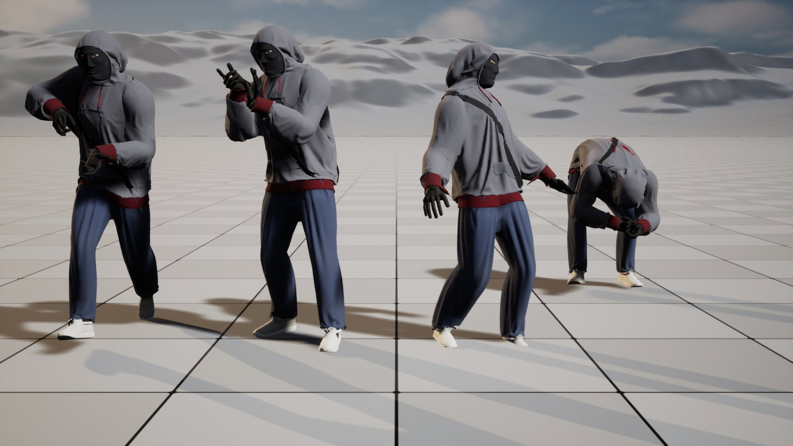
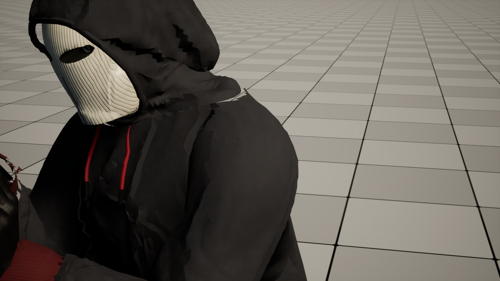

# Characters: the pipeline from Blender to the UE5 mannequin skeleton

Every human in the game (the player's arms `SK_RuleArms`, the three Goons) is a skeletal mesh built in Blender on
Epic's mannequin skeleton `SK_Mannequin`, so the template's motion-captured clips (Rifle, Pistol, Unarmed, Death) drive
it without retargeting. This page holds the settings that are proven to work and the proof.

## Licence rule

Epic's content may be used and modified for this Unreal game but not published, and the repository is public.
Nothing derived from the mannequin meshes, skeleton or animations (FBX, GLB, .blend, baked or posed copies) is
committed: such files live in `art/out/epic/` (git-ignored) and on the box in `/project/ue/chars/`. Scripts, this
document and JPEG pictures of our own characters are committed.

## The scratch project on the box

| What | Where |
|---|---|
| Project | `/project/ue/chars/Chars.uproject` (content only; plugins PythonScriptPlugin, EditorScriptingUtilities, GLTFExporter, ControlRig, ModelingToolsEditorMode, ModelContextProtocol, AllToolsets), `Config/` from `/project/ue/Blank` plus `r.EyeAdaptation.CachedLightingPreExposure=8` |
| Content | `/Game/Characters/Mannequins` and `/Game/Weapons` copied from `Templates/TemplateResources/High/Characters/Content` and `Templates/TemplateResources/Standard/Weapons/Content` |
| Scripts | `tools/box/chars/` (committed), on the box in `/project/ue/chars/scripts/`; `/project/ue/chars/pull.sh` refreshes them from the branch (sparse clone in `/project/ue/chars/src`) |
| Commandlet | `cmdlet.sh <script.py> <name>`: `UnrealEditor-Cmd ... -run=pythonscript -script=...` detached, log `/project/ue/logs/chars/<name>.log`. About 6 minutes per start on this box (the 9p volume), so batch the work in one script |
| Editor | `editor.sh start / status / stop`: our own headless editor, MCP on port 8002, process id in `/project/ue/logs/chars/editor.pid` (stopped by that id only). MCP answers about 6 minutes after the start |
| Editor Python | `MI_MCP_URL=http://127.0.0.1:8002/mcp python3 scripts/mi_mcp.py py - <<< '...'` (a copy of `tools/box/mi_mcp.py`); helpers in `mi_chars.py` |
| Pictures | `... mi_mcp.py shot /tmp/x.png cam=X,Y,Z,pitch,yaw,roll fov=48 size=1600x900 frames=40` then `/opt/venv/bin/python3` (Pillow) to JPEG. A first call can answer "slow task" while shaders compile: wait and repeat |

## Export from Unreal (`ue_export.py`, commandlet, 4 minutes)

`unreal.GLTFExporter.export_to_gltf(asset, path, options, set())` with `GLTFExportOptions`: `export_uniform_scale
0.01` (centimetres to metres), `export_vertex_skin_weights`, `export_animation_sequences`, materials not baked
(`bake_material_inputs DISABLED`), no textures (`texture_image_format NONE`), morph targets on. An AnimSequence
exports with its preview mesh and the whole skeleton. FBX (`SkeletalMeshExporterFBX`, `AnimSequenceExporterFBX`,
`StaticMeshExporterFBX`) is written next to every file as a fallback; it has not been needed.

Files (`art/out/epic/`, 67 MB): `SKM_Manny_Simple.glb` (48,705 vertices, 89 joints, up to 8 influences, two
material sections), `A_rifle_idle_ads` (MF_Rifle_Idle_ADS), `A_pistol_idle_ads`, `A_rifle_reload` (MM_Rifle_Reload),
`A_pistol_reload`, `A_rifle_jog_fwd` (MF_Rifle_Jog_Fwd), `A_unarmed_attack` (MM_Attack_01), `A_death_front`
(MM_Death_Front_01), `SM_Rifle`, `SM_Pistol`; each `.glb` with its `.fbx`.

In the file the mesh node is the parent of the `root` joint, `skins[0].skeleton` is that node, and the 89 joints are
listed in Unreal's order; Unreal (x, y, z) cm becomes glTF (x, z, y) / 100 (mirror included, as in docs/unreal/BOX.md
section 5).

## Blender side (`art/blender/mi/char.py`)

| Step | Setting that works |
|---|---|
| Import | `bpy.ops.import_scene.gltf(..., bone_heuristic="BLENDER", guess_original_bind_pose=False, import_shading="NORMALS", disable_bone_shape=True)` (`rig.import_glb`). BLENDER turns every bone +90 deg about its local X for display; the exporter turns it back (`io_scene_gltf2/blender/exp/tree.py`). TEMPERANCE and FORTUNE are NOT reversible: never use them for a character |
| Scene | Metres, Z up; the mannequin stands at the origin facing Blender -Y (Unreal +Y). Armature and mesh at identity |
| Export | `char.export_character(mesh, armature)`: GLB, `export_yup=True`, `export_skins=True`, `export_def_bones=False` (EVERY bone, so the file carries the whole SK_Mannequin hierarchy), `export_rest_position_armature=True`, `export_armature_object_remove=True` (no extra "Armature" node above `root`), `export_leaf_bone=False`, `export_influence_nb=8`, `export_apply=False`, no animation, no vertex colours, materials as slot-named stubs |
| Check | `char.round_trip_report(src, dst)`: joint names, parents, local rest translation and rotation compared joint by joint |

## Import into Unreal (`mi_chars.import_on_mannequin`)

Interchange (`InterchangeManager.import_asset`) with a transient `InterchangeGenericAssetsPipeline`:
`common_skeletal_meshes_and_animations_properties.skeleton = SK_Mannequin` (the EXISTING asset: no new skeleton),
`import_only_animations False`; `mesh_pipeline.import_skeletal_meshes True`, `import_static_meshes False`,
`create_physics_asset False`; `animation_pipeline.import_animations False`; materials and textures off (slots by
name). The importer's return list comes back empty in 5.9 even when the import worked: load the asset by path.

## The round-trip proof (2026-11-22)

`SKM_Manny_Simple.glb` imported into Blender and exported again untouched with `export_character`
(`art/out/epic/RT_Manny.glb`), then imported in the scratch project as `/Game/RoundTrip/SKM_RT_Manny` on
`SK_Mannequin`:

| Measure | Result |
|---|---|
| Blender: joints in / out, missing, extra, parent changes | 89 / 89, none, none, none |
| Blender: largest change of a joint's local rest translation / rotation in the file | 0.00027 mm (hand_l) / 0.00013 deg (ring_02_r) |
| Unreal: skeleton of the imported mesh | `/Game/Characters/Mannequins/Meshes/SK_Mannequin` |
| Unreal: reference pose of the imported mesh against SKM_Manny_Simple, every bone | 0.00005 cm, 0.00014 deg |
| Unreal: component-space bone transforms, original and imported side by side, MF_Rifle_Jog_Fwd at 0.35 s and MM_Rifle_Reload at 1.3 s | 0.00008 cm, 0.0 deg (every bone) |

`shots/chars-roundtrip.jpg`: from the left, the original mannequin and the round-tripped mesh (grey, default
material) jogging (MF_Rifle_Jog_Fwd, 0.35 s), then the pair in the rifle reload (MM_Rifle_Reload, 1.3 s). Pose for pose
the same, fingers included: no twist, offset, scale or axis error.

## SK_RuleArms, the player's arms (art/blender/assets/characters.py)

Built in Blender on the mannequin's own bones (rest pose), exported with `char.export_character` (the proven path
above) and imported on the existing `SK_Mannequin`: `build.py build characters --bake --res 4096 --export --preview`
(16 minutes on 3 local threads: modelling 3.5, the two 4K sets 9, previews 3).

| Part | How |
|---|---|
| Shape | Signed distance fields placed on the right arm's bones (`ArmRig`): a forearm whose elliptic section turns 74 deg from the wrist to the elbow hinge (radius over ulna), sections from the brief (60 x 42 mm at the wrist to 94 x 82 near the elbow), radial extensor, flexor and ulnar extensor masses, olecranon and epicondyles, biceps, triceps, deltoid, closed at the shoulder. The glove is a second surface: palm (metacarpals, slab, distal pad, thenar, hypothenar), fingers and thumb as tapered round cones through the mannequin's finger joints with knuckles and pulps, glove material 1.2 mm, padded cuff 4 to 42 mm with a rolled edge, raised back panel. Rubber pieces are their own meshes: knuckle bar with four domes, wrist strap with pull tab, five fingertip pads |
| Mesh | Surface nets (2.6 mm skin, 1.35 mm glove, 0.8 mm pieces), every vertex projected onto the exact surface, tangential relaxation, quadric decimation to 54 k triangles per arm; the skin starts 24 mm inside the cuff (hidden overlap), the cuff's top face inside the skin is removed. Left arm = mirror of the right (the skeleton is symmetric to 0.37 mm), sharing the UVs and the texture sets. 108,398 triangles for both arms |
| Slots | `M_RuleArms_Skin`, `M_RuleArms_GloveLeather` (back), `M_RuleArms_GloveSuede` (palm), `M_RuleArms_Rubber` |
| UVs | Skin: one tube cut along the ulnar border and the medial upper arm, plus the shoulder cap. Glove: cut like a real glove pattern along the back/palm seam, so the back and the palm are two whole islands |
| Weights | Transferred from the mannequin's own surface per region (`char.transfer_weights` with labels: a glove finger only reads the same finger of the mannequin), smoothed (3 passes), at most 6 influences |
| Textures | `RuleArms_Skin` and `RuleArms_Glove`, 4096 px, BC / N (OpenGL) / ORM, computed per texel from the baked rest position (`mi/texel.py`, `assets/_characters_tex.py`): skin mottling, lighter inner forearm, veins and wrist tendons, polygonal microrelief, pores, faint creases, forearm hair streaks, elbow folds; leather pebble grain, suede nap, welted seams with raised stitches (3.4 mm pitch) along the back/palm seam, round the back panel, three rows on the cuff with padded pillows between, compression folds over every finger joint and palm creases, rubber stipple, stitched knuckle bar, ribbed strap, gripped fingertip pads |

In Unreal (`mi_chars.setup_arms`, scratch project): textures imported with `flip_green_channel` on the normal maps
(OpenGL to Unreal), `TC_NORMALMAP` / `TC_MASKS`, character texture groups; `M_RuleArms_Skin` uses the Subsurface
Profile shading model with `SP_RuleSkin`; one glove material serves the three glove slots.

### Watch and bracelet

`SM_Character_RuleWatch` (16 k triangles: 44 three-piece links, case, bezel, black dial with four batons and two
hands under a domed glass, crown toward the hand, lugs) and `SM_Character_RuleBracelet` (14.6 k: 26 flattened,
alternately twisted curb links 3.6 mm clear of the arm, sagging 2.8 mm underneath). Their origin is the attach frame:
on the forearm axis, X across the arm, Y toward the elbow, Z out of the back of the forearm. They attach to
`lowerarm_twist_01_l` (watch, 72 mm above the wrist) and `lowerarm_twist_01_r` (bracelet, 70 mm). The rest placement
is written to `art/out/glb/SK_RuleArms.sockets.json`; `mi_chars.attach_transform` turns it into the transform relative
to the bone (watch: 1.88, 0.07, -0.06 cm). `SkeletalMeshSocket` names are read-only from Python in 5.9, so the
jewels are attached to the bone with that relative transform; the same numbers make a socket by hand.

### Proof in Unreal (2026-11-22)

`/Game/Characters/RuleArms/SK_RuleArms` imported on `/Game/Characters/Mannequins/Meshes/SK_Mannequin` (no new
skeleton), four slots assigned, watch and bracelet on `lowerarm_twist_01_l` / `_r`. Left: MF_Rifle_Idle_ADS at 0.5 s;
right: MM_Rifle_Reload at 1.25 s (one hand leaves the frame on the right). The arms are shown without a body, so the
closed shoulder caps are visible from this camera; the first-person camera never sees them.

## The Goons (art/blender/assets/goons.py)

Three skinned meshes on `SK_Mannequin`, one man in three outfits (briefs `docs/unreal/spec/assets/characters.json`
`goon_hoodie`, `goon_puffer`, `goon_tracksuit`): `SK_Goon_Hoodie`, `SK_Goon_Puffer`, `SK_Goon_Tracksuit`
(`art/out/glb/`, never committed: they are skinned on Epic's skeleton). Facing -Y in Blender, which is the
mannequin's own facing (Unreal +Y), so the template clips play as they are; origin on the ground between the feet;
A-pose (the mannequin's rest). Rebuild r2 (after the art review of round 1): about 108k / 113k / 111k triangles
(each under the 120k cap), 89 joints (the whole SK_Mannequin hierarchy), at most 6 influences per vertex.

    venv/bin/python art/blender/build.py build goons [--only hoodie,puffer,tracksuit] [--bake] [--export] [--preview]
    MI_PREVIEWS=goons_lineup,goons_hoodie_hero,goons_detail,goons_poses,goons_wire     pictures to render
    MI_GOONS_REDRAPE=1                                                                ignore the drape cache

| Step | How |
|---|---|
| The man | `Man` (goons.py): the imported mannequin measured (`_goons_body.Body`: joints, region labels, torso sections), a 1 cm distance field of its surface (`BodyField`, cached `art/out/goons/body_field.npz`) and a 3 mm one of the head (`_goons_head.Head`). r2: the mannequin's head is featureless, so `FaceShape` displaces the head field at the front into a face proxy (brow ridge, nose 17 mm out at the tip with alae, cheekbones, lips, a chin 11 cm under the eyes, the long jaw receded): every head piece (balaclava, bandana, glasses, hats, hood collider) lies over it. The only skin modelled is what the balaclava's openings show (`face_skin`: lids, sockets and lips, plus two eyeballs) |
| Kit | `_goons_kit.py`: gloves (the player's glove anatomy from `characters.py`, closed up the forearm under the cuff), socks, sneakers (outsole with 32 deg herringbone tread 2.4 mm deep, upper with toe box, padded collar, tongue, 12 metal eyelets, bar lacing with a bow, oxblood heel tab) |
| Garments | Start shapes cut from the body as offsets plus hanging lofts (`_goons_cloth.py`), open at the hems (`mi/cloth.garment_mesh`), then draped with Blender's cloth solver in the rest A-pose (`cloth.drape`: hems pinned, extra length grown where clothes bunch: sleeve ends, knees, trouser breaks, the blouse over the waistband), colliding with the body and the layers already dressed (sneakers under the trousers, trousers under the top, mask under the hood). Drapes are cached per piece and version (`art/out/goons/cache_*.npz`) |
| Hoodie outfit | Jeans; charcoal-grey heather hoodie (blouses over a rib waistband, gathered into rib cuffs: r2 bands are closed double-walled tubes, `_goons_trim.axis_band`, no cut edge to tear); hood up, an offset of head and shoulders narrowing into the neckline, draped over the balaclava (crown sags, folds at the neck) with a rolled drawstring channel round the face opening; kangaroo pocket (a 2.5 mm thick panel); two oxblood drawstrings with aglets; the balaclava |
| Balaclava (all three) | r2: a 2000-era three-hole balaclava in charcoal rib knit (base colour linear 0.023) over the face proxy, tucked into the collar; two small eye openings (37 x 18 mm) and a mouth opening (43 x 15 mm) cut on clean ellipses (`cut_ellipse_hole`), each with a rolled 2.2 mm hem; behind them the face skin (sockets, lids, lips) and two eyeballs; sweat and breath darkening round the mouth and eyes, grime, stray fuzz in the texture. (The briefs' pale bone ski mask with slits read as a ghost or plague-doctor costume and dominated the figure: changed on the art review) |
| Puffer outfit | Charcoal twill trousers; black nylon puffer: shell draped stiff (bending 5), refined, the torso pushed out 16-26 mm (`inflate_torso`: flat quilted panels, no pecs or stomach), then lofted along its normals between stitched seams 8.7 cm apart (seven baffles on the torso, rings every third of each sleeve segment, 17 mm loft; the loft is kept as `mi_loft` and drives the roughness); stand collar up to the jaw; oxblood yoke cut on the top stitch line; dark oxblood hem binding, cuff bindings; oxblood zip 0.40 m; black beanie with a 4.6 cm dark oxblood turned-up cuff (a closed band tube); period wraparound sunglasses resting on the nose (smoked shield in a moulded black frame, temple arms); a dark cotton bandana fitted over nose and mouth, its point over the collar |
| Tracksuit outfit | Navy tricot track trousers and jacket (mid value: the outfits separate by value and colour at 8 m), rib waistband and cuffs (tubes), short stand collar, oxblood zip 0.40 m; bold white stripe tape 36 mm wide down the outer seam of each sleeve (shoulder, elbow, cuff) and leg (hip, knee, ankle): geometry laid on the draped cloth by ray casts square to the limb (`surface_strip`), constant width over every fold; black fitted cap worn backwards: crown edge tidied and closed by a sweatband tube, the oxblood brim attached under the crown edge at the back and lying down over the nape 17 deg below the horizontal, top button, rigid on `head` |
| All | The sling (webbing loop from the right shoulder across the back to the left hip, for SM_Weapon_GoonPipe) with two black tri-glide buckles (chest and lower back); the crew V on the back (two oxblood bars 0.20 x 0.03 m leaning 24 deg out, centred 1.29 m up: texture), the one accent all three share |
| Weights | Nearest-surface transfer from the mannequin (`char.transfer_weights`) and smoothing (more for loose pieces); gloves per finger (as SK_RuleArms); sneakers from foot/ball/calf; rib cuffs from the forearm bones only (they must not follow the wrist bend); beanie, cap and glasses rigid on `head`. Then `goons.layer_weights`: every vertex of a covered layer within a few cm of its cover takes the cover's weights (mask under hood/collar/bandana, trousers under the waistband and jacket hem, glove tops under the cuffs; trouser hems resting on the sneakers take the sneakers'), so layers move as one (r2 adds: face skin under the knit, stripe tape on the tricot, buckles on the webbing). At most 6 influences |
| Textures | Two unique sets per outfit (`_goons_tex.py`, per texel from the baked rest position): `Goon<Outfit>_Cloth` 4096 (garments, gloves, sneakers) and `Goon<Outfit>_Head` 2048 (mask, hats, glasses, bandana, sling, cords, zips), BC / N (OpenGL) / ORM. Fabric is drawn at true size in body-axis coordinates (wales down a sleeve whatever the UV island's angle): rib knit 2.6 mm wales, jersey with heathering and pilling where arms rub, denim twill with slub warp streaks, faded crests, whiskers and knee honeycombs, tan-stitched seams and back pockets, nylon ripstop with sheen, tricot courses, pebble-grain leather with creases, sneaker leather with toe-flex creases, panel stitching, scuffs and sole grime; dust at hems, cuffs and knees; prints and panels in body space (crew V, puffer yoke and shoulder caps). r2: fleece heathered with dark and light fibre flecks plus brushed-fibre relief; tricot roughness 0.74-0.8 with a warp-knit micro relief; nylon taffeta 0.54 on the baffle crowns to 0.78 in the stitch valleys (from `mi_loft`); denim streaks at half strength; work-glove leather at 0.62-0.68 with knuckle pads over the MCP and PIP joints, fourchette seams along each finger and flex creases (`glove_relief`, from the finger bones); sneakers at albedo ~0.75 with more grime; skin (pores, darker lids and lips, mouth line) and eyes (iris, pupil, limbal ring) |
| Slots | `M_Goon<Outfit>_Cloth`, `M_Goon<Outfit>_Head` |

| Refinement (r2) | `cloth_piece` / `_goons_trim.refine`: the hood, hoodie, jackets and trousers get one Catmull-Clark level and a Taubin pass after the drape (the 10 mm solver facets round off, the folds stay), degenerate triangles are dissolved (`clean_degenerate`, also per piece before the weights), then each is decimated to its r2 budget (hood 12k, hoodie and track jacket 24k, puffer 30k, trousers 15k) |
| Clean-up before export | `goons.unfold`: draped and decimated cloth has folded-over triangles (a face pointing away from its corners' smooth normals); Cycles hides them, Unreal draws them as dark jagged patches. Their vertices are relaxed (Laplacian steps, topology and UVs kept: 575 inverted corners of the hoodie down to 58), what is left are real creases (turned hems, rolled edges) whose normals are split. r2: an edge is split only between two faces that agree with their corners, never on a folded-over face (Unreal now keeps the exported normals, so a split there would show as a dark facet); rib bands, tapes, skin, eyes and hardware are left out of the relaxation. Unweighted vertices take their neighbour's weights (the glTF exporter would otherwise need a neutral bone it cannot place) |
| Texture gaps | `_goons_tex.fill_gaps`: every texel outside the UV islands is filled from the islands by a masked mip pyramid (pull-push), so no mip mixes the empty background into the cloth |

### Size against the brief

Built to the skeleton, not to the brief's joint heights (the clips depend on the skeleton). Mannequin rest against the
brief: shoulder joints 1.436 m (brief 1.42), 0.38 m apart (0.40); hip joints 0.935 (0.93), 0.20 apart (0.19); knees
0.503 (0.50); ankles 0.082 (0.085); neck base 1.528 (1.50); upper arm 0.278 (0.28), forearm 0.272 (0.27), thigh
0.433 (0.43), shin 0.423 (0.415). The rest A-pose holds the arms higher than the brief's (elbows 1.21 against 1.14,
wrists 1.05 against 0.87): a pose difference, not a length one. The top of the hood is 1.818 m and of the mask 1.81 m
(brief: 1.78 over the hood, 1.75 in sneakers) because the mannequin's head is larger. **Uniform scale for the briefed
height: 0.98** on the Goon's skeletal mesh component (hood top 1.78 m; shoulders then 1.41 m, hips 0.92 m); 0.967
would match the 1.75 m figure but sinks every joint 3 to 5 cm below the brief. Hit volumes (head sphere 0.155 m,
body capsule 0.27 m) follow the bones, so they scale with it.

### How to add an outfit

1. A builder `def <name>_outfit(man, parts, shoes)` in `goons.py` (copy `tracksuit_outfit`): trousers with
   `GC.trousers(...)`, the top with `GC.hoodie_shell(...)` (ease, hang, sleeve ease, hem, neck, cuff, bending:
   stiffer for padded fabric), bands with `GC.bands_for`, collars with `collar`, zips with `zipper`, head pieces from
   `_goons_head.py`, each wrapped in `cached("<Piece>", "<version>", col, fn)` (bump the version to re-drape) and
   added as `(name, tag(ob, kind, colour, piece), "cloth" | "head", region)`; `region` picks the weight rule (None =
   nearest surface, `("cuff", side)`, `"head"` rigid, `("foot", side)`, `("glove", side)`).
2. Register it in `BUILDERS` and `OUTFITS`; new fabric kinds go in `K` (goons.py and `_goons_tex.py`) with a branch in
   `_goons_tex.texels`, prints and panels in `_goons_tex.regions` (body-space tests on position and `mi_piece`).
3. `build.py build goons --only <name> --bake --export --preview`, then the layer test: pose with the clips and look
   for the inner layer coming through (scratch `posetest.py` pattern: covered inner vertices against the outer
   surface per pose), fix with `LAYERS` (which layers share weights) or more ease.
4. Unreal: `tools/box/chars/goons-pack.sh pack` (local) and `unpack <url>` (box), `mi_chars.setup_goons()`.

### Animation assets on SK_Mannequin and what each is for

All under `/Game/Characters/Mannequins/Anims/` (copied from the template; `mi_chars.ANIMS` names the ones used here).

| Asset | Use for a Goon |
|---|---|
| `Rifle/MF_Rifle_Idle_ADS` (8 s) | Aimed idle, the SMG shouldered: holding a position, firing stance between bursts |
| `Rifle/Jog/MF_Rifle_Jog_Fwd` (1.53 s) and `_Bwd`, `_Left`, `_Right`, `_Fwd_Left`, `_Fwd_Right`, `_Bwd_Left`, `_Bwd_Right` | Moving with the gun up (8-way blend space on velocity against facing); `Rifle/Walk` the same set for patrols |
| `Rifle/MM_Rifle_Fire` | Fire additive / montage on the upper body |
| `Rifle/MM_Rifle_Reload` (2.2 s) | Reload montage (the SMG magazine swap) |
| `Rifle/MM_Rifle_Equip`, `MM_Rifle_DryFire` | Raising the gun when alerted; empty-gun click |
| `Rifle/HitReact/MM_HitReact_Front_Lgt_01..04`, `_Front_Med_01..02`, `_Front_Hvy_01` (0.8 s), `_Back_Med_01` | Flinches by hit weight and side (head hits: heavy) |
| `Rifle/AIM` aim offsets | Pitch and yaw of the aim at the player |
| `Rifle/Jump` | Vaulting / dropping off a ledge |
| `Death/MM_Death_Front_01..03`, `_Back_01`, `_Left_01`, `_Right_01` (about 1.1 s) | Death by the direction of the killing shot; the body then stays (up to 6) |
| `Pistol/*` | The same set one-handed: the pipe Goon's idle and moves before the swing |
| `Unarmed/MM_Attack_01..03`, charged attack, dash | Pipe swings and lunges (the overhead right-arm swing of the brief) |

### Proof in Unreal (2026-11-23)

`/Game/Characters/Goons/SK_Goon_Hoodie`, `_Puffer`, `_Tracksuit` imported on `/Game/Characters/Mannequins/Meshes/SK_Mannequin`
(no new skeleton: `mi_chars.setup_goons` reports the skeleton path), 18 textures (`TC_NORMALMAP` with the green channel
flipped, `TC_MASKS`), six materials `M_Goon<Outfit>_Cloth` / `_Head`, slots assigned by name.

`chars-goons-1.jpg`: the hoodie Goon in MF_Rifle_Jog_Fwd (0.35 s), MM_Rifle_Reload (1.3 s), MM_HitReact_Front_Hvy_01
(0.22 s) and MM_Death_Front_01 (1.05 s). The garments follow the limbs; the mask stays inside the hood, the gloves
inside the cuffs, the jeans hems on the sneakers; the crew V shows on the back of the falling one.

`chars-goons-2.jpg`: puffer, hoodie and tracksuit in MF_Rifle_Idle_ADS (2 s).

`chars-goons-3.jpg`: the hoodie Goon's hood, mask and drawstrings in the reload, about 1 m away.

Two rounds of fixes after looking: (1) sawtooth shading along the cloth UV islands (a 1K texture AO upscaled) became a
per-vertex AO, the pilling was made quieter, nylon and tricot rougher; (2) inverted cloth triangles relaxed and crease
normals split (`unfold`), texture gaps filled (`fill_gaps`). Still visible at 1 m (picture 3): dark stepped patches in
the hood's deepest folds. Ruled out by tests in the editor: textures (a flat grey material shows them too), the
normal map, back faces (two-sided), shadow bias, virtual shadow maps (off), ray-traced shadows. Next suspects: the
draped cloth's sub-centimetre pleats left after decimation (Cycles smooths them, the raster does not), and the
skeletal mesh build settings at import (recompute normals / degenerate removal, not reachable from Python in 5.9:
set by hand in the asset's LOD build settings to test).

### Known weaknesses of the Goons

- Dark stepped patches in the deepest hood and hoodie folds in Unreal close-ups (above); invisible at 4 m and beyond.
- The puffer's quilting follows the body's chest and stomach too closely (it reads as a muscle suit at some angles):
  the shell needs a boxier start shape before the loft.
- Tracksuit sleeve stripes are broken into patches where the baggy sleeve leaves the arm's outer line (the stripe is
  placed by angle round the arm axis); it should be placed in the sleeve's own pattern space.
- UV islands of the draped cloth are many and small (smart projection at 72 deg): fine at game distances, but the
  texel density per island is uneven and the atlas is 44 % covered before the gap fill.
- The mannequin's head shape gives the mask a long smooth face; there is no nose or brow under the knit.
- The sneaker upper is a smooth form with stitching in the texture only; laces are mostly hidden under the hems.
- No cloth simulation at runtime: folds are baked in the A-pose and only skinned (expected for a dozen enemies).
- The sling is a closed loop with no buckle or pipe attachment point (SM_Weapon_GoonPipe is placed by the game).
