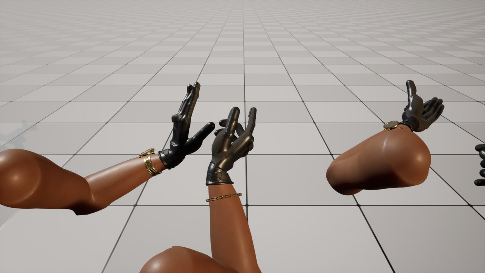
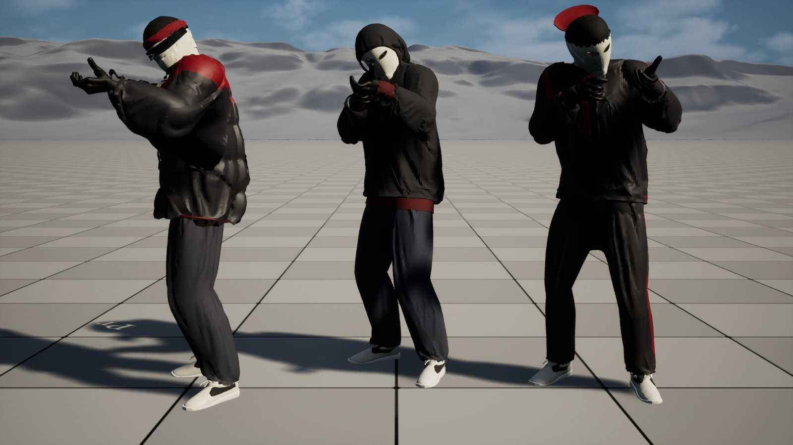

# Characters: the pipeline from Blender to the UE5 mannequin skeleton

Every human in the game (the player's arms `SK_RuleArms`, the three Goons) is a skeletal mesh built in Blender on
Epic's mannequin skeleton `SK_Mannequin`, so the template's motion-captured clips (Rifle, Pistol, Unarmed, Death) drive
it without retargeting. This page holds the settings that are proven to work and the proof.

## Licence rule

Epic's content may be used and modified for this Unreal game but not published, and the repository is public.
Nothing derived from the mannequin meshes, skeleton or animations (FBX, GLB, .blend, baked or posed copies) is
committed: such files live in `art/out/epic/` (git-ignored) and on the box in `/project/ue/chars/`. Scripts, this
document and JPEG pictures of our own characters are committed.

## The scratch project on the box

| What | Where |
|---|---|
| Project | `/project/ue/chars/Chars.uproject` (content only; plugins PythonScriptPlugin, EditorScriptingUtilities, GLTFExporter, ControlRig, ModelingToolsEditorMode, ModelContextProtocol, AllToolsets), `Config/` from `/project/ue/Blank` plus `r.EyeAdaptation.CachedLightingPreExposure=8` |
| Content | `/Game/Characters/Mannequins` and `/Game/Weapons` copied from `Templates/TemplateResources/High/Characters/Content` and `Templates/TemplateResources/Standard/Weapons/Content` |
| Scripts | `tools/box/chars/` (committed), on the box in `/project/ue/chars/scripts/`; `/project/ue/chars/pull.sh` refreshes them from the branch (sparse clone in `/project/ue/chars/src`) |
| Commandlet | `cmdlet.sh <script.py> <name>`: `UnrealEditor-Cmd ... -run=pythonscript -script=...` detached, log `/project/ue/logs/chars/<name>.log`. About 6 minutes per start on this box (the 9p volume), so batch the work in one script |
| Editor | `editor.sh start / status / stop`: our own headless editor, MCP on port 8002, process id in `/project/ue/logs/chars/editor.pid` (stopped by that id only). MCP answers about 6 minutes after the start |
| Editor Python | `MI_MCP_URL=http://127.0.0.1:8002/mcp python3 scripts/mi_mcp.py py - <<< '...'` (a copy of `tools/box/mi_mcp.py`); helpers in `mi_chars.py` |
| Pictures | `... mi_mcp.py shot /tmp/x.png cam=X,Y,Z,pitch,yaw,roll fov=48 size=1600x900 frames=40` then `/opt/venv/bin/python3` (Pillow) to JPEG. A first call can answer "slow task" while shaders compile: wait and repeat |

## Export from Unreal (`ue_export.py`, commandlet, 4 minutes)

`unreal.GLTFExporter.export_to_gltf(asset, path, options, set())` with `GLTFExportOptions`: `export_uniform_scale
0.01` (centimetres to metres), `export_vertex_skin_weights`, `export_animation_sequences`, materials not baked
(`bake_material_inputs DISABLED`), no textures (`texture_image_format NONE`), morph targets on. An AnimSequence
exports with its preview mesh and the whole skeleton. FBX (`SkeletalMeshExporterFBX`, `AnimSequenceExporterFBX`,
`StaticMeshExporterFBX`) is written next to every file as a fallback; it has not been needed.

Files (`art/out/epic/`, 67 MB): `SKM_Manny_Simple.glb` (48,705 vertices, 89 joints, up to 8 influences, two
material sections), `A_rifle_idle_ads` (MF_Rifle_Idle_ADS), `A_pistol_idle_ads`, `A_rifle_reload` (MM_Rifle_Reload),
`A_pistol_reload`, `A_rifle_jog_fwd` (MF_Rifle_Jog_Fwd), `A_unarmed_attack` (MM_Attack_01), `A_death_front`
(MM_Death_Front_01), `SM_Rifle`, `SM_Pistol`; each `.glb` with its `.fbx`.

In the file the mesh node is the parent of the `root` joint, `skins[0].skeleton` is that node, and the 89 joints are
listed in Unreal's order; Unreal (x, y, z) cm becomes glTF (x, z, y) / 100 (mirror included, as in docs/unreal/BOX.md
section 5).

## Blender side (`art/blender/mi/char.py`)

| Step | Setting that works |
|---|---|
| Import | `bpy.ops.import_scene.gltf(..., bone_heuristic="BLENDER", guess_original_bind_pose=False, import_shading="NORMALS", disable_bone_shape=True)` (`rig.import_glb`). BLENDER turns every bone +90 deg about its local X for display; the exporter turns it back (`io_scene_gltf2/blender/exp/tree.py`). TEMPERANCE and FORTUNE are NOT reversible: never use them for a character |
| Scene | Metres, Z up; the mannequin stands at the origin facing Blender -Y (Unreal +Y). Armature and mesh at identity |
| Export | `char.export_character(mesh, armature)`: GLB, `export_yup=True`, `export_skins=True`, `export_def_bones=False` (EVERY bone, so the file carries the whole SK_Mannequin hierarchy), `export_rest_position_armature=True`, `export_armature_object_remove=True` (no extra "Armature" node above `root`), `export_leaf_bone=False`, `export_influence_nb=8`, `export_apply=False`, no animation, no vertex colours, materials as slot-named stubs |
| Check | `char.round_trip_report(src, dst)`: joint names, parents, local rest translation and rotation compared joint by joint |

## Import into Unreal (`mi_chars.import_on_mannequin`)

Interchange (`InterchangeManager.import_asset`) with a transient `InterchangeGenericAssetsPipeline`:
`common_skeletal_meshes_and_animations_properties.skeleton = SK_Mannequin` (the EXISTING asset: no new skeleton),
`import_only_animations False`; `mesh_pipeline.import_skeletal_meshes True`, `import_static_meshes False`,
`create_physics_asset False`; `animation_pipeline.import_animations False`; materials and textures off (slots by
name). The importer's return list comes back empty in 5.9 even when the import worked: load the asset by path.

## The round-trip proof (2026-11-22)

`SKM_Manny_Simple.glb` imported into Blender and exported again untouched with `export_character`
(`art/out/epic/RT_Manny.glb`), then imported in the scratch project as `/Game/RoundTrip/SKM_RT_Manny` on
`SK_Mannequin`:

| Measure | Result |
|---|---|
| Blender: joints in / out, missing, extra, parent changes | 89 / 89, none, none, none |
| Blender: largest change of a joint's local rest translation / rotation in the file | 0.00027 mm (hand_l) / 0.00013 deg (ring_02_r) |
| Unreal: skeleton of the imported mesh | `/Game/Characters/Mannequins/Meshes/SK_Mannequin` |
| Unreal: reference pose of the imported mesh against SKM_Manny_Simple, every bone | 0.00005 cm, 0.00014 deg |
| Unreal: component-space bone transforms, original and imported side by side, MF_Rifle_Jog_Fwd at 0.35 s and MM_Rifle_Reload at 1.3 s | 0.00008 cm, 0.0 deg (every bone) |

`shots/chars-roundtrip.jpg`: from the left, the original mannequin and the round-tripped mesh (grey, default
material) jogging (MF_Rifle_Jog_Fwd, 0.35 s), then the pair in the rifle reload (MM_Rifle_Reload, 1.3 s). Pose for pose
the same, fingers included: no twist, offset, scale or axis error.

## SK_RuleArms, the player's arms (art/blender/assets/characters.py)

Built in Blender on the mannequin's own bones (rest pose), exported with `char.export_character` (the proven path
above) and imported on the existing `SK_Mannequin`: `build.py build characters --bake --res 4096 --export --preview`
(16 minutes on 3 local threads: modelling 3.5, the two 4K sets 9, previews 3).

| Part | How |
|---|---|
| Shape | Signed distance fields placed on the right arm's bones (`ArmRig`): a forearm whose elliptic section turns 74 deg from the wrist to the elbow hinge (radius over ulna), sections from the brief (60 x 42 mm at the wrist to 94 x 82 near the elbow), radial extensor, flexor and ulnar extensor masses, olecranon and epicondyles, biceps, triceps, deltoid, closed at the shoulder. The glove is a second surface: palm (metacarpals, slab, distal pad, thenar, hypothenar), fingers and thumb as tapered round cones through the mannequin's finger joints with knuckles and pulps, glove material 1.2 mm, padded cuff 4 to 42 mm with a rolled edge, raised back panel. Rubber pieces are their own meshes: knuckle bar with four domes, wrist strap with pull tab, five fingertip pads |
| Mesh | Surface nets (2.6 mm skin, 1.35 mm glove, 0.8 mm pieces), every vertex projected onto the exact surface, tangential relaxation, quadric decimation to 54 k triangles per arm; the skin starts 24 mm inside the cuff (hidden overlap), the cuff's top face inside the skin is removed. Left arm = mirror of the right (the skeleton is symmetric to 0.37 mm), sharing the UVs and the texture sets. 108,398 triangles for both arms |
| Slots | `M_RuleArms_Skin`, `M_RuleArms_GloveLeather` (back), `M_RuleArms_GloveSuede` (palm), `M_RuleArms_Rubber` |
| UVs | Skin: one tube cut along the ulnar border and the medial upper arm, plus the shoulder cap. Glove: cut like a real glove pattern along the back/palm seam, so the back and the palm are two whole islands |
| Weights | Transferred from the mannequin's own surface per region (`char.transfer_weights` with labels: a glove finger only reads the same finger of the mannequin), smoothed (3 passes), at most 6 influences |
| Textures | `RuleArms_Skin` and `RuleArms_Glove`, 4096 px, BC / N (OpenGL) / ORM, computed per texel from the baked rest position (`mi/texel.py`, `assets/_characters_tex.py`): skin mottling, lighter inner forearm, veins and wrist tendons, polygonal microrelief, pores, faint creases, forearm hair streaks, elbow folds; leather pebble grain, suede nap, welted seams with raised stitches (3.4 mm pitch) along the back/palm seam, round the back panel, three rows on the cuff with padded pillows between, compression folds over every finger joint and palm creases, rubber stipple, stitched knuckle bar, ribbed strap, gripped fingertip pads |

In Unreal (`mi_chars.setup_arms`, scratch project): textures imported with `flip_green_channel` on the normal maps
(OpenGL to Unreal), `TC_NORMALMAP` / `TC_MASKS`, character texture groups; `M_RuleArms_Skin` uses the Subsurface
Profile shading model with `SP_RuleSkin`; one glove material serves the three glove slots.

### Watch and bracelet

`SM_Character_RuleWatch` (16 k triangles: 44 three-piece links, case, bezel, black dial with four batons and two
hands under a domed glass, crown toward the hand, lugs) and `SM_Character_RuleBracelet` (14.6 k: 26 flattened,
alternately twisted curb links 3.6 mm clear of the arm, sagging 2.8 mm underneath). Their origin is the attach frame:
on the forearm axis, X across the arm, Y toward the elbow, Z out of the back of the forearm. They attach to
`lowerarm_twist_01_l` (watch, 72 mm above the wrist) and `lowerarm_twist_01_r` (bracelet, 70 mm). The rest placement
is written to `art/out/glb/SK_RuleArms.sockets.json`; `mi_chars.attach_transform` turns it into the transform relative
to the bone (watch: 1.88, 0.07, -0.06 cm). `SkeletalMeshSocket` names are read-only from Python in 5.9, so the
jewels are attached to the bone with that relative transform; the same numbers make a socket by hand.

### Proof in Unreal (2026-11-22)

`/Game/Characters/RuleArms/SK_RuleArms` imported on `/Game/Characters/Mannequins/Meshes/SK_Mannequin` (no new
skeleton), four slots assigned, watch and bracelet on `lowerarm_twist_01_l` / `_r`. Left: MF_Rifle_Idle_ADS at 0.5 s;
right: MM_Rifle_Reload at 1.25 s (one hand leaves the frame on the right). The arms are shown without a body, so the
closed shoulder caps are visible from this camera; the first-person camera never sees them.

### SK_RuleArms bare, after the reference photo (art/blender/assets/rule.py), review round 3 (2026-11-23)

The arms the player sees are now the bare `SK_RuleArms` (the gloved build above ships as `SK_RuleArms_Gloved`, slot
`M_RuleArms_GlovedSkin` on the copied set `RuleArms_GlovedSkin`, plus its glove slots). What the Unreal import needs:

| Item | Value |
|---|---|
| Slots | `M_RuleArms_Skin` (Subsurface Profile shading model, profile `SP_RuleSkin`) and `M_RuleArms_Nail` (Default Lit, the nail plates: 10 small meshes, one slot). Both read the same three textures of the unique 4K set `RuleArms_Skin`: `T_RuleArms_Skin_BC` (sRGB), `_N` (OpenGL: flip green on import), `_ORM` (R ambient occlusion, G roughness, B metallic 0). The tattoos are inside the BC: no extra mask, no extra specular over the ink |
| `M_RuleArms_Skin` | Base colour = BC; roughness = ORM.G (0.55-0.7 on the skin, lower on fingertip pads, calmer over the ink); Specular **0.35**; normal = N; AO = ORM.R. Nail: roughness ORM.G (about 0.35), Specular 0.5 |
| `SP_RuleSkin` | Mean free path distance 1.0 cm with mean free path colour (1.0, 0.40, 0.25), i.e. red 1.0 / green 0.4 / blue 0.25 cm; subsurface colour a deep warm red-brown (0.45, 0.17, 0.09); dual specular: roughness 0 = 0.75, roughness 1 = 1.30, lobe mix 0.85; world unit scale 1. (The Blender previews stand in with Principled subsurface 1.0, radius 1.0 / 0.4 / 0.25 at a 3.5 mm scale, specular 0.35 and a thin 0.12 coat lobe) |
| Bracelet | `SM_Character_RuleBracelet` (21.5 k triangles) keeps its own two slots with the values in the GLB: `M_Character_RuleBracelet_Silver` (base 0.96 / 0.95 / 0.93, metallic 1, roughness 0.16) and `M_Character_RuleBracelet_SilverWorn` (0.90 / 0.89 / 0.87, metallic 1, roughness 0.28). Attached on `lowerarm_twist_01_r` with the transform in `SK_RuleArms.sockets.json` (Socket_Bracelet, 27 mm above the wrist) |
| Weights | Per bone segment of the arm (round 3: no hand or finger weight above the wrist zone; one 5.4 cm wrist blend between `hand` and `lowerarm_twist_01`), at most 6 influences. The export runs a posed gate (`assets/_rule_gate.py`): 104 poses (the mannequin arm clips and both guns at the hip and aimed) with no skin within 10 cm of the eye and no vertex more than 6 cm outside its bones' capsule; the result is in `SK_RuleArms.glb.check.json` (`posed_gate`) and a failure stops the export |
| Hip view | `config.json weapons.chopper.views[0]` = (0.125, -0.07, -0.215, 0.05, 0.24, -0.34), `weapons.nine.views[0]` = (0.06, -0.045, -0.26, 0.06, 0.09, -0.16) (and `src/config/weapons.js`): 2.5-10 cm closer, higher and nearer the centre than before, so the bare forearms and the support hand fill the lower third at 54 deg. To judge in the engine with `look.viewmodel`'s lights |
| Grips | The previews solve each hand onto the gun (`assets/_characters_pose.py`: palm on `Palm_R` / `Palm_L`, fingers closed to 1.5 mm of the gun's surface, the trigger pad and both thumbs searched, fingers brought together). These finger angles are not exported as clips yet: the game's hands come from its animation; a per-gun hand pose (pose asset) is the next step. No corrective shapes ship (knuckle, pad and wrist flexion): none are in the GLB |

### SK_RuleArms, hands-and-tattoos pass (2026-11-23): why the game showed a smooth tan tube, and the fix

The owner: "fix the hands and arm tatoos". In play (`shots/fp-hip-sun.jpg`, `fp-hip-el.jpg`, `fp-irons.jpg`) the
forearm and hand read as one smooth orange-tan tube: no tattoo, no pores, veins, knuckles or tendons, red fringes 1-2 cm
wide along every sun-stripe shadow edge, a mitten-like hand.

**What it was not** (each checked on the box):

| Suspect | Evidence |
|---|---|
| Material not bound / fallback colour | The game's `M_RuleArms_Skin` read back from the asset: BC, ORM and N texture samples wired to Base Colour, AO / Roughness / Metallic and Normal, UV 0; slots `M_RuleArms_Skin` and `M_RuleArms_Nail` assigned on `SK_RuleArms`; and in play the arms component (`FirstPersonArms`) carries exactly these two materials |
| Texture settings | BC sRGB, N `TC_NORMALMAP` with the green channel flipped (OpenGL to Unreal), ORM linear `TC_MASKS`: all right |
| Wrong UVs | The game project's own `.uasset` files copied into the characters project render the tattoos, veins and knuckles at 30 cm in a lit view and in a base-colour capture |
| Streaming | `ListTextures` during play: `T_RuleArms_Skin_BC`, `_N`, `_ORM` 4096 x 4096 in memory (full size), yet the frame still showed the smooth tube. (A low mip does give exactly this look: LOD bias 5 in the characters project reproduces it; the pool is 1000 MB against about 9 GB of level sets, so the arms' textures are now never streamed: about 55 MB resident) |

**The cause** (three things together; none of them a broken import):

1. **The tattoos were where the first-person camera never looks, and too faint.** r3 set both pieces on the back of
   the forearm, running along it, at a third of the skin's luminance (a grey smudge in the 4K BC), and the left arm's
   numerals mirrored. In every hip and aimed frame the camera sees the support forearm's inner / thumb side from the
   wrist half way up; the back of the forearm faces away and down. The base colour reaching the screen proves it: the
   game's own assets show the r3 tattoo on the back of the forearm in a close editor view, and the unlit play frame
   (`ev-unlit.jpg`, base colour only) shows an even brown over the whole visible forearm.
2. **The relief was too shallow for 20-50 cm, and the scatter smeared it.** r3's skin lines were 40 um deep, the
   tendons 0.5 mm, the knuckle wrinkles 75 um, at 0.26 mm per texel: below what the hip view can show. On top, the
   Subsurface Profile model on this first-person primitive scattered the lighting over 1-2 cm (red-orange fringes that
   wide along every sun-stripe shadow edge in the FP agent's play frames at full texture residency, where the profile
   asks for 2 mm): the little relief there was averaged into a smooth tube, and the hand into a mitten.
3. **Orange**: a saturated red-orange profile (albedo 0.72 / 0.48 / 0.36, mean free path colour 1.0 / 0.52 / 0.32)
   scattering into an R/B 3.0 albedo that the street's sun and ACES push to orange-tan.

**The fix, at the source** (`tools/box/fp/mi_fp_import.py`, re-run by `import-chars.sh arms`):

| Item | Now |
|---|---|
| `M_RuleArms_Skin` | rebuilt with parameters on the **Standard Subsurface** model (no screen-space blur): base colour BC x `SkinTint` (0.92, 1.0, 1.12: his R/B 3.0 albedo read orange in the street's sun under ACES, now 2.5), roughness ORM.G x `RoughnessScale`, AO ORM.R, `Specular` 0.35, Subsurface Colour BC x `SubsurfaceTint` (0.40, 0.16, 0.10), Opacity `Scatter` 0.92 (a little light through thin fingers); normal = the baked N with the tiling skin grain `T_RuleArms_SkinDetail_N` added (whiteout blend, `DetailStrength` 0.8, `DetailTiling` from the forearm's texel density in `set.json`: 3,904 px/m at 4K, one 24 mm tile, 43.7 repeats per UV unit) |
| `M_RuleArms_SkinProfile` | the same graph on the Subsurface Profile model with a shorter, nearly neutral `SP_RuleSkin` (red 0.12 cm, mean free path colour 1.0 / 0.42 / 0.30, albedo 0.55 / 0.40 / 0.33): kept only for comparison in play (`fp-arms-shots.sh` takes `ev-profile.jpg` with it) |
| Textures | `T_RuleArms_Skin_BC/N/ORM` 4096 and `T_RuleArms_SkinDetail_N` 1024 never streamed (`arms_textures`) |
| `M_RuleArms_Nail` | tint toward keratin 0.12 (was 0.45: the plate read pale pink-white and hid the texture's lunula and free edge), roughness 0.38 |

**The art** (`art/blender/assets/_rule_tex.py`, `rule.py`, `_rule_detail.py`; build `build.py build rule --only arms --bake --res 4096 --export`):

| Item | Now |
|---|---|
| Tattoos | every line runs **across** the forearm (round it), the letters' tops toward the elbow, as in the photo (r3 ran them along the arm); centred 2.6-3.2 cm round from the back of the forearm toward the thumb side, the face the photo's crossed arms show and the face the first-person camera sees of the support forearm. Right forearm near the elbow: the word in heavy serif capitals (Old Standard Bold; the photo's lettering is a serif roman, not blackletter) 21 mm tall, about 7 cm round the arm, 20 cm above the wrist; the script line 16 mm beside it toward the wrist. Left forearm, upper third: XVII and XXIII (r3's IIIXX was the mirror reading) 14 mm tall, rows 2.6 cm apart at 17-19.5 cm above the wrist. The left arm's chart is drawn mirrored (the left arm is the mirror image of the right arm's frame), so the numerals read correctly from outside |
| Ink | healed blue-black at about a fifth of the skin's luminance (r3: a third, a grey smudge), 90 % cover so the skin's grain shows through, 0.15 mm ragged needle edge, 0.4 mm bleed, a faint 0.6 mm halo, uneven take-up |
| Hands (forms) | extensor tendons on the back of the hand 1.1 mm high (r3 0.5), PIP and DIP knuckles swell on the back, the finger shafts slim 0.35-0.45 mm between the joints (no longer even "sausages"), a fuller thenar pad; dorsal knuckle wrinkles 120 um deep in the normal map (r3 75) |
| Skin grain | `T_RuleArms_SkinDetail_N`: a periodic 24 mm tile of skin lines (a 1.1 mm cell network 18 um deep with a finer 0.45 mm one), pores (0.13 mm, 26 um) and a soft relief |
| Nails | the plates 0.6 mm proud of the finger (r3 0.3): the 64k decimation of the skin had smoothed the 0.38 mm nail bed away and covered the middle of 30 % of the plate faces (now 0 %), so only the rims showed: black nails with a pale U. Now a pale keratin plate with the lighter free edge |
| Export | 131,598 triangles, the posed gate 104 poses, 0 failed (nearest skin to the eye 12.4 cm) |

**In play** (`tools/box/fp/fp-arms-shots.sh`; L_Block, Story on Hustler, CHOPPER + NINE + STICK; 1920 x 1080):

| Picture | What it shows |
|---|---|
| `shots/fp-arms-hip-sun.jpg` | the CHOPPER at the hip in the sun: a brown hand on the handguard with the thumb's knuckle wrinkles and nail, wrist creases, no orange |
| `shots/fp-arms-hip-el.jpg` | under the El: crisp sun-stripe shadow edges on the forearm (no red fringe), warm brown in the sun |
| `shots/fp-arms-irons.jpg` | aimed through the irons |
| `shots/fp-arms-forearm-l.jpg`, `fp-arms-forearm-r.jpg` | the world paused in the hip idle in the sun and the arms component turned so each tattoo faces the eye at 30 cm (pose, material, light and the first-person pass as in play): the numerals and the word with its script line |
| `shots/fp-arms-nine.jpg` | the NINE at the hip, the bracelet |

`ListTextures` in the same session: the four arms textures at full size, `Streaming NO`. Evidence frames (not
committed): `ev-unlit` (base colour only) and `ev-profile` (the profile variant on the same frame).

Not fixed in this pass: the hands' grip comes from the pack's and the template's clips. The CHOPPER's support hand reads
well on the handguard at the hip, but no per-gun finger pose ships, and the NINE's hold (template third-person pistol
idle plus the palm IK) rests the gun on the palm with the fingers not wrapped round the grip. The pack clips' finger
contact was not measured against this hand's thickness.

## The Goons (art/blender/assets/goons.py)

Three skinned meshes on `SK_Mannequin`, one man in three outfits (briefs `docs/unreal/spec/assets/characters.json`
`goon_hoodie`, `goon_puffer`, `goon_tracksuit`): `SK_Goon_Hoodie`, `SK_Goon_Puffer`, `SK_Goon_Tracksuit`
(`art/out/glb/`, never committed: they are skinned on Epic's skeleton). Facing -Y in Blender, which is the
mannequin's own facing (Unreal +Y), so the template clips play as they are; origin on the ground between the feet;
A-pose (the mannequin's rest). Rebuild r3 (after the art review of r2 and the lead's mask direction): 117.5k /
115.7k / 115.0k triangles (each under the 120k cap; r2 108k / 113k / 111k), 89 joints (the whole SK_Mannequin hierarchy), at most 6 influences per vertex.

    venv/bin/python art/blender/build.py build goons [--only hoodie,puffer,tracksuit] [--bake] [--export] [--preview]
    MI_PREVIEWS=goons_lineup,goons_hoodie_hero,goons_detail,goons_poses,goons_wire     pictures to render
    MI_GOONS_REDRAPE=1                                                                ignore the drape cache

| Step | How |
|---|---|
| The man | `Man` (goons.py): the imported mannequin measured (`_goons_body.Body`: joints, region labels, torso sections), a 1 cm distance field of its surface (`BodyField`, cached `art/out/goons/body_field.npz`) and a 3 mm one of the head (`_goons_head.Head`). r2: the mannequin's head is featureless, so `FaceShape` displaces the head field at the front into a face proxy (brow ridge, nose 17 mm out at the tip with alae, cheekbones, lips, a chin 11 cm under the eyes, the long jaw receded): every head piece (balaclava, bandana, glasses, hats, hood collider) lies over it. The only skin modelled is what the balaclava's openings show (`face_skin`: lids, sockets and lips, plus two eyeballs) |
| Kit | `_goons_kit.py`: gloves (the player's glove anatomy from `characters.py`, closed up the forearm under the cuff), socks, sneakers (outsole with 32 deg herringbone tread 2.4 mm deep, upper with toe box, padded collar, tongue, 12 metal eyelets, bar lacing with a bow, oxblood heel tab) |
| Garments | Start shapes cut from the body as offsets plus hanging lofts (`_goons_cloth.py`), open at the hems (`mi/cloth.garment_mesh`), then draped with Blender's cloth solver in the rest A-pose (`cloth.drape`: hems pinned, extra length grown where clothes bunch: sleeve ends, knees, trouser breaks, the blouse over the waistband), colliding with the body and the layers already dressed (sneakers under the trousers, trousers under the top, mask under the hood). Drapes are cached per piece and version (`art/out/goons/cache_*.npz`) |
| Hoodie outfit | Jeans; charcoal-grey heather hoodie (blouses over a rib waistband, gathered into rib cuffs: r2 bands are closed double-walled tubes, `_goons_trim.axis_band`, no cut edge to tear); hood up, an offset of head and shoulders narrowing into the neckline, draped over the balaclava (crown sags, folds at the neck) with a rolled drawstring channel round the face opening; kangaroo pocket (a 2.5 mm thick panel); two oxblood drawstrings with aglets; the balaclava |
| Balaclava (all three), r3 | **A two-hole balaclava, closed knit over the mouth** (the art lead: r2's black knit with tan skin rings round bright eye whites and orange lips in a round mouth hole read as a blackface / minstrel caricature at 3 to 8 m; that must never ship). No mouth hole, and no lips under the knit (`FaceShape` keeps the brow, nose, cheekbones and chin, one soft muzzle form instead of lips). Two small eye openings cut 32 x 16 mm whose 3 mm rolled hem leaves about 26 x 10 mm clear, set 1.5 mm below the eye centre so the knit's upper edge covers the top of the iris, with a 5 mm knit tunnel behind the hem (`cut_ellipse_hole(tunnel=)`): the eyes sit recessed in the knit's shadow under a deeper brow and the eyeball fills the opening, so no skin ring shows. Heather knit at linear albedo about 0.06, a different colour per Goon (hoodie dark olive, puffer charcoal, tracksuit dark navy), 2.5 mm 1x1 rib in the height (normal) only, the colour a ply heather (r2's 4.8 mm rib with a 20 % colour stripe read as cardboard). Eyes: sclera 0.33, a larger dark-brown iris, darker lids; no breath ring at the mouth. The puffer adds slim wraparound sunglasses over the openings and the bandana over the nose and mouth; the tracksuit a cap brim over the eyes |
| Balaclava, r2 (replaced) | r2: a 2000-era three-hole balaclava in charcoal rib knit (base colour linear 0.023) over the face proxy, tucked into the collar; two small eye openings (37 x 18 mm) and a mouth opening (43 x 15 mm) cut on clean ellipses (`cut_ellipse_hole`), each with a rolled 2.2 mm hem; behind them the face skin (sockets, lids, lips) and two eyeballs; sweat and breath darkening round the mouth and eyes, grime, stray fuzz in the texture. (The briefs' pale bone ski mask with slits read as a ghost or plague-doctor costume and dominated the figure: changed on the art review) |
| Puffer outfit | Charcoal twill trousers; black nylon puffer, r3 **a boxy shell of its own** (`boxy_puffer`: r2's baffles followed the pecs, abs and deltoids): the draped shell's torso set on one rounded-rectangle section (superellipse 3.6) from the hem to the chest, the body's widest half-width + 5 cm, front + 6 cm, back + 5 cm, the same at every height (flat front, hanging hem, no waist), fading to the draped shoulders above 1.40 m; sleeves straight tubes round the shoulder-wrist axis (82 to 64 mm radius); torso and sleeve told apart by nearest axis AND outside the box's side wall (the upper-arm axis runs close to the chest in the A-pose: the nearest-axis test alone put sleeve rings across the chest, which read as a six-pack); then lofted between straight horizontal seams 8.7 cm apart (flatter crowns, power 0.4), 12 cm sleeve baffles at 60 % loft; matte ripstop 0.62 on the crowns to 0.80 in the valleys; stand collar up to the jaw; oxblood yoke above the top stitch line of the torso only (r2's round shoulder caps tore into ragged edges); dark oxblood hem binding, cuff bindings; oxblood zip 0.40 m; black beanie with a 4.6 cm dark oxblood turned-up cuff (a closed band tube); period wraparound sunglasses resting on the nose (smoked shield in a moulded black frame, temple arms); a dark cotton bandana fitted over nose and mouth, its point over the collar |
| Tracksuit outfit | Navy tricot track trousers and jacket (mid value: the outfits separate by value and colour at 8 m), rib waistband and cuffs (tubes), short stand collar, oxblood zip 0.40 m; bold white stripe tape 36 mm wide down the outer seam of each sleeve (shoulder, elbow, cuff) and leg (hip, knee, ankle): geometry laid on the draped cloth by ray casts square to the limb (`surface_strip`), constant width over every fold; r3: a fitted six-panel black cap worn forward (`cap_forward`; r2's backwards cap read as a skullcap with a red tab): solid crown with a little height at the front panels, sweatband tube, six panel seams with top-stitching and four eyelets in the normal map, oxblood top button, a stiff curved brim 7 cm long, 9 deg down with the sides bent down, spanning +-46 deg of the forehead, shading the eyes; rigid on `head` |
| All | The sling (webbing loop from the right shoulder across the back to the left hip, for SM_Weapon_GoonPipe) with two black tri-glide buckles (chest and lower back); the crew V on the back (two oxblood bars 0.20 x 0.03 m leaning 24 deg out, centred 1.29 m up: texture), the one accent all three share |
| Weights | Nearest-surface transfer from the mannequin (`char.transfer_weights`) and smoothing (more for loose pieces); gloves per finger (as SK_RuleArms); sneakers from foot/ball/calf; rib cuffs from the forearm bones only (they must not follow the wrist bend); beanie, cap and glasses rigid on `head`. Then `goons.layer_weights`: every vertex of a covered layer within a few cm of its cover takes the cover's weights (mask under hood/collar/bandana, trousers under the waistband and jacket hem, glove tops under the cuffs; trouser hems resting on the sneakers take the sneakers'), so layers move as one (r2 adds: face skin under the knit, stripe tape on the tricot, buckles on the webbing). At most 6 influences |
| Textures | Two unique sets per outfit (`_goons_tex.py`, per texel from the baked rest position): `Goon<Outfit>_Cloth` 4096 (garments, gloves, sneakers) and `Goon<Outfit>_Head` 2048 (mask, hats, glasses, bandana, sling, cords, zips), BC / N (OpenGL) / ORM. Fabric is drawn at true size in body-axis coordinates (wales down a sleeve whatever the UV island's angle): rib knit 2.6 mm wales, jersey with heathering and pilling where arms rub, denim twill with slub warp streaks, faded crests, whiskers and knee honeycombs, tan-stitched seams and back pockets, nylon ripstop with sheen, tricot courses, pebble-grain leather with creases, sneaker leather with toe-flex creases, panel stitching, scuffs and sole grime; dust at hems, cuffs and knees; prints and panels in body space (crew V, puffer yoke and shoulder caps). r2: fleece heathered with dark and light fibre flecks plus brushed-fibre relief; tricot roughness 0.74-0.8 with a warp-knit micro relief; nylon taffeta 0.54 on the baffle crowns to 0.78 in the stitch valleys (from `mi_loft`); denim streaks at half strength; work-glove leather at 0.62-0.68 with knuckle pads over the MCP and PIP joints, fourchette seams along each finger and flex creases (`glove_relief`, from the finger bones); sneakers at albedo ~0.75 with more grime; skin (pores, darker lids and lips, mouth line) and eyes (iris, pupil, limbal ring) |
| Slots | `M_Goon<Outfit>_Cloth`, `M_Goon<Outfit>_Head` |

| Final density (r3) | Hood and hoodie are simulated at their final density (hood 6.8 mm, hoodie 7.5 mm cells, `sim_piece`: no subdivision or Taubin pass after the drape, degenerates out, light decimation to 16k / 26k); the hoodie with slimmer sleeves (ease 14 mm) and bending 3.5 (fleece folds, not jersey crumples). r2's refine of a 10 mm drape gave the stepped terminator the review measured |
| UV packing (r3) | `uv_overlap` checks every packed set (texels claimed by two islands) and re-packs as convex hulls, then boxes, if any; all six r3 sets measure 0.000 % |
| Refinement (r2, still used for the trousers, the track jacket and the puffer) | `cloth_piece` / `_goons_trim.refine`: the hood, hoodie, jackets and trousers get one Catmull-Clark level and a Taubin pass after the drape (the 10 mm solver facets round off, the folds stay), degenerate triangles are dissolved (`clean_degenerate`, also per piece before the weights), then each is decimated to its r2 budget (hood 12k, hoodie and track jacket 24k, puffer 30k, trousers 15k) |
| Clean-up before export | `goons.unfold`: draped and decimated cloth has folded-over triangles (a face pointing away from its corners' smooth normals); Cycles hides them, Unreal draws them as dark jagged patches. Their vertices are relaxed (Laplacian steps, topology and UVs kept: 575 inverted corners of the hoodie down to 58), what is left are real creases (turned hems, rolled edges) whose normals are split. r2: an edge is split only between two faces that agree with their corners, never on a folded-over face (Unreal now keeps the exported normals, so a split there would show as a dark facet); rib bands, tapes, skin, eyes and hardware are left out of the relaxation. Unweighted vertices take their neighbour's weights (the glTF exporter would otherwise need a neutral bone it cannot place) |
| Texture gaps | `_goons_tex.fill_gaps`: every texel outside the UV islands is filled from the islands by a masked mip pyramid (pull-push), so no mip mixes the empty background into the cloth |

### Size against the brief

Built to the skeleton, not to the brief's joint heights (the clips depend on the skeleton). Mannequin rest against the
brief: shoulder joints 1.436 m (brief 1.42), 0.38 m apart (0.40); hip joints 0.935 (0.93), 0.20 apart (0.19); knees
0.503 (0.50); ankles 0.082 (0.085); neck base 1.528 (1.50); upper arm 0.278 (0.28), forearm 0.272 (0.27), thigh
0.433 (0.43), shin 0.423 (0.415). The rest A-pose holds the arms higher than the brief's (elbows 1.21 against 1.14,
wrists 1.05 against 0.87): a pose difference, not a length one. The top of the hood is 1.818 m and of the mask 1.81 m
(brief: 1.78 over the hood, 1.75 in sneakers) because the mannequin's head is larger. **Uniform scale for the briefed
height: 0.98** on the Goon's skeletal mesh component (hood top 1.78 m; shoulders then 1.41 m, hips 0.92 m); 0.967
would match the 1.75 m figure but sinks every joint 3 to 5 cm below the brief. Hit volumes (head sphere 0.155 m,
body capsule 0.27 m) follow the bones, so they scale with it.

### How to add an outfit

1. A builder `def <name>_outfit(man, parts, shoes)` in `goons.py` (copy `tracksuit_outfit`): trousers with
   `GC.trousers(...)`, the top with `GC.hoodie_shell(...)` (ease, hang, sleeve ease, hem, neck, cuff, bending:
   stiffer for padded fabric), bands with `GC.bands_for`, collars with `collar`, zips with `zipper`, head pieces from
   `_goons_head.py`, each wrapped in `cached("<Piece>", "<version>", col, fn)` (bump the version to re-drape) and
   added as `(name, tag(ob, kind, colour, piece), "cloth" | "head", region)`; `region` picks the weight rule (None =
   nearest surface, `("cuff", side)`, `"head"` rigid, `("foot", side)`, `("glove", side)`).
2. Register it in `BUILDERS` and `OUTFITS`; new fabric kinds go in `K` (goons.py and `_goons_tex.py`) with a branch in
   `_goons_tex.texels`, prints and panels in `_goons_tex.regions` (body-space tests on position and `mi_piece`).
3. `build.py build goons --only <name> --bake --export --preview`, then the layer test: pose with the clips and look
   for the inner layer coming through (scratch `posetest.py` pattern: covered inner vertices against the outer
   surface per pose), fix with `LAYERS` (which layers share weights) or more ease.
4. Unreal: `tools/box/chars/goons-pack.sh pack` (local) and `unpack <url>` (box), `mi_chars.setup_goons()`.

### Animation assets on SK_Mannequin and what each is for

All under `/Game/Characters/Mannequins/Anims/` (copied from the template; `mi_chars.ANIMS` names the ones used here).

| Asset | Use for a Goon |
|---|---|
| `Rifle/MF_Rifle_Idle_ADS` (8 s) | Aimed idle, the SMG shouldered: holding a position, firing stance between bursts |
| `Rifle/Jog/MF_Rifle_Jog_Fwd` (1.53 s) and `_Bwd`, `_Left`, `_Right`, `_Fwd_Left`, `_Fwd_Right`, `_Bwd_Left`, `_Bwd_Right` | Moving with the gun up (8-way blend space on velocity against facing); `Rifle/Walk` the same set for patrols |
| `Rifle/MM_Rifle_Fire` | Fire additive / montage on the upper body |
| `Rifle/MM_Rifle_Reload` (2.2 s) | Reload montage (the SMG magazine swap) |
| `Rifle/MM_Rifle_Equip`, `MM_Rifle_DryFire` | Raising the gun when alerted; empty-gun click |
| `Rifle/HitReact/MM_HitReact_Front_Lgt_01..04`, `_Front_Med_01..02`, `_Front_Hvy_01` (0.8 s), `_Back_Med_01` | Flinches by hit weight and side (head hits: heavy) |
| `Rifle/AIM` aim offsets | Pitch and yaw of the aim at the player |
| `Rifle/Jump` | Vaulting / dropping off a ledge |
| `Death/MM_Death_Front_01..03`, `_Back_01`, `_Left_01`, `_Right_01` (about 1.1 s) | Death by the direction of the killing shot; the body then stays (up to 6) |
| `Pistol/*` | The same set one-handed: the pipe Goon's idle and moves before the swing |
| `Unarmed/MM_Attack_01..03`, charged attack, dash | Pipe swings and lunges (the overhead right-arm swing of the brief) |

### Proof in Unreal (2026-11-23, rebuild r3)

- **Renderer of the scratch project** (r3): `/project/ue/chars/Config/DefaultEngine.ini` had no renderer settings, so
  Lumen had no scene to trace (no mesh distance fields, no hardware ray tracing) and toggling it changed nothing in
  the captures. It now carries the game's `[/Script/Engine.RendererSettings]`: `r.DynamicGlobalIlluminationMethod=1`,
  `r.ReflectionMethod=1`, `r.GenerateMeshDistanceFields=True`, `r.RayTracing=True`, `r.RayTracing.Shadows=False`,
  `r.SkinCache.CompileShaders=True`, `r.Lumen.HardwareRayTracing=True`, `r.Shadow.Virtual.Enable=1` (the editor
  recompiles shaders once on the next start, about 3 minutes). Set the same block when the project is recreated.
- **Stage light** (`_floor_and_light`, r3): the SkyLight's lower hemisphere is ground-coloured (0.28 / 0.26 / 0.23,
  `lower_hemisphere_is_black=False`; black left every downward-facing fold without fill: the r2 dark stepped
  patches) and the manual exposure bias is 9 (one stop down from r2: with the bounce working the floor clipped).
  The game's level rig (`unreal/MurderInc/Content/Python/build_block.py`) had the same black lower hemisphere and
  gets the same ground colour.
- **Material** (r3): fuzz colour BC x 0.9 + 0.01 (r2's BC x 1.5 + 0.03 lifted the dark fabrics a stop), specular 0.30.

`/Game/Characters/Goons/SK_Goon_Hoodie`, `_Puffer`, `_Tracksuit` imported on `/Game/Characters/Mannequins/Meshes/SK_Mannequin`
by `mi_chars.setup_goons` (box: `goons-pack.sh unpack <url>`, then the editor's MCP `py` with
`mi_chars.setup_goons()`; `setup_goons(meshes=False)` rebuilds only the materials): 19 textures (`TC_NORMALMAP` with
the green channel flipped, `TC_MASKS`, the tiling `T_GoonFabric_Detail_N`), six materials, slots assigned by name.

- **LOD 0 keeps the exported normals.** Interchange turns Recompute Normals on, which threw the GLB's smooth normals
  away and shaded the cloth in flat facets (the r1 "dark stepped hood folds"). `keep_exported_normals` sets
  `recompute_normals=False` (MikkTSpace tangents recomputed, degenerates removed) through
  `SkeletalMeshEditorSubsystem.get/set_lod_build_settings`; the report lists the settings read back.
- **Materials** (`goon_material`): Cloth shading model; Cloth (CustomData0) = saturate((roughness - 0.55) x 3.3) x 0.8,
  so fleece, knit, denim and tricot get the fuzz lobe and nylon, leather, rubber, lens and metal little or none;
  Fuzz Colour = BC x 1.5 + 0.03; Specular 0.35; two-sided (the hood's inside); the baked normal plus the tiling fibre
  normal (25 mm repeat; `detail_tiling` per set from `goons_ue.json`) scaled by the cloth amount.
- **Height**: the meshes are built on the mannequin (hood top 1.818 m); give the Goon's skeletal mesh component a
  uniform scale of **0.98** (`mi_chars.GOON_SCALE`, used by `goon_stage`) for the briefed 1.78 m. The enemy
  Blueprint belongs to the enemy port: set it there.
- **Weapon**: SkeletalMeshSocket names are read-only from Python in 5.9 (`weapon_socket` reports the failure), so
  there is no `Weapon_R` socket on the meshes yet; attach SM_Weapon_GoonSMG (origin = grip) to bone `hand_r` at
  (-1.5, 4.5, -2.0) cm, rotation (0, 0, 90), or add the socket by hand in the mesh editor.

`chars-goons-1.jpg`: the hoodie Goon (scale 0.98) in MF_Rifle_Jog_Fwd (0.35 s), MM_Rifle_Reload (1.3 s),
MM_HitReact_Front_Hvy_01 (0.22 s) and MM_Death_Front_01 (1.05 s): no tearing at shoulders, elbows, hips or knees.

`chars-goons-2.jpg`: puffer, hoodie and tracksuit in MF_Rifle_Idle_ADS (2 s): boxy black puffer with oxblood yoke,
slim wraps, beanie and bandana; charcoal heather hoodie with the olive two-hole balaclava under the hood; navy
tracksuit with white stripes and the forward cap. r3 checks of the faces at 1, 3 and 8 m:
`shots/review/goons-r3-faces_1m.jpg`, `_faces_3m.jpg`, `_three_8m.jpg`.

`chars-goons-3.jpg`: the hoodie Goon's hood, balaclava and drawstrings in the reload, about 1 m away: the hood's folds
shade without near-black patches (r3: ground-lit sky, Lumen bounce, final-density drape), the drop-shoulder seam,
the closed knit face with one small recessed eye in the shadow of the hem.

### Known weaknesses of the Goons

- Elbow and armpit: no corrective shapes or extra loops; the upper arm still balloons in the death pose; the sling
  is skinned to the cloth and can pass through the hood.
- The puffer's shoulders keep some of the draped deltoid shape above the box (the box fades out at 1.40-1.49 m).
- Sneakers: panels, sole sidewall and laces are not sculpted (stitching and creases are in the texture); laces are
  mostly hidden under the hems. Gloves: thinner and finer in r3, but seams and knuckle creases are texture only.
- Tracksuit: no raglan seams, rib collar or ankle zips; the zip is the oxblood coil.
- Jeans: no modelled waistband, fly, pockets or knee bagging (the draped tube with whiskers, stitching and back
  pockets in the texture); the stacked break comes from the drape only.
- No high-resolution fold sculpt baked to the normal map; folds are the drape's (hood and hoodie at final density in
  r3, the trousers, track jacket and puffer still refined from a 10.5 mm drape).
- The hood's edge is a rolled drawstring channel, not a bound 8 mm hem with stitching.
- The puffer's collar can gape in the death pose (no lining piece).
- UV islands of the draped cloth are many and small (smart projection at 72 deg): 33-45 % of each atlas is covered
  before the gap fill.
- No blink or eye bone (r3: the openings are small slots and the sclera is 0.33, so little white shows).
- No `Weapon_R` socket on the meshes (Python cannot name a SkeletalMeshSocket in 5.9; see above).
- No cloth simulation at runtime: folds are baked in the A-pose and only skinned (expected for a dozen enemies).
