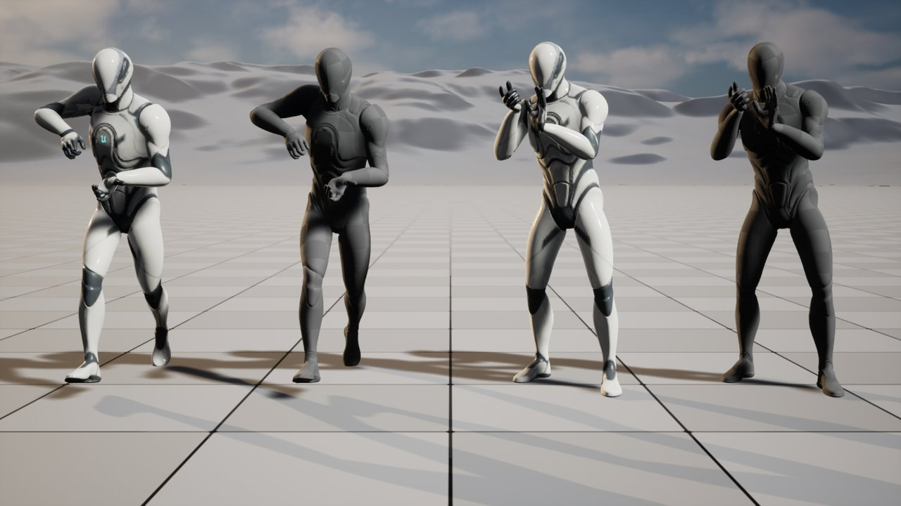

# Characters: the pipeline from Blender to the UE5 mannequin skeleton

Every human in the game (the player's arms `SK_RuleArms`, the three Goons) is a skeletal mesh built in Blender on
Epic's mannequin skeleton `SK_Mannequin`, so the template's motion-captured clips (Rifle, Pistol, Unarmed, Death) drive
it without retargeting. This page holds the settings that are proven to work and the proof.

## Licence rule

Epic's content may be used and modified for this Unreal game but not published, and the repository is public.
Nothing derived from the mannequin meshes, skeleton or animations (FBX, GLB, .blend, baked or posed copies) is
committed: such files live in `art/out/epic/` (git-ignored) and on the box in `/project/ue/chars/`. Scripts, this
document and JPEG pictures of our own characters are committed.

## The scratch project on the box

| What | Where |
|---|---|
| Project | `/project/ue/chars/Chars.uproject` (content only; plugins PythonScriptPlugin, EditorScriptingUtilities, GLTFExporter, ControlRig, ModelingToolsEditorMode, ModelContextProtocol, AllToolsets), `Config/` from `/project/ue/Blank` plus `r.EyeAdaptation.CachedLightingPreExposure=8` |
| Content | `/Game/Characters/Mannequins` and `/Game/Weapons` copied from `Templates/TemplateResources/High/Characters/Content` and `Templates/TemplateResources/Standard/Weapons/Content` |
| Scripts | `tools/box/chars/` (committed), on the box in `/project/ue/chars/scripts/`; `/project/ue/chars/pull.sh` refreshes them from the branch (sparse clone in `/project/ue/chars/src`) |
| Commandlet | `cmdlet.sh <script.py> <name>`: `UnrealEditor-Cmd ... -run=pythonscript -script=...` detached, log `/project/ue/logs/chars/<name>.log`. About 6 minutes per start on this box (the 9p volume), so batch the work in one script |
| Editor | `editor.sh start / status / stop`: our own headless editor, MCP on port 8002, process id in `/project/ue/logs/chars/editor.pid` (stopped by that id only). MCP answers about 6 minutes after the start |
| Editor Python | `MI_MCP_URL=http://127.0.0.1:8002/mcp python3 scripts/mi_mcp.py py - <<< '...'` (a copy of `tools/box/mi_mcp.py`); helpers in `mi_chars.py` |
| Pictures | `... mi_mcp.py shot /tmp/x.png cam=X,Y,Z,pitch,yaw,roll fov=48 size=1600x900 frames=40` then `/opt/venv/bin/python3` (Pillow) to JPEG. A first call can answer "slow task" while shaders compile: wait and repeat |

## Export from Unreal (`ue_export.py`, commandlet, 4 minutes)

`unreal.GLTFExporter.export_to_gltf(asset, path, options, set())` with `GLTFExportOptions`: `export_uniform_scale
0.01` (centimetres to metres), `export_vertex_skin_weights`, `export_animation_sequences`, materials not baked
(`bake_material_inputs DISABLED`), no textures (`texture_image_format NONE`), morph targets on. An AnimSequence
exports with its preview mesh and the whole skeleton. FBX (`SkeletalMeshExporterFBX`, `AnimSequenceExporterFBX`,
`StaticMeshExporterFBX`) is written next to every file as a fallback; it has not been needed.

Files (`art/out/epic/`, 67 MB): `SKM_Manny_Simple.glb` (48,705 vertices, 89 joints, up to 8 influences, two
material sections), `A_rifle_idle_ads` (MF_Rifle_Idle_ADS), `A_pistol_idle_ads`, `A_rifle_reload` (MM_Rifle_Reload),
`A_pistol_reload`, `A_rifle_jog_fwd` (MF_Rifle_Jog_Fwd), `A_unarmed_attack` (MM_Attack_01), `A_death_front`
(MM_Death_Front_01), `SM_Rifle`, `SM_Pistol`; each `.glb` with its `.fbx`.

In the file the mesh node is the parent of the `root` joint, `skins[0].skeleton` is that node, and the 89 joints are
listed in Unreal's order; Unreal (x, y, z) cm becomes glTF (x, z, y) / 100 (mirror included, as in docs/unreal/BOX.md
section 5).

## Blender side (`art/blender/mi/char.py`)

| Step | Setting that works |
|---|---|
| Import | `bpy.ops.import_scene.gltf(..., bone_heuristic="BLENDER", guess_original_bind_pose=False, import_shading="NORMALS", disable_bone_shape=True)` (`rig.import_glb`). BLENDER turns every bone +90 deg about its local X for display; the exporter turns it back (`io_scene_gltf2/blender/exp/tree.py`). TEMPERANCE and FORTUNE are NOT reversible: never use them for a character |
| Scene | Metres, Z up; the mannequin stands at the origin facing Blender -Y (Unreal +Y). Armature and mesh at identity |
| Export | `char.export_character(mesh, armature)`: GLB, `export_yup=True`, `export_skins=True`, `export_def_bones=False` (EVERY bone, so the file carries the whole SK_Mannequin hierarchy), `export_rest_position_armature=True`, `export_armature_object_remove=True` (no extra "Armature" node above `root`), `export_leaf_bone=False`, `export_influence_nb=8`, `export_apply=False`, no animation, no vertex colours, materials as slot-named stubs |
| Check | `char.round_trip_report(src, dst)`: joint names, parents, local rest translation and rotation compared joint by joint |

## Import into Unreal (`mi_chars.import_on_mannequin`)

Interchange (`InterchangeManager.import_asset`) with a transient `InterchangeGenericAssetsPipeline`:
`common_skeletal_meshes_and_animations_properties.skeleton = SK_Mannequin` (the EXISTING asset: no new skeleton),
`import_only_animations False`; `mesh_pipeline.import_skeletal_meshes True`, `import_static_meshes False`,
`create_physics_asset False`; `animation_pipeline.import_animations False`; materials and textures off (slots by
name). The importer's return list comes back empty in 5.9 even when the import worked: load the asset by path.

## The round-trip proof (2026-11-22)

`SKM_Manny_Simple.glb` imported into Blender and exported again untouched with `export_character`
(`art/out/epic/RT_Manny.glb`), then imported in the scratch project as `/Game/RoundTrip/SKM_RT_Manny` on
`SK_Mannequin`:

| Measure | Result |
|---|---|
| Blender: joints in / out, missing, extra, parent changes | 89 / 89, none, none, none |
| Blender: largest change of a joint's local rest translation / rotation in the file | 0.00027 mm (hand_l) / 0.00013 deg (ring_02_r) |
| Unreal: skeleton of the imported mesh | `/Game/Characters/Mannequins/Meshes/SK_Mannequin` |
| Unreal: reference pose of the imported mesh against SKM_Manny_Simple, every bone | 0.00005 cm, 0.00014 deg |
| Unreal: component-space bone transforms, original and imported side by side, MF_Rifle_Jog_Fwd at 0.35 s and MM_Rifle_Reload at 1.3 s | 0.00008 cm, 0.0 deg (every bone) |

`shots/chars-roundtrip.jpg`: from the left, the original mannequin and the round-tripped mesh (grey, default
material) jogging (MF_Rifle_Jog_Fwd, 0.35 s), then the pair in the rifle reload (MM_Rifle_Reload, 1.3 s). Pose for pose
the same, fingers included: no twist, offset, scale or axis error.
