# Loadout: crew, four guns, attachments, block and style

The design an engineer implements next. From the home screen the player picks a **crew member**, a **loadout of up to
four guns** with **attachments**, then the **level and the game style** (with difficulty and time of day), reads a
**briefing** and plays. Everything is data: a gun, an attachment, a crew member or a level is added by adding entries.

| File | What it holds |
|---|---|
| `unreal/MurderInc/Content/Data/guns.json` | The roster (six guns), the `ready` gate, the shared ammunition bag, rule numbers, presentation, stock variants, mounts, and the status of every clip role per gun (3.2, 5, 6) |
| `unreal/MurderInc/Content/Data/attachments.json` | Six slots, the stats an attachment may change with a clamp per target, ten pack parts and twelve of our own with their effects, the trade check, per-gun compatibility (3.3) |
| `unreal/MurderInc/Content/Data/gun_contract.json` | What the art lanes exported for our five own guns and twelve parts: sockets, deform bones, part mounts. The data is held to it (6.8) |
| `unreal/MurderInc/Content/Data/crew.json` | Four crew members as looks on the same arms, in two art phases (3.4) |
| `unreal/MurderInc/Content/Data/levels.json` | Levels with what they provide, modes with what they need (3.5) |
| `unreal/MurderInc/Content/Data/frontend.json` | Screens, shortcuts, transitions, the 3D stage, new inputs, the weapon wheel, the weapon bar, the save schema (2, 4, 7) |
| `unreal/MurderInc/Content/Data/frontend_text.json` | Every new string, keyed as it will sit in `text.json` (2.11) |

Read with `GAMEPLAY.md` (the code as built; this page uses its class names), spec 02 (weapons), spec 04 (flow), spec 07
(HUD and menus), `CHARACTERS.md` (the arms) and `ANIMATION.md` (being written: the pack's clips on the mannequin). This
design changes no file under `Source/` and no existing `Content/Data` file; 4.9 lists what the engineer changes there.

---

## Read this first: what the pack holds, and what the player can pick

**Update, 2026-11-25 (weapons round 4).** The owner saw this section's problem on the stream: "all the guns look the same and no
attachments are able to be added to the guns" (DECISIONS.md). Four of the five offered guns were the pack's one M4. Since round 4 only
the STICK is the pack's rifle. The CHOPPER is `SK_Chopper` again, the SHORTY (a bullpup carbine) and the STRETCH (a marksman rifle) are
meshes of our own, the RATTLER has its own mesh and is offered, and twelve parts of our own fit every gun (3.3, 6.8). Read what follows as
the history of the pack and the STICK's story.

**The pack holds one rifle.** The "Tactical FPS Animation Pack - Assault Rifle" is one M4-style carbine. It comes in
three handguard lengths (Short, Default, Extended), each with the stock open or folded, and eight add-on parts: angled
grip, vertical grip, laser, scope, folding irons, silencer, standard and transparent magazine.

**Decision: the three lengths are three guns** (this was open question 1). They are the **SHORTY**, the **STICK** and
the **STRETCH**, each with its own numbers and no handguard slot. With our **CHOPPER** and **NINE** and the **RATTLER**
(the Goon's gun) the roster is six.

**What that means for the player:** once the weapons import has run on the box (6.8), the player picks up to four guns
out of six; before it the box offers three (CHOPPER, NINE, STICK). In a clean checkout, which holds none of our meshes and no pack,
only the CHOPPER and the NINE are offered, on the template meshes, so the player picks one or two of two. The screen is titled
"Pick up to four".

**The Workbench.** For the STICK the pack import (6.2) brings the part meshes, the lengths and the sockets. For our own guns the weapons
import (6.8) does. Until an import has run, a gun offers no slot and the Workbench says "No parts on this gun yet" instead of showing
parts that cannot be seen.

The other choice, one STICK with the handguard as an attachment slot, is kept as open question 1.

---

## 0. The design on one page

- **Six guns, up to four carried.** The CHOPPER and the NINE play exactly as on the web. The three rifles each
  get one clear edge (3.2). The RATTLER is offered once its mesh is imported. A gun is offered only when it is
  **ready**: its mesh exists and its core motion plays. The parity guns are always offered.
- **Carrying more costs something.** Every gun with a finite reserve draws on **one shared bag of rounds**, which
  starts at 150 and gets the web's 90 per Hold the Block wave (cap 240). Extra long guns bring only their loaded
  magazines. The economy that Hold the Block's wave scaling was tuned for stays the web's (3.2.3).
- **Attachments** go in six slots: optic, muzzle, underbarrel, laser, magazine, stock. There are twenty-two parts: ten from
  the pack (the STICK's) and twelve of our own (round 4). Every part has a balanced trade that `DataLoads` checks. A stat change is resolved on the gun's JSON in web
  units *before* parsing, so a gun with no parts is its JSON untouched (3.3, 3.7). Every gun takes parts: 3 / 3 / 5 / 5 / 4 / 3 slots on
  CHOPPER / NINE / SHORTY / STICK / STRETCH / RATTLER once their meshes are imported (3.3, 6.8).
- **The crew has four members:** Rule, plus DEUCE, SMOKE and KEYS as looks on Rule's arms. A member's card shows only
  once its look exists. The first looks need only material instances (3.4). The crew is cosmetic.
- **The flow** runs Home → Crew → Loadout (⇄ Workbench) → Block & Style → Briefing → intro, five presses for a first
  run. Home keeps the web title's Mode, Difficulty and Time pickers. **Hit the block** starts a run at once with the
  remembered set-up; the very first time it opens Crew instead, so every player sees the flow once. **Gear up** opens
  the flow. Change set-up after a run opens the Briefing (2).
- **Parity holds by construction.** The default set-up is Rule with the CHOPPER and the NINE, no parts, on the block.
  It resolves to the very JSON `config.json` holds today and parses through the same code. With one or two guns, Q, Y,
  the mouse wheel and the D-pad behave as on the web. No new random draw is added. The golden tests replay through the
  new path unchanged (1.2, 8.1).
- **Four guns in the rules.** `FMIWeaponRules` gains slots 1 to 4, quick swap to the last gun used, next and
  previous, per-gun holster and draw times, the shared bag and a semi/auto selector. The host gains damage falloff, a
  noise radius and the aimed field of view per gun (4).

---

## 1. Scope and parity

### 1.1 What is new

| Area | New |
|---|---|
| Front end | Five set-up screens (six when a second level exists) inside the flow's `title` state; a 3D stage with a turntable; a saved set-up; Home shortcuts |
| Guns | SHORTY, STICK, STRETCH, RATTLER (hidden); carrying 1 to 4 guns; the `ready` gate; fire modes; inspect; magazine check |
| Attachments | 10 parts in 6 slots, a per-gun compatibility table gated on mounts, effects resolved before the run |
| Rules | Per-gun holster, draw, aimed field of view and look scale, noise radius, damage falloff, fire modes; the shared bag; four-gun switching |
| Crew | Four looks on the same arms; radio and card lines with the crew member's name |
| Levels and modes | A data index of levels and modes, with a "needs / provides" check |

### 1.2 The parity set-up

`frontend.json parity`: crew `rule`, guns `[chopper, nine]`, no parts, level `block`, and mode, difficulty and time
from the existing settings (defaults `mission`, `boss`, `day`). A first start uses it. So does any saved set-up that
fails validation, and so does a failed load of the new files (3.1). With it, the run must be the web game frame for
frame:

1. **Same data.** `FMILoadoutResolver` (3.7) builds the gun's JSON from the `$ref` into `config.json`, applies no
   effect (no part is fitted), and parses it with the same `ParseGun` and view parser that read `config.json` today.
   Its `FMIWeaponsData` therefore equals `UMIDataSubsystem::GetWeapons()` field by field. The new fields are filled from
   `guns.json extraDefaults`, which are refs to the values the web code uses implicitly:
   - `Holster` and `Draw`: `weapons.common.holster` / `.draw`.
   - `AdsFov`: `player.fov.ads`. `AdsLook` is 1.
   - `NoiseRadius`: `enemies.ai.hear.gunfire`, which `ParseGun` converts to cm like every other distance.
   - Falloff: start = end = +∞, min = 1.
   - `FireModes`: `[auto, semi]` for the CHOPPER and `[semi]` for the NINE. **Every run starts each gun in
     `fireModes[0]`.** No fire mode is saved.
   - Ammunition: the CHOPPER is the only finite gun, so the bag *is* its reserve (150, then the flow's 90 / 240).
2. **Same arithmetic.** A default never enters a formula in a way that changes a double. Falloff is skipped while the
   distance is at most the start (+∞); it is not multiplied by a computed 1. Per-gun holster and draw replace the
   common values in the same expressions.
3. **Same random draws.** No new draw from the `weapon` stream, nor any other. Effects are resolved before the run. The
   selector, inspect and magazine check use no randomness. The alternation of the two melee swings uses a counter.
4. **Same inputs.** With one or two guns there is no weapon wheel: Q and Y swap on press, exactly as today. The mouse
   wheel and D-pad ↑ ↓ become next and previous. With two guns these give the gun the web's swap gave, under the same
   `wheelDebounce`. Keys 3 and 4, B, T and View do nothing in the rules unless pressed. Inspect and magazine check never
   write rule state.
5. **Same events.** No new event fires in a parity run. The `weapon:fire` payload gains fields that the golden test
   does not compare (`NoiseRadius`, `bSuppressed`).
6. **Same picture where it matters.** The weapon bar shows two slots and the melee slot, as the web bar does. The
   radio, the cards and the HUD use the original `text.json` lines word for word for Rule.

### 1.3 Where this design departs from the brief

1. **Four slots, two guns in the default.** The player may carry one to four guns. The default carries two, because
   parity needs it: with four guns, Q from the NINE would go to the last gun used, not always to the CHOPPER.
2. **"All the guns in the pack" are three guns made from one rifle** (see Read this first).
3. **The handguard length trades handling against recoil and accuracy at range, not range.** The block is 92 × 68 m and
   every rifle reaches 300 m, so a range change would never be felt. Instead, the short gun pays with kick, a wider
   aimed cone and damage falloff past 20 m. The long gun pays with slower hands.
4. **Mode, difficulty and time stay on Home** as on the web. Block & Style shows them too. Both write the same settings.
5. **Block and Style are one screen** while there is one level (it has one card). A second level splits it again.
6. **Carrying four guns has a cost:** the shared bag (3.2.3).

---

## 2. The flow

### 2.1 State diagram

Every set-up screen is a sub-screen of the flow's existing `title` state (spec 04 3.2). The flow's state machine, its
events and its golden values are untouched. A run still begins with `start()` (T2). The run reset (spec 04 3.3) reads
the set-up instead of the fixed guns (4.9).

```mermaid
stateDiagram-v2
    state title {
        [*] --> Home
        Home --> Crew: Gear up / Hit the block (first time only)
        Home --> Loadout: a summary link (edit mode; also Crew, Where)
        Crew --> Home: Back
        Crew --> Loadout: Next
        Loadout --> Crew: Back
        Loadout --> Workbench: Attachments (on a gun)
        Workbench --> Loadout: Done / Back
        Loadout --> Where: Next (at least one gun)
        Where --> Loadout: Back
        Where --> Briefing: Next
        Briefing --> Where: Back
        Briefing --> Crew: Change (edit mode)
        Briefing --> Loadout: Change (edit mode)
        Briefing --> Where: Change (edit mode)
    }
    title --> intro: Hit the block (Home, once played; Briefing)
    intro --> playing
    playing --> paused
    paused --> playing: Resume
    paused --> intro: Restart run (same set-up)
    intro --> dead
    playing --> dead
    playing --> complete: Story, at the truck
    dead --> intro: Run it back (same set-up)
    complete --> intro: Run it back (same set-up)
    dead --> title: Back to title (Home) / Change set-up (Briefing)
    complete --> title: Back to title (Home) / Change set-up (Briefing)
```



`Where` is the Block & Style screen (`frontend.json screens.where`, `merge: [level, style]`). With a second level in
`levels.json` it splits into Block (step 3) and Style (step 4), and the step strip gets five bullets.

`Change set-up` first does what `toTitle()` does (spec 04 3.4), then opens the Briefing, whose Change links reach every
screen. The set-up is saved on every Next and every start, so it is remembered whichever way the player leaves (edges
marked `remember` in `frontend.json transitions`). The pause card has no way back to the set-up, as in the web game.

**Presses** (each click, key or button counts one):

| Player | Path | Presses |
|---|---|---|
| First run, defaults | Hit the block (opens Crew) → Next → Next → Next → Hit the block | 5 |
| Returning, same set-up | Hit the block | 1 |
| Returning, Hold the Block instead of Story | Home mode picker → Hit the block | 2 |
| After a death, drop to Hustler | Back to title → Home difficulty picker → Hit the block | 3 |
| After a death, swap a gun | Change set-up → Change on Carrying → pick → Done → Hit the block | 5 |

### 2.2 The frame every set-up screen shares

| Part | Rule |
|---|---|
| Layout | Letterbox bars and the left-to-right veil of the title (spec 07 4.4). The left 40 % holds the controls; the rest shows the 3D stage (2.10). Safe zone and HUD scaling as spec 07 4.2. **As built:** every control of every set-up screen, the step strip and the bottom bar included, lives inside that column (lines wrap, names cut with an ellipsis), so no panel covers the stage at 16:9, 21:9 or 4K; the smallest text is 14 pt (`MinText`) |
| Step strip | Top left: route bullets (spec 07 2.3) in the line colours, labelled `frontend.steps.labels` (four) or `.labelsSplit` (five). Done steps are filled; the current one has the focus ring. A done step can always be clicked. Once the set-up is valid, every step can be clicked, forward too |
| Kicker and title | `frontend.<screen>.kicker` (small, `inkDim`, uppercase) over `frontend.<screen>.title` (display font) |
| Bottom bar | `Back` (quiet button, left, glyph Esc / B) and `Next` (primary, right, glyph Enter / Start). Next is disabled with its reason as a note when the screen is incomplete (`frontend.loadout.needOne`). In edit mode Next reads `Done` and returns to the Briefing. Next takes the focus like any control: Tab cycles the screen's panes and Next, and Down past the last row lands on it. The glyphs come from `frontend.glyphs.<kbm or pad>` for the device used last |
| Shortcut | Ctrl+Enter, or **View+Start** on a pad (hold View, press Start), jumps to the Briefing from any set-up screen when the set-up is valid (`frontend.json navigation`). **Departure:** Start alone was the pad's shortcut; it is Next instead, so a pad player walks crew, loadout, attachments, block and style in the order the user asked for, and Start on Loadout no longer skips Block & Style (review of 2026-11-23) |
| Inputs common to all | A, Enter, Space and a left click always activate the focused control. Start, or Enter on Next, always advances. B, Esc and the Back button go back. In a single-choice row (time, mode, difficulty) moving the focus selects, so A there means Next. No action that loses work is on a tap: Reset build is a 0.6 s hold |
| Memory | Every screen opens with the saved choice selected and focused |
| Sound and focus | `ui_hover` and `ui_click` as on the title (spec 07 3.17); gamepad focus ring; the focus never leaves the screen |
| Reduced motion | The turntable does not spin by itself; camera moves cut instead of easing |

### 2.3 Home

**Shows:** the web title as it is: eyebrow, wordmark, star line, premise, the **Mode, Difficulty and Time pickers**
(they write the settings at once, as on the web), `Settings`, `Controls`, the controls glance strip, and the
fly-through behind it. Added:

- **`Hit the block`**, the primary button, focused on arrival. Under it is the summary line `frontend.home.summary`,
  for example `RULE · CHOPPER / NINE · The Block · Day · Story · Boss`. Each part of the summary is a link that opens
  its screen in edit mode. Hit the block starts the run at once with the remembered set-up. **While `save.played` is
  false it opens Crew instead**, under the note `frontend.home.firstTime`, so a first-time player, mouse or pad, always
  sees the flow the user asked for.
- **`Gear up`**, a quiet button, which opens Crew.

| Input | Mouse | Keyboard | Gamepad |
|---|---|---|---|
| Hit the block | click | **Enter** with nothing else focused (as the web title) | **Start** (as the web title), or A on it |
| Gear up | click | Tab to it, Enter | focus it, A |
| A summary part | click it | Tab to it, Enter | focus it, A |
| Pickers, Settings, Controls | click | Tab, arrows, Enter | focus, A |

On the web title and on the Briefing, `Hit the block` starts a run. Home now does the same (after the first time), so
the label keeps its meaning.

**Texts:** `frontend.home.start`, `.setup`, `.summary`, `.firstTime`; everything else is the existing `text.title.*`.

### 2.4 Crew

**Shows:** one card per *offered* member in `crew.json order`, with a portrait (a 2D card of the arms on the bench,
never a face), the name and the tagline. A member is offered when every asset of its phase-1 `look` exists. Rule is
always offered. The card shows `tagline` (phase 1), or `taglineFull` once phase 2 exists, so the words describe only
what is on screen. `frontend.crew.note`: "Looks only. Everybody shoots the same." With Rule the only member offered,
the screen still shows (one card), because it is the user's first step.

**3D (as built):** the arms shot below needs the member's own first-person arms (`crew.json look.arms`); until that mesh
is in the project the stage shows the turntable with the first carried gun instead, never a gun at the eye with no
hands, and the template body is never shown this close.

**3D:** the stage camera `arms` (2.10) sits **at the first-person eye**, with the viewmodel field of view (54°). It
orbits 10° at most, and a vignette and the sleeve edge frame the view, so the closed shoulder caps of `SK_RuleArms` are
never seen (`CHARACTERS.md`, Proof in Unreal). The arms hold the first carried gun and play its `Inspect` clip if it
exists. Otherwise they play `IdleAds` with the rig's procedural sway. For the CHOPPER, Inspect is missing today (6.1).
When the choice changes, the arms swap behind a 0.15 s dip to black.

| Input | Mouse | Keyboard | Gamepad |
|---|---|---|---|
| Choose | click a card | Left / Right (focus selects) | D-pad or stick left / right |
| Orbit | drag the stage | none | right stick |
| Next / Back | buttons | Enter / Esc | A or Start / B |

### 2.5 Loadout (the rack)

**Shows:**

- **Left, the rack:** class tabs (`All`, `Rifles`, `SMGs`, `Pistols`, `New`), then a grid of gun cards three wide,
  which scrolls past twelve. Only *offered* guns appear (3.2 `ready`). With `mi.Setup.ShowUnready 1` the others appear
  too, tagged `DEV`. Each card shows:
  - the silhouette (`T_UI_Gun_*`, or the name in the display font until it exists);
  - the name and the class;
  - six stat bars computed from the gun's *current build*;
  - the magazine (`∞` for the NINE) and `SEMI` for a semi-only gun;
  - the number of offered attachment slots, or `No attachments`;
  - `Selected` on the card whose attachments are in the panel beside the rack (2.6a);
  - `NEW` until the card has been focused once (save `seen`).

  A carried gun shows `Carried · slot n` and stays selectable: selecting it focuses its slot.
- **The four slots** (as built: a strip of four under the rack, inside the controls column), `Slot 1` to `Slot 4`. Each shows the carried gun's silhouette, name, attachment pips and
  key glyph, or `Empty` with `Pick a gun from the rack`. The melee slot (`text.weapons.melee.<gun of slot 1>`) sits
  below them. Above them: `Carry up to four. Melee comes with you.` and `Long guns share one bag of rounds.`

**3D:** the turntable (2.10) shows the focused gun with its build, slowly spinning. A focus change swaps the gun with a
0.2 s scale-out and scale-in.

**Rules of the slots** (`frontend.json carry`): one to four guns, no duplicates, and the slots always fill 1..n with no
gap (emptying slot 2 of three moves slot 3 up). At zero guns, Next is disabled with `Carry at least one gun`.

| Input | Mouse | Keyboard | Gamepad |
|---|---|---|---|
| Carry a gun | click its card (first empty slot; with all four full, the selected slot) | Enter or Space on the card | A on the card |
| Put in a given slot | drag the card onto the slot | 1–4 on the focused card | A on a slot, then A on a card |
| Reorder | drag a slot onto another (they swap) | Shift + Up / Down on a slot | LB / RB on a slot |
| Empty a slot | right-click the slot (right-click elsewhere does nothing) | Delete | X |
| Attachments | they are on the screen, beside the rack (2.6a): click a slot, then a part | Right from the last card of a row, or E, or Enter on a gun already carried | D-pad right from the last card, or Y |
| Turn, zoom | drag, wheel | none | right stick, LT / RT |
| Switch panes | none | Tab (rack, slots, Next); Up from the first slot returns to the rack | LB / RB on the rack; on the slots LB / RB reorder, so D-pad up from the first slot (or Y on an empty slot) returns to the rack |
| Next / Back | buttons | Enter on Next (Tab or Down to it) / Esc | Start, or D-pad down past the last row then A / B |

**Stat bars** (`frontend.loadout.stats`), each filled 0 to 1 and clamped. The numbers are those of the resolved JSON
(web units):

| Bar | Fill |
|---|---|
| Damage | damage / 40 |
| Kill speed | 1 − (t − 0.2) / 0.4, where t is the time to drop a Goon of the current difficulty with body shots at 10 m (3.2). This bar is what makes the CHOPPER's edge visible |
| Control | 1 − (recoil.pitch − 0.002) / 0.008 |
| Handling | the average of 1 − (adsTime − 0.10) / 0.25 and 1 − (draw − 0.2) / 0.25 |
| Aimed | 1 − (spread.ads − 0.0005) / 0.0035 |
| Hip fire | 1 − (spread.hip − 0.006) / 0.010 |

### 2.6a Attachments on the Loadout (as built, release 6.1)

The owner, on version 6: "when you click a gun the option for attachments should show up in the frame with it, so users
can click weapon, add attachments, then navigate to the game". The attachments no longer sit behind a second screen
(2.6, which a wrench button or E opened and which was hard to find). The Loadout is one screen with the rack, the four
slots and the focused gun's attachments side by side; the 3D gun on the right shows every look and every fit at once.

**Layout (1080p units, the same at 1920 x 1080 and 1280 x 720):** the controls column is 58 % of the width on the Loadout
(40 % on the other screens): left, the heading, the class tabs, the rack (three cards a row, scrolling) and the strip of
the four carried slots with the melee line, as before; right, a panel 370 units wide with `Attachments`, the focused
gun's name, a `Reset` button, one chip per offered slot (`Optic`, `Muzzle`, `Underbarrel`, `Laser`, `Magazine`, `Stock`, as
the gun has them), the options of the chosen slot (`Factory` where the slot is not required, then each part with its
blurb, `Fitted` on the one in use), the effect lines of the part in focus with the six stat bars (ghost: now, fill: with
the part), and a line naming the keys of the device in use. A gun with no offered slot shows `frontend.attachments.noPartsYet`
and its note in the same place. The stage's free part (`AMIShowroom::SetFreeLeft`) starts at 0.18 on the Loadout (-0.14
elsewhere), eased, so the whole gun is framed in what the column leaves; the narrower free part puts the camera further
from a long gun, so the stage room is 2000 x 2000 x 600 (`frontend.json stage.room.size`, it was 1200 x 1200: the camera
stood outside its wall and filmed the wall's far side). Text is never below 14 (`MinText`).

**Which gun:** the focused card, always (`FMIFrontEndRules::FocusGun` sets the bench gun on the Loadout, with its first
offered slot chosen): an arrow, a click on a card, a click on a carried slot (it focuses that slot's gun) all change the
panel together with the stage. The card is marked `Selected`. Nothing needs opening and the screen never changes.

**Input** (a fourth pane of the Loadout, `UMIFrontEnd::Pane == 2`; Tab still cycles rack, slots, Next):

| Input | Mouse | Keyboard | Gamepad |
|---|---|---|---|
| Enter the panel | click a slot chip or an option (the keys then work there) | Right from the last card of a row, E, or Enter on a gun already carried | D-pad right from the last card, Y |
| Slot | click a chip | Left / Right (Left from the first slot leaves the panel), [ ] | D-pad left / right, LB / RB |
| Option | hover looks, click fits | Up / Down look (Up from the first leaves the panel), Enter or Space fits | D-pad up / down look, A fits |
| Factory part | click `Factory` | Backspace | X |
| Reset build | the `Reset` button | hold R 0.6 s | hold Y 0.6 s |
| Leave the panel | click a card | Esc | B (a second Esc or B is Back, as on every screen) |

**3D:** while the keys work the panel (Pane 2) the camera goes to the chosen slot's mount as on the Workbench (2.6); with
the keys on the rack the whole gun turns slowly. A part looked at or fitted is on the gun at once.

**Flicker** (the owner's, DECISIONS.md 2026-11-28): a part fitted or looked at builds the screens again. A card, slot, option or chip
built under the pointer is given the hover look at once (`SMIFrontEnd::PointerOver`), because Slate hovers a new button a frame or two
after its first paint and the card flipped plain and back; and every text that wraps is given the width it wraps at (`Txt(...,
bWrap, WrapAt)`), never `AutoWrapText`, which measures at its last paint's width, so a new one was drawn once on one line.
`MurderInc.Frontend.FirstLayout` fails when a text of the Loadout wraps by itself. Home, Crew, Block & Style and the Briefing still
use the old way for their few wrapped lines (they are built again on a key, not on every hover).

The Workbench screen (2.6) stays for the console (`MIMenu fe bench <gun>`) and the tests that drive it; no control of the
Loadout opens it.

### 2.6 Workbench (attachments)

Opened by `Act("bench")` (the console and the tests) for one gun; the player no longer needs it (2.6a). It edits that gun's build whether or not the gun is carried. Builds are kept per gun
(7).

**Shows:**

- `Build the {gun}`, with arrows and a strip of the carried guns to move between them without leaving.
- **Slot tabs**, only for the slots that are offered on this gun: listed in `attachments.json compatibility.<gun>`,
  with the mount `exists` (or, for the stock, the variant `exists`). If no slot is offered (today the CHOPPER, the
  NINE and every gun in a clean checkout), the screen says `frontend.attachments.noPartsYet` and its note, and Done.
- **The options of the chosen slot:** `Factory` (when the slot is not `required`: "What it came with. No change.") and
  each offered part, with its name and blurb.
- **For the focused option, its effect lines,** generated from data (`frontend.effects.*`). (As built, the mark is
  drawn as a shape, `SMIMark`, not as a character: the fonts have no ▲ ▼ ◀ ▶ glyphs.) Each line starts with ▲
  (better) or ▼ (worse), or • (neutral, such as the scope's `Aimed view 30° (from 52°)`), and is also green or red, so
  the meaning never rests on colour alone. Lines with no sign carry the gun's own value: `▲ Heard 18 m out (from 45 m)`.
  The panel also compares the six stat bars, before and after, as ghost and fill.
- `Fitted` on the option in use, and `Hold to reset build` (every slot back to its `default`; a 0.6 s hold).

**3D:** the turntable gun with the build. Choosing a slot tab eases the camera to that slot's focus (`frontend.json
stage.cameras.focus`, 0.4 s). As built: the camera aims at the slot's mount socket on the shown mesh (the frontend.json
offset only where the mesh has no such socket), the gun turns that side to the camera and stops spinning, the
distance comes from the mesh's bounds so the whole gun stays in the free 60 % of the screen at any aspect ratio, and a
spot lights the mount. Focusing an option previews it on the gun at once, before it is fitted: an add-on part
slides into its socket in 0.25 s, and a stock option swaps the base mesh under a 0.15 s dip (3.3). Leaving the option
without fitting puts the fitted part back. The irons fold down when the scope is fitted, if they are a separate part
(6.2).

| Input | Mouse | Keyboard | Gamepad |
|---|---|---|---|
| Slot | click a tab | Left / Right | D-pad left / right |
| Option | hover previews, click fits | Up / Down previews, Enter or Space fits | D-pad up / down previews, A fits |
| Factory part | click `Factory` | Backspace | X |
| Previous / next carried gun | arrows, strip | [ / ] | LB / RB |
| Reset build | hold the button 0.6 s | hold R 0.6 s | hold Y 0.6 s |
| Turn, zoom | drag, wheel | none | right stick, LT / RT |
| Done | Done or Back | Esc | B |

### 2.7 Block & Style

**Shows:** four rows on one screen (`frontend.where`):

1. **Level:** one card per level in `levels.json order`, with its name, blurb, place line and the modes it plays. There
   is one card today. There are no "coming soon" placeholders.
2. **Time:** `Day` / `Night`, with `text.interface.title.timeNotes`.
3. **Mode:** one card per mode the level provides (3.5), with `text.modes.<id>.name` and `.note`. Hold the Block shows
   `Best 12,345` (the saved best).
4. **Difficulty:** `Hustler` / `Boss` / `Kingpin`, with `frontend.mode.difficultyNotes` and `text.notes.difficulty`.

Every row writes its setting at once, the same settings as the Home pickers.

**3D:** the title fly-through of the chosen level, if that level is the map that is loaded. The time switches live, as
on the web title. A level that is not loaded shows its `preview.thumbnail` behind the veil. A chosen level that is not
the loaded map is remembered, and the world travels to it on Hit the block: the loading screen (spec 07 4.2 boot)
shows, and the new map's flow enters `intro` directly with the saved set-up.

| Input | Mouse | Keyboard | Gamepad |
|---|---|---|---|
| Row | none | Up / Down | D-pad up / down |
| Choose in a row | click | Left / Right (focus selects) | D-pad left / right |
| Next / Back | buttons | Enter / Esc | A or Start / B |

With a second level the screen splits into Block (rows 1–2) and Style (rows 3–4), as `frontend.json screens.level` and
`.style`.

### 2.8 Briefing

**Shows:** the IPX Vault's plan as a card (`IPX Vault · The plan`, `Here's how it goes`), with four lines, each with a
`Change` link that opens its screen in edit mode:

- **Crew:** the portrait and the name.
- **Carrying:** the guns in slot order with their attachment pips.
- **Block:** the place line for the chosen time (`text.location.byTime`).
- **Style:** the mode, the difficulty and the mode's tagline (`text.location.tagline` / `taglineHoldout`).

The radio intro is not printed, because the intro plays it a moment later. The controls glance strip gets the new rows
(`frontend.controls`). The wheel rows are shown only with three or more guns.

**3D:** the player's own first-person camera at the level's `playerStart`. The chosen arms hold the first carried gun
and play `Equip` once, or `IdleAds` when Equip is missing. As built: while the first-person arms are the template body
(its open upper arm fills the lower left this close, a characters / animation hand-off, 6.6) the Briefing hides the
arms and shows the gun alone. `Hit the block` starts the full intro (spec 04 3.5) from
this exact view.

| Input | Mouse | Keyboard | Gamepad |
|---|---|---|---|
| Hit the block | primary button | Enter | A or Start |
| Change a line | `Change` | Up / Down to it, Enter | D-pad to it, A |
| Back | Back | Esc | B |

### 2.9 After a run

The death card (`dead`) and the debrief card (`complete`) gain `Change set-up` (`frontend.cards.changeSetup`) between
`Run it back` and `Back to title`. It opens the Briefing. `Run it back` and `Restart run` keep the whole set-up. For
the other crew, the kicker `Rule down` becomes `frontend.crewLines.deadKicker`.

### 2.10 The 3D stage

- **Where.** `AMIShowroom` is an actor spawned at run time at `frontend.json stage.origin`, 1 km above the block's
  origin, so the project still needs no binary assets (ARCHITECTURE 1.1 rule 4). Its closed room keeps out the block's
  sun, sky light and fog. Its own lights and a fixed-exposure post volume bounded by the room light it. Every value is
  a placeholder for the art pass. A level may later name a place inside itself (`levels.json provides.showroom`).
- **Who owns the view.** On Crew, Loadout and Workbench the front end puts the view on the stage's cameras, as the
  title camera does on Home. On Block & Style the fly-through returns. On the Briefing the player's own camera takes
  over. These are view-target changes with a 0.3 s fade through black, never two renders.
- **The turntable** (`stage.turntable`) spins 18°/s until touched and resumes 3 s after the last touch. It turns 0.35°
  per dragged pixel or 120°/s at full right stick, clamps the pitch to −25° … 35° and zooms 0.65 × … 1.6 ×.
- **What you see is what you carry.** The showroom and the first-person gun build the gun with the same
  `UMIGunAssembly` component: the **base mesh of the build's variant** (the stock slot picks it), one child mesh per
  fitted add-on part at its mount socket, the hidden parts (`mounts.<slot>.hide`) and the marker overrides (4.5). A
  slot whose mount does not exist is not offered, so no fitted part can be invisible.

### 2.11 Text keys

All new strings are in `frontend_text.json`, keyed `frontend.*` as they will sit in `text.json`. They are kept
separate because `text.json` is written by `tools/ue-export` from the web game. The loader reads both, and a
`frontend` key never shadows a `text.json` key. Templates use the `{"$template": ...}` form of `text.json`.

| Group | Keys |
|---|---|
| Home | `frontend.home.start`, `.setup`, `.summary` (with `{time}`), `.firstTime` |
| Frame | `frontend.steps.labels`, `.labelsSplit`, `.of`, `.next`, `.back`, `.done` |
| Crew | `frontend.crew.kicker`, `.title`, `.note`, `.<id>.name`, `.tagline`, `.taglineFull` |
| Loadout | `frontend.loadout.*`, including `.title` "Pick up to four", `.devTag`, `.bag`, `.stats.kill` |
| Workbench | `frontend.attachments.*` (with `.noPartsYet`), `frontend.effects.*` (each line starts with `{mark}`) |
| Block & Style | `frontend.where.*`, `frontend.level.*`, `frontend.levels.block.*`, `frontend.mode.*` |
| Briefing | `frontend.briefing.*` |
| Cards, radio | `frontend.cards.changeSetup`; `frontend.crewLines.deadKicker`, `.radioIntro`, `.radioIntroHoldout`, `.radioDone` |
| Guns | `frontend.weapons.{shorty,stick,stretch,rattler}.{name,blurb}`, `frontend.weapons.melee.*` |
| HUD, glyphs, controls | `frontend.hud.modes.*`, `.wheel`, `.empty`, `.bag`; `frontend.glyphs.{kbm,pad,touch}.*` (the HUD's keys and, as built, the set-up screens' `back`, `next`, `toBriefing`, `prevGun`, `nextGun`, `reset`, `bench`, `melee`, `empty`, `panes`); `frontend.controls.{kbm,pad}` |

No string is written in the code. Every character drawn must have a glyph in the face in use or in the symbol face
behind it (the engine's Droid Sans Fallback, in every checkout; Noto Sans Symbols 2 was tried and has no arrows); the front end logs the
missing ones at load and `Frontend.Glyphs` fails on them.

Text rules kept from `text.json`: gun blurbs have no closing full stop. A crew role never contradicts the story: the
radio calls Keys *from* the Vault, so KEYS "knows every lock on the Ave". DEUCE "goes in first", because the crew goes
in on foot and Story ends at the IPX truck.

---

## 3. Data

### 3.1 Loading

`UMIDataSubsystem` loads the six new files after `config.json` and `presentation.json`, into a new `FMILoadoutData`
(`Core/Data/MILoadoutData.h`) next to `FMIConfigData`, **on its own error path.** A missing or invalid new file never
fails the config load: the front end then offers only the parity set-up, and the log says why (LogMI, Error).

1. **Resolve `$ref`.** `{"$ref": "config.json#weapons.chopper"}` is that object (or number) of that file. The CHOPPER
   and the NINE therefore have one source of truth. `extraDefaults` are refs too, so no default is hard-coded.
2. **Keep the JSON.** Each roster gun is kept as JSON (its resolved `rules`, `extra` and `presentation`) for the
   resolver, which parses it after the effects (3.7). The loader parses each gun once with no parts, to validate it
   and to fill the rack.
3. **Validate** (MurderInc.Loadout.DataLoads, 8.6):
   - every id reference and every `$ref` resolves, and each `extraDefaults` value is a number (or the listed shape);
   - every gun's `clips.byStatus` names every role exactly once;
   - every `required` slot's default is among its options;
   - every non-baseline part passes the trade check (3.3);
   - each stat target's base value of every roster gun lies inside its clamp;
   - every compatible build of every gun resolves with `end ≥ start` and `min` in its clamp;
   - every level's `provides` matches its level file, and every mode is provided by at least one level.

### 3.2 Guns (`guns.json`)

A gun entry has `id`, `class`, `text` (name and blurb), `melee` (the HUD's melee label) and `parity`. It also has:

- `rules`: in `config.json`'s schema, or a `$ref`;
- `extra`: the new per-gun fields (1.2);
- `presentation`: in `presentation.json`'s schema, or a `$ref`;
- `variants`: for the pack rifles, the base mesh per stock position;
- `mounts`: a socket per slot, the parts it hides, and its status;
- `art` and `clips.byStatus` (6.1).

**Ready.** A parity gun is always offered. Any other gun is offered when it is **ready**:

- the mesh of its default variant exists and is not a stand-in;
- each core role (`Idle`, `Fire`, `ReloadTactical`, `Holster`, `Draw`) plays now (exists, template or procedural).

Inside a ready gun, a slot is offered only once its mount exists, and a stock option only once its variant exists.
`mi.Setup.ShowUnready 1` shows the hidden guns with a `DEV` tag. The RATTLER is offered once `SK_Rattler` is
imported. The SHORTY and the STRETCH are ready once their own open variant (`SK_Shorty`, `SK_Stretch`) is imported; the STICK's
pack variant is imported already. The rig plays every core role of our guns from the rules: `Idle` is the template rifle's idle
(status `template`), as for the CHOPPER, and the roles that waited for pack clips are `missing`, not in progress.

**The numbers** (web units; the resolver and the rack use exactly these):

| | CHOPPER | NINE | SHORTY | STICK | STRETCH | RATTLER |
|---|---|---|---|---|---|---|
| Class; modes | rifle; auto, semi | pistol; semi | rifle; auto, semi | rifle; auto, semi | rifle; auto, semi | smg; auto, semi |
| Damage per round (head × 2.2) | 26 | 34 | 21, falloff 20→45 m to 0.8 × | 21 | 25 | 25, falloff 15→35 m to 0.65 × |
| Rate (rpm); damage per s | 720; 312 | 420; 238 | 860; 301 | 800; 280 | 700; 292 | 545; 227 |
| Magazine / reserve | 30 / bag | 15 / ∞ | 30 / bag | 30 / bag | 30 / bag | 32 / bag |
| Range (m) | 300 | 120 | 300 | 300 | 300 | 120 |
| Aim time; holster / draw (s) | 0.18; 0.28 / 0.32 | 0.14; 0.28 / 0.32 | 0.18; 0.26 / 0.29 | 0.20; 0.28 / 0.32 | 0.22; 0.30 / 0.35 | 0.14; 0.24 / 0.27 |
| Spread hip / aimed / moving hip (rad) | .0125 / .0012 / .013 | .0105 / .0017 / .0065 | .012 / .00104 / .0117 | .012 / .0009 / .013 | .012 / .00077 / .013 | .0094 / .003 / .0065 |
| Camera kick per round (rad) | .0068, climb then weave | .0092, snap | .0056 | .0051 | .0047 | .0041, fast buzz |
| Reload tactical / empty (s) | 2.24 / 2.72 | 1.50 / 1.90 | 2.13 / 2.45 | 2.13 / 2.45 | 2.13 / 2.45 | 1.90 / 2.31 |
| Heard at; aimed view | 45 m; 52° | 45 m; 52° | 50 m; 52° | 45 m; 52° | 45 m; 52° | 45 m; 52° |
| Gun length near walls (`wallPull`, m) | 1.05 / .42 | .80 / .32 | .95 / .38 | 1.10 / .44 | 1.27 / .51 | .85 / .34 |

**Rounds and time to drop a Goon with body shots** (Goon HP 90 / 110 / 130 by difficulty, `config.json
enemies.difficulty`; time = (rounds − 1) × 60 / rpm; in brackets, the rounds at 50 m when the gun has a falloff):

| | Hustler 90 | Boss 110 | Kingpin 130 | Its edge | Its cost |
|---|---|---|---|---|---|
| CHOPPER | 4, **0.25 s** | 5, **0.33 s** | 5, **0.33 s** | the fastest kill on every tier | climbs hard, wide hip cone |
| NINE | 3, 0.29 s | 4, 0.43 s | 4, 0.43 s | never runs dry; quick hands | snap kick; 15 rounds |
| SHORTY | 5, 0.28 s (6) | 6, 0.35 s (7) | 7, 0.42 s (8) | quickest rifle hands, best on the move, shortest | kick, loud, falls off past 20 m |
| STICK | 5, 0.30 s | 6, 0.375 s | 7, 0.45 s | no weakness; the base for every build | the slowest rifle kill |
| STRETCH | 4, 0.26 s | 5, 0.34 s | 6, 0.43 s | steadiest and tightest; hits hardest of the three | slow hands, long near walls |
| RATTLER | 4, 0.33 s (6) | 5, 0.44 s (7) | 6, 0.55 s (8) | quickest hands, best hip fire | weak past 15 m; wide aimed cone |

Every breakpoint of a new gun has at least 11 % to spare at 10 m (for example STRETCH 4 × 25 = 100 against 90). So no
new gun sits on a knife-edge. The CHOPPER's 5 × 26 = 130 on Kingpin is the web game's own, and parity keeps it. The
rack bars at Boss:

| Bar | CHOPPER | NINE | SHORTY | STICK | STRETCH | RATTLER |
|---|---|---|---|---|---|---|
| Damage / Kill speed | .65 / **.67** | .85 / .43 | .53 / .63 | .53 / .56 | .63 / .64 | .63 / .40 |
| Control / Handling | .40 / .60 | .10 / .68 | .55 / .66 | .61 / .56 | .66 / .46 | .74 / .78 |
| Aimed / Hip fire | .80 / .35 | .66 / .55 | .85 / .40 | .89 / .40 | .92 / .40 | .29 / .66 |

#### 3.2.1 How the pack rifles' numbers are derived

The **STICK** is a lighter, faster round in a longer gun with a full stock. Each number is a CHOPPER number times a
stated factor:

| Field | CHOPPER | Factor | STICK |
|---|---|---|---|
| damage, rpm | 26, 720 | × 0.81, × 1.11 | 21, 800 |
| magSize, range | 30, 300 | same | same |
| adsTime | 0.18 | × 1.11 | 0.20 |
| reload tactical, marks to tug | 2.24, 0.40 … 1.565 | × 0.95 | 2.13, 0.38 … 1.49; no press check |
| reload empty | 2.72 (rack) | bolt catch | 2.45; the bolt closes at 1.92 (`slideRelease`) |
| spread hip, ads, moveHip, moveAds | .0125, .0012, .013, .004 | × 0.96, × 0.75, × 1, × 0.9 | .012, .0009, .013, .0036 |
| bloomHip, bloomAds, shot, decay | .0065, .0022, .17, 1.5 | × 0.85, × 0.8, × 0.8, × 1.1 | .0055, .0018, .14, 1.65 |
| recoil pitch, pitchRandom | .0068, [.85, 1.15] | × 0.75, narrower | .0051, [.9, 1.1] |
| yawEarly, weaveAmp, weaveRandom, weaveFrom | .0011, .0042, .001, 4 | × 0.8, × 0.7, × 0.8, + 1 | .0009, .0029, .0008, 5 |
| shake; kick back, rise, yaw, roll, up, side | .12; .82, 1.5, .475, .85, .11, .09 | × 0.75; × 0.8 | .09; .66, 1.2, .38, .68, .09, .07 |
| flash scale, light; wallPull | 1, 45; [1.05, .42] | × 0.9; × 1.05 | .9, 40; [1.1, .44] |
| springs, sway, views, poses, strike keys | | same | provisional until the pack is measured |

The **SHORTY** and the **STRETCH** were worked out from the STICK when they were still the pack's other two handguards. Round 4 gave
them bodies of their own and left every number as it was:

| Field | SHORTY | STRETCH |
|---|---|---|
| damage, rpm | 21, 860 (short gas system) | 25, 700 (longer barrel) |
| adsTime; holster, draw | × 0.9 → 0.18; × 0.92 → 0.26, 0.29 | × 1.1 → 0.22; × 1.08 → 0.30, 0.35 |
| spread ads; moveHip | × 1.15 → .00104; × 0.9 → .0117 | × 0.85 → .00077; same |
| recoil pitch, shake; kick rise, back | × 1.1 → .0056, .10; 1.32, .73 | × 0.92 → .0047, .083; 1.10, .61 |
| flash scale, light; noise | × 1.3 → 1.17, 52; 50 m | same; 45 m |
| falloff | 20 → 45 m, down to 0.8 × | none |
| wallPull; swayMax | × 0.86 → [.95, .38]; same | × 1.15 → [1.27, .51]; × 1.1 → .077 |
| markers muzzle, support (gun space) | the exported sockets: z −0.445, −0.250 | z −0.79, −0.300 |

#### 3.2.2 How the RATTLER's numbers come from the Goon's gun

The RATTLER is the Goon's gun, so the player hears from it the cadence he hears from every Goon. The enemy's per-round
damage (4 on Boss) is tuned against the player's 100 HP, so it is not used.

| Field | Source | Rule | RATTLER |
|---|---|---|---|
| rpm | `enemies.goon.burstGap` 0.11 s | 60 / 0.11 | 545 |
| damage | breakpoints | 4 / 5 / 6 rounds by difficulty, ≥ 11 % to spare, never quicker than the CHOPPER | 25 |
| magSize | `goon.burst` 4 | 8 bursts | 32 (from the bag) |
| range, falloff | the NINE's 120 m | short barrel | 120 m; full to 15 m, 0.65 × from 35 m |
| adsTime, holster, draw | the NINE's 0.14; common 0.28 / 0.32 | × 0.85 | 0.14; 0.24 / 0.27 |
| spread hip, moveHip, ads, moveAds | CHOPPER .0125, .013, .0012, .004 | × 0.75, × 0.5, × 2.5, × 1 | .0094, .0065, .003, .004 |
| recoil pitch, shake; yaw weave | CHOPPER .0068, .12 | × 0.6, × 0.67; faster and wider | .0041, .08; a sideways buzz instead of a climb |
| reload, every mark | CHOPPER's | × 0.85 | 1.90 / 2.31 |

#### 3.2.3 The carry cost: one bag of rounds

Without a cost, four guns would always beat fewer. The best loadout would start with 180 + 180 + 160 rounds plus the
infinite NINE, against the web's 180 + ∞, and the Hold the Block resupply would grow from 90 to 276 rounds per wave.
The rule (`guns.json ammo`):

- Every carried gun with a finite reserve draws its reloads from **one shared reserve, the bag**. The NINE's reserve
  stays infinite and has no bag.
- The bag starts with the largest `reserve` among the carried finite guns. That is 150 for every gun of the roster: the
  web CHOPPER's.
- The Hold the Block clear resupplies the bag once. The flow keeps calling `Host->AddReserve(90, 240)`
  (`Flow/MIGameRules.cpp:723`, golden-tested as `weapon:reserve`), unchanged. `FMIWeaponRules::AddReserve` adds to
  each finite pool instead of to each gun. With one finite gun that is the same arithmetic.
- Each gun keeps its own magazine. So the extra long guns bring only their loaded magazines: +30 rounds each at the
  start, and never more resupply.

**The trade, next to the table above:** carrying the CHOPPER, the STRETCH, the SHORTY and the NINE starts with 90 rounds
in magazines plus a bag of 150 (240 in all, against the web's 180), and it gets the web's 90 per wave. Swapping to a
loaded gun is faster than a reload (about 0.6 s of holster and draw against 1.9–2.7 s). But the bag empties at the same rate whatever is
carried, so every magazine fired is still a reload owed. The HUD shows the bag once (`BAG`), with one magazine count
per slot.

### 3.3 Attachments (`attachments.json`)

**Slots,** in this order (the order of the Workbench tabs and of applying `set`): optic, muzzle, underbarrel, laser,
magazine, stock. The stock slot is a **variant** slot: its options switch the gun's base mesh (`guns.json variants`)
instead of adding a child mesh, because the pack ships the folded stock as whole-rifle variants.

**Stats.** Each stat names its targets **with a clamp per target, in that target's own web unit**:

| Stat | Targets (clamp) | Better |
|---|---|---|
| `adsTime` | `rules.adsTime` [0.08, 0.6] s | lower |
| `adsFov`, `adsLook` | `extra.adsFov` [20, 60]°; `extra.adsLook` [0.3, 1.5] | none (a trade) |
| `spread.hip`, `.moveHip`, `.ads`, `.moveAds` | those spreads [0.002, 0.04], [0, 0.04], [0.0003, 0.01], [0, 0.02] rad | lower |
| `recoil.pitch` | `recoil.pitch` [.001, .02], `recoil.shake` [.02, .4], `kick.rise` [.3, 8], `kick.back` [.2, 2] | lower |
| `recoil.yaw` | `recoil.yaw` [0, .01], `yawEarly` [0, .005], `weaveAmp` [0, .012], `weaveRandom` [0, .005], `kick.yaw` [0, 2], `kick.roll` [0, 3] (a target the gun lacks is skipped) | lower |
| `swapTime` | `extra.holster`, `extra.draw` [0.12, 0.6] s | lower |
| `reloadTime` | every number under `rules.reload` (lengths, marks, each `pressCheck` element), **no per-value clamp** | lower |
| `magSize` | `rules.magSize` [5, 100] rounds; the parser drops a fraction, so a part's factor must give a whole number on every gun that takes it (30 × 1.5, 32 × 1.5, 15 × 1.6) | higher |
| `noise` | `extra.noise` [5, 90] m | lower |
| `flash` | `flash.scale` [0, 2.5], `flash.light` [0, 100] | lower (presentation) |
| `falloff.start`, `.end`, `.min` | `extra.falloff.*` [5, ∞] m, [5, ∞] m, [0.3, 1] | higher |
| `length` | `wallPull[0]` [0.2, 2] m, `wallPull[1]` [0.1, 1] m | lower |
| `sway` | `swayMax` [0.02, 0.2] | lower (presentation) |

**Ops,** per stat, over the parts fitted:

1. Every `set` in slot order (the later slot wins), then the sum of every `add`, the product of every `mul`, every
   `min` (the smallest wins), every `max`.
2. A stat with more than one target accepts only `mul` (DataLoads checks it). Its combined factor is clamped to
   `meta.factor` [0.15, 2] and then multiplied into each target. (The lower end was 0.5 until READY.md W6: it turned
   every silencer's `flash` x0.15 into x0.5, and the Workbench said "−50% muzzle flash". No other multi-target stat
   comes below 0.5 or above 2 in any of the 230 builds; `tools/data/check_guns_data.py` warns when the clamp changes a
   part's effect or a stacked build's.)
3. Each target is then clamped to its own clamp. `reloadTime` has none, so the marks are exactly marks × factor.
4. **A stat that no fitted part names is not touched at all,** neither ops nor clamp. A gun with no parts is its JSON
   unchanged, which proves parity.

After the stats, the resolver enforces falloff `end = max(end, start)`, and `start == end` is a step to `min`.

**The trade check** (`meta.trade`). Every non-baseline part must make one stat better and one worse. Its trade must
also be balanced: let B be the sum of |ln f| over its better `mul` effects and W the same over its worse ones. Only
rule stats count (flash, sway, adsFov and adsLook are presentation), and `falloff.min` stands for the whole falloff.
B / W must lie in [0.4, 2.5]. The pack parts: scope 0.63, silencer 2.35, vertical grip 2.31, angled grip 1.74, laser
1.82, clear mag 1.58, folded stock 0.58. Ours: 4x scope 0.63, red dot 1.68, suppressors 2.35, compensator 1.30, vertical grips 2.31,
angled grip 1.74, laser module 1.82, extended magazines 2.01 (rifle), 1.84 (SMG) and 2.04 (pistol). `DataLoads` computes it, and
`tools/data/check_guns_data.py` prints the table.

**The ten pack parts** (the STICK's; ◦ = baseline, the "no change" choice of a required slot, with no effects):

| Part | Slot | Better | Worse |
|---|---|---|---|
| Folding irons ◦ | optic | | |
| Scope | optic | aimed spread × 0.7 | aim time × 1.35, aimed spread on the move × 1.3, sway × 1.2; aimed view 30°, look × 0.6 |
| Silencer | muzzle | heard × 0.4 (45 → 18 m), flash × 0.15, kick × 0.95 | damage falls from 25 m to 0.85 × at 50 m, aim time × 1.08, swap × 1.06, length × 1.12 |
| Vertical grip | underbarrel | kick × 0.88, side × 0.85 | aim time × 1.08, swap × 1.05 |
| Angled grip | underbarrel | aim time × 0.9, swap × 0.95, kick × 0.96 | side × 1.12 |
| Laser | laser | hip spread × 0.8, moving hip × 0.85 | aimed spread × 1.1, aim time × 1.08, swap × 1.04 |
| Standard mag ◦ | magazine | | |
| Clear mag | magazine | reload × 0.94 (plays the quick and empty-retain reloads) | kick × 1.04 |
| Stock open ◦ | stock | | |
| Stock folded | stock | aim time × 0.85, swap × 0.88, hip spread × 0.95 | kick × 1.2, side × 1.2, aimed spread × 1.25, sway × 1.2 |

The laser's cost is real: its heavier front end and the dot pull the eye off the sight.

**The twelve parts of our own** (round 4, art in `art/blender/assets/weapons_parts_contract.json`; none is a baseline: on our guns the
factory part is the gun's own, `default` is null and no slot is required):

| Part | Slot | Fits | Better | Worse | B / W |
|---|---|---|---|---|---|
| Red dot | optic (eye relief 0.14) | CHOPPER, SHORTY, STRETCH, RATTLER | aim time × 0.92, aimed spread on the move × 0.88 | aimed spread × 1.08, swap × 1.05 | 1.68 |
| 4x scope | optic (relief 0.085) | CHOPPER, SHORTY, STRETCH | aimed spread × 0.7 | aim time × 1.35, aimed spread on the move × 1.3, sway × 1.2; aimed view 30°, look × 0.6 | 0.63 |
| Suppressor | muzzle | CHOPPER, SHORTY, STRETCH, RATTLER | heard × 0.4, flash × 0.15, kick × 0.95 | damage falls from 25 m to 0.85 × at 50 m, aim time × 1.08, swap × 1.06, length × 1.12 | 2.35 |
| Pistol suppressor | muzzle | NINE | the same | the same | 2.35 |
| Compensator | muzzle | CHOPPER, SHORTY, RATTLER | kick × 0.88, side-to-side × 0.9 | heard × 1.15, aim time × 1.04, flash × 1.3 | 1.30 |
| Vertical grip | underbarrel | SHORTY, STRETCH | kick × 0.88, side × 0.85 | aim time × 1.08, swap × 1.05 | 2.31 |
| Vertical grip (walnut) | underbarrel | CHOPPER | the same | the same | 2.31 |
| Angled grip | underbarrel | SHORTY, STRETCH | aim time × 0.9, swap × 0.95, kick × 0.96 | side × 1.12 | 1.74 |
| Laser module | laser | NINE, SHORTY | hip spread × 0.8, moving hip × 0.85 | aimed spread × 1.1, aim time × 1.08, swap × 1.04 | 1.82 |
| Extended mag (rifle) | magazine | SHORTY, STRETCH | rounds × 1.5 (30 to 45) | reload × 1.12, swap × 1.05, aim time × 1.04 | 2.01 |
| Extended mag (SMG) | magazine | RATTLER | rounds × 1.5 (32 to 48) | reload × 1.12, swap × 1.06, aim time × 1.05 | 1.84 |
| Extended mag (pistol) | magazine | NINE | rounds × 1.6 (15 to 24) | reload × 1.10, swap × 1.08, aim time × 1.06 | 2.04 |

The extended pistol magazine is × 1.6, not × 1.67: 15 × 1.67 is 25.05 and the parser drops the fraction, so a round would vanish.

**Compatibility** (`attachments.json compatibility`; an unlisted slot does not exist on that gun; a listed slot is offered only once
its mount exists and at least one of its parts has its mesh, so a clean checkout shows none):

| | Optic | Muzzle | Underbarrel | Laser | Magazine | Stock |
|---|---|---|---|---|---|---|
| CHOPPER | red dot, 4x scope | suppressor, compensator | walnut vertical grip | | | |
| NINE | | pistol suppressor | | laser module | extended pistol mag | |
| SHORTY | red dot, 4x scope | suppressor, compensator | vertical or angled grip | laser module | extended rifle mag | |
| STICK | irons◦ or scope, required | silencer | vertical or angled grip | laser | standard◦ or clear, required | open◦ or folded, required (variant; hidden while the folded variant has no art) |
| STRETCH | 4x scope, red dot | suppressor | vertical or angled grip | | extended rifle mag | |
| RATTLER | red dot | suppressor, compensator | | | extended SMG mag | |

Slots offered once the meshes are imported: 3 / 3 / 5 / 5 / 4 / 3 on CHOPPER / NINE / SHORTY / STICK / STRETCH / RATTLER. The
STRETCH has no compensator (it has a brake) and no laser; the RATTLER takes no scope (its rail is short) and no grip (the strap wraps
the forend); a bullpup has no stock to fold.

**Builds, worked out** (exact values from the data; `Attachments.Builds` asserts them, 8.2):

| Gun, build | Aim (s) | Kick (rad) | Aimed (rad) | Hip (rad) | Heard (m) | Holster / draw (s) | Also |
|---|---|---|---|---|---|---|---|
| STICK factory | 0.20 | 0.0051 | 0.0009 | 0.012 | 45 | 0.28 / 0.32 | |
| STICK, scope | 0.27 | 0.0051 | 0.00063 | 0.012 | 45 | 0.28 / 0.32 | aimed view 30° |
| STICK close: folded, angled grip, laser, clear mag | 0.16524 | 0.00611021 | 0.0012375 | 0.00912 | 45 | 0.243443 / 0.278221 | reload 2.0022, magOut 0.3572 |
| STRETCH long and quiet: scope, vertical grip, silencer | 0.346421 | 0.0039292 | 0.000539 | 0.012 | 18 | 0.3339 / 0.38955 | 30°; 21.25 damage past 50 m |
| SHORTY, silencer | 0.1944 | 0.00532 | 0.00104 | 0.012 | 20 | 0.2756 / 0.3074 | falloff 20 → 45 m to 0.68 × (14.28) |
| CHOPPER, scope and silencer | 0.26244 | 0.00646 | 0.00084 | 0.0125 | 18 | 0.2968 / 0.3392 | 30°; 22.1 damage past 50 m |
| CHOPPER, red dot and suppressor | 0.178848 | 0.00646 | 0.001296 | 0.0125 | 18 | 0.31164 / 0.35616 | 22.1 damage past 50 m |
| CHOPPER, compensator and walnut grip | 0.202176 | 0.00526592 | 0.0012 | 0.0125 | 51.75 | 0.294 / 0.336 | |
| SHORTY carry: compensator, angled grip, laser module, extended mag | 0.189237 | 0.00473088 | 0.001144 | 0.0096 | 57.5 | 0.269724 / 0.300846 | 45 rounds; reload 2.3856, magOut 0.4256; 16.8 damage past 45 m |
| STRETCH marksman: 4x scope, vertical grip, suppressor, extended mag | 0.360278 | 0.0039292 | 0.000539 | 0.012 | 18 | 0.350595 / 0.409028 | 30°; 45 rounds; 21.25 damage past 50 m |
| RATTLER close: red dot, compensator, extended mag | 0.14065 | 0.003608 | 0.00324 | 0.0094 | 51.75 | 0.26712 / 0.30051 | 48 rounds; reload 2.128; 16.25 damage past 35 m |
| NINE quiet and long: pistol suppressor, laser module, extended mag | 0.173094 | 0.00874 | 0.00187 | 0.0084 | 18 | 0.333366 / 0.380989 | 24 rounds; reload 1.65; 28.9 damage past 50 m |

### 3.4 Crew (`crew.json`)

A crew member is a look on Rule's arms: `arms` (a mesh on `SK_Mannequin`, by default `SK_RuleArms`), `materials`
(material instances per slot), `glove`, `sleeve` and `jewellery` (static meshes on a bone, with an offset as in
`CHARACTERS.md`). It also has a `callName`, a `portrait`, art status, and `perks: []`.

Looks come in two phases. **Phase 1 (`look`)** changes only material instances on Rule's arms and glove, so no new mesh
is needed. **Phase 2 (`later`)** adds the glove, sleeve and jewellery meshes. A member is offered once its phase-1
assets exist. Rule is always offered.

| Id | Name | Phase 1 (tagline) | Phase 2 (taglineFull) |
|---|---|---|---|
| rule | RULE | black leather and suede gloves, steel watch, curb bracelet (as built) | |
| deuce | DEUCE | own skin tone; black nylon gloves (one instance on both glove slots) | fingerless knit gloves, grey hoodie sleeve pushed up, thin gold rope |
| smoke | SMOKE | own skin tone; grey suede gloves | bare taped hands (needs hand skin detail), black bomber cuff, wooden beads |
| keys | KEYS | own skin tone; charcoal wool gloves | the same gloves with two fingertips cut off, denim cuff, digital watch |

Rule's `lines` are `original` (the `text.json` lines word for word). The others use `template`: `crew.json
lines.replaces` maps the four lines that name the player to `frontend.crewLines.*` with `{name}`. The crew is cosmetic:
a perk would make one member the best pick, would need its own golden tests, and could not be read off arms. `perks`
is reserved for open question 4.

### 3.5 Levels and modes (`levels.json`)

A level gives its `map`, its `data` files, its `times`, a `preview` and `provides`, the counts of what its level file
has. A mode gives `needs`. The Block & Style screen offers a mode only where `provides` covers it.

| Mode | Needs from a level | The block |
|---|---|---|
| Story (`mission`) | a player start; at least 1 objective (each is a master reel); an extraction zone; at least 1 ground spawn; nav | 3 objectives, truck at the lot, 29 ground and 17 air spawns, nav, 14 title keys |
| Hold the Block (`holdout`) | a player start; at least 1 ground and 1 air spawn; nav. Objectives and explosives optional | the same |

A new level is a map, its level JSON and one entry here. The flow already reads everything per level from
`level.json` (spec 04 2.15). Story counts its reels from the level's objectives.

### 3.6 Front end (`frontend.json`)

`parity` (1.2), `carry` (2.5), `screens` (with `merge` for Block & Style), `navigation` (edit mode, step strip,
Ctrl+Enter / Start), `transitions` (2.1), `stage` (2.10), `input` (4.2 and the menu inputs of 2.2–2.8), `wheel` (4.6),
`hud` (4.7) and `save` (7).

### 3.7 The resolver

`FMILoadoutResolver` (`Weapons/MILoadoutResolver.h/.cpp`) is a rule core with no world and no UObject (ARCHITECTURE
1.1 rule 2). Given `FMILoadoutData`, the set-up, `config.json` and `presentation.json`, it returns the run's
`FMIWeaponsData` and `FMIViewmodelData`. **All effects are applied to JSON in web units, then everything is parsed
once:**

1. Validate the set-up (7) against the data.
2. For each carried gun, in slot order: **copy** its resolved `rules` and `extra` JSON and its `presentation` JSON.
3. **Fill the defaults** of `extra` as numbers from `extraDefaults` (holster, draw, adsFov, noise, falloff, …), so a
   multiplication always has a number to work on.
4. **Apply the effects** of the fitted parts (3.3) to the copied JSON, in web units: radians, metres, seconds, with
   the per-target clamps. A gun with no parts skips this step entirely.
5. **Parse:** `ParseGun(rulesObj, extraObj)` gives the `FMIWeaponDef`, in cm and degrees like every other gun, with
   `NoiseRadius` in cm. `FMIViewmodelData::ParseGunView(presentationObj, rulesObj)` gives the view data from the same
   modified rules: kick, springs, `swayMax`, views and the reload marks. Both outputs come from one JSON, so they agree.
   Then `Slot` = position (1 … 4) and `Fitted` (slot → part id) are set. The assembly gets the variant's base mesh and
   the list of add-on meshes, and the marker overrides (4.5) go on the view data.
6. `Common`, `Melee` and the global view data (first person, feel, tracer, `player.fov.viewmodel`) are parsed by the
   existing global parsers from the root documents, unchanged.

It is called once per run at the run reset, and live on the Workbench to fill the bars and the effect lines. It is
pure, so the tests call it directly. The reference arithmetic of every table on this page is exactly these steps.

---

## 4. Four guns in the rules

### 4.1 Slots

The resolved `Guns` array holds the carried guns in slot order, so index = slot − 1. `Reset()` already puts index 0 in
the hands with full magazines. It now fills the bag (3.2.3) and sets each gun's mode to `fireModes[0]`.

### 4.2 Switching

New fields of `FMIWeaponInput`: `bWeapon3Pressed`, `bWeapon4Pressed`, `bNextPressed`, `bPreviousPressed`, `WheelPick`
(the index chosen on the wheel this frame, or `INDEX_NONE`) and `bFireModePressed`. They default to false or
`INDEX_NONE`. `bSwapPressed`, `bWeapon1Pressed` and `bWeapon2Pressed` keep their names, so the golden harness is
unchanged.

| Input (`frontend.json input.game`) | Becomes (in `AMIPlayerController`) | Target |
|---|---|---|
| Q, Y (`swap`) | with N ≤ 2: `bSwapPressed` **on press**, as today. With N ≥ 3: on **release** of a tap shorter than `wheel.hold`; a hold opens the wheel and starts no swap | holstering: the gun being put away (`Current`); otherwise `LastUsed` |
| Wheel down, D-pad ↑ (`next`) | `bNextPressed`, with `wheelDebounce` (0.28 s) between wheel steps as today | (`Aim` + 1) mod N, where `Aim` = `Swap.To` while holstering, else `Current` |
| Wheel up, D-pad ↓ (`previous`) | `bPreviousPressed`, the same debounce | (`Aim` − 1) mod N |
| 1–4; D-pad ←, → (slots 1, 2) | the slot flags | that slot, when it holds a gun |
| The wheel (4.6) | `WheelPick` | the gun chosen |

Precedence within a frame: swap, next, previous, slots 1 to 4, wheel. `LastUsed` is set by `Equip` to the gun put
away. `Reset()` sets it to index 1, or 0 with one gun. `GetOtherIndex()`, which the golden weapon test reads as
`otherMag`, becomes `LastUsed`.

**Why the parity set-up is unchanged.** With N = 2:

- (`Aim` ± 1) mod 2 is the other gun of `Aim`. That is what the web's `OtherOf(Swap.bActive && Swap.bHolster ? Swap.To
  : Current)` gives, so the wheel and D-pad, now next and previous, pick the gun the web's swap picked.
- The quick swap gives the same gun: `Current` while holstering, and otherwise the gun last put away, which is the
  other one.
- `LastUsed` equals `OtherOf(Current)` at every frame, so `otherMag` is unchanged.

Tests 8.1 and 8.3 replay `nine_presses` and `switch_reverse` through `bNextPressed` / `bPreviousPressed` and through
the controller, not only through `bSwapPressed`.

`RequestSwitch` gains one case. While holstering toward `To`, a request for a third gun (neither `Current` nor `To`)
**retargets** `Swap.To`, lets the holster run on, and broadcasts `WeaponSwitch {holster, Current, newTo}` so the HUD
and the animation follow. A request for `Current` brings the gun back up, as today. With two guns, any other request
is a request for `Current`, so the web behaviour is unchanged.

**Per-gun timing.** `C.Holster` and `C.Draw` become `HolsterOf(i)` and `DrawOf(i)`:

- in the reversal arithmetic, `T = Draw(Current) × (1 − T / Holster(Current))`, and its mirror;
- in `AdvanceSwitch`, the holster ends at `Holster(Current)`; after `Equip`, `T −= Holster(previous)` and the draw ends
  at `Draw(new Current)`;
- in `GetView().ActivityLength`.

They equal the common values in the parity set-up.

### 4.3 Ammunition

Each gun keeps its own magazine in `Ammo[i].Mag`. The reserve moves to `Pools[]`: one finite pool (the bag) for all
finite guns, plus "infinite" for the NINE. `Ammo[i].Pool` indexes it. Reload, auto-reload, the low-ammunition cue and
`Empty — Q swaps` read the gun's pool. `AddReserve(Rounds, Cap)` loops over the pools instead of the guns, and the
game-mode host's `AddReserve` forwards to it as today. The flow and its golden note `weapon:reserve` (90 / 240) are not
touched. With one finite gun, every number is the web's.

### 4.4 Fire modes

Each gun has `FireModes` (from `extra`) and a per-gun `bSemi`, set at every reset from `fireModes[0]`. On a gun with
two modes, `bFireModePressed` while not `Busy()` and not dropped starts a **Selector** activity of `ModeSwitch` seconds:

- `EMIWeaponActivity::Selector` is new. `Busy()` includes it, so the gun cannot fire, reload or aim meanwhile.
  `GetActivity()` returns it. `GetActivityTime()` returns its T, and `GetView().ActivityLength` is `ModeSwitch`.
  `GetState()` returns `selector`, checked after `reloading`. `GetCue()` is unchanged.
- A pending **AutoReload stays pending** until the Selector ends, then runs. That is a dry fire followed by a selector
  press within `dryReloadDelay`. `StartReload` is never asked while Busy, so nothing is lost.
- At its end the rules flip `bSemi` and broadcast `WeaponMode {weapon, semi}`.
- A switch request, a melee strike or death cancels it without flipping.

In `PullTrigger`, `Def.bAuto` becomes `Def.bAuto && !bSemi[Current]`. A semi press on an automatic gun is buffered by
`Def.FireBuffer > 0 ? Def.FireBuffer : Def.SemiFireBuffer` (0.13 s, the NINE's). The interval stays 60 / rpm. The HUD
shows `AUTO` or `SEMI`.

### 4.5 What the attachments do at run time

| Effect | Where it acts | Change |
|---|---|---|
| Aimed field of view, look | `FMIPlayerRules` | `FovTarget = Lerp(base + sprint, AimFov, A)` with `AimFov` from the gun in hand, in place of `T.Fov.Ads`. The aimed look scale is `T.Look.AdsScale × AimLook`. The weapon sets both every frame through the new host call `IMIWeaponHost::SetPlayerAimView(AdsFov, AdsLook)`, whose default does nothing |
| Damage falloff | `UMIWeaponComponent::Hitscan` | `FMIShotRequest` gains `FalloffStart`, `FalloffEnd` (cm) and `FalloffMin`. Damage × 1 while distance ≤ start (the branch is skipped). Beyond it: if end == start, × min; else linear to min at end, min beyond. Then the head multiplier. Applies to explosives too |
| Noise | the enemies' gunfire listener | `FMIShotFiredEvent` gains `NoiseRadius` (cm, like the rest of the event) and `bSuppressed`. The listener converts it to metres and calls a new `FMIEnemyField::Gunfire(Pos, RadiusM)`. The existing `Gunfire(Pos)` calls that with `HearGunfire`. The 0.3 s throttle stays, except that a round heard further than the last alert in the window still alerts (never true when every radius is equal) |
| Flash, smoke, sound | `OnRoundFired`, effects, audio | the resolved `FlashScale` and light; `bSuppressed` picks the suppressed sound set |
| Length near walls | `ProbeWall` | the resolved `WallStart` / `WallFull` |
| Sight, muzzle, support hand | `FMIViewmodelRig` markers | a fitted part's socket replaces a marker: the optic's `SightEye` replaces `sightRear` (with the part's `relief`), the silencer's `Muzzle` replaces `muzzle` (tracers and flash start there), a grip's `SupportHand` replaces `support` (left-hand IK) |
| Laser | `UMIWeaponComponent` (presentation) | a beam from the `Beam` socket to the point the eye ray hits on the `Bullet` channel (rounds leave the eye: spec 02), so the dot shows where hip fire goes. It fades out above 0.6 aim. Always on |
| Clear magazine | gun material; clips | the scalar `RoundsShown` = magazine / size; `ReloadQuick` and `ReloadEmptyRetain` play (5) |

### 4.6 The weapon wheel

The wheel exists only with **three or more guns carried** (`wheel.minGuns`). With one or two, Q and Y swap on press
exactly as today, and holding them does nothing more.

- With N ≥ 3, a tap of Q or Y (released before 0.25 s) is a quick swap **on release**. A hold of 0.25 s opens the
  wheel and **starts no swap**, so nothing is holstered before the player has chosen. The cost of this is up to 0.25 s
  of latency on the quick swap with three or more guns.
- One sector per carried gun, slot 1 at the top, clockwise. Each sector shows the silhouette (or the name), the
  magazine, the bag and the mode. The centre shows `Pick a gun`.
- The mouse travel since the wheel opened selects (60 px radius, 0.5 dead zone). On the pad, the right stick selects.
  Look and fire are blocked while the wheel is open.
- On release, a selection becomes `WheelPick` and goes through `RequestSwitch` as a fresh request. Releasing inside the
  dead zone picks nothing.
- The game does not slow down (open question 5). Pad players reach slots 3 and 4 through the wheel or the D-pad ↑ ↓
  cycle, both one action.
- The wheel is drawn by the HUD and lives in the input layer (`AMIPlayerController`). The rules see only `WheelPick` and
  the flags.

### 4.7 HUD

The weapon bar (spec 07 3.5) shows one slot per carried gun, then melee. The parity set-up shows exactly two slots and
melee.

- Each slot shows its silhouette (or name), its magazine pips and count, its glyph (`frontend.json hud.weaponBar.glyphs`),
  `AUTO` / `SEMI` on two-mode guns, and attachment pips. The bag's count shows once at the right of the bar. The NINE
  shows ∞.
- The inspect prompt (T / Hold View) shows only for a gun whose `Inspect` role exists. The fire-mode prompt (B / View)
  shows on every two-mode gun, because the selector rule works without its clip.
- Clicking or tapping a slot switches to it, as today.
- The slice-1 `AMIHUD` canvas lists all carried guns. The real `WBP_WeaponBar` (spec 07 4.2) is built for four from the
  start.

### 4.8 Presentation-only features from the pack

These never write rule state. Any rule activity (a fire or aim press, sprint, a swap) cancels them with a 0.15 s blend
out.

| Feature | Trigger | Notes |
|---|---|---|
| Inspect | T, or hold View 0.4 s; and by itself after `inspectAfter` s (24) of idle | only where the role exists (5). `inspectAfter: 24` is in `config.json` today with no animation (spec 02 open question 2): this answers it |
| Magazine check | Reload with a full magazine, or with an empty bag | the rules refuse that reload as always. `UMIWeaponComponent` sees the press and plays `MagCheck` where it exists. With the clear magazine the rounds show |
| Melee with the gun | the existing melee (F, V, RB, R3) | rules unchanged (0.55 s, contact at 0.16 s). The strike plays `MeleeA` and `MeleeB` alternately (a counter), with `MeleeBash` or the rig's strike keys as fallback |
| Dry trigger | dry fire with an empty magazine | the first 0.3 s of the pack's tap-rack jam clearance, blended out when the auto reload starts. No jam rule, no draw |
| Trigger discipline | always, while not firing | the `TriggerOff` finger pose as an additive layer |

### 4.9 Classes that change (GAMEPLAY.md names)

| Class (file) | Change | Parity guard |
|---|---|---|
| `FMIWeaponDef`, `FMIWeaponsData` (`Core/Data/MIData.h`) | new fields: `Holster`, `Draw`, `AdsFov`, `AdsLook`, `NoiseRadius` (cm), `FalloffStart/End/Min`, `FireModes`, `SemiFireBuffer`, `ModeSwitch`, `Pool`, `InspectAfter`, `Fitted` | defaults = config values (1.2) |
| `UMIDataSubsystem` (`Core/Data`) | `ParseWeapons` splits into **`ParseGun(rulesObj, extraObj)`** (one gun object, no path) and `ParseWeaponsCommon` (common and melee); `ParseConfig` calls both for `weapons.common.order` as today. Loads the six new files into `FMILoadoutData` on a separate error path; `$ref` | `MurderInc.Core.DataLoads` unchanged |
| `FMIViewmodelData` (`Weapons/MIViewmodel`) | `Parse` splits into **`ParseGlobal(Presentation, Config)`** (first person, feel, tracer, strides, viewmodel FOV) and **`ParseGunView(presentationGunObj, rulesGunObj)`** (views, kick, springs, swayMax, reload marks, markers); `Parse` calls both as today | `Weapons.ViewmodelRig` unchanged |
| `FMIViewmodelRig` (same) | marker and relief overrides from the fitted parts | same |
| `FMIWeaponRules` (`Weapons/MIWeaponRules`) | 4.2 switching, `LastUsed`, retarget and its event, `GetOtherIndex` = `LastUsed`; per-gun holster and draw; pools and `AddReserve` over pools; Selector (`GetState`, `GetActivity`, view, AutoReload held); fire modes; falloff, noise and suppression in `FMIShotRequest` and the fire event | golden weapon scenarios through the resolver (8.1) |
| `IMIWeaponHost` (same file) | `SetPlayerAimView(double, double)` with a default empty body | the golden host needs no change |
| `UMIWeaponComponent` (`Weapons/MIWeaponComponent`) | `Setup` takes the resolved data; builds the guns with `UMIGunAssembly`; falloff in `Hitscan`; laser; inspect, magazine check, dry tap-rack; forwards the aim view | `Weapons.HitscanDummyBlast` unchanged |
| `FMIPlayerRules` (`Player/MIPlayerRules`) | `AimFov` and `AimLook` per frame | `Golden.PlayerPure`, `.PlayerSim` unchanged |
| `AMIPlayerController` (`Player`) | the actions of `frontend.json input.game` over config's (wheel and D-pad ↑ ↓ become next and previous, same debounce); Q / Y press or release by N; hold timing for Q, Y and View; the wheel; menu console `MIMenu` | `Core.GameClasses` counts change (8.7); controller tests (8.4) |
| `AMIPlayerCharacter` (`Player`) | passes the run's resolved data to `UMIWeaponComponent::Setup`; spawns the crew's look | |
| `FMIGameEvents` (`Core/MIEvents.h`) | `WeaponMode`; `FMIShotFiredEvent.NoiseRadius`, `.bSuppressed` | no new event in parity runs |
| `AMIHUD` (`UI`) | 4-slot ammunition, the bag, mode tag, wheel, gated prompts | |
| `AMIGameMode` (`Flow`, the host side only) | the title sub-screens; the run reset applies the set-up (resolver → `FMIWeaponRules::Init`, the crew's look and lines); `Change set-up`; level travel. Its `AddReserve` keeps forwarding to the rules | the flow rules and their golden tests are not touched |
| `FMIEnemyField` (`Enemies/MIEnemies`, the enemy agent's) | `Gunfire(Pos, RadiusM)` overload | `Golden.Enemies` unchanged |

### 4.10 New classes

| Class | Folder | Kind |
|---|---|---|
| `FMILoadoutData` and its structs (guns as JSON, attachments, crew, levels, modes, front end) | `Core/Data/MILoadoutData.h/.cpp` | data |
| `FMIRunSetup` (crew, guns, builds, level, mode, difficulty, time) | `Core/Data/MILoadoutData.h` | data |
| `FMILoadoutResolver` | `Weapons/MILoadoutResolver.h/.cpp` | rule core |
| `FMIFrontEndRules` (screen stack, edit mode, focus, Back and Next, the carry rules, readiness, validation; no widgets) | `Flow/MIFrontEndRules.h/.cpp` | rule core |
| `UMIRunSetupSubsystem` (the set-up across level travel, save and load) | `Flow/MIRunSetupSubsystem.h/.cpp` | game-instance subsystem |
| `UMIGunAssembly` (base mesh by variant + add-on parts + hidden parts + marker overrides) | `Weapons/MIGunAssembly.h/.cpp` | component |
| `AMIShowroom` (stage, turntable, cameras, arms) | `UI/MIShowroom.h/.cpp` | actor |
| `SMIFrontEnd`, one widget per screen (`SMIScreenHome`, `…Crew`, `…Loadout`, `…Workbench`, `…Where`, `…Briefing`), `SMIWeaponWheel` | `UI/` | Slate (ARCHITECTURE 2.2) |

---

## 5. The pack's clips

`guns.json clipRoles` lists every role, its pack source, whether the rules time it, and its fallback. A gun's
`clips.byStatus` gives the status of each role *for that gun*. The asset is `A_FP_<Set>_<Role>` (spec 02 5.x), and
`ANIMATION.md` maps each pack clip to it. Timed roles are stretched to the rule length, with notifies on the marks: the
rules are the clock, never the clip.

| Pack clips | Role, use |
|---|---|
| fire semi, auto, aimed, empty | `FireSemi`, `Fire`, `FireAds`, `FireLast` |
| fire-mode switch | `ModeSemi` / `ModeAuto` (4.4) |
| reload, reload empty | `ReloadTactical`, `ReloadEmpty` |
| quick reload | `ReloadQuick`: plays for a tactical reload when the resolved reloadTime factor is below 0.95 (the clear mag) |
| empty-retain reload | `ReloadEmptyRetain`: plays for an empty reload with the clear mag fitted (you keep that magazine) |
| jam clearance (tap-rack) | `Dry` (4.8) |
| magazine check | `MagCheck` (4.8) |
| inspect | `Inspect` (4.8; Crew stage) |
| melee bash, two swings | `MeleeBash`, `MeleeA`, `MeleeB` (4.8) |
| equip, quick equip, holster | `Equip` (Crew, Briefing), `Draw`, `Holster` |
| aim in and out, crouch, poses, locomotion | `AimIn` / `AimOut` (stretched to the aim time), `CrouchIn` / `Out`, `Idle`, `IdleAds`, `Walk`, `Sprint` |
| trigger discipline | `TriggerOff` (4.8) |
| grip change, grip poses | `GripChange` (Workbench preview), `GripNone`, `GripVertical`, `GripAngled` |
| weapon-part clips | the pack rifles' moving parts during reload, inspect, magazine check and the selector |

**Status per gun, in short** (the full lists are in `guns.json`):

- **The pack rifles** get every role from the pack. The import is in progress. Until a clip lands, the procedural rig
  plays the core roles.
- **The CHOPPER** plays procedurally today, with `Idle` from the template. Its reloads are being adapted
  (`mi_adapt.py`). Nobody is making its `Equip`, `Inspect`, `MagCheck`, `ModeSemi` / `ModeAuto`, `MeleeA` / `MeleeB` or
  `TriggerOff`. These work the M4's parts and hands (thumb selector, M4 magazine, rail) and need adapting to the AK's
  rock-in magazine and left-side lever. They are requested in 6.6 and marked missing until then.
- **The NINE** has no pack clips (the pack has no pistol).
- **The RATTLER** has nothing started.

**Fallbacks when a role is missing:** the Crew and Briefing stages play `IdleAds` with the rig's sway. The HUD hides the
inspect prompt. The selector still runs and its HUD tag flips, with the hands still.

**Pack animations not yet in the game** (`clipRoles.notYet`, open question 8): the aimed reloads and aimed magazine
check (the rules lower the sight during reloads), the other two jam clearances, the syringe heal, the quick grenade
throw, and the third-person clips.

---

## 6. Art and animation

Status words, as in the data: **exists** (usable now), **template** (an Unreal template stands in), **procedural**
(the rig plays it), **inProgress** (an agent is on it), **inPack** (in the purchased pack but not imported or not
prepared), **missing** (nobody has started).

### 6.1 What can be shown today

| Gun | Mesh | Mounts for its slots | Clips | Offered |
|---|---|---|---|---|
| CHOPPER | `SK_Chopper` exists (150,487 triangles, three 4K sets): back on slot 1 | `Optic`, `MuzzleMount` (hides `Booster`), `Underbarrel`: exist; `FrontSight` hides under an optic | hand IK on `Palm_R` / `Palm_L` (`chopper_ik`); procedural + template Idle | always (parity); 3 slots after the import |
| NINE | `SK_Nine` exists | `Laser`, `MuzzleMount`, `MagHinge`: exist | hand IK (`pistol`); procedural + template Idle | always (parity); 3 slots after the import |
| SHORTY | `SK_Shorty` exists (our bullpup carbine, 67,168 triangles, one 4K set) | `Optic`, `MuzzleMount`, `Underbarrel`, `Laser`, `MagHinge`: exist | hand IK (`shorty_ik`) | after the import; 5 slots |
| STICK | `SK_TFA_AR_Default_Combined` exists on the box (open); folded: no art | five sockets: exist (pack import) | the pack's clips (`rifle`, Pack mode) | yes on the box; no in a clean checkout; 5 slots |
| STRETCH | `SK_Stretch` exists (our marksman rifle, 61,792 triangles, one 4K set) | `Optic`, `MuzzleMount`, `Underbarrel`, `MagHinge`: exist; no `Laser` | hand IK (`stretch_ik`) | after the import; 4 slots |
| RATTLER | `SK_Rattler` exists (67,964 triangles, one 4K set) | `Optic`, `MuzzleMount`, `MagHinge`: exist | hand IK (`rattler_ik`); Idle template | after the import; 3 slots |

The icons `T_UI_Gun_*` are rendered for the SHORTY, the STRETCH and the RATTLER from our meshes (`art/out/ui`, not committed) and
still missing for the CHOPPER and the NINE; the box's own pack renders cover the STICK. No widget draws an icon today: the rack, the
wheel and the bar show the name in the display font.

### 6.2 The pack import: parts, variants and sockets

**Since round 4 this section is the STICK's story.** Our own guns and parts come in by the weapons import (6.8).

Today `tools/box/anim/ue_import_pack.py` imports `Meshes/SK_TFA_AR_Default_Combined.fbx` and
`Meshes/SK_TFA_AR_Magazine.fbx` only. That brings no part mesh, none of the other five rifle variants, and no socket.
Owner: **the animation agent**, which owns the import script and the box project. The work, in order, is step 5 of
the build order:

1. **List the pack's `Meshes/` folder** on the box and record it in `ANIMATION.md`: every file, and for each rifle
   whether the irons, the handguard and the stock are separate meshes, mesh sections or baked in.
2. **Import every part mesh** (scope, silencer, both grips, laser, irons if separate, the transparent magazine) **and
   all six rifle variants** (three lengths × stock open / folded) onto the shared weapon skeleton.
3. **A socket pass**, written by the script and re-run on every import, puts these sockets on every variant: `Optic`,
   `MuzzleMount`, `Underbarrel`, `Laser`, `MagHinge`, `Muzzle`, `Eject`, `SightRear`, `SightFront`, `RecoilPivot`,
   `Palm_R`, `Palm_L`. On the parts it puts `SightEye` (scope), `Muzzle` (silencer), `SupportHand` (grips) and `Beam`
   (laser). A length's `MuzzleMount`, `Underbarrel` and `Laser` differ per variant.
4. **Update the data**: fill `guns.json variants.*.mesh`, `attachments.json presentation.mesh`, and move each status
   from `inPack` to `exists`. `MurderInc.Loadout.MountsExist` (8.6) then checks every socket on the imported meshes.

**Why variants:** the pack ships each length as a whole rifle, open or folded. Neither the handguard nor the stock can
be bolted on as a child mesh. So the length is the gun, the stock is a base-mesh choice (`variants`), and
`UMIGunAssembly` swaps the base mesh and attaches only the true add-on parts.

**If the irons are baked into "Combined":** the scope then sits over raised irons. If they are a mesh section, they are
hidden as a section. If they are welded into the mesh, they stay up until split off in the import, and the irons
option shows no fold.

### 6.3 Attachments

| Part | Needs beyond the import | Status |
|---|---|---|
| Scope | a reticle lens material; `SightEye` on the eye axis at the ocular | inPack; lens missing |
| Irons | the folded state under an optic | depends on 6.2 step 1 |
| Silencer | `Muzzle` at its far end; suppressed gun sounds (audio) | inPack; sounds missing |
| Grips | `SupportHand`; the `GripVertical` / `GripAngled` poses (pack clips) | inPack |
| Laser | `Beam`; a Niagara beam and dot (a line-batcher placeholder first) | inPack; beam missing |
| Clear mag | the `RoundsShown` material parameter | inPack; parameter missing |
| Stock | the folded variants | inPack |
| Pips | one small icon per part (`T_UI_Att_<id>`) | missing |

### 6.4 Crew

| Member | Phase 1 (no new mesh) | Phase 2 | Portrait |
|---|---|---|---|
| RULE | `SK_RuleArms` inProgress; watch and bracelet inProgress (the bracelet's offset comes from `SK_RuleArms.sockets.json`) | | missing |
| DEUCE | `MI_Crew_Skin_Deuce`, `MI_Crew_Glove_BlackNylon`: missing | knit glove, hoodie sleeve, rope bracelet: missing | missing |
| SMOKE | `MI_Crew_Skin_Smoke`, `MI_Crew_Glove_GreySuede`: missing | taped hands (needs hand skin detail), bomber cuff, beads: missing | missing |
| KEYS | `MI_Crew_Skin_Keys`, `MI_Crew_GloveWool`: missing | cut fingertips, denim cuff, digital watch: missing | missing |

Phase 1 is six material instances on the existing `M_RuleArms_*` materials: a few hours, and it unlocks three cards.
Phase 2 goes through the proven path of `CHARACTERS.md`: SDF surfaces on the mannequin's bones, weights transferred per
region, imported onto `SK_Mannequin`. Never a real person's likeness, no logos, no maker's marks.

### 6.5 Front end

The stage room, bench and turntable (`frontend.json stage`), the level thumbnail `T_UI_Level_Block`, the gun icons, the
part pips and the crew portraits are missing (the pips of our twelve parts and three of the gun icons are rendered since round 4; no widget draws them). Engine shapes and text stand in for all of them, so no binary asset is
needed to run the flow.

### 6.6 Requests to other agents

These are hand-offs. This design does not edit their files.

| To | Request | Why it is needed now |
|---|---|---|
| Weapons rebuild (`_weapons_kit.py`, `_weapons_nine.py`, `weapons.py`) | **Before the next export:** `CH['sockets']` gets `Optic` (on the top-cover rail) and `MuzzleMount` (base of the booster); the booster becomes its own bone or section `Booster`; `NN['sockets']` gets `Laser` (middle rail slot; the rebuild cuts slots at x 0.142, 0.156, 0.170). Write the coordinates from the rebuilt mesh into the manifest; spec 02's and `guns.json`'s old numbers are not to be used | the CHOPPER and NINE slots stay hidden until these exist; adding them after the export means another export |
| Weapons pipeline | A render step: a white-on-transparent 512 × 192 side silhouette of every exported gun mesh (`T_UI_Gun_Chopper`, `_Nine`, later `_Rattler`). Commit only renders of our own guns | the rack, the wheel and the four-slot bar read best by silhouette |
| Animation agent | 6.2 (listing, parts, variants, socket pass); the pack-rifle silhouettes rendered at import time on the box, once per variant, never committed; measure the pack laser along the bore (if > 50 mm, the NINE laser row is dropped and a compact pistol laser becomes missing art) | the Workbench shows nothing until then |
| Animation agent | Add to `ANIMATION.md`'s scope for the CHOPPER: `Inspect`, `MagCheck`, `ModeSemi`, `ModeAuto`, `MeleeA`, `MeleeB`, `Equip`, `Holster`, `Draw`, adapted to the AK's rock-in magazine and left-side lever (like the reloads in `mi_adapt.py`); or record them as missing | the parity gun is in slot 1, so every Crew screen and Briefing shows it |
| Characters | The six phase-1 material instances (6.4) | three crew cards |

**Status, 2026-11-25.** Done by the weapons lanes of round 4: the CHOPPER's `Optic`, `MuzzleMount`, `Underbarrel` and the separate
`Booster` and `FrontSight` bones; the NINE's `Laser`, `MuzzleMount` and `MagHinge`; the silhouettes of the SHORTY, STRETCH and RATTLER.
Still open: the CHOPPER's and the NINE's silhouettes (the twelve part pips `T_UI_Att_<id>` are rendered) and the CHOPPER's extra clip roles (it is hand IK now,
so they stay `missing` by design). The compact laser for the NINE is done: the module is 46 mm, under the 50 mm gate.

### 6.7 Licence

The pack (Fab licence) and Epic's mannequin content are used but never committed. A clean checkout has no pack mesh, no
pack clip and no pack-rifle icon. The pack rifles are then not ready and are not offered, and every rule and test still
works, because the tests use the data, not the meshes (except `MountsExist`, which skips without the pack). Only data,
scripts and pictures of our own work are committed.

### 6.8 Weapons round 4: our own guns and parts (the data)

The art is in `art/blender/` (README, PROGRESS) and `art/out/` (git-ignored: it holds the GLB files and textures, which reach the box by
`tools/box/send-art.sh` and `tools/box/fp/fp-art.sh packr4`, then `tools/box/fp/import-chars.sh r4`). The data is committed. What it says:

| Gun | Mesh asset (`/Game/Weapons/...`) | The mesh's origin | Hidden under a part | Mesh offset (gun space, web) | Hand-IK set |
|---|---|---|---|---|---|
| CHOPPER | `Chopper/SK_Chopper` | on the bore at the back of the receiver | `FrontSight` (optic), `Booster` (muzzle) | identity | `chopper_ik` |
| NINE | `Nine/SK_Nine` | the web gun's origin | none | identity | `pistol` |
| SHORTY | `Shorty/SK_Shorty` | on the bore at the butt face | `IronsFront` (optic), `MuzzleDevice` (muzzle) | pos [-0.001, 0.010, 0.255] | `shorty_ik` |
| STRETCH | `Stretch/SK_Stretch` | on the bore at the back of the receiver (the stock reaches 25 cm behind it) | `IronsRear`, `IronsFront` (optic), `MuzzleDevice` (muzzle) | identity | `stretch_ik` |
| RATTLER | `Rattler/SK_Rattler` | on the bore at the back of the receiver | `IronsFront`, `IronsRear` (optic), `MuzzleDevice` (muzzle) | identity | `rattler_ik` |

Magazines are `<Gun>/SM_Weapon_<Gun>Magazine` (and `_TopRound`), brass `Casings/SM_Weapon_CasingRifle` and `_CasingPistol`, the parts
`Parts/SM_Part_<Name>` (the extended magazines also `_TopRound`). Every path is in `gun_contract.json`; the importer puts each mesh there.

**Frames.** Blender metres (x forward, y left, z up) become Unreal centimetres as (x, −y, z) × 100 and the viewmodel data's gun space as
(−y, z, −x). Our meshes face +X, so `meshOffset.rot` is the identity (the pack rifles face +Y and needed a quarter turn; the
specification's `[0, 1.5708, 0]` for ours would turn a gun sideways). Every view, pose and melee key of `config.json` is authored for
the CHOPPER's gun space, with the firing palm at web (0.0155, −0.085, −0.040). `meshOffset.pos` carries each gun there: the SHORTY, whose
origin is its butt, 25.5 cm back; the STRETCH and the RATTLER already sit within 6 and 22 mm of it. (The specification moved `views[0]`
instead, which moves only one of the poses; the offset gives the same hip pose to 0.5 mm and keeps the sprint, reload, wall, holster
and melee poses right too.) `tools/data/make_gun_contract.py --anchors` prints the numbers.

**Mounts** (`guns.json mounts.<slot>`): `socket` (a non-deform bone of the mesh), `at` (its place in the mesh's frame, metres, held to the
contract), `hide` (deform bones that vanish while a part of the slot is fitted), `rideBone` (on magazine mounts: the bone a part follows
after it is placed), `status`.

**Presentation.** The markers are the exported sockets in gun space and the real sockets replace them at run time. `magazine` is the
factory magazine the stage draws when no magazine part is fitted. `ejectDir` is the casing's direction. The first-person sets
(`firstPerson.animSets.<gun>_ik`) clone the NINE's: the template rifle's idle and fire clips on the arms, both palms put on `Palm_R` and
`Palm_L` by two-bone IK, the support hand's fingers from the pack's rifle idle when the pack is installed. Shoulders, `fireWeight`
and `bobScale` are first guesses.

**Checks.** `python3 tools/data/check_guns_data.py` (no engine) runs the data's rules, every compatible build, the ready rule in three
worlds and the art contract; `python3 tools/data/make_gun_contract.py --check` says whether `gun_contract.json` is stale. The tests
this data changes are listed in `WEAPONS_R4_TESTS.md`; the numbers and decisions of the data in `WEAPONS_R4_DATA.md`.

**Not done, and why.** The wall pull of the new guns is not re-measured (a rule number; DECISIONS.md). `grips.json` has entries for the NINE
only: the new guns' hands are the palm IK alone until Blender solves their grips. The RATTLER's deployed-stock variant (`stock_wire_open`)
waits for a second export. The CHOPPER's and the NINE's silhouettes are not rendered (the twelve part pips are, in `art/out/ui`, and named in each part's `art.pip`).

---

## 7. Save data

One `USaveGame` (`UMISaveGame`, ARCHITECTURE 2.2 `Core/Settings`), slot `MurderInc`, holds the nine existing settings,
the best Hold the Block score and a new `Setup` block (`frontend.json save`):

```
struct FMISetupSave
{
    int32 Version = 1;
    FName Crew;                                  // crew.json id
    TArray<FName> Guns;                          // up to 4, slot order
    TMap<FName, FMIGunBuildSave> Builds;         // gun -> (slot -> part or NAME_None); every gun ever built
    FName Level;                                 // levels.json id
    TArray<FName> Seen;                          // ids looked at (NEW badges)
    bool bPlayed = false;                        // false: Hit the block on Home opens Crew
};
```

Mode, difficulty and time stay the existing settings keys (`mode`, `difficulty`, `time`). No fire mode is saved: every
run starts each gun in `fireModes[0]`, so Same set-up and Run it back always play like the web game.

**When it is written:** on every Next, on Done in the Workbench, and on every start.

**When it is read:** at boot, then validated in this order:

1. An unknown or unoffered crew member → `rule`. An unknown level → `block`.
2. Unknown or unoffered guns are dropped. If none remains → the parity guns.
3. Parts not in the gun's options, or not offered, are dropped. A required slot without a valid choice takes its
   default.
4. Duplicates and gaps are removed, and the list is cut to four.
5. A mode the level does not provide → the level's first mode.

So a removed pack degrades to a playable set-up, never to a crash. `MISetup dump` (console) prints the set-up as JSON
for bug reports.

---

## 8. Tests

All run headless (`tools/box/test.sh`) and are named `MurderInc.*`.

### 8.1 Parity of the default set-up

| Test | Proves |
|---|---|
| `Loadout.ParityResolve` | the resolver's JSON for the parity set-up is byte-equal to the `config.json` objects plus the filled defaults; its `FMIWeaponsData` equals `Config.Weapons` field by field (doubles compared exactly); its view data equals `FMIViewmodelData::Load`; every gun starts in `fireModes[0]` |
| `Loadout.ParityGolden` | the 13 weapon golden scenarios (`golden/weapon.json`) replayed with `FMIWeaponRules::Init(resolved parity data)` match every recorded number and event |
| `Loadout.ParityNextPrevious` | `switch_reverse` and `nine_presses` replayed with `bNextPressed` (and again with `bPreviousPressed`) in place of `bSwapPressed`: identical events and numbers |
| `Loadout.ParityPIE` (play in editor) | after a run reset from the front end, the weapon component's data equals the resolver's parity output; holding Q for 1 s with two guns opens no wheel and gives exactly one swap on the press frame |
| All existing `Golden.*`, `Weapons.*`, `Core.*` | unchanged and green. They bypass the resolver, and the tests above cover the resolver path |

### 8.2 Attachments

- **`Attachments.<part>.<stat>`**, a complex automation test whose cases come from `attachments.json`, so a new part
  gets its tests by being added. Each case resolves the first roster gun whose compatibility row takes the part
  (mounts ignored), with only that part, and checks the resolved `FMIWeaponDef` field against base × factor (relative
  1e-12). There is no settling: `Spread` converges through `MI::Damp` and never arrives, so spreads are checked on the
  resolved field. 37 cases for the pack parts (scope 6, silencer 9, vertical grip 4, angled grip 4, laser 5, clear mag 2, folded stock 7)
  and 62 for ours (red dot 4, 4x scope 6, suppressor 9, pistol suppressor 9, compensator 5, vertical grips 4 and 4, angled grip 4, laser
  module 5, extended magazines 4 each),
  plus three `…Baseline` cases (irons, standard mag, open stock) asserting the JSON is unchanged.
- **Probes in play** for the stats a field cannot prove alone:
  - `adsTime`: frames at 60 Hz to `Ads` = 1 equal ceil(resolved × 60).
  - `adsFov`: the view FOV at full aim (± 0.01°).
  - `recoil.*`: the kick sum over 12 rounds ÷ the bare gun = the factor (1e-9, the same seed).
  - `swapTime`: frames of holster + draw.
  - `reloadTime`: `magin` and `done` at marks × factor, exactly.
  - `falloff`: hitscan at a dummy at 20, 37.5 and 60 m on the CHOPPER with the silencer gives 26, the linear value
    24.05 and 22.1.
  - `noise`: a Goon at 30 m **behind a wall and facing away** is alerted by a bare round and not by a silenced one; one
    at 15 m, also behind the wall, by both.
- **`Attachments.Builds`**: the twelve builds of the 3.3 table (the six pack ones and six of ours), every listed value exact.
- **`Attachments.Ops`**: a fixture file (`Tests/Fixtures/attachments_ops.json`, new) with two `set` effects in two
  slots (the later wins), an `add`, two `mul` (they multiply), two `min` and a `max` on one stat, checked against
  hand values.
- **`Attachments.Clamps`**: fixture parts that drive every target past each bound (× 10 and × 0.01) land on the target's
  clamp. A multi-target factor lands on `meta.factor`.
- **`Attachments.Falloff`**: a fixture that makes start > end gives end = start, and the shot is a step to `min` at
  start.

### 8.3 Four guns

`Weapons.FourGuns`, a scripted rules run:

- 1–4 select; Q goes back to the last gun used; next and previous cycle and wrap, with N = 3 and N = 4;
- a third gun requested mid-holster retargets and broadcasts `holster(Current, newTo)`;
- the current gun requested mid-holster comes back up, and a gun requested mid-draw holsters again;
- **mixed timing**: RATTLER → STICK, reversed mid-holster, gives `T = Draw(RATTLER) × (1 − T / Holster(RATTLER))`
  (0.27 and 0.24), then a re-holster mid-draw of the STICK;
- the bag: two finite guns share it, reload one and the other's next reload sees the rest; `AddReserve(90, 240)` adds
  90 once; the NINE is untouched;
- the Selector blocks fire for `ModeSwitch`, then flips; a swap cancels it; a dry fire then a selector press within
  0.32 s still reloads when the Selector ends; `GetState()` is `selector` meanwhile;
- semi buffering on the STICK; the magazine check never changes rule state; a set-up with one gun ignores every switch
  input.

### 8.4 The controller

`Player.ControllerSwitching`, driving the input layer (`FMISwitchInput`) with timed events, and, as built,
`Player.ControllerKeys`, which drives a real local player and `AMIPlayerController` through its own Enhanced Input
mapping context with `InputKey` (3, a Q tap and hold, D-pad right, the mouse wheel, B):

- **N = 2:** a Q press gives `bSwapPressed` on the press frame, whether it is held or not, with no wheel. The mouse
  wheel gives `bNextPressed` / `bPreviousPressed` with steps no closer than `wheelDebounce` (0.28 s), as the web wheel.
- **N = 3:** a Q tap of 0.1 s gives `bSwapPressed` on the release frame. A 0.3 s hold opens the wheel at 0.25 s with no
  flag set. A pick on release gives `WheelPick`, and a release in the dead zone gives nothing.
- View: a tap gives `bFireModePressed`; a 0.4 s hold inspects.

### 8.5 A scripted walk through the whole flow

`Frontend.Walk` (rules only, `FMIFrontEndRules`), then `Frontend.WalkWorld` (play in editor). `Frontend.Walk` and the
pictures are driven by the console `MIMenu <action> [args]`, the menu twin of `MIInput`. As built, `Frontend.WalkWorld`
(keyboard) and `Frontend.WalkPad` (gamepad) walk Home to the run with real key events only, routed by Slate
(`FSlateApplication::ProcessKeyDownEvent`, `UMIFrontEnd::PressKey`; in a test world the screens sit in a virtual
window), and check that a focused card loses NEW and keeps it through a save; the console twin is `MIKey <key>`.

1. Boot: Home. `played` is false. Enter opens Crew (not a run).
2. Crew: one card per offered member (only `rule` without the phase-1 materials). Next → Loadout with CHOPPER and NINE.
3. With the test data marking every gun ready: carry `stick` and `stretch` (slots 3, 4). A fifth carry asks for a slot.
   Move slot 4 to 1. Empty slot 2 (the rest close up). Right-click off a slot: nothing.
4. Workbench on the STICK: fit the scope, the silencer and the folded stock (the base mesh swaps). The effect lines,
   with their ▲ / ▼, and the bars equal the resolver's. A tap of R does nothing; a 0.6 s hold resets. [ / ] reaches the
   CHOPPER: three slots (optic, muzzle, underbarrel). Done. On the STRETCH the optic is the 4x scope.
5. Next → Block & Style: night, Hold the Block, Kingpin. Next → Briefing: the four lines read back the set-up, and the
   Style line is the Hold the Block tagline.
6. Change on Carrying → Loadout in edit mode → Done → back on the Briefing. Ctrl+Enter from Crew → Briefing.
7. Hit the block: slot 1 is the STRETCH, the bar has four slots and one bag count (150), the STRETCH's FOV at full aim
   is 30°, and the radio names the crew member.
8. Die (`MIFlow kill`): `Change set-up` opens the Briefing. Back to title: Home shows the summary with `Night` in it.
   Hit the block (now `played`) starts at once with the identical set-up, and every gun starts in `fireModes[0]`.
9. Quit and load: the set-up is restored. Corrupt the save (an unknown gun, a part that does not fit, a gun that is
   not ready): it loads as the validated set-up.
10. Picture review: `WalkWorld` writes one screenshot per screen to `docs/unreal/shots/frontend-<screen>.jpg`.

### 8.6 Data and save

`Loadout.DataLoads` checks every rule of 3.1, the `provides` counts (the block: 3, 29 / 17, 21 explosives, 14 title
keys), that every `frontend.*` key used exists, and that every `$ref` resolves to a number where a number is needed.
`Loadout.MountsExist` (needs the pack; skipped without it) fails when a mount or variant marked `exists` has no socket
or mesh. As built it also checks each variant's irons-folded `opticMesh`, the viewmodel sockets of `presentation.sockets`
and each part's own sockets. The 8.2 probes in play are `Loadout.BuildPIE` (the STICK with scope and silencer and a
bare CHOPPER through the run reset: the weapon's data equals the resolver's, the view at full aim is 30°, the
silenced round is heard at 15 m and not at 30 m, the bare one at 30 m) and `Enemies.GunfireRadius` (the throttle
exception of 4.5 on the field alone). `Save.SetupRoundTrip` writes a set-up and reads it back equal. `Save.SetupValidation` covers each rule of 7.

### 8.7 Existing tests that change

Round 4's data falsifies eleven existing expectations (10 parts, a pack-rifle CHOPPER, the pack twins, a hidden RATTLER, no CHOPPER slots, the
pack scope on the STRETCH, no `magSize` row) and adds seven tests (trade band, distinct guns, slot counts, the socket contract that runs in
a clean checkout, parts on every gun, the own guns' first-person sets, the extended `MountsExist`): all in `WEAPONS_R4_TESTS.md`.

`Core.GameClasses` counts 38 key mappings today. It becomes 38 plus the actions of `frontend.json input.game` (the
mapping count is not a parity number). No golden file is regenerated.

---

## 9. Build order

Each step is testable alone:

1. `FMILoadoutData`, the separate loading path, `Loadout.DataLoads`.
2. The parser split (`ParseGun(obj)`, `ParseGunView`), the resolver, `Loadout.ParityResolve`.
3. The new `FMIWeaponDef` fields through the rules (per-gun timing, falloff, noise, aim view, pools) and
   `Loadout.ParityGolden`, `.ParityNextPrevious`.
4. Four-gun switching, the Selector, `Weapons.FourGuns`; the controller and `Player.ControllerSwitching`.
5. **The pack import (6.2), by the animation agent, in parallel with 1–4**: listing, parts, variants, socket pass,
   data statuses, `Loadout.MountsExist`.
6. Attachment effects and `Attachments.*`.
7. `UMIGunAssembly` (variants, parts, marker overrides), first with the template meshes, then with 5's meshes.
8. The HUD's slots, the bag and the wheel.
9. `FMIFrontEndRules`, `UMIRunSetupSubsystem`, save, and `Frontend.Walk`.
10. The Slate screens and `AMIShowroom`, then `Frontend.WalkWorld` and `Loadout.ParityPIE`.
11. Crew phase-1 looks and lines.
12. The pack's clips as they land (inspect, magazine check, selector, swings, quick and empty-retain reloads, dry
    tap-rack); then the CHOPPER's adapted ones (6.6).

---

## 10. Open questions for the user

Each has a default, and work proceeds on the default until the user answers.

1. **The pack's rifle as three guns or one.** **Default:** three guns (SHORTY, STICK, STRETCH), so the player picks up
   to four of five once the pack is imported. The alternative is one STICK with the handguard as an attachment slot:
   there would be fewer guns (four, so "pick four" would be "pick four of four") and more builds.
2. **Fewer than four guns.** **Default:** a set-up may carry one to four. The default carries two (the CHOPPER and the
   NINE), which parity needs.
3. **Names.** SHORTY, STICK, STRETCH, RATTLER, DEUCE, SMOKE and KEYS are placeholders. **Default:** keep them until you
   replace them (text and ids live only in data).
4. **Crew perks.** **Default:** cosmetic only. If you want perks, the recommendation is one small, presentation-adjacent
   perk per member (for example 5 % faster swaps), with its own golden tests and never on Rule.
5. **Slow motion while the weapon wheel is open.** **Default:** no; the game runs at full speed.
6. **The scope on the CHOPPER's top-cover rail.** It looks unusual on an AK-pattern gun. **Default:** allowed, once the
   rebuild adds the socket.
7. **The laser.** **Default:** always on, with no key, fading while aimed.
8. **Pack animations not yet in the game:** aimed reloads and aimed magazine check, two of the three jam clearances,
   the syringe heal, the quick grenade throw, the third-person clips. **Default:** left out (section 5). The grenade and
   the syringe are the natural first additions to Hold the Block if you want them.
9. **The shared bag of rounds.** **Default:** one bag for every finite gun (3.2.3). The alternatives are one bag per
   ammunition type (AK rounds apart from the pack rifles' rounds, which costs a resupply rule per type) or a move-speed
   cost per extra long gun.
10. **The RATTLER.** **Default:** built in round 4 (`SK_Rattler`, hand IK) and offered once imported. Say if you want it dropped.
