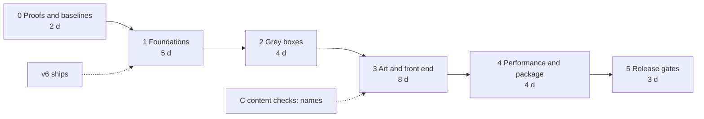

# Three maps, three levels: summary and build plan

Status: design done, nothing built (2026-11-25). The owner asked for "3 maps to start ... the player needs to progress to 3
levels each map is a different newyork setting" and chose the levels and the order of work (DECISIONS.md 2026-11-25
~21:40): the guns-and-fixes release (v6) ships first with one map, and the three-level story is the next release, at the
same bar. The designs are [maps/chinatown.md](maps/chinatown.md), [maps/midtown.md](maps/midtown.md) and
[maps/progression.md](maps/progression.md), each at revision 2 after two independent design reviews. This file is the
summary for the owner (section 1) and the staged build plan with its lanes (sections 2 to 6).

---

## 1. For the owner

### 1.1 The three levels

| | Level 1 · The Block | Level 2 · Canal Street | Level 3 · Midtown |
|---|---|---|---|
| Setting | Jamaica Ave under the elevated train, Hollis, Queens, 4:15 PM, daylight. **Exactly as it is now.** | Chinatown, Canal St and Mott St, 7:40 PM, night, the streets wet after rain, packed with shop signs and neon | The roofs above a bright square at 11:52 PM: water towers, the steel behind giant screens, then the street |
| Feel | Open avenue, one big shop, a lot | Close quarters: a covered market, alleys, a bakery you walk through, an arcade, a banquet hall, a low roof | Vertical: three roof heights, stairs and a scaffold down to the street, a fight across the square |
| What the player does | Takes back Reels 1 to 3 (the Avenue, the Chop Shop, the Cage) and reaches the IPX truck | Takes back Reels 4 to 6 (a bootleg table on Canal, the market's cold room, the dub room where the Vultures copy masters) and reaches the IPX truck at the east end of Canal | Takes back Reels 7 to 9 (a tank house under a water tower, the gantry behind the big LED wall, the booth under the viewing stand), and the IPX truck rolls in on 46th Street |
| Enemies | Goons only (2026-11-28: drones removed by the owner) | The same, one more Goon alive at once; Goons come out of doorways and onto the roof | The same, pursuit +2 on the harder settings; Goons on every roof (2026-11-28: drones removed by the owner, so Goons only on every level) |
| Length | about 5 minutes | about 5 minutes | about 6 to 7 minutes |

The story: the Vultures stole a whole album, nine master reels, and Rule takes them back across one day and night. The
IPX Vault's dispatcher stays the only voice on the radio. Every name on a sign or a screen is invented and, on Canal
Street, in English only (the owner's answer of 2026-11-26); IPX is the only real mark.

### 1.2 How the player progresses

- **A campaign in a fixed order.** Level 1 is always open. Clearing a level's Story on any difficulty opens the next one.
  The debrief then offers **Next: Canal Street** (or **The album** after Level 3), which loads the next map with the
  same crew, guns, attachments and difficulty. Health, ammo and enemies start fresh on each level.
- **A death restarts the current level only.** After two deaths on a level at the harder settings, the death card also
  offers "Run it back on hustler".
- **Ratings.** Each level keeps its best rating (Demo to Diamond). After Level 3 the album card adds the three up into
  an album rating.
- **Hold mode on every map** with its own name and best score: Hold the Block, Hold Canal Street, Hold the Square.
- **The front end** gets a Level screen with three cards (locked, open, cleared, best rating) and a "Continue" button.
- **Progress survives a new session.** Every E3DS session is a fresh machine, so progress is kept three ways: the save
  for the session, the IPX page storing it in the browser automatically (if the site adds a small message handler),
  and an 8-character progress code (like `4FMY-N7W6`) shown on every debrief, typed in on any machine.

### 1.3 The bar

The same as v6: 60 fps held on E3DS (A4000, 8 threads, no Nanite) on every map and across the map loads; story guidance
(objective line, hints, marker, a path on the ground) on every level, in any reel order; clean menus; enemies that bleed
and fall; every gun and attachment working; an independent end-to-end play from the front end through all three levels.
The Block itself does not change: its data, text and recorded replays stay byte for byte.

### 1.4 What we need from you

| # | Decision | Recommendation |
|---|---|---|
| 1 | E3DS Max Session Time | **30 minutes**, so the campaign fits one sitting (a first play is about 19 minutes without deaths). The alternative is 20 minutes, with the progress code carrying Level 3 to a second session. On the Core plan's 300 minutes a month, the worst case is 10 sessions at 30 minutes or 15 at 20 (progression.md 4.6) |
| 2 | Levels 2 and 3 locked until the one before is cleared | **Yes** ("progress to 3 levels") |
| 3 | The story: nine masters, one album, an unnamed buyer premiering it at midnight | **Accept** (no new voice needed) |
| 4 | Night for Canal Street and Midtown | **Night**: neon and screens only read at night, and it frees GPU time for the lights |
| 5 | Will the IPX page store the progress code (a small change on the site) | **Yes**; the code alone works without it |
| 6 | The invented sign and billboard names | Approve the lists in chinatown.md 13.3 and midtown.md 12; each is searched before its art is final |
| 7 | ~~Who reads the Chinese signs~~ | **Answered 2026-11-26: English only**, no Chinese characters anywhere, no reader needed |
| 8 | Hold mode names (Hold Canal Street, Hold the Square) | Accept |
| 9 | The far-off bridge silhouette east of Canal Street | Allowed, unnamed; or generic towers |

### 1.5 When

About **five weeks of calendar time after v6 ships**, or about four if the first two stages start while v6 is still
being checked (they touch only tools, docs and a separate code branch). That is the honest number: the Block's art alone
took about two and a half days in Blender and three more on the build machine, and the new maps have as much art each,
plus engine work the Block never needed (multi-level navigation for the roofs, map loading, the campaign). The build
machine is the bottleneck (one at a time): about **100 hours** of it, about 11,000 credits at today's rate. Two things
outside our control can hold the art back: the name searches.

---

## 2. What the reviews changed (revision 2)

Two reviews (game and New York design; engineering and E3DS) found six must-fix problems. All are resolved in the
designs:

| Must-fix | Resolution | Where |
|---|---|---|
| Canal's roof drops assumed no fall damage; falls hurt above 13 m/s | Every drop is 4.0 m or less (a sidewalk shed under the kitchen-roof gap), every other edge is guarded | chinatown.md 4, 4.4 |
| Midtown's radio lines and guide assumed one reel order | Lines that name no place; the screen dies with its own reel; the guide aims at the nearest unsecured reel over a route graph; an any-order test | midtown.md 6.2, 6.4 |
| Midtown's reel rooms were safe rooms (doors too narrow for Goons, too low for Buzzards; moot since 2026-11-28) | 2.0 m Goon doors everywhere; no Buzzard doorways by design; the booth window a shoot-through slot | midtown.md 2.3, 9.1 |
| Canal's roof was a camp, worst in Hold Canal Street | The roof is its own nav layer with roof Goons, firing cells and an `overlooks` filter; Holdout ships only with it; a roof-hold test | chinatown.md 4.4, 8.6 |
| No proof that a map load streams through Pixel Streaming on Linux | Stage 0, before any loader code, with the MoviePlayer check; it picks hard travel or the persistent-map fallback | progression.md 6.3 |
| Midtown needs multi-layer nav, the longest engine task | Split into step A (layers, spawn reach, firing cells: enough for roof fights) and step B (stair links); step A starts in stage 1 | midtown.md 7.2, 17 |

The should-fix items taken: readability against the oxblood Goons (palettes, a check), a less postcard Canal Street and
a dressed midnight square, one word on the HUD ("reels") and reels 7 to 9, per-level difficulty adds, the truck rolling
in at Midtown's end (no backtrack), "Run it back on hustler", no spawns in the player's room, the night rig measured in a
grey box first, the SM5 triangle baseline first, package size and copy-time gates, scoped shader precompiles, one schema
and one generator for both levels, nav written by the engine not a Python copy, the new levels joining `order` last,
the L_Block dump-and-diff, the sky dome kept off the front-end stage, a test switch for the campaign menus, the debrief
input guard. Not taken in this release: per-level checkpoints (they touch the rules' reset, which the replays pin) and a
reward per level (an open question for the loadout lane, progression.md 11).

---

## 3. Stages

Each stage ends at a gate. Estimates are working days with the lanes running in parallel, by agents, with the box shared
one job at a time. They include one review-and-fix loop per stage; a second loop adds about a third.

| Stage | What | Lanes | Estimate | Depends on | Gate |
|---|---|---|---|---|---|
| **0. Proofs and baselines** | The travel stream proof (box, then one E3DS session); the Block's SM5 triangle and draw-call baseline; the L_Block dump for the builder diff; owner decisions; the name searches started (Canal signs are English only: no reader) | T, R, B, C | 2 days (box 9 h) | nothing; can run while v6 is checked, in a box slot when no one measures frame rates | Travel chosen (hard travel or the persistent-map fallback); baseline numbers recorded; dump committed as a report |
| **1. Foundations, no GPU** | The layout tool and the engine bake; both level files; the loader, `el` optional, text overlay, tuning, audio, boot gate; nav step A; progress code and save; the per-level data tests; the night-rig code; Blender families that need no final names | D, E, N, P, Q, L, A-CT, A-MT | 5 days | stage 0 (the travel choice); C++ on a maps branch cut from the v6 commit | Both level files load and pass checks 1 to 7 (chinatown.md 17) and midtown.md 19's data tests; every Block golden unchanged |
| **2. Grey boxes playable** | L_GreyChinatown and L_GreyMidtown; travel between grey maps with the loading card; the night rig prototype with the lights on posts, measured wet and damp; guidance on both levels in any order; nav step B begun; playtests and tuning | T, L, G, N, Q, R, D | 4 days (box 24 h) | stage 1 | Both levels complete in Story (any order) and Holdout in the grey box; the roof-hold and any-order tests pass; travel timings within progression.md 6.5; the night rigs within budget in the worst views |
| **3. Art and front end** | Blender art for both maps (two lanes); sign and screen atlases once the names are searched; the parameterised builder (L_Block identical); both art maps built on the box with 2 to 3 picture rounds each; the Level and Style screens, cards, Continue, Progress drawer, debrief items, album card, thumbnails; `order` grows to three; nav step B merged if it passes | A-CT, A-MT, B, P, N, E, C | 8 days (box 33 h) | stage 2 (the light count and the budgets); C for the signs | Picture rounds signed off by someone other than the builder; front-end screenshots at 1920 x 1080 and 1280 x 720 for every card state; Block golden replays unchanged |
| **4. Performance and package** | Every map's worst views under the l20 load against the Block in the same run; fixes; flicker at render scale 0.50; texture pool; per-map shader caches recorded; the three-map package with its size and copy-time gates; recorded goldens for the new levels | R, T, B, Q | 4 days (box 27 h) | stage 3 | All budgets of chinatown.md 14 and midtown.md 15 met; package at most +1.0 GB; recorded goldens 0 mismatches |
| **5. Release gates** | An independent end-to-end play (fresh save through all three levels, the album, Hold the Square, then a fresh session with a code); per-map E3DS runs with SMOOTH.md's frame metrics; the owner's preview; the fix loop | X, R, all | 3 days (box 6 h) | stage 4 | The bar of section 1.3, on one commit, nothing waived |
| **Total** | | | **26 working days**, about five calendar weeks; about four if stages 0 and 1 overlap v6's checks | | |

---

## 4. Lanes

Item codes are the ones the designs cite. "Block-safe" means the item changes nothing for the Block: its data has none
of the new sections, so the old code path runs.

### D · Level data, the layout tool and the bake

- **Inputs:** chinatown.md 4 to 10, 15 and Appendix A; midtown.md 2 to 9 and 16; the Block's level.json schema.
- **Outputs:** D1 `tools/levels/build_level.py`, one layout schema for both levels (rectangles, points, layers, links,
  drops, the guide graph, tuning); D2 the engine bake `-run=MILevelBake --level <id>` (nav per layer, generated link
  polylines, cover filter, reach and drop report, all with FMIBoxWorld's own code); D3 `tools/levels/layouts/chinatown.py`
  → `Content/Data/level_chinatown.json`, `props_`, `atmos_`, `audio_chinatown.json`; D4 the same for Midtown; D5
  `mi_greyblock_map.py --level <id>`.
- **Acceptance:** chinatown.md 17 checks 1 to 7 and 13; midtown.md 19 Loads, Nav, Reach, ReelRooms, Edges, Budgets;
  colliders at most 800 (Canal) and 820 (Midtown). Made in stage 1 (tools/levels, its README): both level files with
  the designs' clutter as colliders and every gate of tools/levels/check_level.py passing or waived on record (falls
  counted with the jump's apex, the approved names, explosives off the doorways, the sight-line rules, guidance from
  every layer).
- **Depends on:** E1 (to load), N1 (for the layer bake).

### E · Engine generalisation and the level loader

- **Inputs:** progression.md 8; chinatown.md 16; midtown.md 17.
- **Outputs:** E1 `FMILevelData::ForLevel(Id)` (`Get()` stays the Block); E2 `el` optional; E3 boot gate from levels.json
  `map`/`greyMap`, `?level=`, `?enter=`; E4 times per loaded level; E5 text overlay with fallback; E6 per-level audio;
  E7 per-level tuning (startPitch, rating, difficulty adds; no Buzzard ceiling since 2026-11-28); E8 `excludePlayerRoom`, `overlooks` and
  `enabled` (a spawn point marked `"enabled": false` is not loaded: Canal's roof points until N1; the patch is
  docs/unreal/patches/maps-D/0002, and `check_level.py --release` fails while any point is still off); E9
  the per-level enemy-look rim boost (only if the readability check fails); E10 the extraction arrival (`afterAll`;
  the truck's colliders are not noNav, so the bake keeps its stop spot blocked on the nav from the start, while the box
  world takes them only on arrival);
  E11 the screen director; E12 rooms with no doorway.
- **Acceptance:** every Block golden and run test unchanged (Golden.World, Enemies, EnemyLogic, Blast, FlowRules,
  Directors, PlayerSim, Loadout.DataLoads); Levels.Overlay; Run.<Id>.StoryComplete, StoryDeath, Holdout headless.
- **Depends on:** stage 0's travel choice (the fallback design changes Boot). C++ lands on a maps branch cut from the v6
  commit and merges after v6 ships.

### N · Multi-layer nav (Canal's roof, Midtown's roofs)

- **Inputs:** midtown.md 7.2 and 17.3 to 17.5; chinatown.md 4.4.
- **Outputs:** step A: N1 per-layer grids (a Goon snapped within its own layer); N2 `layer` on spawns and covers, spawn
  reach, the layer-aware fallback; N3 firing cells; N4 the stranded rule. Step B: N5 links walked with MoveCapsule.
- **Acceptance:** Golden.World diff 0 (the Block has one plane layer); Levels.Midtown.NavStepA and NavStepB;
  Levels.Chinatown.RoofHold; the grey-box gate of stage 2.
- **Depends on:** E1, D2. **The riskiest engine work**: step A starts on day one of stage 1. No data-only fallback
  exists for Midtown (midtown.md 7.2); if step A misses its stage-2 gate, the lead decides between a slip and a reduced
  release (Hold Canal Street left out; 2026-11-28: drones removed by the owner, so there is no Buzzard fallback: Midtown's roof fights need nav step A, and if it misses the gate the lead chooses a slip).

### T · Map travel and loading

- **Inputs:** progression.md 6.
- **Outputs:** T0 the stream proof (stage 0); T1 `TravelTo`, PendingTravel, travel-failed handling; T2 preload during
  the debrief; T3 `SMILoadingCard` through MoviePlayer, its hold conditions; T4 per-map shader caches and the scoped
  precompile.
- **Acceptance:** progression.md 6.3 (no black frame, no frozen frame over 1 s, ten travels under l20, then on E3DS);
  6.5 timings (Next to intro at most 6 s preloaded, 10 s worst); no frame over 100 ms in the first 10 s after travel;
  Campaign.Travel.
- **Depends on:** nothing for T0; E3 for T1.

### P · Front end and progression

- **Inputs:** progression.md 2 to 4, 7.2 to 7.5.
- **Outputs:** P1 FMIProgress and the progress code (Appendix A of progression.md is the test oracle); P2 the save
  fields; P3 the Level and Style screens (the split) and `order` grown to three; P4 the card states, Continue; P5 the
  debrief and dead-card items (Next, album, Run it back on hustler, the 0.9 s guard, `bCampaignMenus`); P6 the Progress
  drawer and code entry; P7 the page bridge and the session warnings; P8 the level thumbnails (`mi_level_thumbs.py`).
- **Acceptance:** Campaign.Code, Merge, Unlocks, BlockUnchanged, Debrief, Travel; screenshots of every state at both
  sizes; the parity set-up plays as today.
- **Depends on:** E1 to E5; T1 for Next; stage 3 art for P8. SMIFrontEnd is in the readiness lane's v6 scope, so P3 and
  P4 start after v6 ships.

### L · Lighting and atmosphere

- **Inputs:** chinatown.md 11; midtown.md 11; atmos.json `rigs.night`; build_block.py's day rig.
- **Outputs:** L1 one night-rig builder driven by each level's atmos file (no sun shadow at Canal, two cascades at
  Midtown, no volumetric clouds, a static sky dome hidden while the front-end stage shows); L2 `MPC_Weather` wetness and
  the `damp` fallback, the puddle decal; L3 the grey-box light prototype (lights on posts, placeholder sign quads) and its
  measurement; L4 the final rigs in the art maps.
- **Acceptance:** at most 48 placed lights (Canal) and 26 (Midtown), shadowed ones spots only; the five or six worst views
  within budget under l20 in stage 2; the readability check (chinatown.md 17 check 11) in every worst view.
- **Depends on:** D5 grey maps, E4.

### G · Guidance (with the PLAY.md lane)

- **Inputs:** the PLAY.md lane's ground path, hint and marker (built for the Block); chinatown.md 7; midtown.md 6.4.
- **Outputs:** G1 the Block's guidance fed by each level's data (on the street layer, no new code); G2 the route graph
  for levels with layers, Canal's roof included (nearest unsecured reel, hysteresis, step marks: Canal's graph is the
  yard stair and the kitchen-roof drop, so a player on the roof is drawn a way down); G3 hints keyed by objective id, the
  marker's height; G4 path hysteresis (`guide.pathHysteresis` 0.10): between two routes to the same target the drawn
  one is kept until another is 10 % shorter, so it never flips between near-equal ways out (Canal's leg 4: the
  partition door and the roll-up are 6 % apart; its route-tie check is waived on G4).
- **Acceptance:** Run.<Id>.StoryAnyOrder (the guide always targets an unsecured reel and never flips twice in 5 s); on
  every leg of both levels the drawn path lies on a walking surface; a player who did not build the level reaches every
  reel by the guidance alone.
- **Depends on:** the PLAY.md lane's v6 guidance (read, not edited, by this lane until v6 ships); D3, D4; N for G2.

### A-CT · Blender art, Canal Street

- **Inputs:** chinatown.md 13; the level file's colliders (the art is fitted to them); ART_BIBLE.md.
- **Outputs:** the `chinatown` family (about 60 meshes, generic shopfront modules, market kit, everyday clutter, the
  stair, the shed, the bulkhead), Chinatown facade tables beside the Block's, sign carriers, English-only sign
  atlases (made: one 4096 x 4096 page holds all 45 faces, each sign with its own lettering, final after the owner signs
  names.md), the market and vendor goods atlas (CT_MarketGoods, 2K), the north row's far proxies, placements, the
  manifest. Made in stage 1
  without the box: art/blender/assets/chinatown.py (66 meshes, the atlas, the north-row placements, art/previews/maps/ct_*).
  Round 2 (2026-11-26, offline): W1, W3, S1 to S3, E1a/b, the arcade and the market placed on their faces with lane D's signs
  and props, the real 1.0 m alcoves, eight structures fitted to the colliders (0 unexplained vertices), far proxies for
  every facade building, 195 meshes, 1947 instances, none scaled, every shop front signed; worst view 1.18 M triangles with
  the proxies (ceiling 1.5 M, aim 1.1 M, prop LODs open). Detail, checks and the open list:
  [maps/chinatown_art.md](maps/chinatown_art.md); previews ct_canal_start, ct_canal_east, ct_mott, ct_square, ct_alley, ct_yard.
- **Acceptance:** triangle caps per asset and at most 300k per mesh; manifest bounds; previews; no real mark; facade.py
  and place_buildings.py give the Block's outputs byte for byte (A0 diff).
- **Depends on:** D3 colliders; C for the faces. Estimate: 3 days.

### A-MT · Blender art, Midtown

- **Inputs:** midtown.md 12 and 14.
- **Outputs:** the roof, gantry, scaffold and square families, the city bus, Midtown facade tables, two screen atlases,
  the ticker and digits, the sign atlas, placements. Made in stage 1 without the box: art/blender/assets/midtown.py (39
  meshes: roofs, parapets, water towers, bulkheads, HVAC, roof stairs and bridges, the gantry and the back of G1, C1's frame,
  the LED tile, ticker and tower stack, the scaffold stair kit), the two screen atlases, the ticker, digits, LED mask and the
  English-only sign atlas, the roof, gantry, scaffold and screen placements, art/previews/maps/mt_*; record and open items in
  [maps/midtown_art.md](maps/midtown_art.md). Round 2 (2026-11-26, offline): the square family (24 meshes: THE STAND
  and THE BOOTH as the level data has them, planters, kiosks, carts, cafe furniture, LED poles, barriers, the generator,
  road cases), four new English-only faces, every placement fitted to tools/levels/data/level_midtown.json (159 instances on
  186 colliders; the water towers, bulkhead B and the roof dressing moved onto the data's boxes), the square's emissive cost
  checked at 0.5 % of the screens', previews mt_stand, mt_plaza, mt_booth (midtown_art.md 7). Round 3 (2026-11-27, offline): THE LOFTLARK
  (bar, loungers, deck, umbrellas, planters, the neon), the roof boxes, the city bus, the premiere's trucks, trailers, towers, press
  walls, tents and booths, the plaza's small dressing, the Midtown facade tables and the east podium (the marquee, the hotel canopy), the
  storefront carriers: 96 meshes with LOD1s, 1,677 placements, 16 new faces, checks all pass, previews mt_bar, mt_set, mt_bus, mt_facade,
  mt_street (midtown_art.md 9). Still to make: the parked cars (light variants of the Block's vehicles), the sawhorse's collider, the decals.
- **Acceptance:** as A-CT; members at least 6 cm within 25 m of the path (flicker); netting opaque.
- **Depends on:** D4 colliders; C for the names. Estimate: 3 days.

### B · The box build and the art builder

- **Inputs:** BOX.md; build_block.py; the art tars.
- **Outputs:** A0 the L_Block dump (manifest, placements, a sorted actor list with name, class, mesh, transform and tags)
  taken before any refactor; B1 `build_level.py --level <id>`; B2 L_Chinatown and B3 L_Midtown with explicit Nanite
  fallback settings; B4 2 to 3 picture rounds per map; map art packs with `send-art.sh pack --maps <patterns>` (the
  default pack leaves the chinatown and midtown families and their placements out, so a release's art pack never
  carries them).
- **Acceptance:** `--level block` reproduces the dump exactly; the picture rounds reviewed by someone else; the art's
  collision off (the data decides).
- **Depends on:** A-CT, A-MT, L4. One box at a time (BOX.md discipline).

### Q · Tests and golden replays

- **Inputs:** progression.md 9; chinatown.md 17; midtown.md 19.
- **Outputs:** Q1 per-level data tests; Q2 nav tests per layer; Q3 campaign tests; Q4 run tests per level (story, any
  order, death, holdout, front-end walk); Q5 recorded goldens for the new levels (`-MIGoldenRecord`); Q6 drops, edges,
  roof hold, reel rooms.
- **Acceptance:** the full suite passes in a fresh clone on the release commit, nothing skipped; the Block's goldens
  unchanged on every commit of this work.
- **Depends on:** each lane's items as they land; Q5 only once the level data is final.

### R · Performance gates on E3DS-class limits

- **Inputs:** READY.md and SMOOTH.md methods (read only); the budgets of chinatown.md 14 and midtown.md 15.
- **Outputs:** R0 the Block's SM5 baseline (`stat rhi`, `stat scenerendering`, `stat initviews` in its six views,
  coordinated with the READY and SMOOTH lanes because explicit fallbacks on shared meshes change the Block too); R1 the
  grey-box night numbers; R2 every worst view under l20 at 1920 x 1080 against the Block in the same run; R3 E3DS runs
  per map; R4 package size and copy time; R5 travel timings.
- **Acceptance:** GPU at most the Block + 0.5 ms (Canal) and 12.0 ms (Midtown) in a fight; render thread measured with
  8 threads; texture want within the pool; flicker within the READY.md limits at render scale 0.50; package at most
  +1.0 GB and a copy under 4 minutes; per-minute frames over 25 ms and 100 ms no worse than the Block's.
- **Depends on:** a quiet box (never measure while another game shares the GPU).

### C · Content checks

- **Outputs:** C1 every invented name searched against real New York businesses, brands and trade
  dress, replaced where real; C2 dropped (2026-11-26: English only, nothing to sign off); C3 a look-alike
  review of every billboard and storefront; the new real place names added to ART_BIBLE 5.7's list by the lead.
- **Acceptance:** a signed table per map. **External**: these can block the sign art regardless of the build.

### X · End-to-end play

- **Outputs:** an independent play from a fresh save: Block Story → Next → Canal Story → Next → Midtown Story (once in
  the intended order, once out of order) → album → Level select → Hold the Square; then a fresh session with a progress
  code → Continue; deaths bleed and fall, guns switch, attachments show, guidance on every leg; the same through the
  E3DS page with SMOOTH.md's frame metrics.
- **Acceptance:** no blocker or must-fix left.

---

## 5. Rules for every lane

- **The Block does not change.** level.json, text.json, props.json, atmos.json, the rules and every golden replay stay
  byte for byte. New behaviour is reached only through sections the Block's data does not have.
- **v6 first.** Until v6 ships, only docs and tools land on the shared branch; engine and content changes for the maps
  go on a maps branch cut from the v6 commit. The new levels join levels.json `order` only with the split screens and
  travel (stage 3).
- Leave the other lanes' files alone (READY.md, SMOOTH.md, PLAY.md, HANDS_R4.md) and src/ (the reference).
- Invented names only on signs and billboards; IPX is the only real mark; no real people but the star, no real songs.
- Box discipline (BOX.md): one box, every editor call short, long jobs detached and polled, no frame measurements while
  another game shares the GPU.
- Commits: small, explicit paths, no model names, personal names, emails, download links or storage addresses.

---

## 6. Risks

| Risk | Effect | Mitigation |
|---|---|---|
| The stream freezes or goes black during a map load | No map travel as designed | Stage 0 proof; the persistent-map fallback (progression.md 6.6) chosen before any loader code |
| Nav step A is late or misbehaves | Midtown has no roof Goons; Canal's roof is a camp | Starts day one of stage 1, with its own tests; if it misses the stage-2 gate, the lead chooses between a slip and a reduced release (Hold Canal Street left out; no Buzzard fallback since 2026-11-28: Midtown's roof fights need step A, and if it misses, the lead chooses a slip) |
| Night rigs and wet ground over budget on SM5 | Frame rate below 60 on E3DS | Measured in the grey box in stage 2; spots-only shadows; the `damp` step; fewer lights |
| Nanite fallback meshes (vehicles, the road) too heavy | Triangle and draw-call budgets missed on every map, the Block included | R0 baseline in stage 0; explicit fallback settings, coordinated with the READY and SMOOTH lanes |
| Package and copy time grow | Slower session starts; fewer versions fit in 10 GB | Size ceilings per map, a copy-time gate, shared tiling sets and atlased signs |
| Name searches late | Sign art cannot be final | Started in stage 0; the sign atlases are the last art step |
| Shader precompiles on a fresh machine every session | Stalls during play | Scoped per map, behind the title, debrief and loading card; measured with SMOOTH.md's metrics |
| The box is the bottleneck | Stages 3 and 4 take longer | Plan about 100 box hours; batch imports; one picture round less if the first is clean |

---

## Fast build 2026-11-28 (engine, campaign and front end lane)

What the lane built, in the order the owner's goal needs it: play Canal Street and Midtown from their data and go from
the Block to Canal Street to Midtown.

- **Loader.** `FMILevelData::ForLevel(id)` reads `Content/Data/level_<id>.json` (copied from `tools/levels/data`), one
  cached object per id; `Get()` is still the Block's `level.json` and `ForLevel("block")` returns that same object.
  `Current()` is the level the running game plays (set by the game mode's `InitGame` from `?level=<id>` or from the map,
  before any actor begins). A missing `el` is a deck far outside the bounds (`bHasDeck` false); `interior.doorways` is
  optional; spawn points carry `layer`, `enabled` and `overlooks` (a disabled point is never chosen; a point with
  `overlooks` is a candidate only while the player stands in one of those zones); `tuning.spawn.excludePlayerRoom` drops
  the points in the interior room the player is in; `tuning.difficulty.maxAliveAdd` / `pursuitBudgetAdd` and
  `tuning.rating.time` are merged over the flow tune in `Boot` for that level only; the `nav` object is kept as the
  contract gives it (`NavJson`, `NavLayerIds`) for the nav lane.
- **Per-level text, audio, guide.** `text_<id>.json` (the level's `frontend.story.<id>` overlay of progression.md 7.2,
  `{name}` written as Rule) is merged over text.json by `FMIText::Load(..., id)`; `audio_<id>.json` replaces the audio
  zones; `guide.json` has `levels.chinatown` and `levels.midtown` hint lines; `story.json` holds the loading card text.
- **Extraction arrival.** Midtown's truck is hidden and its two colliders stay out of the box world until every reel is
  secured (`FMILevelData::TruckColliders`, `FMIBoxWorld::RemoveIds`); Canal's is there from the start. No refusal line
  is said at a truck that has not arrived. The 5 s roll-in is not built: the truck appears with its doors opening.
- **Travel.** Hard travel (`UMIGameSubsystem::TravelTo`): the set-up lives in the game instance and the save slot, a
  full-screen loading card (`UI/MILoadingCard`) is a viewport widget so it stays on the stream while the old world goes
  and the new one loads, then `OpenLevel(<map>?level=<id>?block=1?travelled)`. The map is levels.json `map` when its
  package exists, else `/Game/Maps/L_GreyBlock` with the level's boxes drawn at run time (the art maps of the other
  lane drop in by name: `L_Chinatown`, `L_Midtown`). The game mode boots any map named in levels.json, applies the
  carried set-up, starts the run and takes the card away. For tests and shots: open any grey map with `?block=1?level=chinatown?autostart`.
- **Campaign.** `Flow/MIProgress` (`FMIProgress`): cleared, clears, best rating (points, difficulty), Hold best, the album
  flag, `Merge`, `IsOpen`, `FurthestOpen`, `NextAfter`, the 8-character code of progression.md Appendix A (checked
  against the Python oracle, examples and all). Stored in `UMIRunSetupSubsystem` (game instance), written to the save
  slot as `UMISaveGame::Progress` (a new field: old saves load with nothing cleared and the Block open); a remembered
  level that is not open falls back to the furthest open one. A Story complete is recorded when the debrief card shows
  (game only: `FMIBootOptions::bCampaign`, which tests and replays leave false, so no golden event changes). Hold bests of
  Canal and Midtown are kept in the progress; the Block's stays in `Best`.
- **Front end.** The existing Block & Style screen lists the three levels (levels.json `order`): a card that is locked
  reads "Locked · Finish <level> to open" and cannot be chosen, an open one reads "Not cleared yet", a cleared one
  "Cleared · <rating> · <difficulty>". The progress code is shown under the cards with a box to type a code. The debrief
  of a cleared level has `Next: <level>` as its first item and the progress code as a stat line. `-MIUnlockAll` opens
  every level on a desktop. Hold is offered where the level has ground spawns (no air spawns are needed: the drones are out).
- **Checked live (editor, PIE, 1920x1080).** Level cards locked, then open after typing a Block-cleared code; travel from the Block to Canal Street (loading card, run starts); Canal complete shows the debrief with the progress code, `Next: Midtown`, Run it back, Change set-up, Back to title; Next travels to Midtown and the run starts there. Two faults found and fixed in that pass: a travelled world had no front end (so its debrief lacked Next and Change set-up), and the HUD could read the text deck a frame before it was loaded (crash on travel). Known leftover: the debrief still lists the \"Vultures dropped\" row (drones are out).
- **Not built here:** the art maps, lighting rigs and thumbnails (the cards show text only), the page bridge's game half
  (`docs/unreal/patches/maps-progress-bridge`), per-level shader caches, the truck's roll-in, the Hold-mode album card.

## Fast build 2026-11-28 (nav lane, step A)

Multi-layer nav, step A only (no stair links: Goons stay on their own layer). Code: `World/MINavLayers.*` (the `nav`
object: layers, spawn reach, `firingCellRange`, `strandedAfter`), `World/MIBoxWorld.*`, `Enemies/MIEnemies.*`,
`Flow/MIGameRules.cpp`; `FMILevelData::FillWorld` hands the level's `nav` to the box world. A level without
`nav.layers` (the Block) has one plane layer and every call takes the old path: Golden.World, Golden.Enemies and
Golden.Directors are untouched.

- **N1 grids.** One grid per layer, built when the world's nav is built (the engine does it at run time; the bake step
  writes nothing for this, the grids are cheap). Layer 0 is today's plane rule. A `boxes` layer cell is walkable when
  a collider top lies within 0.45 m of the layer's y at the cell centre, the cell is inside the layer's rect, and no
  nav-blocking collider spans [y + 0.47, y + 1.5] within 0.5 m. `FindPath`, `IsWalkable`, `ClearLine`, `RandomPoint`,
  `NearestWalkable`, `NavBlocked` take a layer (default 0). `LayerForY` (a spawn or cover point) and `LayerAt` (a body: the
  highest layer with y <= feet + 0.5 and a walkable cell under it). A Goon is snapped to and paths within his layer.
- **N2 reach.** `ChoosePosition` only uses a ground spawn whose layer is in `spawnReach` of the player's layer; on a roof
  with nothing allowed it takes the nearest authored ground point instead of the 26 m ring. The layer of a spawn or
  cover point is read from its y (the files carry the same layer id).
- **N3 firing cells.** A Goon whose target is on another layer adds firing cells to his candidates: his own cell, a 1 m
  grid (+-12 m) around the own-layer cell nearest the target, and random cells over the disc around the target; a cell
  counts when it is within `firingCellRange` of the Goon and sight range of the target, the Goon can walk to it, and a
  ray from the gun reaches the target's eye. The existing cost function chooses (travel, crowding, bearing). With the
  target on another layer and no cell, he holds where he stands and fires when he sees the player: he never walks
  toward the player's x and z (a roof Goon would walk off the parapet, a street Goon under a building). Investigating
  a point on another layer uses the same cells as his stand.
- **N4 stranded.** Each second a Goon who cannot see the player asks whether he has a way to fight (a firing cell, or the
  player's own cell in his region); after `strandedAfter` seconds without one and without sight he is returned to the
  pool: no kill, no score, no event; the flow queues one new Goon for each (`TakeRecycled`).
- **Honest edges.** A roof Goon cannot see a street player closer than about 12 m to the building (the parapet hides him), so
  Midtown's r2 and r3 Goons get no cell over a street player (they are out of spawn reach then, and are returned when
  they are already there). The tests use a player placed where the cells exist (`SpotSeenFrom`). Link walking (step B)
  is not built: nobody changes layer.
- **Tests (headless, the maps' level files from tools/levels/data, a standing player, 30 Hz).**
  `MurderInc.Levels.Midtown.NavStepA`: roof grids, every enabled spawn on its layer's grid, the spawn reach table, a
  Goon on r1, r2 and r3 stays on his layer's floor, walks to a cell and keeps firing at a player one layer below
  (>= 30 rounds in 45 s, never recycled), a street Goon with the player on r1 stays on the plane and on free street
  cells, a Goon with no cell is returned after about 10 s, once. `MurderInc.Levels.Chinatown.RoofHold`: three roof
  Goons and street Goons fight a player on the roof edge and a player in the street: both sides fire, nobody is
  recycled, nobody leaves his layer. `MurderInc.Levels.Block.OneLayer`: the Block has no layers.

## Fast build 2026-11-28 (Canal Street map, lane C)

L_Chinatown, built by `Content/Python/build_canal.py` (the Block's `build_block.py` pointed at the Canal art; it imports
`build_block` and reuses its importers, master materials and instanced-mesh helpers). Run it in the editor with
`import build_canal; build_canal.start("all")` (steps: textures, materials, meshes, paints, signs, wet, canal); status in
`Saved/BuildBlock/status.txt`. A rerun of `signs,wet,canal` rebuilds the map from the data in 3 to 15 s; the whole build
from empty content took 455 s on the box. The generated map and assets are not committed (Block convention).

- **Art in.** Blender's outputs are not built on the box: a pack of the chinatown family and what its placements use (370
  GLBs without the LOD and far-proxy meshes, 77 texture sets, the manifest, `placements_chinatown.json`, the sign files),
  660 MB in 3 tars, goes through the storage to a lane folder (`MI_ART_IN`), never the shared art folder. LODs and far
  proxies are not imported: every mesh is Nanite.
- **Map.** Ground slabs (asphalt, concrete) from `ground.surfaces`; the level's movement-blocking colliders of kind level
  (and the five props with no mesh) as 3 cm inset matte masses behind the art, no collision of their own (the game builds
  collision from `level_chinatown.json` at run time, as in the Block); the 2,264 placements as instanced meshes, one
  holder per building (paint colours per vehicle as clear-coat instances, no instance scaled); 71 sign faces: a new master
  `M_CT_Sign` reads the atlas (BC, ORM, E) through a per-face cell `Cell = (u1-u0, v1-v0, u0, 1-v1)`, one instance per
  cell; a board with no text of its own is dark steel (the stand-in slot is rebuilt dark, only Canal's use of it).
- **Night rig.** One cool movable directional light (0.15 lux, no shadow, no sky atmosphere, no clouds), a sky light
  captured once, exponential height fog from the night opacity table (0.26 at 92 m), no volumetric fog, histogram
  exposure EV100 5.0 to 7.5, bloom 0.35. 48 placed lights, 9 of them shadowed, all spots: 9 LED lamps (4 on Canal and
  Mott shadowed), 13 sign washes in the sign colours, market (4 rects, 2 shadowed bulb spots), bakery, arcade, workshop,
  alley bulkheads, kitchen roof, the square's pavilion spot (shadowed), banquet and stage, dub room. Cull distances 35 m
  (25 m shadowed).
- **Seen** (6 views at 1920 x 1080 from the player's height, `/project/ue/maps/shots` on the box): start, Canal east to
  the truck's stop, Mott south, the market inside, Lantern Alley, the market roof looking at the rooftop letters.
- **Performance** (profile of one frame, `ProfileGPU`, headless editor at 1920 x 1080, RTX PRO 6000 shared with other
  jobs, Vulkan SM6, not -sm5, not the A4000): the start view looking east is 12.7 ms GPU against 25.1 ms for the Block's
  start view on the same editor; draws 2,352 against 2,399; 8 of the 12.7 ms are post processing (the editor's
  bloom and TSR at this size), the scene's geometry and lighting about 4 ms. Not measured: -sm5, the A4000, a quiet GPU,
  the worst view of chinatown.md 14 with Nanite triangle counts.
- **Known faults.** The market floor reads icy (wet tile blend lit blue); some lightbox bands are plain grey where the
  data gave no text; wet street copies (`MI_CT_*_Wet`) show no change (the set's alpha carries no wet mask), the street
  is dark and damp only by its material; the Block's cube-map interiors are not baked for Canal, so shop windows are
  dark glass with the Block's room cubes where they exist; no decal actors for the street dressing, no steam, no LED
  animation (emissive only).

## Fast build 2026-11-28 (integration, one tree)

One clone, one tree: the pushed branch head (engine and nav lanes together) plus the changes below, built and run on the
GPU box. Nothing here touches the Block: its `level.json`, `text.json`, `props.json`, `atmos.json` and `rules.json`
show no diff against v6, and `Campaign.BlockUnchanged` passes.

- **Build note.** A clone made by copying another clone's folder keeps the other clone's absolute paths in
  `Intermediate/`, and the build then compiles and links the *other* clone. It looked like a good build and was not (the
  first test pass ran the old library). The cure is `build.sh clean` once in the new folder; a build that really took
  the changes shows a new library file date and, here, one more test.
- **Debrief rows.** With `flow.drones` false (the shipped data) the cards leave out the "Vultures dropped" row, in the
  debrief and in the two Lights-out layouts. `FMIRunCard::bDrones` carries the flag; `text.json` is untouched, so the
  row returns when drones are switched on by data.
- **Truck roll-in (Midtown, `arrival: afterAll`).** When the last reel is in, the truck is shown 30 m back along its
  heading and rolls in over 5 s (eased); its doors open and its colliders join the box world when it has stopped, not
  before. Levels whose truck is there from the start are unchanged.
- **Progress bridge, game half.** `docs/unreal/patches/maps-progress-bridge` applied (the three patches; the first
  needed its include line merged by hand). `UMIGameSubsystem::BindProgressBridge` connects it: a page message is checked,
  decoded, merged into the campaign progress (maximum of every field; the Block's Hold best stays in the settings) and
  saved; the provider answers with the code and the three Hold bests; a send follows every debrief and every new Hold
  best. `MurderInc.Cloud.ProgressBridge` runs in the suite. Not run: the stream (`SendPlayerMessage` is written from the
  documented interface and compiled, not exercised) and the E3DS relay.
- **Dev commands** (not in Shipping): `MICampaign reels` (every reel taken, the player stays), `MICampaign truck` (14 m
  from the truck, facing it), `MICampaign at X Y Z` (web metres, facing the truck), `MICampaign goons` (every live enemy:
  layer, position, mode, sees). Scripts: `tools/box/merged-shots.sh` and `tools/box/roof-shots.sh` (PIE, detached).
- **What was run.** Full suite `tools/box/test.sh MurderInc` on the final tree: 241 passed, 0 failed, 0 skipped (240 before the bridge test). PIE on the
  grey-box maps, typed code, travel Block-set-up to Canal, `MICampaign finish`, Next to Midtown, `finish` again, with the
  pictures read: both debriefs (no Vultures row; Canal has Next: Midtown), a fight on each level, the truck rolling in.
  Midtown's Goons were seen on layers 2 and 3 (r2 and r3 roofs) from the loader's own nav layers; with the player on r1
  they stayed on r2 and did not walk off. Canal's street Goons all stayed on layer 0.
- **Seen and not liked.** With the player parked in the middle of Canal's roof (-12, 5.7, 0) in a mission run, the three
  street Goons went from 3 alive to 0 within 30 s: they have no way to fight, so the stranded rule returns them to the
  pool, and a mission run has no refill. A player who hides in the middle of the roof is left alone. That is the rule
  as written (N4), not a fault of the merge; it wants a decision (refill in mission mode, or a smaller stranded window
  on Canal).
- **Not done.** Art maps (`L_Chinatown`, `L_Midtown`) were not on this box, so the boot never drew an art map and a grey
  map together. Night lighting, the Hold-mode album card, packaged or E3DS travel, frame rate and hitching on travel.

## Fast build 2026-11-28 (Midtown map, lane M)

`L_Midtown` is built, in about two hours of box time, by `unreal/MurderInc/Content/Python/build_midtown.py` (it reuses
`build_block.py`'s importers and masters; nothing of the Block's data, code or content changes). Run it in the editor:
`import build_midtown; build_midtown.start("all")` (steps `textures,materials,meshes,level`; the level step alone takes
about 8 s). Inputs: the Midtown archive of art/out (`maps-midtown.tar`, unpacked) plus the scan sets it names that the
Block did not have, in one art-in folder (`MI_ART_MT`, default `/project/ue/art-in-mt`: `glb/`, `textures/`,
`manifest.json` cut to the 172 Midtown assets, the manifest's emissive colour lists written as hex), the level data
`tools/levels/data/level_midtown.json` and `art/out/placements/placements_midtown.json`.

- **Imported:** 138 meshes (the `_LOD1` ones are skipped, Nanite is on for all), 40 textures, about 400 material
  instances. New masters: `M_MT_Screen` (an atlas rect per face: one instance per screen, per tile on the tiled ones,
  emissive only, no animation), `M_MT_Window` (night panes: a quarter lit, tungsten to TV blue, from the world
  position), `M_MT_Backdrop` (the far towers). Night values of the lit slots are `MI_MT_*` flat instances applied by
  slot name on the meshes, so the Block's and Canal's shared instances are not touched.
- **The map:** 15 ground slabs, one collider box per level collider (610): hidden full-size collision under every
  collider the art draws (the fitted ones and the stairs, parapets, scaffold, gantry, wall and billboards), a grey box
  for the rest (the cars the art does not cover, the explosives, the planters, the service stair); the five roofs'
  masses are drawn 32 cm inside their collision so the facade bays (which reach 30 cm in) show their windows. 1,677
  placements as instanced static meshes (one actor per mesh) and 268 screen faces as actors; 68 dark far towers on three
  rings; the player start from the level data.
- **The art fix:** the screens E1, E2a, E2b and S1 sat 3 m and 0.4 m behind the round-3 facade modules and could not be
  seen: moved 3.45 m and 0.55 m toward the plaza in the builder (`SCREEN_SHIFT`; the placements file is not changed).
  Every slot on the canvas scan came out lime under the lamps (the scan is blue and the manifest tints assume white):
  scaffold netting, scrim, tents, umbrellas and cushions are flat cloth colours now.
- **Night rig:** one moon (a faint cool directional, two cascades, shadows), a dim sky light, haze, a fixed exposure
  (EV100 3.0), and 26 placed lights: 6 street lamps and the plaza poles as spots with shadows, 2 roof work lights, 8
  door glows, 6 rect lights in front of the screens. No stat beyond that.
- **Pictures looked at (1920x1080, editor viewport, Lumen):** the six views V1 roof start, V2 gantry side, V3 gantry,
  V4 scaffold, V5 the booth's window, V6 the street, plus the screens from the plaza, the Stand, the booth inside and a
  facade close-up, five rounds; the last round is clean of the lime, the white-out screens and the missing windows.
- **Cost (V1, the worst view by the art lane's count):** `ProfileGPU` in the SM6 editor at 1920x1080: 4.85 ms graphics
  (2,363 draws) plus 1.32 ms async compute on the RTX PRO 6000. This is not the `-sm5` game and not a stream.
- **Not done / unproven:** the truck's arrival on W 46 St is the engine lane's (the map has no truck); the reel
  rooms are the art's rooms with the reels spawned by the game from the data; nothing of the map was played, no Goon
  walked it, no test suite was run on it; per-face atlas cells of the sign faces are the meshes' default cells (the
  name plates and the billboard show their default face); no Higgsfield props were needed; no `-sm5` frame time.
