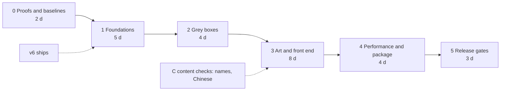

# Three maps, three levels: summary and build plan

Status: design done, nothing built (2026-11-25). The owner asked for "3 maps to start ... the player needs to progress to 3
levels each map is a different newyork setting" and chose the levels and the order of work (DECISIONS.md 2026-11-25
~21:40): the guns-and-fixes release (v6) ships first with one map, and the three-level story is the next release, at the
same bar. The designs are [maps/chinatown.md](maps/chinatown.md), [maps/midtown.md](maps/midtown.md) and
[maps/progression.md](maps/progression.md), each at revision 2 after two independent design reviews. This file is the
summary for the owner (section 1) and the staged build plan with its lanes (sections 2 to 6).

---

## 1. For the owner

### 1.1 The three levels

| | Level 1 · The Block | Level 2 · Canal Street | Level 3 · Midtown |
|---|---|---|---|
| Setting | Jamaica Ave under the elevated train, Hollis, Queens, 4:15 PM, daylight. **Exactly as it is now.** | Chinatown, Canal St and Mott St, 7:40 PM, night, the streets wet after rain, packed with shop signs and neon | The roofs above a bright square at 11:52 PM: water towers, the steel behind giant screens, then the street |
| Feel | Open avenue, one big shop, a lot | Close quarters: a covered market, alleys, a bakery you walk through, an arcade, a banquet hall, a low roof | Vertical: three roof heights, stairs and a scaffold down to the street, a fight across the square |
| What the player does | Takes back Reels 1 to 3 (the Avenue, the Chop Shop, the Cage) and reaches the IPX truck | Takes back Reels 4 to 6 (a bootleg table on Canal, the market's cold room, the dub room where the Vultures copy masters) and reaches the IPX truck at the east end of Canal | Takes back Reels 7 to 9 (a tank house under a water tower, the gantry behind the big LED wall, the booth under the viewing stand), and the IPX truck rolls in on 46th Street |
| Enemies | Goons and Buzzards | The same, one more Goon alive at once; Goons come out of doorways and onto the roof | The same, one more Buzzard per wave on the harder settings; Goons on every roof |
| Length | about 5 minutes | about 5 minutes | about 6 to 7 minutes |

The story: the Vultures stole a whole album, nine master reels, and Rule takes them back across one day and night. The
IPX Vault's dispatcher stays the only voice on the radio. Every name on a sign or a screen is invented (English and
Chinese); IPX is the only real mark.

### 1.2 How the player progresses

- **A campaign in a fixed order.** Level 1 is always open. Clearing a level's Story on any difficulty opens the next one.
  The debrief then offers **Next: Canal Street** (or **The album** after Level 3), which loads the next map with the
  same crew, guns, attachments and difficulty. Health, ammo and enemies start fresh on each level.
- **A death restarts the current level only.** After two deaths on a level at the harder settings, the death card also
  offers "Run it back on hustler".
- **Ratings.** Each level keeps its best rating (Demo to Diamond). After Level 3 the album card adds the three up into
  an album rating.
- **Hold mode on every map** with its own name and best score: Hold the Block, Hold Canal Street, Hold the Square.
- **The front end** gets a Level screen with three cards (locked, open, cleared, best rating) and a "Continue" button.
- **Progress survives a new session.** Every E3DS session is a fresh machine, so progress is kept three ways: the save
  for the session, the IPX page storing it in the browser automatically (if the site adds a small message handler),
  and an 8-character progress code (like `4FMY-N7W6`) shown on every debrief, typed in on any machine.

### 1.3 The bar

The same as v6: 60 fps held on E3DS (A4000, 8 threads, no Nanite) on every map and across the map loads; story guidance
(objective line, hints, marker, a path on the ground) on every level, in any reel order; clean menus; enemies that bleed
and fall; every gun and attachment working; an independent end-to-end play from the front end through all three levels.
The Block itself does not change: its data, text and recorded replays stay byte for byte.

### 1.4 What we need from you

| # | Decision | Recommendation |
|---|---|---|
| 1 | E3DS Max Session Time | **30 minutes**, so the campaign fits one sitting (a first play is about 19 minutes without deaths). The alternative is 20 minutes, with the progress code carrying Level 3 to a second session. On the Core plan's 300 minutes a month, the worst case is 10 sessions at 30 minutes or 15 at 20 (progression.md 4.6) |
| 2 | Levels 2 and 3 locked until the one before is cleared | **Yes** ("progress to 3 levels") |
| 3 | The story: nine masters, one album, an unnamed buyer premiering it at midnight | **Accept** (no new voice needed) |
| 4 | Night for Canal Street and Midtown | **Night**: neon and screens only read at night, and it frees GPU time for the lights |
| 5 | Will the IPX page store the progress code (a small change on the site) | **Yes**; the code alone works without it |
| 6 | The invented sign and billboard names | Approve the lists in chinatown.md 13.3 and midtown.md 12; each is searched before its art is final |
| 7 | Who reads the Chinese signs | Someone fluent in Traditional Chinese must sign them off; nothing Chinese is final until then |
| 8 | Hold mode names (Hold Canal Street, Hold the Square) | Accept |
| 9 | The far-off bridge silhouette east of Canal Street | Allowed, unnamed; or generic towers |

### 1.5 When

About **five weeks of calendar time after v6 ships**, or about four if the first two stages start while v6 is still
being checked (they touch only tools, docs and a separate code branch). That is the honest number: the Block's art alone
took about two and a half days in Blender and three more on the build machine, and the new maps have as much art each,
plus engine work the Block never needed (multi-level navigation for the roofs, map loading, the campaign). The build
machine is the bottleneck (one at a time): about **100 hours** of it, about 11,000 credits at today's rate. Two things
outside our control can hold the art back: the Chinese reader's sign-off and the name searches.

---

## 2. What the reviews changed (revision 2)

Two reviews (game and New York design; engineering and E3DS) found six must-fix problems. All are resolved in the
designs:

| Must-fix | Resolution | Where |
|---|---|---|
| Canal's roof drops assumed no fall damage; falls hurt above 13 m/s | Every drop is 4.0 m or less (a sidewalk shed under the kitchen-roof gap), every other edge is guarded | chinatown.md 4, 4.4 |
| Midtown's radio lines and guide assumed one reel order | Lines that name no place; the screen dies with its own reel; the guide aims at the nearest unsecured reel over a route graph; an any-order test | midtown.md 6.2, 6.4 |
| Midtown's reel rooms were safe rooms (doors too narrow for Goons, too low for Buzzards) | 2.0 m Goon doors everywhere; no Buzzard doorways by design; the booth window a shoot-through slot | midtown.md 2.3, 9.1 |
| Canal's roof was a camp, worst in Hold Canal Street | The roof is its own nav layer with roof Goons, firing cells and an `overlooks` filter; Holdout ships only with it; a roof-hold test | chinatown.md 4.4, 8.6 |
| No proof that a map load streams through Pixel Streaming on Linux | Stage 0, before any loader code, with the MoviePlayer check; it picks hard travel or the persistent-map fallback | progression.md 6.3 |
| Midtown needs multi-layer nav, the longest engine task | Split into step A (layers, spawn reach, firing cells: enough for roof fights) and step B (stair links); step A starts in stage 1 | midtown.md 7.2, 17 |

The should-fix items taken: readability against the oxblood Goons (palettes, a check), a less postcard Canal Street and
a dressed midnight square, one word on the HUD ("reels") and reels 7 to 9, per-level difficulty adds, the truck rolling
in at Midtown's end (no backtrack), "Run it back on hustler", no spawns in the player's room, the night rig measured in a
grey box first, the SM5 triangle baseline first, package size and copy-time gates, scoped shader precompiles, one schema
and one generator for both levels, nav written by the engine not a Python copy, the new levels joining `order` last,
the L_Block dump-and-diff, the sky dome kept off the front-end stage, a test switch for the campaign menus, the debrief
input guard. Not taken in this release: per-level checkpoints (they touch the rules' reset, which the replays pin) and a
reward per level (an open question for the loadout lane, progression.md 11).

---

## 3. Stages

Each stage ends at a gate. Estimates are working days with the lanes running in parallel, by agents, with the box shared
one job at a time. They include one review-and-fix loop per stage; a second loop adds about a third.

| Stage | What | Lanes | Estimate | Depends on | Gate |
|---|---|---|---|---|---|
| **0. Proofs and baselines** | The travel stream proof (box, then one E3DS session); the Block's SM5 triangle and draw-call baseline; the L_Block dump for the builder diff; owner decisions; the name searches and the Chinese reader started | T, R, B, C | 2 days (box 9 h) | nothing; can run while v6 is checked, in a box slot when no one measures frame rates | Travel chosen (hard travel or the persistent-map fallback); baseline numbers recorded; dump committed as a report |
| **1. Foundations, no GPU** | The layout tool and the engine bake; both level files; the loader, `el` optional, text overlay, tuning, audio, boot gate; nav step A; progress code and save; the per-level data tests; the night-rig code; Blender families that need no final names | D, E, N, P, Q, L, A-CT, A-MT | 5 days | stage 0 (the travel choice); C++ on a maps branch cut from the v6 commit | Both level files load and pass checks 1 to 7 (chinatown.md 17) and midtown.md 19's data tests; every Block golden unchanged |
| **2. Grey boxes playable** | L_GreyChinatown and L_GreyMidtown; travel between grey maps with the loading card; the night rig prototype with the lights on posts, measured wet and damp; guidance on both levels in any order; nav step B begun; playtests and tuning | T, L, G, N, Q, R, D | 4 days (box 24 h) | stage 1 | Both levels complete in Story (any order) and Holdout in the grey box; the roof-hold and any-order tests pass; travel timings within progression.md 6.5; the night rigs within budget in the worst views |
| **3. Art and front end** | Blender art for both maps (two lanes); sign and screen atlases once names and Chinese are signed; the parameterised builder (L_Block identical); both art maps built on the box with 2 to 3 picture rounds each; the Level and Style screens, cards, Continue, Progress drawer, debrief items, album card, thumbnails; `order` grows to three; nav step B merged if it passes | A-CT, A-MT, B, P, N, E, C | 8 days (box 33 h) | stage 2 (the light count and the budgets); C for the signs | Picture rounds signed off by someone other than the builder; front-end screenshots at 1920 x 1080 and 1280 x 720 for every card state; Block golden replays unchanged |
| **4. Performance and package** | Every map's worst views under the l20 load against the Block in the same run; fixes; flicker at render scale 0.50; texture pool; per-map shader caches recorded; the three-map package with its size and copy-time gates; recorded goldens for the new levels | R, T, B, Q | 4 days (box 27 h) | stage 3 | All budgets of chinatown.md 14 and midtown.md 15 met; package at most +1.0 GB; recorded goldens 0 mismatches |
| **5. Release gates** | An independent end-to-end play (fresh save through all three levels, the album, Hold the Square, then a fresh session with a code); per-map E3DS runs with SMOOTH.md's frame metrics; the owner's preview; the fix loop | X, R, all | 3 days (box 6 h) | stage 4 | The bar of section 1.3, on one commit, nothing waived |
| **Total** | | | **26 working days**, about five calendar weeks; about four if stages 0 and 1 overlap v6's checks | | |

---

## 4. Lanes

Item codes are the ones the designs cite. "Block-safe" means the item changes nothing for the Block: its data has none
of the new sections, so the old code path runs.

### D · Level data, the layout tool and the bake

- **Inputs:** chinatown.md 4 to 10, 15 and Appendix A; midtown.md 2 to 9 and 16; the Block's level.json schema.
- **Outputs:** D1 `tools/levels/build_level.py`, one layout schema for both levels (rectangles, points, layers, links,
  drops, the guide graph, tuning); D2 the engine bake `-run=MILevelBake --level <id>` (nav per layer, generated link
  polylines, cover filter, reach and drop report, all with FMIBoxWorld's own code); D3 `tools/levels/layouts/chinatown.py`
  → `Content/Data/level_chinatown.json`, `props_`, `atmos_`, `audio_chinatown.json`; D4 the same for Midtown; D5
  `mi_greyblock_map.py --level <id>`.
- **Acceptance:** chinatown.md 17 checks 1 to 7 and 13; midtown.md 19 Loads, Nav, Reach, ReelRooms, Edges, Budgets;
  colliders at most 800 (Canal) and 820 (Midtown).
- **Depends on:** E1 (to load), N1 (for the layer bake).

### E · Engine generalisation and the level loader

- **Inputs:** progression.md 8; chinatown.md 16; midtown.md 17.
- **Outputs:** E1 `FMILevelData::ForLevel(Id)` (`Get()` stays the Block); E2 `el` optional; E3 boot gate from levels.json
  `map`/`greyMap`, `?level=`, `?enter=`; E4 times per loaded level; E5 text overlay with fallback; E6 per-level audio;
  E7 per-level tuning (startPitch, rating, Buzzard ceiling, difficulty adds); E8 `excludePlayerRoom` and `overlooks`; E9
  the per-level enemy-look rim boost (only if the readability check fails); E10 the extraction arrival (`afterAll`);
  E11 the screen director; E12 rooms with no doorway.
- **Acceptance:** every Block golden and run test unchanged (Golden.World, Enemies, EnemyLogic, Blast, FlowRules,
  Directors, PlayerSim, Loadout.DataLoads); Levels.Overlay; Run.<Id>.StoryComplete, StoryDeath, Holdout headless.
- **Depends on:** stage 0's travel choice (the fallback design changes Boot). C++ lands on a maps branch cut from the v6
  commit and merges after v6 ships.

### N · Multi-layer nav (Canal's roof, Midtown's roofs)

- **Inputs:** midtown.md 7.2 and 17.3 to 17.5; chinatown.md 4.4.
- **Outputs:** step A: N1 per-layer grids (a Goon snapped within its own layer); N2 `layer` on spawns and covers, spawn
  reach, the layer-aware fallback; N3 firing cells; N4 the stranded rule. Step B: N5 links walked with MoveCapsule.
- **Acceptance:** Golden.World diff 0 (the Block has one plane layer); Levels.Midtown.NavStepA and NavStepB;
  Levels.Chinatown.RoofHold; the grey-box gate of stage 2.
- **Depends on:** E1, D2. **The riskiest engine work**: step A starts on day one of stage 1. No data-only fallback
  exists for Midtown (midtown.md 7.2); if step A misses its stage-2 gate, the lead decides between a slip and a reduced
  release (Midtown's roofs held by Buzzards, Hold Canal Street left out).

### T · Map travel and loading

- **Inputs:** progression.md 6.
- **Outputs:** T0 the stream proof (stage 0); T1 `TravelTo`, PendingTravel, travel-failed handling; T2 preload during
  the debrief; T3 `SMILoadingCard` through MoviePlayer, its hold conditions; T4 per-map shader caches and the scoped
  precompile.
- **Acceptance:** progression.md 6.3 (no black frame, no frozen frame over 1 s, ten travels under l20, then on E3DS);
  6.5 timings (Next to intro at most 6 s preloaded, 10 s worst); no frame over 100 ms in the first 10 s after travel;
  Campaign.Travel.
- **Depends on:** nothing for T0; E3 for T1.

### P · Front end and progression

- **Inputs:** progression.md 2 to 4, 7.2 to 7.5.
- **Outputs:** P1 FMIProgress and the progress code (Appendix A of progression.md is the test oracle); P2 the save
  fields; P3 the Level and Style screens (the split) and `order` grown to three; P4 the card states, Continue; P5 the
  debrief and dead-card items (Next, album, Run it back on hustler, the 0.9 s guard, `bCampaignMenus`); P6 the Progress
  drawer and code entry; P7 the page bridge and the session warnings; P8 the level thumbnails (`mi_level_thumbs.py`).
- **Acceptance:** Campaign.Code, Merge, Unlocks, BlockUnchanged, Debrief, Travel; screenshots of every state at both
  sizes; the parity set-up plays as today.
- **Depends on:** E1 to E5; T1 for Next; stage 3 art for P8. SMIFrontEnd is in the readiness lane's v6 scope, so P3 and
  P4 start after v6 ships.

### L · Lighting and atmosphere

- **Inputs:** chinatown.md 11; midtown.md 11; atmos.json `rigs.night`; build_block.py's day rig.
- **Outputs:** L1 one night-rig builder driven by each level's atmos file (no sun shadow at Canal, two cascades at
  Midtown, no volumetric clouds, a static sky dome hidden while the front-end stage shows); L2 `MPC_Weather` wetness and
  the `damp` fallback, the puddle decal; L3 the grey-box light prototype (lights on posts, placeholder sign quads) and its
  measurement; L4 the final rigs in the art maps.
- **Acceptance:** at most 48 placed lights (Canal) and 26 (Midtown), shadowed ones spots only; the five or six worst views
  within budget under l20 in stage 2; the readability check (chinatown.md 17 check 11) in every worst view.
- **Depends on:** D5 grey maps, E4.

### G · Guidance (with the PLAY.md lane)

- **Inputs:** the PLAY.md lane's ground path, hint and marker (built for the Block); chinatown.md 7; midtown.md 6.4.
- **Outputs:** G1 the Block's guidance fed by Canal's data (single layer, no new code); G2 the route graph for levels with
  layers (nearest unsecured reel, hysteresis, step marks); G3 hints keyed by objective id, the marker's height.
- **Acceptance:** Run.<Id>.StoryAnyOrder (the guide always targets an unsecured reel and never flips twice in 5 s); on
  every leg of both levels the drawn path lies on a walking surface; a player who did not build the level reaches every
  reel by the guidance alone.
- **Depends on:** the PLAY.md lane's v6 guidance (read, not edited, by this lane until v6 ships); D3, D4; N for G2.

### A-CT · Blender art, Canal Street

- **Inputs:** chinatown.md 13; the level file's colliders (the art is fitted to them); ART_BIBLE.md.
- **Outputs:** the `chinatown` family (about 60 meshes, generic shopfront modules, market kit, everyday clutter, the
  stair, the shed, the bulkhead), Chinatown facade tables beside the Block's, sign carriers, three 4096 x 4096 sign
  atlases with Chinese faces in an OFL font (after C1 and C2), placements, the manifest.
- **Acceptance:** triangle caps per asset and at most 300k per mesh; manifest bounds; previews; no real mark; facade.py
  and place_buildings.py give the Block's outputs byte for byte (A0 diff).
- **Depends on:** D3 colliders; C for the faces. Estimate: 3 days.

### A-MT · Blender art, Midtown

- **Inputs:** midtown.md 12 and 14.
- **Outputs:** the roof, gantry, scaffold and square families, the city bus, Midtown facade tables, two screen atlases,
  the ticker and digits, the sign atlas, placements.
- **Acceptance:** as A-CT; members at least 6 cm within 25 m of the path (flicker); netting opaque.
- **Depends on:** D4 colliders; C for the names. Estimate: 3 days.

### B · The box build and the art builder

- **Inputs:** BOX.md; build_block.py; the art tars.
- **Outputs:** A0 the L_Block dump (manifest, placements, a sorted actor list with name, class, mesh, transform and tags)
  taken before any refactor; B1 `build_level.py --level <id>`; B2 L_Chinatown and B3 L_Midtown with explicit Nanite
  fallback settings; B4 2 to 3 picture rounds per map; send-art.sh patterns `SM_*_CT_*` and Midtown's.
- **Acceptance:** `--level block` reproduces the dump exactly; the picture rounds reviewed by someone else; the art's
  collision off (the data decides).
- **Depends on:** A-CT, A-MT, L4. One box at a time (BOX.md discipline).

### Q · Tests and golden replays

- **Inputs:** progression.md 9; chinatown.md 17; midtown.md 19.
- **Outputs:** Q1 per-level data tests; Q2 nav tests per layer; Q3 campaign tests; Q4 run tests per level (story, any
  order, death, holdout, front-end walk); Q5 recorded goldens for the new levels (`-MIGoldenRecord`); Q6 drops, edges,
  roof hold, reel rooms.
- **Acceptance:** the full suite passes in a fresh clone on the release commit, nothing skipped; the Block's goldens
  unchanged on every commit of this work.
- **Depends on:** each lane's items as they land; Q5 only once the level data is final.

### R · Performance gates on E3DS-class limits

- **Inputs:** READY.md and SMOOTH.md methods (read only); the budgets of chinatown.md 14 and midtown.md 15.
- **Outputs:** R0 the Block's SM5 baseline (`stat rhi`, `stat scenerendering`, `stat initviews` in its six views,
  coordinated with the READY and SMOOTH lanes because explicit fallbacks on shared meshes change the Block too); R1 the
  grey-box night numbers; R2 every worst view under l20 at 1920 x 1080 against the Block in the same run; R3 E3DS runs
  per map; R4 package size and copy time; R5 travel timings.
- **Acceptance:** GPU at most the Block + 0.5 ms (Canal) and 12.0 ms (Midtown) in a fight; render thread measured with
  8 threads; texture want within the pool; flicker within the READY.md limits at render scale 0.50; package at most
  +1.0 GB and a copy under 4 minutes; per-minute frames over 25 ms and 100 ms no worse than the Block's.
- **Depends on:** a quiet box (never measure while another game shares the GPU).

### C · Content checks

- **Outputs:** C1 every invented name searched (English and Chinese) against real New York businesses, brands and trade
  dress, replaced where real; C2 every Chinese string signed off by a reader of Traditional Chinese; C3 a look-alike
  review of every billboard and storefront; the new real place names added to ART_BIBLE 5.7's list by the lead.
- **Acceptance:** a signed table per map. **External**: these can block the sign art regardless of the build.

### X · End-to-end play

- **Outputs:** an independent play from a fresh save: Block Story → Next → Canal Story → Next → Midtown Story (once in
  the intended order, once out of order) → album → Level select → Hold the Square; then a fresh session with a progress
  code → Continue; deaths bleed and fall, guns switch, attachments show, guidance on every leg; the same through the
  E3DS page with SMOOTH.md's frame metrics.
- **Acceptance:** no blocker or must-fix left.

---

## 5. Rules for every lane

- **The Block does not change.** level.json, text.json, props.json, atmos.json, the rules and every golden replay stay
  byte for byte. New behaviour is reached only through sections the Block's data does not have.
- **v6 first.** Until v6 ships, only docs and tools land on the shared branch; engine and content changes for the maps
  go on a maps branch cut from the v6 commit. The new levels join levels.json `order` only with the split screens and
  travel (stage 3).
- Leave the other lanes' files alone (READY.md, SMOOTH.md, PLAY.md, HANDS_R4.md) and src/ (the reference).
- Invented names only on signs and billboards; IPX is the only real mark; no real people but the star, no real songs.
- Box discipline (BOX.md): one box, every editor call short, long jobs detached and polled, no frame measurements while
  another game shares the GPU.
- Commits: small, explicit paths, no model names, personal names, emails, download links or storage addresses.

---

## 6. Risks

| Risk | Effect | Mitigation |
|---|---|---|
| The stream freezes or goes black during a map load | No map travel as designed | Stage 0 proof; the persistent-map fallback (progression.md 6.6) chosen before any loader code |
| Nav step A is late or misbehaves | Midtown has no roof Goons; Canal's roof is a camp | Starts day one of stage 1, with its own tests; if it misses the stage-2 gate, the lead chooses between a slip and a reduced release (Midtown's roofs held by Buzzards, Hold Canal Street left out) |
| Night rigs and wet ground over budget on SM5 | Frame rate below 60 on E3DS | Measured in the grey box in stage 2; spots-only shadows; the `damp` step; fewer lights |
| Nanite fallback meshes (vehicles, the road) too heavy | Triangle and draw-call budgets missed on every map, the Block included | R0 baseline in stage 0; explicit fallback settings, coordinated with the READY and SMOOTH lanes |
| Package and copy time grow | Slower session starts; fewer versions fit in 10 GB | Size ceilings per map, a copy-time gate, shared tiling sets and atlased signs |
| Chinese sign-off or name searches late | Sign art cannot be final | Started in stage 0; the sign atlases are the last art step |
| Shader precompiles on a fresh machine every session | Stalls during play | Scoped per map, behind the title, debrief and loading card; measured with SMOOTH.md's metrics |
| The box is the bottleneck | Stages 3 and 4 take longer | Plan about 100 box hours; batch imports; one picture round less if the first is clean |
