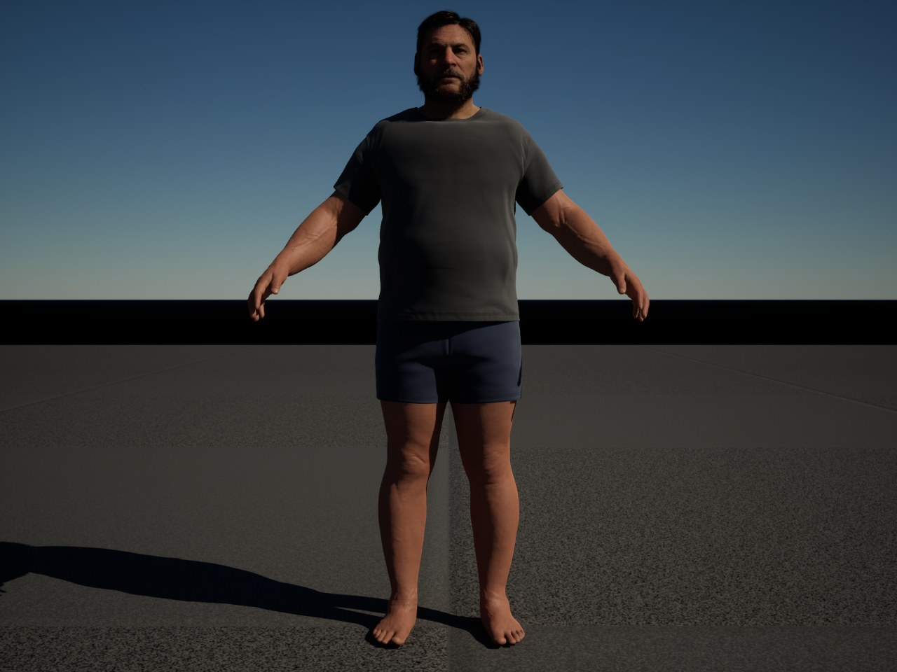
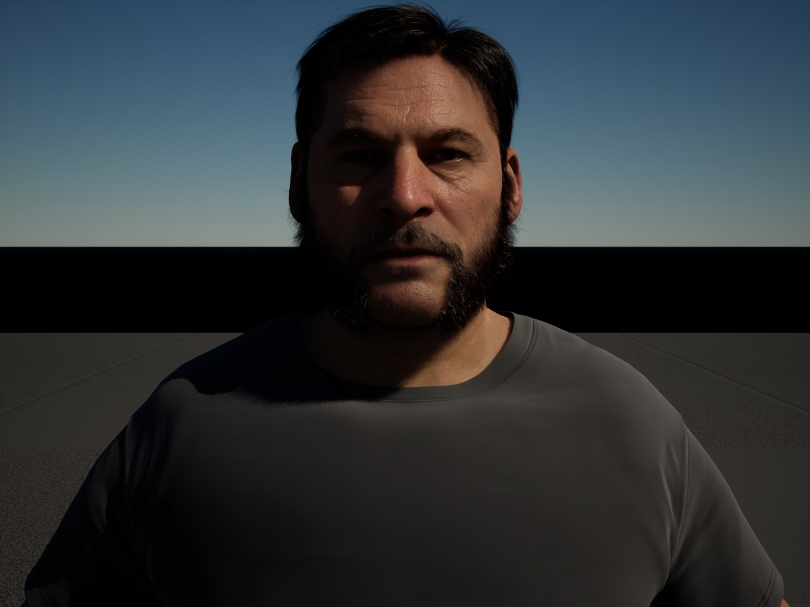
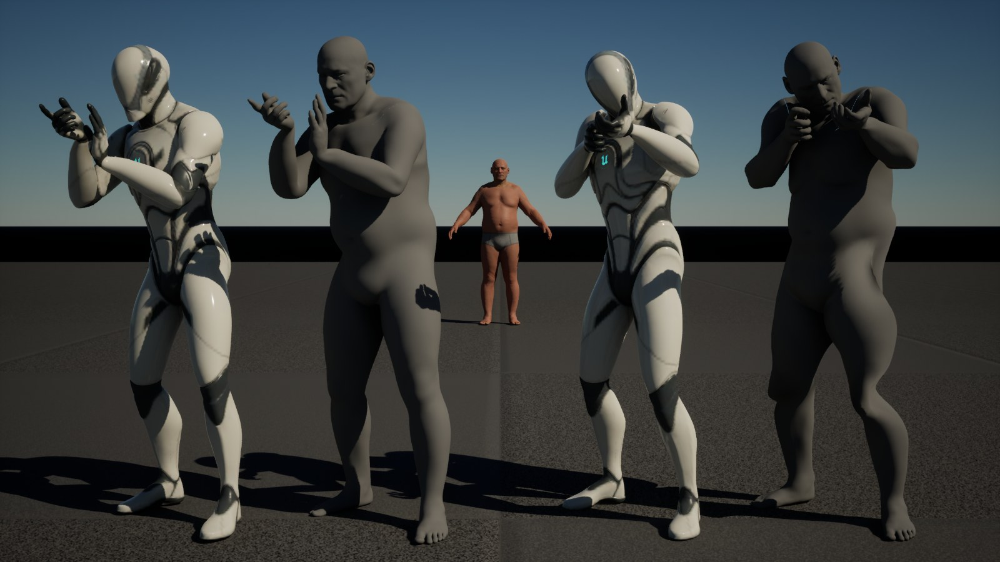
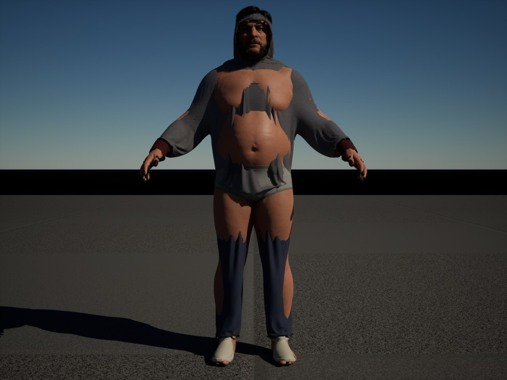

# MetaHuman Creator on the box: what works offline, what needs an Epic login

Tested 2026-11-23 on the rented box (Unreal Engine 5.9.0 preview 2, Linux, headless, `-RenderOffscreen`) in a
scratch project of its own, `/project/ue/metahuman/MHScratch.uproject` (MCP port 8006). Nobody signed in to
anything; the editor ran with `-NoMetaHumanAccountPortalLoginFallback` so no request could open an Epic login page.

**Verdict:** MetaHuman Creator runs headless on the box and makes photoreal characters **offline** up to a full
preview (face, parametric body, strand grooms, the engine's outfit) and plain skeletal meshes; the mannequin's rifle
clips play on them. The **assembly** into a game-ready MetaHuman (`BuildMetaHuman`, materials export, DCC export)
is gated on two Epic cloud services that need an Epic account login: the face auto-rig and the high-resolution
texture download.

## 1. What is on the box

| Plugin (`Engine/Plugins/...`) | Modules | Notes |
|---|---|---|
| `MetaHuman/MetaHumanCharacter` ("MetaHuman Creator", beta, 1.0.0, off by default) | MetaHumanCharacterEditor, MetaHumanCharacter, MetaHumanCharacterPalette(+Editor), MetaHumanDefaultPipeline, MetaHumanDefaultEditorPipeline, MetaHumanCharacterMigrationEditor | Linux binaries present. Depends on MetaHumanSDK, MetaHuman (Animator), RigLogic, HairStrands, ChaosClothAsset, ChaosOutfitAsset, TextureGraph, IKRig, GeometryScripting, Dataflow, LiveLink. No window is required: every call below ran headless |
| `MetaHuman/MetaHumanSDK` | MetaHumanSDKEditor, MetaHumanSDKRuntime, InterchangeDNA | Holds the cloud client: `Private/Cloud/MetaHumanCloudAuthentication.cpp` (Epic Online Services login), `MetaHumanServiceRequest.cpp`, `MetaHumanTextureServiceRequest.cpp`. Services: `mh-uemhc-autorig-service.eeeb.live.use1a.on.epicgames.com/v1/autorigs`, `mh-texture-synthesis-service.eeeb.live.use1a.on.epicgames.com` |
| `MetaHuman/MetaHumanCoreTechLib` | identity solver, archetype DNA (`SKM_Face.dna`, `SKM_Body.dna`, `body_head_combined.dna`), face detector, trackers | All local |
| `MetaHuman/MetaHumanAnimator`, `MetaHumanAnimationTools`, `MetaHumanLiveLink`, `MetaHumanCrowd`, `MetaHumanCalibrationProcessing`, `MetaHumanCoreML`; `Experimental/MetaHuman/MetaHumanRuntime`, `MetaHumanCharacterUAF`, `MetaHumanCalibrationDiagnostics` | | Not needed here |

No Fab / Marketplace MetaHuman content is installed. The engine ships with the creator: 29 preset characters
(`/MetaHumanCharacter/Optional/Presets/*`: Ada ... Zuri), 38 hair, 16 beard, 16 mustache, 18 eyebrow, 6 eyelash
and 1 peach-fuzz strand grooms (`Optional/Grooms/Bindings/WI_*`), **one** outfit (`Optional/Clothing/WI_DefaultGarment`:
T-shirt and shorts, a Chaos cloth outfit that resizes to any body), body skin texture sets
(`Optional/BodyTextures`) and a local texture-synthesis model (`Optional/TextureSynthesis/TS-1.3-F_UE_res-1024_nchr-153`).
None of the 29 presets carries high-resolution textures (asset tag `bHasHighResolutionTextures=False` on all).

Python API (`unreal.MetaHumanCharacterEditorSubsystem`, examples in
`Plugins/MetaHuman/MetaHumanCharacter/Content/Python/examples/`):

| Step | Call | Offline? |
|---|---|---|
| Create | `AssetTools.create_asset(name, path, unreal.MetaHumanCharacter, unreal.MetaHumanCharacterFactoryNew())`, or `EditorAssetLibrary.duplicate_asset` of a preset | yes |
| Edit session | `try_add_object_to_edit(ch)` / `remove_object_to_edit` | yes |
| Body | `get_body_constraints` (30: Height, Chest, Waist, Hip, Neck, Bicep, Thigh, ..., Fat, Masculine/Feminine, Muscularity, each with a range), `set_body_constraints`, `commit_body_state`; also `conform_body`, `set_body_mesh`, `import_body_whole_rig` | yes |
| Face | `get/set_face_model_coefficients`, `get/translate_face_landmarks`, `import_from_face_dna`, `import_from_template` (MetaHuman topology), `conform_to_target_meshes` + `track_face_landmarks_from_image` + `get_mesh_data_for_conforming` (any mesh: Mesh to MetaHuman) | yes (local solver) |
| Skin, eyes, makeup | `commit_skin_settings` (skin tone U/V, texture indices, freckles, accents), `commit_eyes_settings`, `commit_makeup_settings`; face maps come from the local 1024 px synthesis model | yes |
| Grooms, outfit | `character.internal_collection.try_add_item_from_wardrobe_item(slot, WI)` + `default_instance.try_add_slot_selection(...)`; slots Hair, Eyebrows, Beard, Mustache, Eyelashes, Peachfuzz, Outfits, Top Garment, Bottom Garment, SkeletalMesh; colours through `get_preview_collection(ch).default_instance.get_instance_parameters(...)` (`PrimaryColorShirt`, `Melanin`, ...) | yes |
| Preview | `assemble_for_preview(ch)`, `spawn_meta_human_actor(ch)` (a `MetaHumanDefaultEditorPipelineActor`: Body, Face, six GroomComponents, a ChaosClothComponent) | yes |
| Plain meshes | `MetaHumanCharacterExportBlueprintLibrary.export_geometry(ch, MetaHumanGeometryExportParams)`: head, body and full-body skeletal meshes (no materials) | **yes** (only needs the edit session) |
| Face rig | `request_auto_rigging(ch, MetaHumanCharacterAutoRiggingRequestParams)` | **no: cloud, Epic login** |
| High-res textures | `request_texture_sources(ch, MetaHumanCharacterTextureRequestParams)` (2k face and body maps, animated maps) | **no: cloud, Epic login** |
| Assembly | `build_meta_human(ch, MetaHumanCharacterEditorBuildParameters)` (optimized / UEFN pipelines, quality levels) | **no**: `CanBuildMetaHuman` refuses unless rigged AND high-res textures present |
| Materials, DCC, DNA export | `export_materials`, `export_dcc` (need high-res textures), `export_dna` (needs face DNA) | no |

## 2. The exact blocker

`UMetaHumanCharacterEditorSubsystem::CanBuildMetaHuman` (`MetaHumanCharacterEditorSubsystem.cpp` 2407-2443)
returns false unless `GetRiggingState == Rigged` (the character has face DNA) **and**
`HasHighResolutionTextures()`. Face DNA for a new face is only written by the auto-rig service response;
`bHasHighResolutionTextures` is only set by the texture service response (`MetaHumanCharacterService.cpp` 277 and 370);
the property is `BlueprintReadOnly`. Both services log in through Epic Online Services
(`FClientState::LoginUsingPersist`: a persistent auth token, or the cvars `MetaHuman.Cloud.Config.UserEmail`/`Password`
or `ExchangeCode`; then the Account Portal, which a browser must show). On the box, with no stored login
(`mh_cloud_probe.py`), the log says:

```
LogEOSSDK: LogEOS: SDK Config Product Update Request Successful        (the network to Epic works)
LogMetaHumanCharacterEditor: Display: Requesting Auto-Rigging for MH_Probe. Rig Type: Joints Only.
LogMetaHumanCharacterEditor: Display: Requesting texture sources for MH_Probe. Face: Albedo 2k, Normal 2k, ...
LogMetaHumanAuth: Display: Login failed - error code: EOS_InvalidAuth
LogMetaHumanCharacterEditor: Error: Auto-Rigging of Face failed with code 'Login Failed'
LogMetaHumanCharacterEditor: Error: User not logged in, please autorig before downloading source face textures
LogMetaHumanCharacterEditor: Error: Failed to build MetaHuman Character 'MH_Probe: Character is not rigged.
```

Offline paths that exist: everything up to the preview, `export_geometry`, and `import_from_face_dna` with a DNA
file we already have (the archetype `SKM_Face.dna` rigs the archetype face, not ours). No local auto-rig and no local
high-resolution texture path exist in this engine build.

## 3. The Goon built offline (recipe)

On the box (`/project/ue/mh-tools/`, copies in `tools/box/metahuman/`):

```
bash setup.sh                          # project, config, mannequin + template weapons + Goon content copied from /project/ue/chars
bash editor.sh start                   # MCP 8006, about 40 s on a warm box (first MetaHuman start compiles shaders: a few minutes)
bash py.sh mh_probe.py                 # presets, body constraints, can_build (False)
bash py.sh mh_goon.py                  # MH_Goon: preset "Bruce" copied, heavy-set body, grooms, outfit, preview assembled
bash py.sh mh_stage.py                 # L_MH: floor, sun, sky, exposure; the preview actor at the origin
bash py.sh mh_export.py                # export_geometry -> /Game/MH/Export/MH_Goon/{Head,Body,FullBody}
bash py.sh mh_skel.py                  # skeleton comparison with SK_Mannequin
bash py.sh mh_anim.py                  # mannequin rifle clips on the exported body next to the mannequin
bash py.sh mh_pose.py                  # outfit colours (MH_CLIP = None to keep the A pose)
bash shot.sh /tmp/x.png cam=0,330,100,-2,-90,0 fov=45 size=1280x960 frames=40
bash py.sh mh_hoodie.py                # our SK_Goon_Hoodie worn by the preview body (fit test)
bash editor.sh stop                    # by process id only
```

Body constraints used: height 182, chest 124, waist 118, hip 116, high hip 114, neck 45, neck base 49, bicep 40,
thigh 70, across shoulder 44 (cm), fat 1.6, muscularity 0.4; all were met. The preset's own hair and full beard stayed
selected (slot selections added on top of a preset's are not exclusive: use `set_single_slot_selection` to replace).



`shots/metahuman-goon-3m.jpg`: the offline MetaHuman at 3 m under the sun (A pose): preset face, parametric heavy
body, strand hair and beard, the engine's outfit resized to the body and coloured charcoal and navy by instance
parameters. Skin is the local 1024 px synthesized face and the stock 2048 px body set.



`shots/metahuman-goon-1m.jpg`: the same at 1 m, against the sun: pores, stubble roots, eye wetness, strand hair. This is
the quality the Goons lack today (graded 1.5-2 of 5 for latex masks, sack hoods and blob gloves).

## 4. Skeleton and the rifle clips

`metahuman_base_skel` (342 bones) contains all **80 deforming bones of SK_Mannequin with identical names and
parents**; only the mannequin's 9 IK/virtual bones are missing (`ik_foot_root`, `ik_foot_l/r`, `ik_hand_root`,
`ik_hand_gun`, `ik_hand_l/r`, `interaction`, `center_of_mass`). The other 262 are corrective and helper bones
(`upperarm_correctiveRoot_l`, `*_bulge_*`, `*_half_*`, `*_palmMid_*`, ...) driven by RigLogic in the MetaHuman post-process
animation blueprint. The head mesh has its own `Face_Archetype_Skeleton` (875 bones, includes `head`, `neck_01`,
`FACIAL_C_FacialRoot`).

With SK_Mannequin added to `metahuman_base_skel`'s `compatible_skeletons` (done in memory by `mh_anim.py`, never
saved into the engine plugin), the template clips play on the exported MetaHuman body directly, no retargeter:

| Clip | Bone | Mannequin (cm, component space) | MetaHuman Goon |
|---|---|---|---|
| MM_Rifle_Reload 1.3 s | hand_r / hand_l / head | (-27.6 19.7 142.0) / (-16.8 30.9 132.5) / (-9.8 1.1 158.5) | (-30.2 20.4 145.4) / (-16.4 33.3 135.4) / (-10.2 1.5 160.2) |
| MF_Rifle_Idle_ADS 0.5 s | hand_r / hand_l / head | (-16.9 7.2 139.9) / (-7.6 43.4 141.6) / (-5.7 -3.3 158.7) | (-18.5 7.0 143.7) / (-6.8 44.3 144.8) / (-6.5 -2.9 160.4) |

Hands land within 2-4 cm of the mannequin's (the body is 2 cm taller); a rifle socketed on `hand_r` with the left
hand on IK, as the game already does, should hold (not tried with a rifle mesh). The same clip on the preview actor's body moves face and grooms
with it; the preview's cloth outfit stays in the A pose (the editor preview only drives the outfit through its own
pipeline animation blueprint, which the single-node override replaces).



`shots/metahuman-clips.jpg`: from the left, mannequin and MetaHuman body in MM_Rifle_Reload at 1.3 s, then both in
MF_Rifle_Idle_ADS at 0.5 s; the exported meshes are grey because materials only export with high-res textures.
Behind, the textured preview in its A pose.

## 5. Clothing

* **MetaHuman outfits** work offline: `WI_DefaultGarment` resizes to the heavy body (picture above) and takes colours.
  It is the only outfit in the engine; any other ready-made MetaHuman outfit has to come from outside the engine (for example Fab, with the owner's account).
  Our own garments become MetaHuman outfits as Chaos Outfit assets (a Chaos Cloth asset plus source bodies), which the
  outfit system then resizes to every MetaHuman body; that conversion was not attempted.
* **Our Goon hoodie** (`SK_Goon_Hoodie`, on SK_Mannequin) follows the MetaHuman body by leader pose without any
  retargeting (same bones), but it was cut for the mannequin's proportions: the heavy body comes through chest, belly,
  shoulders and thighs. It needs a refit to each MetaHuman body (export the body with `export_geometry` and refit in
  Blender with the existing cloth pipeline, or make it a Chaos outfit).



`shots/metahuman-hoodie-fit.jpg`: SK_Goon_Hoodie (mask section hidden) on the heavy MetaHuman body by leader pose: the
bones match, the shape does not.

## 6. Measurements

Triangles (Geometry Script copy of each LOD of the exported meshes):

| Mesh | LOD0 | LOD1 | LOD2 | LOD3 | LOD4-7 |
|---|---|---|---|---|---|
| Head (8 LODs, 15 material slots: skin, teeth, saliva, eyes, eye shell, lashes, eye edge, cartilage, per-LOD skin) | 64,094 | 34,514 | 17,274 | 6,872 | 3,504 / 1,524 / 710 / 356 |
| Body (4 LODs) | 60,816 | 15,196 | 6,632 | 1,952 | |
| Full body, head merged (4 LODs, one material) | 95,330 | 22,068 | 8,156 | 2,308 | |

Vertices: head 34,661 at LOD0, body 32,334, full body 51,619. For comparison a Goon today is one 92,522-vertex mesh
with one LOD.

Textures of the offline character: face base colour, normal, cavity and six animated (wrinkle) maps, all 1024 x 1024
(synthesized locally; 4 MB each uncompressed in the editor, about 1 MB each block-compressed); body and chest base
colour, normal, cavity 2048 x 2048 plus underwear maps 1024 x 1024 (stock plugin sets, shared by every character with
the same skin choice). The cloud download would bring 2k face maps instead.

Memory of the render resources in the editor (`obj list`, ResExcKB; cooked sizes are lower, without editor data):

| Asset | MB |
|---|---|
| Head mesh / body mesh / full-body mesh (all LODs) | 4.9 / 3.0 / 4.3 |
| Outfit (default garment, combined mesh) | 4.3 |
| Grooms: hair Casual 52.0, BuzzCut 10.7; beard MuttonChops 16.8, Stubble 2.9; peach fuzz 6.9; eyebrows 1.5-2.9; eyelashes 0.15; bindings 0.1-1.4 each | |

So one Goon at LOD0 with strand hair and beard is roughly 8 MB of meshes, 10 MB of unique face textures and 15 to
75 MB of grooms (strands dominate). For several enemies on screen, use the full-body mesh at LOD1-LOD3 (22k to 2k
triangles), short grooms (buzz cut, stubble) or the grooms' card/mesh LODs, and one shared body texture set.

## 7. Mesh to MetaHuman for the main character

The engine has everything to make a MetaHuman identity from a head mesh **locally**:
`get_mesh_data_for_conforming(mesh)` (any topology), `track_face_landmarks_from_image` on a portrait render of it
(local face detector), `conform_to_target_meshes(ch, key, ConformTargetParams)` (local identity solve), then
`commit_posed_state_as_a_pose` (example `example_conform_from_custom_mesh.py`; `import_from_template` for meshes in
MetaHuman topology). The result would be an editable, previewable, geometry-exportable character with synthesized
skin, but with **no face rig** and no 2k textures: those need the same cloud auto-rig and texture download (login), and
the skin texture would be synthesized, not taken from the head's own texture. Because the assembly step of the
enemy test needed a login, the private head (`art/out/glb/SK_Rule.glb`) was not moved to the box and not tested.

## 8. What would unlock assembly

One of:
1. The owner signs in to MetaHuman Creator with an Epic account in a windowed Unreal Editor 5.9 on their own computer
   (the box cannot open an editor window: PrimusVK aborts it, `BOX.md` section 1), runs **auto-rig** and **download
   texture sources** on each character, and sends the saved `MetaHumanCharacter` assets (face DNA and textures are
   stored inside them) to the box through Higgsfield storage. `build_meta_human` then runs headless here with no
   login (it only checks what the asset contains).
2. A persistent Epic login stored for user `ue4` on the box (`/home/ue4/.config/Epic` is linked to persistent
   `/project/ue/home/Epic`): EOS tries the persistent token first, so after one interactive sign-in the headless
   editor would reach the services. Signing in needs a browser on the box's desktop; not tried.

Licence: MetaHuman output may be used in Unreal projects under Epic's terms; nothing from these tests (assets,
meshes, DNA, textures) is committed, only the pictures above and the scripts. The scratch project stays on the box.
