# PLAY: the owner's play report of version 4, lane by lane

The owner played version 4 on E3DS (2026-11-25, about 21:15 UTC): killed enemies crouch instead of bleeding and falling,
"switching between weapons doesnt work", the story needs cues and walking paths, and a full end-to-end play before
deployment (DECISIONS.md, 2026-11-25 ~21:20, criterion 5). One section per lane. Pictures are in `docs/unreal/shots/`.

## Weapon switching (the switch lane)

### What was played, and what happened

**Version 4 itself** (the zip of `6c4d810`, `/project/ue/cloud/v3a-fix/out/MurderInc.zip`, unpacked to
`/project/ue/play/switch/v4/Linux`), the Shipping game streamed by Pixel Streaming 2 to the box's test viewer, every input
sent as a browser page sends it (`tools/box/cloud/switch-keys.txt`, played by `rtcinput.py`; run
`/project/ue/play/switch/lag/v4-switch`). The two parity guns, the CHOPPER in slot 1 and the NINE in slot 2:

| Input through the stream | Result (frame) |
|---|---|
| key 2, key 1 (JavaScript key codes 50, 49) | NINE, then CHOPPER (`s-key2`, `s-key1`) |
| number pad 2, 1 (98, 97) | NINE, CHOPPER (`s-numpad2`) |
| Q | the other gun (`s-q`) |
| the mouse wheel, one notch down (-120), one up (+120) | next, previous (`s-wheel-down`, `s-wheel-up`) |
| a fast flick of three notches 30 ms apart | one step, as the debounce says (`s-wheel-flick`) |
| key 2 while reloading | the reload stops, the NINE comes up (`s-mid-reload`) |
| key 1 aimed | the CHOPPER comes up aimed (`s-mid-aim`) |
| key 2 with the fire button held | the NINE (`s-mid-fire`) |
| key 1 sprinting | the CHOPPER in the HUD; the gun is lowered out of the picture while sprinting (`s-sprint`) |
| F (the rifle butt) then key 2 at once | the NINE once the strike is over (`s-melee`) |
| P, key 1 on the pause card, P | the card; the press does nothing; the NINE still in hand after the resume (`s-paused`, `s-resumed`) |
| **key 1 after the resume** | **the game stopped drawing and died: SIGSEGV** (`game.log`: `Signal 11 caught`, crash context `SkeletalMeshComponent='FirstPersonPackGun' SkeletalMesh='SK_TFA_AR_Short_Combined' AnimInstance='MIFPAnimInstance_...'`; the stream's last frame at 58 s of the viewer, the process gone at 86 s) |

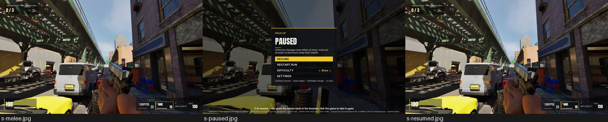

So in version 4 every way to change guns reached the rules and drew the right gun, and **a weapon switch crashed the game
about a minute into the run**. That is what a player sees as "switching doesn't work": the picture freezes on the key
press and the session ends.

**The newest package** (the release engineer's trial of `fd8ce12`, run `/project/ue/cloud/lag-v6trial/t-guns`, four guns:
CHOPPER, NINE, SHORTY, RATTLER): keys 1 to 4 through the stream drew the four guns, each aimed, fired and reloaded
(`g-gun1` to `g-gun4`). That package has no fix for the crash below (it predates `1f560d7`).

### The cause of the crash

`UMIFirstPersonRig::Equip` (`MIFirstPersonRig.cpp`) starts every equip with `Loaded.Reset()`: the array that holds the
gun's clips for the garbage collector lets go of the previous gun's clips. But the first-person anim instances
(`UMIFPAnimInstance`, `MIFirstPersonAnim.h`) keep the last pose they were given, and a pose names its clips by raw pointer
(`FMIFPLayer::Clip`). In version 4 the CHOPPER was the pack rifle (pack mode: the arms' instance and a second instance on
the gun, `FirstPersonPackGun`); after a switch to the NINE (hand IK) the hidden pack gun kept ticking
(`EVisibilityBasedAnimTickOption::AlwaysTickPoseAndRefreshBones`) with its last pose. The next garbage collection (a
packaged game collects about once a minute) freed the CHOPPER's gun clips, and the next evaluation of that pose read freed
memory: `SIGSEGV ... address 0x0` in the pack gun's animation. The hands lane saw the same crash once with `HighResShot`
(HANDS_R4.md 5) and the branch has since stopped the hidden pack gun's tick and cleared its instance on every equip
(`1f560d7`, in `MIFirstPersonRig.cpp`). That covers the pack gun; it does not cover any other instance left holding an
old pose, and nothing tested it.

The smooth-play lane found the same crash independently in the newest package (`fd8ce12`, SMOOTH.md C1: 2 of 2 sessions,
symbolised stack `MIFirstPersonAnimPrivate::Sample` -> `L.Clip->GetPlayLength()` from `FMIFPAnimProxy::Evaluate`, at the
first periodic collection after a switch). That package predates `1f560d7`; its sessions carried the STICK (the pack gun) and switched
out of it and back. SMOOTH.md names the fix's commit as `2a35906`; that hash is
a READY.md commit: the fix is the commit that adds this section. The freeze of about a second around a switch (SMOOTH.md
C3, synchronous loads in `EquipMesh` and `UMIFirstPersonRig::Equip`) is the smooth lane's; it is not a failure to switch.

### What was changed (the switching code and its tests)

1. **`UMIFPAnimInstance::SetPose` holds the clips of the pose it is given** (`MIFirstPersonAnim.h`, a `UPROPERTY` array
   `HeldClips`, emptied and refilled on every pose; `Reset` keeps its memory, so nothing is allocated per frame after the
   first). An instance can no longer evaluate a clip the collector freed, whatever the rig does with `Loaded`. No rule,
   timing or pose changes: the same clips are sampled at the same times.
2. **`MurderInc.Player.SwitchEveryWay`** (`Tests/MISwitchPlayTests.cpp`): a run in a world with the real character, the
   real `AMIPlayerController` and its Enhanced Input mapping; every key goes in through `APlayerController::InputKey` as
   the viewport sends it, the mouse wheel as `FSceneViewport::OnMouseWheel` sends it (the press and its release in the
   same frame). For one, two, three and four carried guns (STRETCH; CHOPPER NINE; SHORTY RATTLER NINE; STICK CHOPPER
   RATTLER STRETCH: the six guns between them), after every input it checks the slot the rules hold, that the weapon
   component shows that gun's mesh (`UMIWeaponComponent::GetShownGun`) and that the gun is up: keys 1 to 4 (a slot past
   the last does nothing), the number pad, the wheel both ways and round both ends, the D-pad left / right / up / down,
   Q and Y, two Q taps at once. With four guns: a switch while reloading, aimed (the new gun comes up aimed while the
   button is held), firing (the holster starts at once), sprinting, during the rifle butt (it goes through when the
   strike ends), presses on the pause card (none act) and after the resume, a press on the death card (none acts), and
   after Run it back (slot 1, then keys and the wheel).
3. **`MurderInc.FirstPerson.SwitchSurvivesGC`**: the STICK (the pack gun today) and the hand-IK guns, switched pack ->
   hand IK -> pack -> NINE -> CHOPPER -> pack -> hand IK with a garbage collection after each switch; every clip that any
   first-person anim instance of the player still holds in its pose must survive it, and the poses are evaluated again
   afterwards. It times `SetPose` too (below). Without the pack art it says so and checks nothing.

**The suite** (`tools/box/test.sh MurderInc` in `/project/ue/play/switch/repo-switch`, a clone with the guns imported as
the guns lane does, built with `-MaxParallelActions=6`) at `a3e57b0` with these changes: **206 passed, 0 failed, 0
skipped** in 77 s, the golden replays included (`Golden.*`, `Loadout.ParityGolden`); `SwitchEveryWay` 4.3 s,
`SwitchSurvivesGC` 1.3 s. No rule moved: the switching rules (`FMIWeaponRules::RequestSwitch`, `AdvanceSwitch`) and the
input layer (`FMISwitchInput`, `AMIPlayerController`) are unchanged.

**Negative control**: the same clone with version 4's behaviour put back by hand (the pack gun's tick and instance left
alone in `Equip`, `HeldClips` not filled) fails `SwitchSurvivesGC` at the first switch out of the pack gun: "slot 2
(rattler, mode 2): every clip of the 2 first-person pose(s) survives a collection: expected 0, was 1". The test catches
the version 4 crash. (In the editor every loaded asset carries `RF_Standalone` and is never collected, which is why the
crash was never seen in play in editor; the test clears that flag on the poses' clips for its collection, as a packaged
game has it.)

**Cost**: `SetPose` with the clips held measured 0.023 microseconds a call (the arms' pose, 20,000 calls in the test);
two calls a frame (the arms and, with the pack gun drawn, the gun). No allocation after the first frame, no load, no
change to what is drawn.

### What was checked and found right (no change needed)

- **Presses while the game cannot take them**: on the pause card and the death card no gun changes, and the press is
  not carried into play (the resume and Run it back drop it; `DropMenuPresses`). A first version of the test resumed by
  calling the game's pause key directly and saw the press go through: a world made by a test has no game mode, so the
  engine pause does not stop input there; the test now pauses and resumes with the P key, as a player does.
- **The input map** (`AMIPlayerController::BuildInputAssets`) matches the web game and `frontend.json input.game`: 1-4 and
  the number pad (slots), D-pad left / right (slots 1 and 2, `src/config/player.js` 14 and 15), wheel down / D-pad up
  (next), wheel up / D-pad down (previous), Q / Y (swap; with three or more guns a tap swaps on release and a hold of
  `wheel.hold` opens the weapon wheel), B / View (fire mode), F, V, the middle button, RB, R3 (the rifle butt).
- **The loadout-to-slot mapping**: the set-up's guns are contiguous (`FMIFrontEndRules` closes gaps), the resolver keeps
  their order (`FMILoadoutResolver::Resolve`), and slot N is `Guns[N-1]`; the test checks it for the six guns.
- **The stream path** (Pixel Streaming 2's `RTCInputHandler.cpp`): key codes go through `JavaScriptKeyCodeToFKey`
  (49 to 52 are One to Four, 97 to 100 the number pad) and the wheel through `HandleOnMouseWheel` (delta / 120) to Slate
  and `FSceneViewport::OnMouseWheel`; the game's own input processor (`FMICloudInput`) passes both on. Seen working in
  version 4 above.
- **Equip locks**: the rules accept a switch in every state but a dropped gun (death); a switch during the rifle butt is
  queued; a switch cancels a reload and the fire selector, as the rules say. Unchanged.

### Tools added

- `tools/box/cloud/rtcinput.py`: the verb `wheel <delta> [events] [gap ms] [x y]` (the page's `MouseWheel` message, id 75).
- `tools/box/cloud/switch-keys.txt`: the viewer script of the table above.

### For the hands engineer (MIFirstPersonRig.*, not edited here)

Nothing is required: with `HeldClips` an instance keeps its clips alive itself, and the `1f560d7` guard stays right. If
the rig ever adds an instance of its own (another component with `UMIFPAnimInstance`), it is covered by the same
`SetPose`; a pose built by hand and written another way would not be. Seen on the way, for that lane: while sprinting the
gun and both arms leave the picture entirely in version 4 (`s-sprint`); the HUD still shows the gun in hand.

### Still open

- A package of this branch played through the stream (the crash was reproduced on version 4; the fix is proven by the
  test, not yet by a packaged game on E3DS). The release engineer's gate should include `switch-keys.txt` (with
  `wheel` lines) on the new package, for longer than a minute (the first collection).
- The viewer's pad section of `switch-keys.txt` did not run on version 4 (the game had crashed by then); the pad paths
  are covered by `SwitchEveryWay` and by `ControllerPad`.
- E3DS's own page was not used (no E3DS session was spent): its key and wheel handling were taken from Epic's player
  library and from the version 4 sessions in DECISIONS.md.

## Story guidance (the guide lane)

The owner: "the story needs to have ques to tell a player where to go and hints (highlighted walking paths on the ground
to get to the next object. this is important for story mode so the player can advance through levels." Story mode is one
map (the Block) with three reels and the IPX truck: Reel 1 The Avenue, Reel 2 Chop Shop, Reel 3 The Cage, then the truck's
rear doors. The rules let the reels be taken in any order; the guidance always points at the first one not yet taken
(the radio's own order: "the avenue, the chop shop, the cage"), then the truck. Nothing of it is a rule: no collision, no
timing, no decision of the flow or the enemies reads it.

### What the player sees

| Cue | What it is | Where it comes from |
|---|---|---|
| Objective block (top left) | The flow's line ("TAKE BACK THE THREE MASTER REELS", "TWO REELS LEFT", "LAST REEL", "GET TO THE IPX TRUCK") and the reels count as before, and under them the **step**: a small amber diamond and "Reel 1 — The Avenue", "Reel 2 — Chop Shop", "Reel 3 — The Cage", then "IPX truck — The Lot". The block now scales with the frame's height (READY.md M9: the title stayed 1080-sized at 4K) | `text.json` objectives, `level.json` objectives labels, `interface.hud.zones` |
| Hint line | Under the step, in a warm white, after **45 s of play without progress** (fighting does not count: the clock stops while any enemy is engaging; the intro does not count). Progress is being 3 m closer along the route than ever before on this step; the line goes at once when that happens and comes back after another 45 s | `guide.json` `levels.block.steps.<id>.hint` |
| Step marker | The step's "[1] 24m" where it stands; the distance is what is left **along the route**. Off the screen or behind: an amber arrow on the screen's edge pointing toward it, with its label inside. It fades from 10 m and is gone at 2.5 m, where the grab prompt takes over. The other reels keep their plain marker. Hidden while the weapon wheel is open (as before) | `guide.json` `marker` |
| Ground path | Amber chevrons (two flat strips of 60 x 14 cm each) on the ground from 1.4 m ahead of the player to the step, at most 30 m of it, 1.5 m apart, each pointing along the way; a light runs along them toward the goal (four phases, 0.9 a second). Dimmer under a roof, the El or inside the chop shop (the eye is adapted darker there), and toned down to 35 % while an enemy is engaging. Depth-tested (walls hide it), drawn on the floor under it (kerbs and slabs), no shadow, no collision, no part in Lumen or distance fields | `guide.json` `path`, `look` |
| Settings | A new row on the Settings card, **Path and markers: On / Off** (on by default, saved): Off hides the ground path, the step marker and the reel markers. The step line and the hint stay | `FMISettings::bGuide` |

The hint lines, in the voice of the radio (`text.radio`) and the prompts:

| Step | Line |
|---|---|
| Reel 1 | Reel 1's out on the avenue, under the El. Head east. |
| Reel 2 | Reel 2's inside V&R Auto Body, north side. The bay door's open. |
| Reel 3 | Reel 3's in the cage at the north-east end. The gate's off the avenue. |
| Truck | The IPX truck's idling at the south end of the lot. Get to its back doors. |

### How the path is found

- **The Goons' own nav grid** (`FMIBoxWorld::FindPath`: A* on the 0.5 m occupancy grid of `level.json` with string
  pulling, the one `MurderInc.Golden.World` checks against the web game), searched on a **private copy** of the box
  world (`AMIGuide::SyncNav`), refreshed only when the box list changes (a run's start, an explosive gone). The
  simulation's own world is never searched by the guide, so not even its search buffers are touched.
- A search every second, at once (after 0.25 s) when the player is 2.5 m off the drawn route, and on every step change. A
  new route replaces the drawn one only when it is 5 % shorter than what is left of it, so two routes of about the same
  length never flip back and forth.
- The chevrons are laid **from the goal backwards** in slots of 1.5 m, so a chevron stays where it is while the player
  walks the route (test `Stable`: 0 moved in 6 s of walking); only the two ends grow in and out.
- **Upper floors**: the grid is the ground's. A player on the scaffold shed's deck or the chop shop's mezzanine (feet more
  than 1 m above the ground under them) is first led down that floor's own stair (`guide.json` `waysDown`), never through
  the parapet to the street under it. The station's stair is not a way down: its steps are 0.75 m, more than the 0.42 m a
  body climbs, so nobody gets up there.
- The route ends on the free cell nearest the reel's case (0.8 m from its centre, inside the 2.2 m grab range), and in the
  truck's zone.

The routes as the guide draws them (test `Routes`, from the step before):

| Leg | Route | Straight line | Way |
|---|---|---|---|
| Start → Reel 1 | 37.7 m | 34.2 m | East along the south sidewalk, then across the avenue under the El to the case |
| Reel 1 → Reel 2 | 25.2 m | 23.4 m | North across the avenue, through the chop shop's bay door (x -3.2 to 0.6), inside to the case |
| Reel 2 → Reel 3 | 64.8 m | 44.0 m | Out of the bay door, east along the north sidewalk past the deli, through the cage's south gate |
| Reel 3 → truck | 60.0 m | 52.2 m | Out of the cage gate, across the avenue, into the lot by its entry (x 28.6 to 35), south to the truck's rear doors |
| The whole story | 187.7 m | | (the maps lane measured 193.7 m with its own A* from the start) |

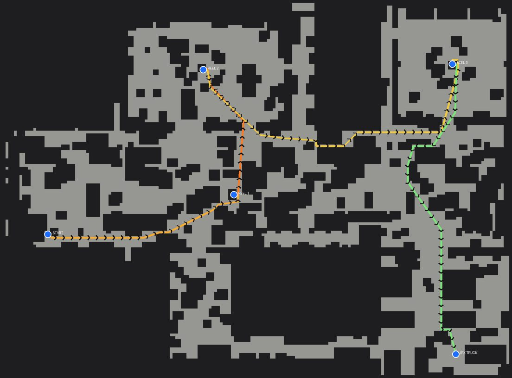

`shots/play-guide-routes.jpg`: the four legs and their chevrons on the nav grid (grey walkable, dark blocked; north up), drawn
by `tools/box/fp/guide_routes_map.py`, a Python replica of the game's search and chevron laying (its lengths: 37.4, 25.2,
64.7 and 60.6 m, within 0.6 m of the game's). It is a plan, not a game picture.

### The end-to-end play

`MurderInc.Guide.EndToEnd` plays the whole story in a world with the block's collision and the real player movement: a
bot that **only follows the drawn route** (pure pursuit on `AMIGuide`'s path, sprinting), holds the grab at each case,
and walks to the truck; the enemies are live and shoot (the bot is patched up each frame, as in `Run.StoryComplete`).
It fails if the bot gains no metre along the route in 8 s anywhere. Result: **story complete in 37.2 s of game time**,
steps of 7.9 s, 6.4 s and 11.8 s to the reels (grabs included) and the rest to the truck, never more than 0.48 m from the
drawn route, the path shown in every frame of the story and nothing drawn after the truck. No place was found where the
route goes through a wall, off the block or onto the wrong floor (`Routes` checks every leg of every step from the start
and from the step before: every leg clear on the grid, every point inside the block and on the ground floor, every
chevron on walkable ground at the floor's height).

### The cost (game thread)

| What | Measured | Where |
|---|---|---|
| The guide's frame (plan, strips, light) | **0.021 ms a frame on average**, worst 0.87 ms (the first frame of a run: the box world copied, the grid built; 1.88 ms in another run) | `EndToEnd` in the suite run below, 1,120 frames, `AMIGuide::GetCost` |
| A path search | 0.116 ms on average, worst 0.52 ms, once a second | same |
| Strips moved | 1,590 in 1,120 frames (about 1.4 a frame while sprinting: the two ends of the path) | same |
| Strips drawn | at most 40 (20 chevrons x 2 flat strips, the engine plane), one of 8 material instances each; per frame 8 scalar parameters are set, nothing else | same |
| Allocations in play | none after the first route of a step: the input, the search buffers, the chevrons and the slot cache are reused; the strips are built once at the map's start | code |

| The path on the GPU | `ProfileGPU` in play in editor (L_Block, the avenue, 1920 x 1080, RTX PRO 6000): the `Translucency` pass **0.016 ms with the path, 0.002 to 0.011 ms without** (two pairs), the whole `Scene` 5.8 to 6.6 ms either way: about 0.01 ms, under the noise of the frame | editor log of run `shots2`, four `ProfileGPU` dumps |
| In play in editor | 0.011 to 0.015 ms a frame on average, worst 0.59 ms; searches 0.10 to 0.16 ms on average, worst 0.42 ms | `MIGuide.Stats`, runs `shots` and `shots2` |

The packaged game under the gate's load (PREFLIGHT.md: `lag-test.sh` with `load=1:0.05:0.05:1024`, 6 CPUs, `-sm5`) has
not been measured with the guidance (it needs a package of this commit; the release engineer's gate covers it). On an A4000
the translucency cost scales with the pixels the chevrons cover (a few thousand), a few hundredths of a millisecond at most.

### What it looks like (play in editor, L_Block)

Pictures from `tools/box/fp/guide-shots.sh` in this lane's clone (`/project/ue/play/guide`, runs in
`/project/ue/play/guide-lane/shots*`), looked at one by one:

| Picture | What it shows |
|---|---|
| 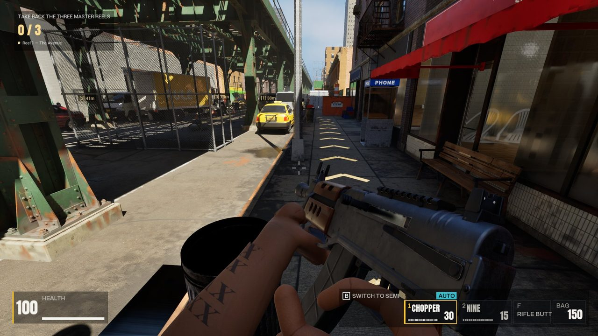 `shots/play-guide-start.jpg` | The run's start on the south sidewalk: the objective block with the step "Reel 1 — The Avenue", the chevrons along the sidewalk toward the avenue, the step marker "[1] 38m" and the plain markers of the other reels |
| 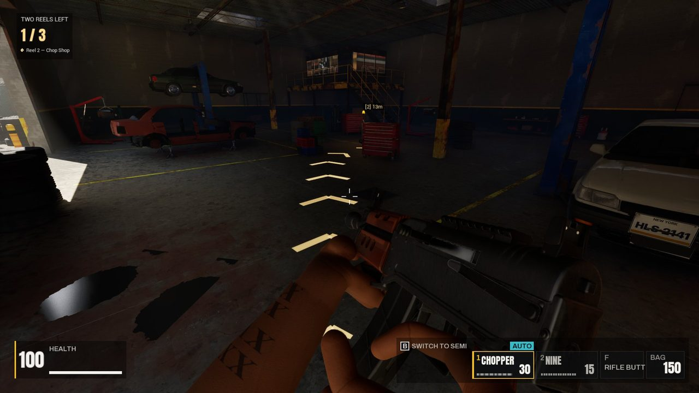 `shots/play-guide-inside.jpg` | Inside the chop shop (Reel 2): the chevrons on the dark floor up to the case, "[2] 13m" |
| 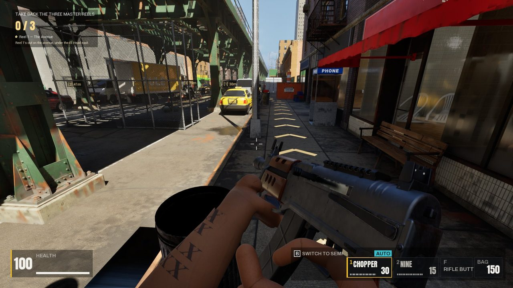 `shots/play-guide-hint.jpg` | The hint line under the step after no progress (here after 3 s: `MIGuide.HintAfter 3`) |
| 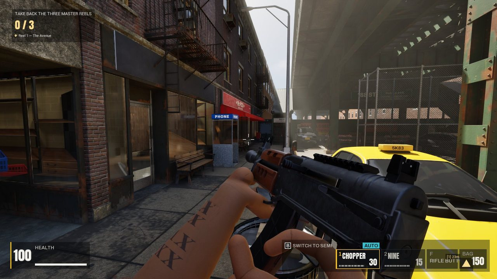 `shots/play-guide-behind.jpg` | Turned away from the step: the edge arrow with "[1] 23m". In this picture it sat on the weapon bar (bottom right); fixed since (below) |
| 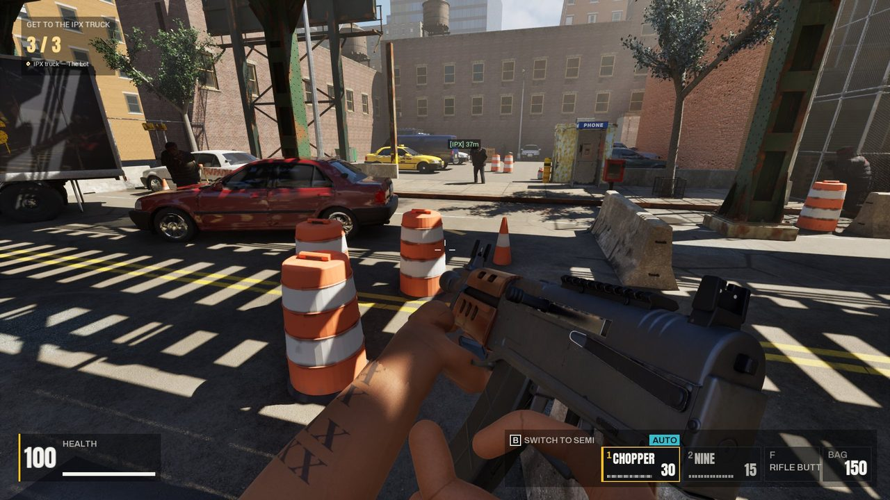 `shots/play-guide-lot.jpg` | The last leg, "IPX truck — The Lot", "[IPX] 37m": in full sun on the asphalt the chevrons of the first tuning were not visible; brightened since (below) |
| 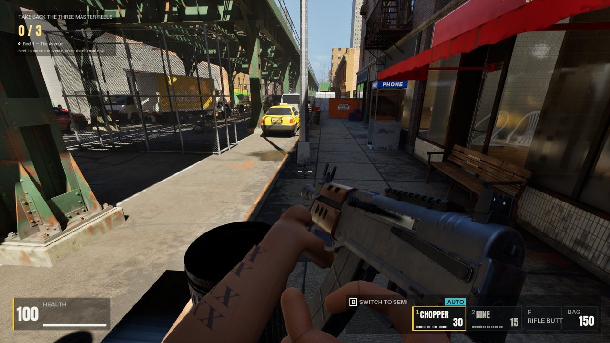 `shots/play-guide-off.jpg` | Settings "Path and markers" off: no chevrons, no markers; the step line and the hint stay |

These pictures are of run `shots2`, the first tuning (chevrons 50 x 11 cm at 4,000 nits). What they taught, changed in
`e294785` (suite 217 passed): on sunlit asphalt and concrete (the lot, the cage's court) the chevrons washed out, so they
are now 60 x 14 cm at 10,000 nits (3,000 under a roof); the edge arrow for a step behind the player sat on the weapon bar,
so it now turns with the view's yaw and stays above the bottom fifth of the frame; the step and hint lines were small at
1080 and are now 1.2 and 1.15 times the large font. The same stills with that tuning (run `shots3`) are queued on the box
behind the other lanes' GPU claims (`/project/ue/play/guide-lane/chain3.sh`); they replace these when they come.

The PIE walk of the whole story by the demo director (`guide` verb, `auto 1`) did not finish: with "fight what you see"
on, the director stops walking whenever an enemy is in sight, and in 120 s of the first leg it gained 5 m. It is a
limit of the director's fighting, not of the route; the whole story by the drawn route is `MurderInc.Guide.EndToEnd`.

### What was changed

- `World/MIGuide.h/.cpp` (new): `FMIGuideTune` (guide.json), `FMIGuidePlan` (the step, the route, the hint clock, the
  chevrons; no engine), `AMIGuide` (the actor the HUD spawns: the private box world, the strip pool, the light);
  console `MIGuide.Stats`, `MIGuide.Reset`, `MIGuide.HintAfter <s>`, `MIGuide.Show 0|1`.
- `Content/Data/guide.json` (new): timings, look, the hint lines, the ways down.
- `UI/MIHUD.*`: the step line and the hint in the objective block (scaled with the frame), the step marker with its edge
  arrow and fade, the Settings row's effect on the markers; `BeginPlay` spawns the guide.
- `Flow/MISettings.*`, `UI/MIMenus.cpp`, `Flow/MIGameSubsystem.cpp`: the Settings row "Path and markers" (saved).
- `Flow/MIDemoDirector.*`, `tools/box/demo/demo.txt`: the verb `guide [limit] [sprint]` (walk the drawn route to the
  step; with `grab` and `waitstate complete` it plays the story by the guidance alone).
- `Tests/MIGuideTests.cpp` (new): `MurderInc.Guide.Data`, `Routes`, `Hint`, `Stable`, `EndToEnd`.
- `tools/box/fp/guide-shots.sh` (new): the pictures below and the walk in play in editor.

The rules, the golden replays and every other test are untouched (the suite: below).

### The suite

`tools/box/test.sh MurderInc` on the branch at `7209dc4` with this lane's change (clone `/project/ue/play/guide` on the
box): **216 passed, 0 failed** (78 s), the golden replays included; no test weakened, skipped or re-recorded. With the
retune `e294785` on `04c66c8`: **217 passed, 0 failed** (83 s).

### For the other lanes

- **READY.md M9** (the objective title not scaling at 4K) is done here, in the same block: the title, the counter, the
  step and the hint all scale with the frame's height.
- The hands engineer: nothing (no change to `MIFirstPersonRig.*` is needed).
- The release engineer: `guide.json` ships with `Content/Data` (loose files); the chevrons use `/Game/FX/M_FX_Tracer` and
  the engine plane, both already in every package (no new asset, no usage flag: static meshes are the material's default).
  Without them the guide says so in the log and draws only the HUD cues.

### Still open (guide lane)

- The retuned look (`e294785`: 10,000 nits, 60 x 14 cm, the edge arrow above the weapon bar) has passed the suite but has
  not been seen in a picture yet (run `shots3` queued behind the other lanes' GPU claims). 10,000 nits may glare in deep
  shade outside a roof (a building's shadow is not "under a roof" for the guide); `look.intensity` and `look.shade` in
  `guide.json` tune it without a build.
- Not measured in the packaged game under the gate's load, and not seen through the E3DS stream.
- The reels can be taken in any order (a rule); the guidance always points at the first one not taken. A player who goes
  for Reel 3 first is led back to Reel 1 by the path (the other reels keep their plain markers).
- The ways down from the scaffold shed's deck and the chop shop's mezzanine are tested on the plan only; no picture of
  chevrons on a stair.
- The hint lines and the Settings row "Path and markers" are English text (the row is in code, as "Controller" is:
  READY.md M11).
- Seen on the way, for the demo director's owner: its `goto` and `hunt` verbs search the simulation's own box world
  (dev only; the search is result-pure, it only reuses the search buffers).

## Enemy deaths (the death lane)

The owner, playing version 4: "enemies when killed crouch over they should have blood splatter and then fall to the floor".

### Why a killed Goon crouched over

The death itself worked as written: on the kill `AMIGoon::Sync` played one of the template's four death clips
(`/Game/Characters/Mannequins/Anims/Death/MM_Death_{Front,Back,Left,Right}_01`, presentation.json `enemies.goon.death`) by
the shot's direction, once, and held its last frame for the 45 s the rules keep a body. **Those clips never reach the
floor.** Evaluated bone by bone in the editor (`/project/ue/play/death-run/py/clip.py`, its output `clip.txt`), the hips stay
at standing height through every clip and the head comes down only part of the way:

| Clip (length) | pelvis height over the root, start / 25 % / 50 % / 75 % / end | head height, start / end |
|---|---|---|
| Front (1.10 s) | 93 / 86 / 83 / 84 / 88 cm | 159 / 85 cm |
| Back (1.10 s) | 93 / 85 / 93 / 85 / 85 cm | 159 / 121 cm |
| Left (0.97 s) | 93 / 86 / 88 / 88 / 85 cm | 159 / 98 cm |
| Right (1.10 s) | 93 / 86 / 88 / 87 / 83 cm | 159 / 74 cm |

A man whose hips are 85 cm up and whose head is 74 to 121 cm up is bent double on his feet: "crouched over". The clips are
the template's start of a fall that a ragdoll is meant to take over (they carry no root motion, the root slides 1.3 to 2.2
m along the ground); played alone and held, they end in that pose. Nothing in the rules or the Goon's animation blueprint
was wrong, and the hit volumes (off from the kill) were not involved.

### What a death is now

Presentation only: nothing below is read by the rules (`FMIEnemyField`), and the rules decide, as before, when a unit is
dead, how long its body stays (`goon.bodyStay` 45 s, `goon.bodyFade` 3.2 s, the `poolBodies` cap) and when it is removed.

- **The body falls from the killing hit as a ragdoll** (`AMIGoon::StartDeath`, `StartRagdoll`, `Enemies/MIEnemyActors.cpp`)
  on the mannequin skeleton's own physics asset (`/Game/Characters/Mannequins/Rigs/PA_Mannequin`, 22 bodies; the Goons are
  skinned on that skeleton bone for bone, CHARACTERS.md), set on the Goon's mesh at set-up (presentation.json
  `enemies.goon.ragdoll.physicsAsset`; `/Game/Characters` is always cooked). The bodies are made from the pose of the frame
  of the kill, so the fall starts from whatever the Goon was doing. The push is a change of speed (`enemies.goon.ragdoll`):
  the whole body 110 cm/s along the shot (a head shot 140) and the bone that was hit 330 cm/s (the head 480: a head shot
  snaps the head back); a blast throws the body 650 cm/s away from its centre and 320 cm/s up. The death clip still plays
  underneath for the bones that have no body (fingers, twist bones), so the hands go slack; the support-hand IK lets go on
  the frame of the kill.
- **Bodies get in nobody's way.** The ragdoll's bodies are `PhysicsBody` objects that block world geometry (`WorldStatic`,
  `WorldDynamic`) and ignore everything else: the player (`Pawn`), rounds (`Bullet`), sight lines (`Visibility`), the camera
  and other bodies. The engine queries the rules make (rounds on `Bullet`, blast sight and wall probes on `WorldStatic` /
  `WorldDynamic` objects, the player's sweeps on `Pawn`) cannot see them. The Goon's hit volumes are off from the kill on, as
  before. Blood and bullet marks never land on a Goon (`bReceivesDecals` off on the body and its gun).
- **At rest the body is frozen where it lies**: once the hips move under 18 cm/s for 0.5 s (after at least 1.2 s, at most
  5 s) the simulation stops, the bodies are removed and the pose is kept (no pose update, no tick): a body on the floor
  costs nothing until the rules remove it. A new unit in the slot gets its living mesh back (`AMIGoon::ResetBody`: physics
  off, the mesh back on its place in the capsule, the animation blueprint).
- **At most two ragdolls start in one frame** (`enemies.goon.ragdoll.startsPerFrame`): the deaths of a blast that kills a
  wave fall one frame after another instead of in one long frame. The blood of every killing hit is out on the frame of the
  hit.
- **Blood** (`UMIEffects`, `Weapons/MIEffects.cpp`, presentation.json `fx.blood`). Every hit, as before: a short dark mist
  out of the wound (3 puffs) and a spatter on the wall behind within 2.6 m. The killing hit adds (`UMIEffects::BloodKill`) a
  heavier burst out along the shot (5 puffs; 7 and one back out of the entry for a head shot; 7 low and wide for a blast;
  `fx.blood.color`, 0.35 to 0.65 s, falling as they slow), a spatter on the nearest surfaces behind the hit (up to two, within
  3.2 m, larger on far walls) and drops on the ground just ahead. When the body comes to rest a **pool** spreads under the
  hips (`UMIEffects::BloodPool`): about 1.1 m across over 6 s, glossy and nearly black-red (`MD_FX_Mark` kind 1.25, written
  by `tools/box/fp/mi_fp_import.py fx`; a material made before this pass draws kind 1.25 as a spatter), faded out over 2.5 s
  when the rules remove the body. Blood decals have a pool of their own (32: a body's pool is never taken by a bullet mark;
  the marks keep their 72), the puffs 128 (were 96). Nothing is spawned or loaded at a death: decals, puffs and the physics
  asset are made or loaded when the world begins play.
- **Switch**: `mi.Goon.Ragdoll 0` (console, or the launch option `-MICVars=mi.Goon.Ragdoll=0`) gives the death clip back,
  as before this pass.

### The frames

Play in editor on `L_Block`, a Story run, the world frozen for each picture (`tools/box/fp/death-shots.sh`, runs in
`/project/ue/play/death-run/` on the box). Each sequence: the kill, then about 0.05, 0.25, 0.6 and 1.5 s after it.

- **Before** (`mi.Goon.Ragdoll 0`, the death clip of version 4; run `old`): a Goon on the avenue by the burnt car, one round
  to the chest. 1.5 s and 4.5 s after the kill (the two lower right pictures, from beside him) he is still on his feet, bent
  double over his gun: exactly the owner's "crouch over", and he stays so until the rules remove him.
  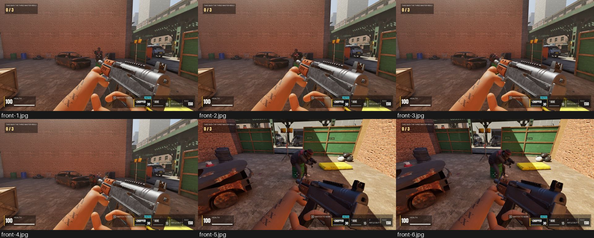
- **After** (the ragdoll; run `s3`, the same spot): the round throws him back off his feet and he goes down beyond the
  car. In this run the world was frozen when the kill came, and a ragdoll made in a frozen world is solved in steps of
  microseconds: its joints throw it higher than they should (the second picture). The capture is fixed (the kill now comes
  with the world at full speed, `death-shots.sh`); the pictures of the fixed capture are in `s4` on the box (below).
  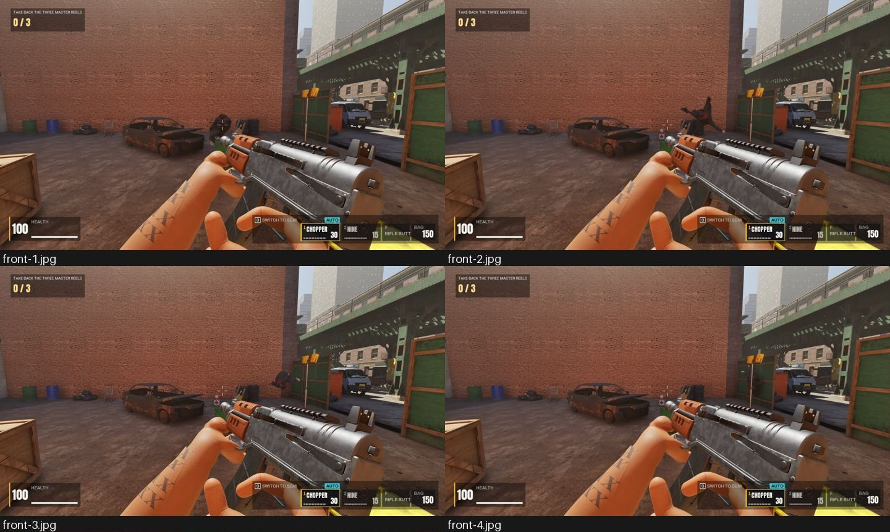
- **Head shot** (a natural Goon on the cage's ledge, run `new`): he folds and drops off the ledge, limp.
  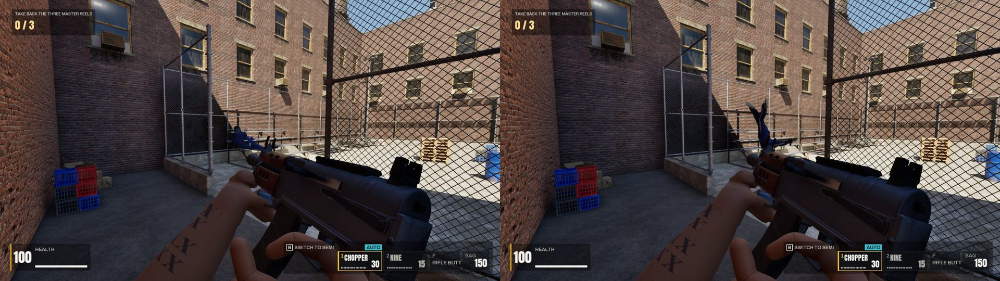
- Where the bodies come to rest, measured rather than pictured (the headless game, `/project/ue/play/death-run/null/staged.rest`,
  the new log line `Goon <slot> at rest after ...`): staged on the avenue and shot from the front, from behind (turned
  away), in the head, by a shop front (shot toward the wall) and on the shed's stair: at rest after 1.7 to 4.1 s, **1.0 to
  1.6 m along the shot, hips 13 to 16 cm over the floor** (35 cm on the stair, hips 97 cm up its risers: lying on the
  steps, not through them). The head-shot body staged under an awning fell the 4 m from it to the street and lay 16 cm over it.

### Cost

Measured headless first (the GPU was claimed by other lanes' gate runs for over an hour): the uncooked Development game on
`L_Block`, `-NullRHI`, on CPUs 8 to 15 of the box (the other lanes' games were on 0 to 7), the death probe killing every
living Goon in one frame through the weapon's damage path; the same run with `mi.Goon.Ragdoll 0` (the death clip of version
4) for comparison. Runs `/project/ue/play/death-run/null/{hold,story}-{ragdoll,clip}.log`.

| Deaths in one frame | Ragdoll starts (game thread) | Mean frame over the 3 s after (ragdoll / clip) | Note |
|---|---|---|---|
| 4 (Hold the Block, wave 1) | 2.29 ms in all, worst body 0.83 ms | 1.86 / 1.50 ms | |
| 5 (Story, the avenue) | 3.36 ms, worst 1.35 ms | 1.72 / 1.37 ms | |
| 5 (wave 2) | 2.80 ms, worst 0.66 ms | 2.01 / 1.38 ms | |
| 7 (wave 3) | 3.67 ms, worst 0.63 ms | 2.02 / 1.57 ms | |
| 8 (wave 4: the most Goons the game has alive at once, 8 of a wave of 13) | 4.09 ms, worst 0.59 ms | 1.90 / 1.56 ms | |

So a ragdoll start costs **0.5 to 0.8 ms** of game thread (22 bodies and their joints; 0.6 ms on average over 29 bodies), and
the bodies in flight add **0.35 to 0.6 ms a frame** for the second or two until they rest; at rest they cost nothing. With two
starts a frame, the deaths add at most about 1.6 ms to any one frame. **Ten deaths at once** (more than the game ever fields:
8 Goons is the most alive at once, Hold the Block wave 4) would start over five frames, about 1.2 to 1.6 ms each, and add
about 0.7 ms a frame for two seconds. The worst single frames after a kill (4 to 14 ms) are the same with the clip (3.6 to
10.5 ms): they are the kill's other work (the rules, the events, the HUD, the sound), not the fall. Headless, the bodies'
pose updates are not drawn, so this understates the visible case slightly. In play in editor the numbers are not usable: the headless editor draws about 4 frames a second between
pictures (frames of 240 to 450 ms whatever happens), so the editor runs under the gate's load were stopped.

Seen on the way (not this lane's, for SMOOTH.md): the uncooked game logs `FlushAsyncLoading ... 1 QueuedPackages` about every
two seconds in play, the same with and without the ragdoll (59 in each Hold the Block run), and one of them coincided with a
133 ms frame in a wave-4 kill. Whether a cooked package does the same was not looked at here.

### Tests

`MurderInc.Death.Ragdoll` (`Tests/MIDeathTests.cpp`): a world with collision booted from level.json (as the run tests); one
round kills the first living Goon. The rules' record of the killed unit (alive, active, mode, position, yaw, death direction,
health) second by second for 6 s is identical with the ragdoll on and off; the body is a ragdoll answering to world geometry
only (Pawn, Bullet, Visibility, Camera and PhysicsBody ignored), at rest and frozen within 6 s with its hips 16.7 cm and its
head 4.5 cm over the ground (not under it, not crouched), its hit volumes off, and a round fired through where it lies is not
stopped by it.

The suite on the box (`tools/box/test.sh MurderInc`, the branch at `d469d73` with this lane's changes up to `2d2dc51`):
**208 passed, 0 failed**, the golden replays among them, none changed or re-recorded.

### Tools

- `MI.Goon.Kill <count> [body|head|blast|drones] [max metres] [delay s] [x y [z]]` (development console,
  `Enemies/MIDeathProbe.cpp`): kills the nearest living Goons through the weapon's damage path (one round from the eye, or a
  blast beside them; `drones` the Buzzards, so a Hold the Block wave ends) and logs the frame times before and after, the
  ragdoll start time and the bodies frozen; with `x y` the first body is staged there before it falls (presentation only: the
  rules' unit stays where it was), for falls on stairs and by walls.
- `tools/box/fp/death-shots.sh` (play in editor, the world frozen per picture, the kill at full speed, pictures from a
  camera beside the body): front, head, back, the player's view, wall, stairs, blast; `OLD=1` with the ragdoll off for
  the "before" frames. The headless runs: `/project/ue/play/death-run/null/run2.sh <label> "<console commands>" <script>`
  (the uncooked game, `-NullRHI`, CPUs 8 to 15).
- For the hands engineer: nothing needed from `MIFirstPersonRig.*`.

### Still wrong

- **The pictures of the fixed capture were not looked at**: the GPU was held by other lanes' gate runs for most of the pass
  (about two hours of waiting in all); `run4.sh` on the box takes them when it gets the GPU (`/project/ue/play/death-run/s4/`:
  front, head and back from a camera beside the body, the player's own view, the wall, the stair, a blast). Look at them
  before the release; if the body still flies, the cause is not only the frozen capture.
- **Blood is not proven in a picture.** The kill burst lives 0.35 to 0.65 s and the frozen pictures caught it small and far
  (and under the gun); the spatters and the pool were not framed. The code paths ran (the probe counts the blood decals: 15
  after the Story kills, 31 to 32 in the waves: the pool of 32 full), but nobody has seen the colour, size or the pool's
  spread on screen. The pool needs `tools/box/fp/mi_fp_import.py fx` in the copy that packages (MD_FX_Mark kind 1.25);
  without it a pool draws as a large spatter.
- **Ten deaths at once were not reached**: the game never has more than 8 Goons alive (Hold the Block wave 4); 8 were
  measured, 10 are extrapolated.
- **The cost was measured headless and on the box's CPUs**, not under the gate's GPU load on 6 CPUs, and without drawing the
  bodies; E3DS's 8 threads are slower. The per-frame start budget keeps the worst case at two ragdoll starts (about 1.6 ms).
- **The gun stays in the dead hand** (it is attached to `hand_r`): it falls with the body rather than as a body of its own.
- **Buzzards** keep their old death (not in this pass).
- **Hit reactions** on non-lethal hits are the old 3-puff mist and spatter; no flinch animation was added.
- A body staged onto a car or a ledge (the probe's staging) can start inside it and be thrown out; the rules never put a
  living Goon inside a car, so this is the probe's, not the game's, but a Goon killed while overlapping a prop collider
  would do the same.

## The review's findings, fixed (the fixer lane)

The end-to-end review of 2026-11-26 found one blocker, four must-fix and six should-fix items (below). The GPU box ended
(credits used up, 03:33 UTC) before this lane started, so its game code changes were first held back, unbuilt, as four
patches (`docs/unreal/patches/unbuilt-review-fixes`, base `293fd82`). **They are landed now** (integrator, 2026-11-26,
15:46 to 16:12 UTC, box `8496fd8c`): applied with `git am` as they were, built and tested before anything was pushed; the
patch folder is deleted. The four commits on the branch are `4925c1e` (guide), `401ca99` (demo director), `6b90888`
(deaths) and `ea75710` (blood), on top of `98f35a0`.

**How they were checked** (a new integration clone, `/project/ue/int/repo`, logs `/project/ue/logs/int-repo`; the chain
that made it is `/project/ue/int-tools/int-chain.sh`):

- The clone: the branch at `98f35a0`, the generated content of `/project/ue/repo-guns` copied in (reflinks, never over a
  file of the checkout) except the folders the guns import owns (`Content/Weapons/{Chopper,Nine,Shorty,Stretch,Rattler,Parts,Casings}`),
  then the four patches with `git am`. The guns imported fresh: `MI_FP_IN=/project/ue/fp-in-guns import-chars.sh r4 all`
  (`MI-FP sockets ok`, `MI-DONE`; the seven folders written 16:07 to 16:09 UTC), `audio-import.sh` once
  (`AUDIO-IMPORT-DONE imported=289 failed=0`), and the effect materials made again from the commit
  (`import-chars.sh fx`: `MI-FP fx ok`; `Content/FX/MD_FX_Mark.uasset`, 12,285 bytes, holds the pool branch's words "a
  pool under a body"), as `package-cloud.sh fx` does in the release copy.
- The build (`build.sh -MaxParallelActions=6`, cold box, makefile included): **95 actions, 465 s, `Result: Succeeded`,
  no error**. The first-build API risks named below all compiled as written. The only warnings of the project's own files
  are the two old `CompositeFont` deprecations in `UI/MIStyle.cpp`, which no patch touches.
- The full suite (`tools/box/test.sh MurderInc`, nothing filtered): **TESTS OK passed=222 failed=0 skipped=0, 104 s**
  (220 before plus the two new tests), the 11 golden replays among them, unchanged and not re-recorded.
  `MurderInc.Death.Retired` and `MurderInc.Guide.Combat` passed with no warning (the death test did not take its "no
  physics asset" exit). The test log has 0 `Invalid Bone Name` lines; its rest lines now end with the count of speeds held
  back, and the kills on open ground in the death tests show "0 speeds held back" (for example "Goon 0 at rest after
  1.33 s: ... 16 cm over the floor under them (found), 103 cm from where it died, 0 speeds held back"). Three tests pass
  with a warning, none of them about these changes (`Audio.EngineRender`: no audio device under `-NoSound`;
  `Audio.VoiceData`: placeholder takes; `Frontend.StageFloor`: the pack's transparent magazine is not in the project).
- The working tree after the suite differs only by the editor's own rewrite of `Config/DefaultEngine.ini` (the Android
  file server section), as in every clone (READY.md); it is not committed.

**Not yet seen** (no picture or play has been taken of these changes): everything under "To see, once built" below is
still to do, by the lanes that own the pictures and the end-to-end play, on this clone (it is built and has the guns
imported; editor work takes `MI_MCP_PORT=8020` or another free port, and the GPU claim of `lag-test.sh` before anything
renders). Whether `/Engine/BasicShapes/BasicShapeMaterial` takes the `Color` parameter (the underlay) shows only in a
picture of the path.

| Finding | Severity | What was done | Where |
|---|---|---|---|
| No rendered end-to-end play of a package | blocker | Not fixable here: no box. The review's prepared runs (`/project/ue/play/review/scripts/r1..r3`) are the plan once a box is back; give one lane the GPU at a time. | open |
| Ragdolls thrown metres up in the staged frames | must-fix | Each frame a body falls, no part of it may go faster than `maxSpeed` (900 cm/s) or rise faster than `maxUp` (250 cm/s; a blast 1.5 x `blastUp` = 480): a body started against a wall or a ledge is pushed out by the solver, and the push no longer flings it. Real kills on open ground (1.5 s, 15 to 17 cm over the floor in the review's run) are under the caps and fall as before. The rest line in the log counts the speeds held back. | landed `6b90888`: `MIEnemyActors.cpp` `UpdateRagdoll`, `presentation.json` `enemies.goon.ragdoll.maxUp` |
| Blood-pool material not in the release copy | must-fix | `package-cloud.sh` has a new step `fx` after `content` (in `all`, and alone as `package-cloud.sh fx`): `mi_fp_import.py fx` makes the effect materials again in the release copy, and the step fails unless `MD_FX_Mark.uasset` holds the pool branch's own words ("a pool under a body") afterwards. | **pushed** |
| Ground path unreadable in direct sun, and dimmed where Goons are | must-fix | The chevrons are cyan (no road paint, crosswalk or brick on the block is) and lie on a dark strip each (`look.underlay`: the engine plane's own lit material with its `Color` parameter near black, 2.4 x the arm's width, 10 cm longer, 1.2 cm under it): an additive line on bare concrete only brightens it, a lit line on black reads in full sun. In a fight the path drops to 0.75 instead of 0.35. No new asset. | landed `4925c1e`: `MIGuide.cpp/.h`, `guide.json` |
| The demo director's `guide` verb did not walk | should-fix | The guide's drawn route starts where the player stood at its search and is kept while it stays the shortest, so its first corner was soon behind the player; the verb walked back to it every half second. It now joins the route at the segment nearest the feet. | landed `401ca99`: `MIDemoDirector.cpp` `FollowGuide` |
| Settings off removed the objective markers | should-fix | Off now hides only the ground path; every objective keeps its plain marker (as the web game draws them), and the next step's marker is the plain one too. The row is renamed "Ground path" (still English in code, like "Controller", READY.md M11). | landed `4925c1e`: `MIHUD.cpp`, `MIMenus.cpp` |
| Orange support-hand blob in the death-shot poses | should-fix | For the hands engineer (`MIFirstPersonRig.*`, not edited here): `/project/ue/play/death-run/s4` stairs-1..5 and blast-1..5, sheets `/project/ue/play/review/out/d4a.jpg`, `d4b.jpg`; it looks like READY.md W2. | passed on |
| Guide checked fights with slot indexes as unit ids | must-fix | `AMIGuide::Step` reads `GetSlots()[I]` for each listed slot (as `UMIGameSubsystem::UpdateLastEnemies` does). New test `MurderInc.Guide.Combat`: one engaging Goon whose id is no listed slot's index raises the plan's combat; nobody engaging brings it back to 0 (the old code fails it). | landed `4925c1e`: `MIGuide.cpp`, `MIGuideTests.cpp`; the test passes |
| Pools recycled by later spatters | should-fix | A new blood decal goes round the ring of 32 past every pool still under a body (when every slot is a live pool, the next is taken anyway). At most 32 checks, no allocation. | landed `ea75710`: `MIEffects.cpp/.h` |
| A retired ragdoll kept simulating hidden | should-fix | `AMIGoon::Show(false)` freezes a body that is still falling (physics off, no collision, no pose update, no tick), as at rest; a new unit in the slot resets it as before. New test `MurderInc.Death.Retired`: kill, clear the field while the body falls, and it no longer simulates. | landed `6b90888`: `MIEnemyActors.cpp`, `MIDeathTests.cpp`; the test passes |
| Two ragdoll starts a frame, measured only without rendering | should-fix | Not changed: it needs the Shipping package measured under the gate's load (Hold the Block wave 4 with a grenade). If the kill frame rises, `enemies.goon.ragdoll.startsPerFrame` 1 is a data change. | open |

**API risks for the first build** (all compiled in the first build, 2026-11-26 15:58 UTC): `FBodyInstance::IsInstanceSimulatingPhysics`,
`GetUnrealWorldVelocity` and `SetLinearVelocity(FVector, bool)` in `UpdateRagdoll`; `AActor::IsHidden` in the new death
test. The underlay assumes `/Engine/BasicShapes/BasicShapeMaterial` has a vector parameter `Color`; if it does not, the
underlay draws in the material's own light grey: then set `look.underlay.material` to `""` (no underlay) or point it at a
material that has one.

**To see, once built** (none of it has been seen): `guide-shots.sh` again in the sun (avenue, the lot, the chop shop
front) and in a fight; `death-shots.sh` with the wall, back and stairs cases (the bodies must stay down, and the rest
lines' "speeds held back" says how often the caps bit); the whole story with `guide` legs in the demo director (it should
now reach each reel) and with `goto` legs as the review planned (`r1-demo.txt`); Settings Ground path off: the [1] [2] [3]
[IPX] markers still drawn; then the release package played through the stream with a blood pool under a body (it must
not be a spatter).

## The visual pass: what the fixer lane's changes look like (2026-11-26, from 16:26 UTC)

Play in editor on the integration clone (`/project/ue/int/repo`, branch head `0017a21` built, `unreal/` tree `3fbc520`; box
`8496fd8c`), 1920 x 1080 `HighResShot`, the world frozen for each frame. The GPU was taken run by run by
`/project/ue/logs/int-repo/vis/queue.sh` (lag-test.sh's rule; a watcher notes other games and editors every 2 s): every
run named below was CLEAN for all its frames. Hands, optics and finishes: HANDS_R4.md section 11.

### Story guidance (runs `g1` and `g3`; `tools/box/fp/guide-shots.sh` and the new `guide-orders.sh`)

| Picture (`/project/ue/logs/int-repo/vis/g1/`) | Seen | Verdict |
|---|---|---|
| `shots/start.jpg` (`shots/vis-guide-story.jpg`) | the objective block with the step "Reel 1 — The Avenue", "[1] 38m", cyan chevrons on their dark strips along the shaded south sidewalk | pass |
| `shots/el.jpg`, `shots/fight.jpg`, `orders/b2.jpg`, `orders/c2.jpg` | under the El, where the sun falls through the deck in stripes: one or two faint cyan marks, most of the path not seen | **fail** (fixed in part, below) |
| `shots/inside.jpg`, `orders/b3.jpg`, `orders/c1.jpg` | inside the chop shop: the chevrons bright and clear on the dark floor, leading to the case or out of the bay door | pass |
| `orders/b1.jpg` (the cage, open sun) | the chevrons on their dark strips read in full sun: **the underlay draws dark**, so `/Engine/BasicShapes/BasicShapeMaterial` takes the `Color` parameter (the fixer lane's open question) | pass |
| `shots/hint.jpg` | the hint "Reel 1's out on the avenue, under the El. Head east." under the step | pass |
| `shots/behind.jpg` | turned away: the edge arrow "[1] 23m" above the weapon bar | pass |
| `shots/off.jpg` (Settings Ground path off) | no chevrons; the [1], [2] and [3] markers still drawn; the step line stays | pass |
| `shots/shop.jpg`, `shots/avenue.jpg`, `shots/lot.jpg`, `shots/cage.jpg`, `shots/truck.jpg` | the path toward the bay door and the cage reads where it lies in shade; in the sunlit stripes under the El it does not; two of the script's poses put the eye in a doorway (`cage`) or against a barrier (`lot`) | as above |

**Other reel orders** (`guide-orders.sh`; sheet `shots/vis-guide-orders.jpg`). The guidance points at the first reel not
taken, then the truck; every new leg was asked for and the step line and route followed (MIGuide.Stats at each picture,
`g1/orders.log`):

| Order | Where | Step shown | Route left | Path seen |
|---|---|---|---|---|
| Reel 3 first | in the cage after Reel 3 (`b1`) | Reel 1 — The Avenue | 56.8 m | yes, out of the cage gate, in sun |
| | on the avenue, on the way west (`b2`) | Reel 1 | 23.3 m | no (under the El) |
| | in the chop shop after Reels 3, 1, 2 (`b3`) | IPX truck — The Lot | 78.3 m | yes, to the bay door |
| Reel 2 first | in the chop shop after Reel 2 (`c1`) | Reel 1 | 24.5 m | yes, to the bay door |
| | at Reel 1 after Reels 2, 1 (`c2`), and under fire (`c3`) | Reel 3 — The Cage | 58.1 m | no (under the El) |

0 failed searches in every run; the guide's own cost 0.0135 to 0.0246 ms a frame on average (worst 0.598 ms), a search
0.06 to 0.27 ms on average.

**Fixed here (data, `666eabc`):** `guide.json` `look.intensity` 10000 to 18000, `look.shade` 0.3 to 0.35, `look.low` 0.4
to 0.6. Re-shot (`g3`, CLEAN; sheet `shots/vis-guide-retune.jpg`): under the El the sunlit chevrons are brighter and the
nearest read, though still weaker than in shade; inside the chop shop brighter and clear, no glare. **Still to change
(C++, `World/MIGuide.cpp`, the chevron's roof test):** `C.bShade = Nav.Raycast(..., 40.0, Hit)` calls the El's deck (its
underside 6.5 m up, `level.json el.deck.ue.underside 650`) a roof, so every chevron under the El is drawn at the
roof's 0.35 although the sun reaches the street through the deck. Shade only inside `level.json interior.boxes` (the
chop shop, 0 to 6.3 m) or under a roof less than 4 m above (an awning): `C.bShade = InsideInterior(P) || (Nav.Raycast(...,
40.0, Hit) && Hit.Distance < 4.0)`. Acceptance: `guide-shots.sh ONLY="el fight"` and `guide-orders.sh ONLY="b2 c2"`
show the path under the El as clearly as in `start`.

### Enemy deaths at full speed (runs `d1`, `d5`, `d6`; `tools/box/fp/death-shots.sh`)

The kill comes with the world at full speed (`slomo 1`), the frames at about 0.05, 0.25, 0.6, 1.5 and 4 s after it with the
world frozen. Two things in the script were found and changed on the way: the side camera (`cam`) cannot be spawned from
Python in the play world in this engine (`GameplayStatics` has no `finish_spawning_actor`), so every "camera" frame of
the earlier death runs was the player's own view from where the shot came; and a Story run has only three Goons to kill,
so a run takes at most three sequences. `CLOSE=1` (`46fc9f2`, `05174a3`) now poses the player 2.5 m from the body on the
side the shot came from, looking down at it, before each frame. `d1` (the player's view from 6 m, all sequences; CLEAN)
killed the first three only; `d5` (front, back) and `d6` (wall, stairs, blast) are the close runs (frames CLEAN; one
watcher sample in each, before the first frame, saw another lane's editor start while this run's editor restarted).
Sheets: `shots/vis-deaths.jpg`, `shots/vis-deaths-blast-and-ball.jpg`.

| Case | Seen | Verdict |
|---|---|---|
| Front, back, head (`d1` from 6 m; `d5` close) | the body folds forward at 0.25 s (a moment of the "crouch", then down), lies on its side at 0.6 s and flat on the sidewalk from 1.5 s; never thrown, never sinking; the back-shot body falls toward the pole and lies there | pass |
| By a wall (`d6` `wall-*`) | a spatter of dark red drops on the wall behind the body at 0.25 to 4 s; the body falls behind the hot-dog cart (not framed) | spatter **pass**; the body's rest not seen |
| On the shed's stair (`d6` `stairs-*`) | the body slides onto the steps, one arm over the rail, lying on the treads, not through them; blood drops on a tread | pass |
| Blast (`d6` `blast-*`) | lifted about half a metre at 0.05 to 0.25 s, then down beside the dumpster by 1.5 s; not flung (the player, 3 m away, took 14 damage from the same blast: the red vignette) | pass |
| Kill burst | not caught in any frame: at 0.05 s the body was behind the El column (`d5` front) or the cart (`d6` wall) from the player's side | **not seen** |
| Pool under a body (`d5` `back-5`, the front-shot body about 8 s down) | a flat pool spreading from under the torso, an even bright red with a clean edge: in sun it read as red paint | colour changed (below); spread and placement **pass** |
| Bodies blocking shots | not tested in pictures (the rules' units are removed; bodies collide with world geometry only, PLAY.md death lane) | |

**Fixed here (data, `1b37c7b`):** `presentation.json` `effects.blood.color` from `[0.16, 0.012, 0.01]` to `[0.085, 0.006,
0.005]` (half as bright; mist, spatter, drops and pool share it). Re-shot in `d6`, which ran with it: the spatter on the
wall and the drops on the stair read as blood, not paint. The pool itself was not framed again with the new colour (the
`d6` bodies came to rest behind the cart and on the stair).

**Seen in these frames, for the hands' owner (HANDS_R4.md 11):** whenever the player stands close against something and
looks down (beside the cart in `wall-2` to `wall-5`, at the stair in `stairs-1`, `-2`, `-5`), the support hand is drawn as
a huge skin-coloured ball filling a third of the frame: READY.md W2's "brown ball", still present (the black ring of W2 is
gone).
