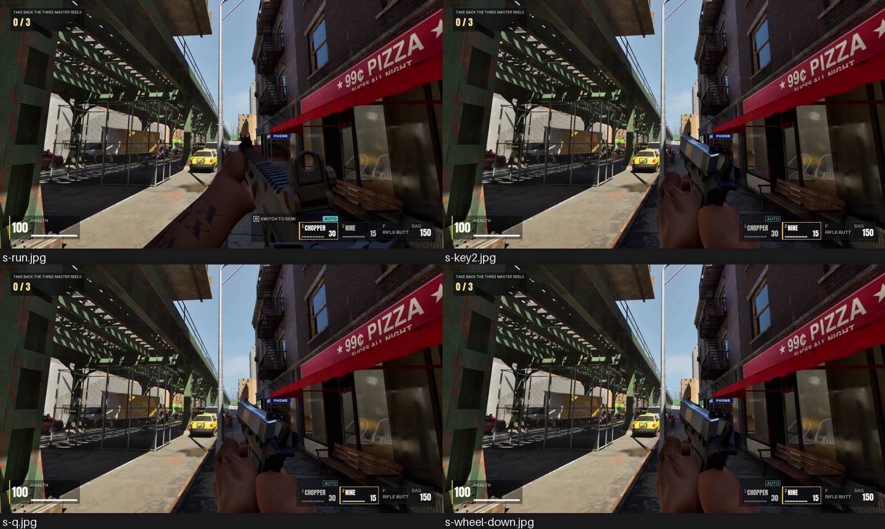
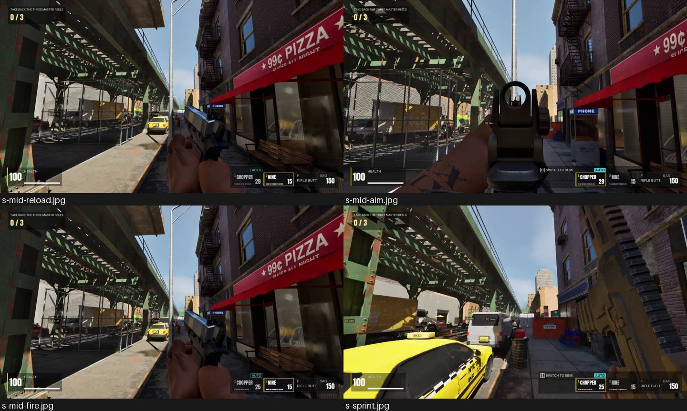

# PLAY: the owner's play report of version 4, lane by lane

The owner played version 4 on E3DS (2026-11-25, about 21:15 UTC): killed enemies crouch instead of bleeding and falling,
"switching between weapons doesnt work", the story needs cues and walking paths, and a full end-to-end play before
deployment (DECISIONS.md, 2026-11-25 ~21:20, criterion 5). One section per lane. Pictures are in `docs/unreal/shots/`.

## Weapon switching (the switch lane)

### What was played, and what happened

**Version 4 itself** (the zip of `6c4d810`, `/project/ue/cloud/v3a-fix/out/MurderInc.zip`, unpacked to
`/project/ue/play/switch/v4/Linux`), the Shipping game streamed by Pixel Streaming 2 to the box's test viewer, every input
sent as a browser page sends it (`tools/box/cloud/switch-keys.txt`, played by `rtcinput.py`; run
`/project/ue/play/switch/lag/v4-switch`). The two parity guns, the CHOPPER in slot 1 and the NINE in slot 2:

| Input through the stream | Result (frame) |
|---|---|
| key 2, key 1 (JavaScript key codes 50, 49) | NINE, then CHOPPER (`s-key2`, `s-key1`) |
| number pad 2, 1 (98, 97) | NINE, CHOPPER (`s-numpad2`) |
| Q | the other gun (`s-q`) |
| the mouse wheel, one notch down (-120), one up (+120) | next, previous (`s-wheel-down`, `s-wheel-up`) |
| a fast flick of three notches 30 ms apart | one step, as the debounce says (`s-wheel-flick`) |
| key 2 while reloading | the reload stops, the NINE comes up (`s-mid-reload`) |
| key 1 aimed | the CHOPPER comes up aimed (`s-mid-aim`) |
| key 2 with the fire button held | the NINE (`s-mid-fire`) |
| key 1 sprinting | the CHOPPER in the HUD; the gun is lowered out of the picture while sprinting (`s-sprint`) |
| F (the rifle butt) then key 2 at once | the NINE once the strike is over (`s-melee`) |
| P, key 1 on the pause card, P | the card; the press does nothing; the NINE still in hand after the resume (`s-paused`, `s-resumed`) |
| **key 1 after the resume** | **the game stopped drawing and died: SIGSEGV** (`game.log`: `Signal 11 caught`, crash context `SkeletalMeshComponent='FirstPersonPackGun' SkeletalMesh='SK_TFA_AR_Short_Combined' AnimInstance='MIFPAnimInstance_...'`; the stream's last frame at 58 s of the viewer, the process gone at 86 s) |

So in version 4 every way to change guns reached the rules and drew the right gun, and **a weapon switch crashed the game
about a minute into the run**. That is what a player sees as "switching doesn't work": the picture freezes on the key
press and the session ends.

**The newest package** (the release engineer's trial of `fd8ce12`, run `/project/ue/cloud/lag-v6trial/t-guns`, four guns:
CHOPPER, NINE, SHORTY, RATTLER): keys 1 to 4 through the stream drew the four guns, each aimed, fired and reloaded
(`g-gun1` to `g-gun4`). That package has no fix for the crash below (it predates `1f560d7`).

### The cause of the crash

`UMIFirstPersonRig::Equip` (`MIFirstPersonRig.cpp`) starts every equip with `Loaded.Reset()`: the array that holds the
gun's clips for the garbage collector lets go of the previous gun's clips. But the first-person anim instances
(`UMIFPAnimInstance`, `MIFirstPersonAnim.h`) keep the last pose they were given, and a pose names its clips by raw pointer
(`FMIFPLayer::Clip`). In version 4 the CHOPPER was the pack rifle (pack mode: the arms' instance and a second instance on
the gun, `FirstPersonPackGun`); after a switch to the NINE (hand IK) the hidden pack gun kept ticking
(`EVisibilityBasedAnimTickOption::AlwaysTickPoseAndRefreshBones`) with its last pose. The next garbage collection (a
packaged game collects about once a minute) freed the CHOPPER's gun clips, and the next evaluation of that pose read freed
memory: `SIGSEGV ... address 0x0` in the pack gun's animation. The hands lane saw the same crash once with `HighResShot`
(HANDS_R4.md 5) and the branch has since stopped the hidden pack gun's tick and cleared its instance on every equip
(`1f560d7`, in `MIFirstPersonRig.cpp`). That covers the pack gun; it does not cover any other instance left holding an
old pose, and nothing tested it.

The smooth-play lane found the same crash independently in the newest package (`fd8ce12`, SMOOTH.md C1: 2 of 2 sessions,
symbolised stack `MIFirstPersonAnimPrivate::Sample` -> `L.Clip->GetPlayLength()` from `FMIFPAnimProxy::Evaluate`, at the
first periodic collection after a switch). That package predates `1f560d7`; its sessions carried the STICK (the pack gun) and switched
out of it and back. SMOOTH.md names the fix's commit as `2a35906`; that hash is
a READY.md commit: the fix is the commit that adds this section. The freeze of about a second around a switch (SMOOTH.md
C3, synchronous loads in `EquipMesh` and `UMIFirstPersonRig::Equip`) is the smooth lane's; it is not a failure to switch.

### What was changed (the switching code and its tests)

1. **`UMIFPAnimInstance::SetPose` holds the clips of the pose it is given** (`MIFirstPersonAnim.h`, a `UPROPERTY` array
   `HeldClips`, emptied and refilled on every pose; `Reset` keeps its memory, so nothing is allocated per frame after the
   first). An instance can no longer evaluate a clip the collector freed, whatever the rig does with `Loaded`. No rule,
   timing or pose changes: the same clips are sampled at the same times.
2. **`MurderInc.Player.SwitchEveryWay`** (`Tests/MISwitchPlayTests.cpp`): a run in a world with the real character, the
   real `AMIPlayerController` and its Enhanced Input mapping; every key goes in through `APlayerController::InputKey` as
   the viewport sends it, the mouse wheel as `FSceneViewport::OnMouseWheel` sends it (the press and its release in the
   same frame). For one, two, three and four carried guns (STRETCH; CHOPPER NINE; SHORTY RATTLER NINE; STICK CHOPPER
   RATTLER STRETCH: the six guns between them), after every input it checks the slot the rules hold, that the weapon
   component shows that gun's mesh (`UMIWeaponComponent::GetShownGun`) and that the gun is up: keys 1 to 4 (a slot past
   the last does nothing), the number pad, the wheel both ways and round both ends, the D-pad left / right / up / down,
   Q and Y, two Q taps at once. With four guns: a switch while reloading, aimed (the new gun comes up aimed while the
   button is held), firing (the holster starts at once), sprinting, during the rifle butt (it goes through when the
   strike ends), presses on the pause card (none act) and after the resume, a press on the death card (none acts), and
   after Run it back (slot 1, then keys and the wheel).
3. **`MurderInc.FirstPerson.SwitchSurvivesGC`**: the STICK (the pack gun today) and the hand-IK guns, switched pack ->
   hand IK -> pack -> NINE -> CHOPPER -> pack -> hand IK with a garbage collection after each switch; every clip that any
   first-person anim instance of the player still holds in its pose must survive it, and the poses are evaluated again
   afterwards. It times `SetPose` too (below). Without the pack art it says so and checks nothing.

**The suite** (`tools/box/test.sh MurderInc` in `/project/ue/play/switch/repo-switch`, a clone with the guns imported as
the guns lane does, built with `-MaxParallelActions=6`) at `a3e57b0` with these changes: **206 passed, 0 failed, 0
skipped** in 77 s, the golden replays included (`Golden.*`, `Loadout.ParityGolden`); `SwitchEveryWay` 4.3 s,
`SwitchSurvivesGC` 1.3 s. No rule moved: the switching rules (`FMIWeaponRules::RequestSwitch`, `AdvanceSwitch`) and the
input layer (`FMISwitchInput`, `AMIPlayerController`) are unchanged.

**Negative control**: the same clone with version 4's behaviour put back by hand (the pack gun's tick and instance left
alone in `Equip`, `HeldClips` not filled) fails `SwitchSurvivesGC` at the first switch out of the pack gun: "slot 2
(rattler, mode 2): every clip of the 2 first-person pose(s) survives a collection: expected 0, was 1". The test catches
the version 4 crash. (In the editor every loaded asset carries `RF_Standalone` and is never collected, which is why the
crash was never seen in play in editor; the test clears that flag on the poses' clips for its collection, as a packaged
game has it.)

**Cost**: `SetPose` with the clips held measured 0.023 microseconds a call (the arms' pose, 20,000 calls in the test);
two calls a frame (the arms and, with the pack gun drawn, the gun). No allocation after the first frame, no load, no
change to what is drawn.

### What was checked and found right (no change needed)

- **Presses while the game cannot take them**: on the pause card and the death card no gun changes, and the press is
  not carried into play (the resume and Run it back drop it; `DropMenuPresses`). A first version of the test resumed by
  calling the game's pause key directly and saw the press go through: a world made by a test has no game mode, so the
  engine pause does not stop input there; the test now pauses and resumes with the P key, as a player does.
- **The input map** (`AMIPlayerController::BuildInputAssets`) matches the web game and `frontend.json input.game`: 1-4 and
  the number pad (slots), D-pad left / right (slots 1 and 2, `src/config/player.js` 14 and 15), wheel down / D-pad up
  (next), wheel up / D-pad down (previous), Q / Y (swap; with three or more guns a tap swaps on release and a hold of
  `wheel.hold` opens the weapon wheel), B / View (fire mode), F, V, the middle button, RB, R3 (the rifle butt).
- **The loadout-to-slot mapping**: the set-up's guns are contiguous (`FMIFrontEndRules` closes gaps), the resolver keeps
  their order (`FMILoadoutResolver::Resolve`), and slot N is `Guns[N-1]`; the test checks it for the six guns.
- **The stream path** (Pixel Streaming 2's `RTCInputHandler.cpp`): key codes go through `JavaScriptKeyCodeToFKey`
  (49 to 52 are One to Four, 97 to 100 the number pad) and the wheel through `HandleOnMouseWheel` (delta / 120) to Slate
  and `FSceneViewport::OnMouseWheel`; the game's own input processor (`FMICloudInput`) passes both on. Seen working in
  version 4 above.
- **Equip locks**: the rules accept a switch in every state but a dropped gun (death); a switch during the rifle butt is
  queued; a switch cancels a reload and the fire selector, as the rules say. Unchanged.

### Tools added

- `tools/box/cloud/rtcinput.py`: the verb `wheel <delta> [events] [gap ms] [x y]` (the page's `MouseWheel` message, id 75).
- `tools/box/cloud/switch-keys.txt`: the viewer script of the table above.

### For the hands engineer (MIFirstPersonRig.*, not edited here)

Nothing is required: with `HeldClips` an instance keeps its clips alive itself, and the `1f560d7` guard stays right. If
the rig ever adds an instance of its own (another component with `UMIFPAnimInstance`), it is covered by the same
`SetPose`; a pose built by hand and written another way would not be. Seen on the way, for that lane: while sprinting the
gun and both arms leave the picture entirely in version 4 (`s-sprint`); the HUD still shows the gun in hand.

### Still open

- A package of this branch played through the stream (the crash was reproduced on version 4; the fix is proven by the
  test, not yet by a packaged game on E3DS). The release engineer's gate should include `switch-keys.txt` (with
  `wheel` lines) on the new package, for longer than a minute (the first collection).
- The viewer's pad section of `switch-keys.txt` did not run on version 4 (the game had crashed by then); the pad paths
  are covered by `SwitchEveryWay` and by `ControllerPad`.
- E3DS's own page was not used (no E3DS session was spent): its key and wheel handling were taken from Epic's player
  library and from the version 4 sessions in DECISIONS.md.

## Story guidance (the guide lane)

The owner: "the story needs to have ques to tell a player where to go and hints (highlighted walking paths on the ground
to get to the next object. this is important for story mode so the player can advance through levels." Story mode is one
map (the Block) with three reels and the IPX truck: Reel 1 The Avenue, Reel 2 Chop Shop, Reel 3 The Cage, then the truck's
rear doors. The rules let the reels be taken in any order; the guidance always points at the first one not yet taken
(the radio's own order: "the avenue, the chop shop, the cage"), then the truck. Nothing of it is a rule: no collision, no
timing, no decision of the flow or the enemies reads it.

### What the player sees

| Cue | What it is | Where it comes from |
|---|---|---|
| Objective block (top left) | The flow's line ("TAKE BACK THE THREE MASTER REELS", "TWO REELS LEFT", "LAST REEL", "GET TO THE IPX TRUCK") and the reels count as before, and under them the **step**: a small amber diamond and "Reel 1 — The Avenue", "Reel 2 — Chop Shop", "Reel 3 — The Cage", then "IPX truck — The Lot". The block now scales with the frame's height (READY.md M9: the title stayed 1080-sized at 4K) | `text.json` objectives, `level.json` objectives labels, `interface.hud.zones` |
| Hint line | Under the step, in a warm white, after **45 s of play without progress** (fighting does not count: the clock stops while any enemy is engaging; the intro does not count). Progress is being 3 m closer along the route than ever before on this step; the line goes at once when that happens and comes back after another 45 s | `guide.json` `levels.block.steps.<id>.hint` |
| Step marker | The step's "[1] 24m" where it stands; the distance is what is left **along the route**. Off the screen or behind: an amber arrow on the screen's edge pointing toward it, with its label inside. It fades from 10 m and is gone at 2.5 m, where the grab prompt takes over. The other reels keep their plain marker. Hidden while the weapon wheel is open (as before) | `guide.json` `marker` |
| Ground path | Amber chevrons on the ground from 1.4 m ahead of the player to the step, at most 30 m of it, 1.5 m apart, each pointing along the way; a light runs along them toward the goal (four phases, 0.9 a second). Dimmer under a roof, the El or inside the chop shop (the eye is adapted darker there), and toned down to 35 % while an enemy is engaging. Depth-tested (walls hide it), drawn on the floor under it (kerbs and slabs), no shadow, no collision, no part in Lumen or distance fields | `guide.json` `path`, `look` |
| Settings | A new row on the Settings card, **Path and markers: On / Off** (on by default, saved): Off hides the ground path, the step marker and the reel markers. The step line and the hint stay | `FMISettings::bGuide` |

The hint lines, in the voice of the radio (`text.radio`) and the prompts:

| Step | Line |
|---|---|
| Reel 1 | Reel 1's out on the avenue, under the El. Head east. |
| Reel 2 | Reel 2's inside V&R Auto Body, north side. The bay door's open. |
| Reel 3 | Reel 3's in the cage at the north-east end. The gate's off the avenue. |
| Truck | The IPX truck's idling at the south end of the lot. Get to its back doors. |

### How the path is found

- **The Goons' own nav grid** (`FMIBoxWorld::FindPath`: A* on the 0.5 m occupancy grid of `level.json` with string
  pulling, the one `MurderInc.Golden.World` checks against the web game), searched on a **private copy** of the box
  world (`AMIGuide::SyncNav`), refreshed only when the box list changes (a run's start, an explosive gone). The
  simulation's own world is never searched by the guide, so not even its search buffers are touched.
- A search every second, at once (after 0.25 s) when the player is 2.5 m off the drawn route, and on every step change. A
  new route replaces the drawn one only when it is 5 % shorter than what is left of it, so two routes of about the same
  length never flip back and forth.
- The chevrons are laid **from the goal backwards** in slots of 1.5 m, so a chevron stays where it is while the player
  walks the route (test `Stable`: 0 moved in 6 s of walking); only the two ends grow in and out.
- **Upper floors**: the grid is the ground's. A player on the scaffold shed's deck or the chop shop's mezzanine (feet more
  than 1 m above the ground under them) is first led down that floor's own stair (`guide.json` `waysDown`), never through
  the parapet to the street under it. The station's stair is not a way down: its steps are 0.75 m, more than the 0.42 m a
  body climbs, so nobody gets up there.
- The route ends on the free cell nearest the reel's case (0.8 m from its centre, inside the 2.2 m grab range), and in the
  truck's zone.

The routes as the guide draws them (test `Routes`, from the step before):

| Leg | Route | Straight line | Way |
|---|---|---|---|
| Start → Reel 1 | 37.7 m | 34.2 m | East along the south sidewalk, then across the avenue under the El to the case |
| Reel 1 → Reel 2 | 25.2 m | 23.4 m | North across the avenue, through the chop shop's bay door (x -3.2 to 0.6), inside to the case |
| Reel 2 → Reel 3 | 64.8 m | 44.0 m | Out of the bay door, east along the north sidewalk past the deli, through the cage's south gate |
| Reel 3 → truck | 60.0 m | 52.2 m | Out of the cage gate, across the avenue, into the lot by its entry (x 28.6 to 35), south to the truck's rear doors |
| The whole story | 187.7 m | | (the maps lane measured 193.7 m with its own A* from the start) |

### The end-to-end play

`MurderInc.Guide.EndToEnd` plays the whole story in a world with the block's collision and the real player movement: a
bot that **only follows the drawn route** (pure pursuit on `AMIGuide`'s path, sprinting), holds the grab at each case,
and walks to the truck; the enemies are live and shoot (the bot is patched up each frame, as in `Run.StoryComplete`).
It fails if the bot gains no metre along the route in 8 s anywhere. Result: **story complete in 37.2 s of game time**,
steps of 7.9 s, 6.4 s and 11.8 s to the reels (grabs included) and the rest to the truck, never more than 0.48 m from the
drawn route, the path shown in every frame of the story and nothing drawn after the truck. No place was found where the
route goes through a wall, off the block or onto the wrong floor (`Routes` checks every leg of every step from the start
and from the step before: every leg clear on the grid, every point inside the block and on the ground floor, every
chevron on walkable ground at the floor's height).

### The cost (game thread)

| What | Measured | Where |
|---|---|---|
| The guide's frame (plan, strips, light) | **0.021 ms a frame on average**, worst 0.87 ms (the first frame of a run: the box world copied, the grid built; 1.88 ms in another run) | `EndToEnd` in the suite run below, 1,120 frames, `AMIGuide::GetCost` |
| A path search | 0.116 ms on average, worst 0.52 ms, once a second | same |
| Strips moved | 1,590 in 1,120 frames (about 1.4 a frame while sprinting: the two ends of the path) | same |
| Strips drawn | at most 40 (20 chevrons x 2 flat strips, the engine plane), one of 8 material instances each; per frame 8 scalar parameters are set, nothing else | same |
| Allocations in play | none after the first route of a step: the input, the search buffers, the chevrons and the slot cache are reused; the strips are built once at the map's start | code |

The headless suite cannot measure the GPU: 40 small additive quads on the ground in the translucency pass. `MIGuide.Stats`
(console) prints the same numbers in any game; the packaged game under the gate's load (PREFLIGHT.md) has not been
measured yet (below).

### What was changed

- `World/MIGuide.h/.cpp` (new): `FMIGuideTune` (guide.json), `FMIGuidePlan` (the step, the route, the hint clock, the
  chevrons; no engine), `AMIGuide` (the actor the HUD spawns: the private box world, the strip pool, the light);
  console `MIGuide.Stats`, `MIGuide.Reset`, `MIGuide.HintAfter <s>`, `MIGuide.Show 0|1`.
- `Content/Data/guide.json` (new): timings, look, the hint lines, the ways down.
- `UI/MIHUD.*`: the step line and the hint in the objective block (scaled with the frame), the step marker with its edge
  arrow and fade, the Settings row's effect on the markers; `BeginPlay` spawns the guide.
- `Flow/MISettings.*`, `UI/MIMenus.cpp`, `Flow/MIGameSubsystem.cpp`: the Settings row "Path and markers" (saved).
- `Flow/MIDemoDirector.*`, `tools/box/demo/demo.txt`: the verb `guide [limit] [sprint]` (walk the drawn route to the
  step; with `grab` and `waitstate complete` it plays the story by the guidance alone).
- `Tests/MIGuideTests.cpp` (new): `MurderInc.Guide.Data`, `Routes`, `Hint`, `Stable`, `EndToEnd`.
- `tools/box/fp/guide-shots.sh` (new): the pictures below and the walk in play in editor.

The rules, the golden replays and every other test are untouched (the suite: below).

### The suite

`tools/box/test.sh MurderInc` on the branch at `7209dc4` with this lane's change (clone `/project/ue/play/guide` on the
box): **216 passed, 0 failed** (78 s), the golden replays included; no test weakened, skipped or re-recorded.

### For the other lanes

- **READY.md M9** (the objective title not scaling at 4K) is done here, in the same block: the title, the counter, the
  step and the hint all scale with the frame's height.
- The hands engineer: nothing (no change to `MIFirstPersonRig.*` is needed).
- The release engineer: `guide.json` ships with `Content/Data` (loose files); the chevrons use `/Game/FX/M_FX_Tracer` and
  the engine plane, both already in every package (no new asset, no usage flag: static meshes are the material's default).
  Without them the guide says so in the log and draws only the HUD cues.
