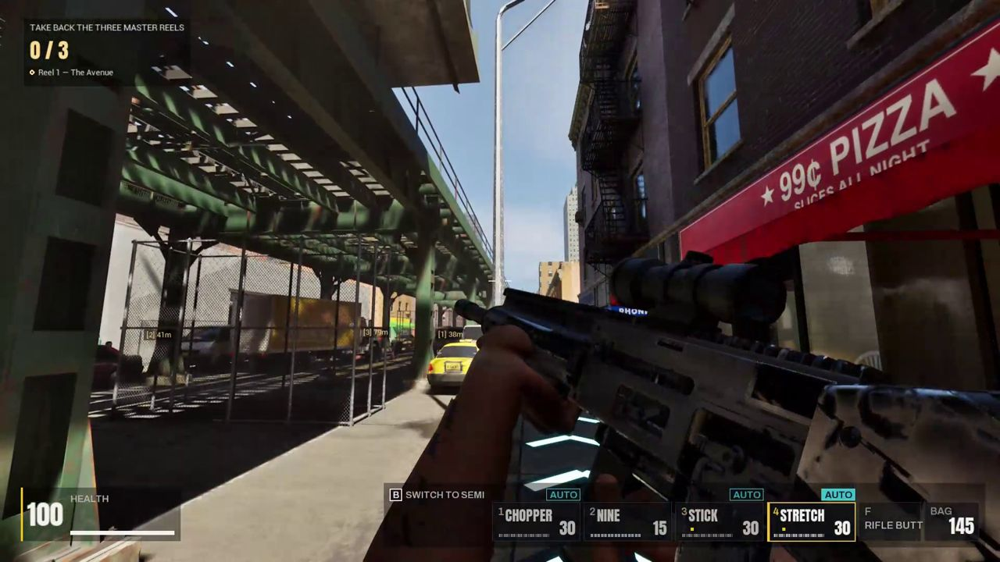
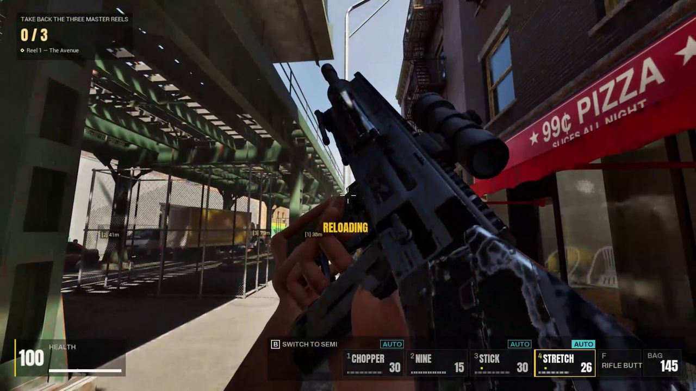
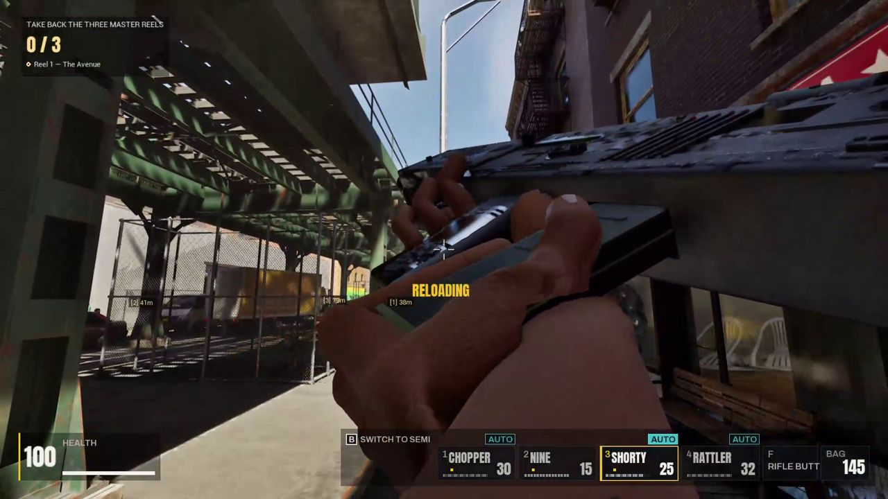
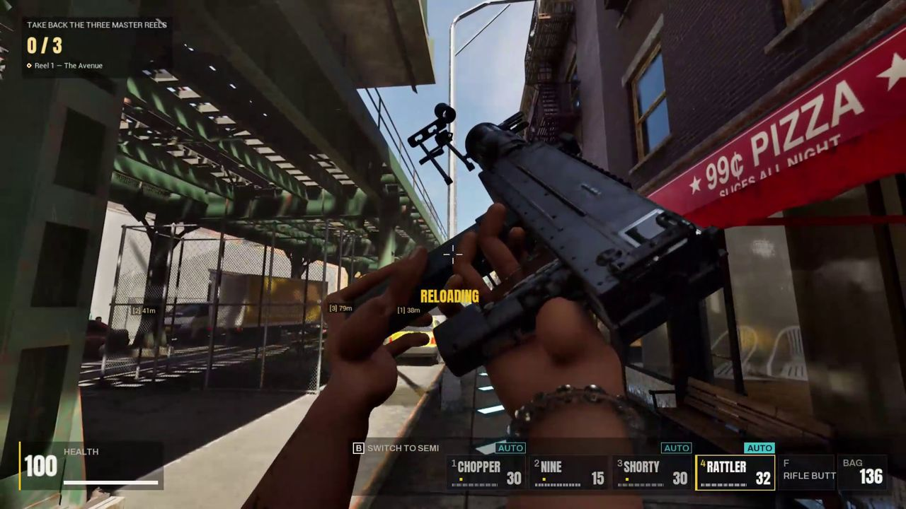

# Deployment readiness (release v6)

One section per lane of the readiness pass. Every finding names the evidence it rests on (a picture, a log line, a number).

## v6 GO readiness (release fixer, 2026-11-26, 22:15 to 00:30 UTC)

**Proposed commit: none yet. Verdict: NOT YET (no go).** The last code commit of this pass is `ef28d60`; the full suite passes on it
(`TESTS OK passed=222 failed=0 skipped=0`, golden replays included, nothing skipped, weakened or re-recorded; run in the integration clone
`/project/ue/int/repo` with the guns imported, log `/project/ue/v6fix/c4-test.txt`). The hands, the reload magazines, the Crew screen, the
deaths and the guide are fixed and were looked at in engine frames (enlarged, one by one). Four things stop a GO: the STRETCH's finish,
the smoothness numbers (not re-measured: no new package was built), the independent look at these frames, and the independent end-to-end play
of a package built from the fixed commit. Each criterion of DECISIONS.md (2026-11-25 20:40, 21:00, 21:20):

| # | Criterion | Pass / fail | Evidence |
|---|---|---|---|
| 1a | Hands C++ pass built, review's must-fix closed | **pass for CHOPPER, RATTLER, SHORTY, STRETCH hands**; STRETCH finish fails (see 2) | `16f819d` (reach guard, firing-hand log, `ReloadHold` checks the firing palm within 1.5 cm); engine log `firing hand <gun>: palm 0.3 cm` on all four rifles; frames `shots/v6-hands-chopper.jpg`, `-rattler`, `-stretch`, `-shorty-after`, HANDS_R4.md 14 |
| 1b | Support hand holds the magazine in every reload | **pass** | reload 0.5 s on CHOPPER, RATTLER, STRETCH, SHORTY in the sheets above: the magazine is in the support hand, the firing hand on the grip |
| 1c | Aimed optics show no black ring | **pass (not re-taken)** | the visual pass (PLAY.md): red dot and 2x/4x scopes without the ring; the aimed frames of this pass (chopper, stretch, shorty, rattler) show none |
| 1d | Pictures looked at by someone other than the engineer | **fail (pending)** | the fixer's own look only; a second reviewer must open `shots/v6-hands-*.jpg` |
| 2a | Readiness pass says go, rendering faults fixed | **fail** | STRETCH finish (HANDS_R4.md 14): the stock draws as marbled white and black mirror in every frame with the box's files identical to the repo's; SHORTY's olive finish is right after `guns-resident.py` |
| 2b | Menus clean, every gun with every part fitting | not re-run | READY.md M and W items stand as the readiness lane recorded them; open here: Workbench keeps previewing a removed part, framing hides STRETCH/STICK/NINE muzzle fits, pause card diagnostics line (e2e review should-fix) |
| 3 | Full suite on one commit, guns imported fresh | **pass** | 222/222 on `ef28d60`'s unreal tree (also on `e28598d` and `6fb9f92`); the clone's guns were imported fresh on 2026-11-26 16:07 and the first-person gun textures set never-stream on 22:43 |
| 4 | SMOOTH.md verdict "smooth" | **fail (not re-measured)** | the prover's NOT-YET stands (menus-with-guns 25 ms frames, engine start). What this pass changed that touches it: the Crew stage is drawn once behind the title card (H3), first-person gun textures are never streamed (about +416 MB resident). Neither was measured: that needs a package of the fixed commit and the lag harness (`package-cloud.sh`, `lag-test.sh`), which this pass did not run |
| 5a | Killed enemies bleed and fall (no crouch) | **pass in frames** | `shots/v6-deaths-back.jpg`, `-stairs`: the body is on the ground by 0.25 s (before: kneeling with the gun ready until 0.6 s). Blast (`shots/v6-crew-guide-blast.jpg`, bottom): the Goon next to a pallet stack slumps against it at 0.6 s with one arm up and is down at 1.5 s: acceptable, not perfect (a body leaning on a wall) |
| 5b | Weapon switching by keys, wheel and pad, with tests | pass (earlier) | PLAY.md switching lane, tests green |
| 5c | Story guidance leads start to extraction | **pass in frames, tuned twice** | the roof test now reaches 5 m (the El's deck at 6.5 m no longer counts as a roof) and the path is brighter and wider; `shots/v6-crew-guide-blast.jpg` (top middle and right) |
| 5d | Independent end-to-end play, no blocker or must-fix | **fail (pending)** | needs a package of the fixed commit; the earlier play's must-fixes are answered below |

### The must-fix and blocker list of `v6-proofs.json`, one by one

| Finding | State | What was done / evidence |
|---|---|---|
| Hands: reload fanned hand, no magazine | **fixed** | shoulders anchor [12, 12, -36] (data of the offline lane, HANDS_R4.md 13) plus the reach guard; engine frames |
| Firing hand V on the rifles | **fixed** | palm 0.3 cm off the grip, frames |
| Torn back of the hand | not seen in 40 frames | HANDS_R4.md 14 |
| Skin-coloured ball (wall, Crew) | **Crew fixed; wall not reproduced** | the Crew stage showed the pack idle's fist as a stump: `mi.FE.CrewArms` 0 shows the turntable gun (`d611454`); against walls the new anchor leaves nothing (HANDS_R4.md 14, `shots/v6-hands-wall.jpg`); the black dome of the death-shot runs is the template body's arm in `MIStart mission skip` runs, not a play fault |
| SHORTY reload pose and eye relief | **fixed** | `shoulders` [12, 12, -36] (was [2, 2, -20]: the forearm filled the screen), the offline reload pose and relief 0.12; aimed frame clear of the butt (no aperture ring: art) |
| Deaths read as alive 0.25 to 0.6 s | **fixed in frames** | `fallPull` 1800 cm/s2 for 0.8 s (60 percent in blasts) and angular damping 0.6 to 0.25 (`7e4eb8d`, `ef28d60`); no gameplay rule touched (presentation of the ragdoll only) |
| Stiff arm on stairs | **not seen** | `shots/v6-deaths-stairs.jpg`: the body slumps on the treads, no raised arm; the rest on the stair is out of frame at 1.5 s and 4 s |
| Story path invisible in sun under the El | **improved, check** | `MIGuide` shade raycast 40 m to `look.shadeReach` 5 m; intensity 18000 to 80000, width 0.14 to 0.2 m (`ef28d60`); frames in `shots/v6-crew-guide-blast.jpg` (top middle and right) (at 36000 the path was still faint; in the frames where the path lies in view, back and stairs sequences, it is bright) |
| Gun finish (mirror) | **SHORTY fixed, STRETCH open** | `tools/box/fp/guns-resident.py` and `mi_guns_r4.keep_resident` (never stream): SHORTY olive in every frame; STRETCH still marbled, box files = repo files (md5), so a UV/island mismatch on import, not residency: owner of `mi_fp_import._import_mesh` |
| 349.7 ms freeze under load | **not fixed** | evidence in the game.log (`e2eb2`, 20:01:40): two `UPixelCaptureMediaCapture::WaitForGPU: Timed out waiting for fence` lines 100 ms apart on the game thread (`gameMs` 98.7), then the pacer's 250 ms wait: one event in 4.5 minutes, none in the 15-minute holdout; the cause is the stream capture's copy not finishing (the engine's own time-out, with a hog process sharing the card), not the pacer; lowering `MI.Cloud.GpuWaitLimitMs` from 250 would cap the pacer's share but is untested on the A4000 emulation and was not changed |
| Crew screen's first frame (H3) | **changed, not measured** | `WarmStage`: the Crew arms and the turntable are drawn once into a 192 x 108 target behind the title (`d611454`); measuring it needs the package |
| B2: 77 s wait for an unhurt Buzzard | **not changed: owner decision** | `UpdateLastEnemies` (60 s limit, persist builds only) is the guard that ends such a wave; the HUD already marks the last enemies (`MIHUD.cpp:465`). Shortening the limit changes when a wave ends, so it is written up for the owner: pick a limit (30 s?) or leave it |
| Owner's polish decisions (2x scope name, 90 degree default field of view, STRETCH semi-automatic) | **not done by this fixer** | they change gameplay data (the STRETCH's fire mode) and defaults (FOV; golden tests read 74); this pass was bound by "gameplay rules must not change", so they wait for the lead to say go; each is a data edit plus the tests that read the old value |
| POLISH.md v6 shortlist | **not done** | no time left in this pass (wedge timer, blast hit marker, NEXT label, slider steps, HUD scale, plates) |

### What is still needed before a GO

1. The STRETCH's finish (UV or material), one picture of it right.
2. A package of the final commit (`tools/box/cloud/package-cloud.sh`), the lag harness on it (menus with guns, Story, holdout: frames over 25 ms per minute, engine start, the Crew screen's first frame) and a new SMOOTH.md verdict.
3. A second reviewer's look at the pictures named above, and the independent end-to-end play of that package.
4. The lead's word on the three owner decisions and the POLISH.md shortlist; the owner's on B2.

### Independent check of the fixer's head (checker, 2026-11-27, 23:35 to 00:10 UTC): **NO-GO**

**Verdict: NO-GO for v6.** The hands, the Crew screen, the guide and the fixer's other changes hold up in a package of the fixer's
head. Three things block a GO: the STRETCH's finish is wrong in the package (must-fix), the smoothness criterion is still not met or
re-measured (the prover's NOT-YET stands), and the deaths were not seen close in the package. Nothing here weakens the fixer's
own list; the checker found no new blocker.

**What was checked, on what.** A package of `914d350` (the fixer's head: code as `ef28d60`, then docs) was built on the box with
`package-cloud.sh all` (`MI_COMMIT=914d350...`, `MI_GP=/project/ue/int/repo`, own output folder `/project/ue/chk6/c`): editor build OK,
weapons import 16 texture sets OK, `PACKAGE Development OK`, `PACKAGE Shipping OK`, 405 PSOs in the cache, `ALL OK`, 13 minutes
(`v6c.zip`, sha256 `3cfbfc0c...`). Unzipped to local disk, run by `lag-test.sh` as the cold user (`runas=fresh clean=1`, `cpus=0-7`,
`-sm5`, `load=1:0.05:0.05:1024`, qp 34:34) with the viewer's real keys through the stream. Runs: `c-g1` (`guns-keys.txt`: card,
Home, Crew, Loadout, three Workbench visits, briefing, Story, guns 1 to 4 drawn, aimed, fired, reloaded), `c-g2`
(`guns-keys-b.txt`: STICK and STRETCH the same way), `c-p3` (Development game, demo director: Story start, `hunt` three kills with
god mode, `guide` along the chevrons, viewer frames every 0.3 s). **Clean in every run**: `others=0` and `build=0` in every watcher
line (141, 122 and 71 lines). Each game quit by itself on the stop signal, exit 0, no crash, no `Fatal`, no pacer time-out, no
`WaitForGPU` fence line. Every frame below was opened one at a time at 1920 x 1080.

| Item the fixer marks fixed | Checker's finding on the package | Evidence |
|---|---|---|
| Firing hand on the grip, CHOPPER, RATTLER, SHORTY, STRETCH | **Confirmed** at the hip. The hand is on the grip in the idle and fired frames of the four rifles; it reads as a heavy, thick-fingered hand (the CHOPPER's thumb is a large brown sausage beside the receiver), correct but not refined | `c-g1/g-gun1.jpg`, `g-gun4*`; `c-g2/gb-gun4.jpg` (`shots/v6c-pkg-stretch-hip.jpg`) |
| Support hand holds a magazine in every reload | **Confirmed** on CHOPPER, RATTLER (best frame: both hands, magazine, bracelet), NINE, STICK and STRETCH (a hand with a dark block). **SHORTY: should-fix.** The receiver is a slab across the top right, the support forearm and a very large hand fill the middle, the crosshair is behind the hand: it reads as a reload but is the worst frame of the set | `shots/v6c-pkg-rattler-reload.jpg`, `v6c-pkg-shorty-reload.jpg`, `v6c-pkg-stretch-reload.jpg` |
| SHORTY olive finish | **Confirmed** (frame of the aimed and hip views is olive green, not mirror) | `c-g1/g-gun3.jpg` |
| **STRETCH finish** (the fixer: still open) | **Confirmed wrong, must-fix.** In the package the stock and the rear of the receiver draw as a marbled white-and-black blotch (like dalmatian camouflage) in the hip, fired and reload frames, where the art has walnut and a clean finish. It is the first thing seen on the gun. The STICK, CHOPPER, RATTLER and SHORTY do not show it | `shots/v6c-pkg-stretch-hip.jpg`, `v6c-pkg-stretch-reload.jpg` |
| Aimed views | Seen, same as the prover's pass: the red-dot housing is faded, the rear of the gun sits in the lower third with the game's reticle above it (CHOPPER, SHORTY). Not a regression; the aim frames are 0.8 s after the press, so the blend is finished | `c-g1/g-gun1-aim.jpg`, `g-gun3-aim.jpg` |
| Crew screen shows the turntable gun | **Confirmed** by the fixer's frame (`v6-crew-guide-blast.jpg`, top left: a clean gun on its turntable, no stump); the package's Crew screen was passed by key in `c-g1` and `g-rack.jpg` shows the rack. The first-frame cost of `WarmStage` was **not measured** (no per-frame profile was possible in the Shipping game; see below) | |
| Guide path brighter and wider | **Confirmed in the package.** In `c-p3` the cyan chevrons are plainly visible from the first frames under the El, on the sidewalk in sun, and along the whole alley; the step arrow at the screen edge follows the route to the case (`guide done: at the case, 3.5 m left`). The two full-sun frames the fixer called faint were not reproduced | `c-p3` frames 1 to 32 (sheet of 32), log `MIDemo ... guide done` |
| Falling bodies on the ground by 0.25 s | **Not seen in the package.** The director killed three targets (`event killed ... Head`, `Body` at game time 21.9, 28.7, 29.8 s; ammo 30 to 23), but they were far away in the alley and no body is in a frame. The fixer's editor frames (`v6-deaths-back.jpg`, `v6-deaths-stairs.jpg`, read enlarged by the checker) show the body flat by 0.25 s and no raised arm on the stairs; the blast frame still shows a Goon sitting on a pallet stack at 0.6 s (acceptable, not perfect) | log of `c-p3`; fixer's shots |
| Weapon switching, gun strip, reload, kill, HUD | **Works end to end** through the stream: keys 1 to 4, each gun's draw, aim, burst and reload, ammo counts change (30 to 25 CHOPPER, 15 NINE, 30 SHORTY, 32 RATTLER; STICK 25, STRETCH 26), HUD strip follows the gun in hand, the rack and the three Workbench visits fit parts on the CHOPPER, NINE and SHORTY | `c-g1`, `c-g2` frames |

**Smoothness (criterion 4): not met, not re-measured here.** No per-frame CSV exists for a Shipping game, so only one-second probe
lines (`worstMs` is the worst frame of each second) are available; they are not a replacement for the prover's per-frame counts and
do not close the verdict. What they show, with the load on: in play (`state 2`) `c-g1` and `c-g2` hold 60 fps with every second's
worst frame under 25 ms; `c-p3` (Development game, no load) has three seconds with a worst frame over 25 ms in 45 s of play (51.3,
29.5, 31.0 ms). In the front end (`state 0`) there are single 75 to 92 ms frames (76.6 ms in the first Workbench visit of `c-g1`, 91.5 and
85.4 ms in `c-g2`) and, in the first second of the engine's life, one long frame (108.7 ms Shipping `c-g1`; 824 ms Shipping `c-g2`; 1,074 ms
Development `c-p3`, all before any picture, which is the engine-start cost the prover measured at 6.0 to 6.7 s). `FlushAsyncLoading`:
0 in the Shipping runs, two lines in the Development run's first second. So the prover's two numbers (menus with guns 14.0 and 7.9
frames over 25 ms a minute, engine start 3.4 to 4.1 s longer than version 4) were **not** shown to be fixed; neither
`WarmStage` nor never-stream gun textures was measured with the lag harness. SMOOTH.md's NOT-YET stands.

**Remaining list before a GO.**

1. **Must-fix: the STRETCH finish** (marbled white and black where the art has walnut), in the package. One right picture.
2. **Must-fix (criterion 4): smoothness** re-measured on a package of the final commit with the prover's harness (viewer-driven
   front end with all four guns; engine start; Story; holdout) and a new SMOOTH.md verdict that says smooth. This package
   (`/project/ue/chk6/v6c.zip`) can be that package if nothing else changes in `unreal/`.
3. **Should-fix: SHORTY reload** (receiver slab and a giant hand cover the middle of the screen).
4. **Should-fix: bodies seen close in a package**: one run with a kill at 5 to 10 m and frames every 0.1 s (the checker's demo
   killed at range and showed none).
5. The fixer's own open items: Workbench keeps previewing a removed part, framing hides STRETCH/STICK/NINE muzzle fits, pause
   card diagnostics line, the 349.7 ms freeze (one event, cause in the capture's fence time-out), B2 (the 77 s Buzzard wait,
   an owner decision), and the owner's three polish decisions plus the POLISH.md v6 shortlist (not applied; they change gameplay
   data and need the lead's go).
6. A second-reviewer end-to-end play was done here only briefly (front end, a gun switch, a reload on every rifle, kills, the
   guidance); the long play (Hold the Block deaths, pause, Settings, pad) was not repeated on this package. It showed no
   blocker.

> **For the v6 fixer (2026-11-26 ~22:40 UTC, the lead):** besides the items in this file, SMOOTH.md, PLAY.md and HANDS_R4.md 11 to 13,
> also do the v6 shortlist of docs/unreal/POLISH.md (the cheap and safe polish items marked v6: the damage wedge timer, blast kills
> without hit marker or kill tick, the invisible NEXT label, slider steps and repeat, HUD scale K = H/1080, plates and font for the
> in-run warnings, prompt and location card), each built, in the suite and seen in a picture. Owner decisions in POLISH.md are not
> to be made by the fixer; the three the owner made on 2026-11-26 ~22:45 (2x scope name, 90 degree default field of view,
> STRETCH semi-automatic: DECISIONS.md) go into v6.

## Go / no-go for E3DS (verifier lane, 2026-11-26, 01:00 to 01:30 UTC)

**Verdict: GO WITH CAVEATS for version 6, packaged from `04c66c8cb4118c3ed13f858339ca99e949d3cef3`** (the branch head when
this was written; the last code commit is `11ff1ff`; a later commit that changes only docs is the same build). It is a go
only once that package has passed the release gate and the four package checks listed under "Before upload" below. **Do not
upload the trial zip** (`fd8ce12`): it contains none of the fixes, so it still has the Workbench strobe, the 4K stream death
and the aimed optic's black ring.

**What this verification rests on.** No v6 package exists yet: `/project/ue/cloud/v6` holds only the release engineer's
`final.sh`, which waits for `RELEASE-V6-GO`. Other lanes held the GPU for the whole window (a 7200 s claim from 01:08 UTC,
and the weapons fixer's queue had been waiting since 00:30), so I started no game. Instead:

- I built the exact head `04c66c8` in my own clone (`/project/ue/ready/verify/repo-verify`, build OK, 93 of 93 actions).
  The full suite passed: **TESTS OK, passed=217, failed=0, skipped=0, 90 s**, golden replays included. The test log has
  0 `Invalid Bone Name` lines. The only change in the working tree is the editor's own rewrite of `DefaultEngine.ini`
  (blank lines and the Android file server section).
- I re-measured the fixers' recorded stream frames with my own counter (`/project/ue/ready/verify/tools/vflash.py`,
  `steps.py`, `blend.py`).
- I read each fix in the code at the head.
- I ran the data checks: `check_guns_data.py` gives 0 errors and 0 warnings. My own walk of every build of every gun
  (278) is described under W6 below.

### Fixed items: confirmed or not

| Item | Fixer's commit | Verdict | Evidence |
|---|---|---|---|
| M1: Workbench strobes at 20 Hz while the pointer rests on an option, and the hover sound repeats | `d072184`, `7bc34df`, `959d1a0` | **Confirmed** | My count of one-frame flashes on the fixer's stream frames: before (`mf2-before`), **48 in 600 frames**; 29 of 90 while hovering "Pistol suppressor" and 19 of 60 after the click (frame-to-frame step 19.8 luma levels, every third frame). After (`mf2-after4`), **0 in 350**; the largest step is 3.0 while hovering and 5.0 on the click, then 0.0. The three front-end files that game was built from (`8103f35`) are byte-identical to the head's (`git diff --stat` empty). In the code, `Act("preview")` on the part already previewed returns before `Changed()` and `UiNote`, so there is no rebuild and no sound. `MurderInc.Frontend.Steady` passed in my suite. |
| R2 / M1: one garbled frame on each screen change | `7bc34df` (rebuild on the game thread, before Slate's frame) | **Partly confirmed** | Before: Crew, Loadout, back to Loadout, Block & Style and the Briefing each had an in-between frame between the two screens (for example Crew: 34.0 from the old screen and 16.9 from the new one). On the final build only the Workbench opening was caught: one clean step (21.8, then 0.6 from the new screen). The Crew and Loadout bursts began after their change (largest step 1.1 and 1.9). Block & Style and the Briefing were not run on the final build. The code fix is sound, but the stream proof covers 1 of 6 screens. |
| M4: carried tag shows "..." | `d072184` | **Confirmed** | `ready-menu-fixes.jpg`, panel 3 (`mf2-after4`, final front end): "Carried · slot 1" and "Carried · slot 2" in full. |
| M5: focused control not scrolled into view | `d072184` | **Confirmed for rack row 2** | `ready-menu-fixes.jpg`, panel 4: the STRETCH row is fully visible. The Difficulty row at 1280 x 800 was not re-shot. |
| M6: Home's SETTINGS and CONTROLS unreachable by keys / pad | `d072184` | **Confirmed by test** | `MurderInc.Frontend.KeysReach` passed in my suite. No stream frame. |
| M7: pad trapped in the Loadout slots | `d072184` | **Confirmed by test** | `KeysReach` passed (RB to the slots, D-pad Up back to the rack, Y on an empty slot back to the rack). No stream frame. |
| M9: HUD objective label does not scale at 4K | `104b068` | **Confirmed in code only** | `MIHUD.cpp` 340-365: `TitleScale = K * 1.3` is used for both the measurement and the drawing. No 4K frame (and 4K is no longer drawn on E3DS, see R1). |
| M10: "STYLE" wraps alone; "Best 0" | `9858e85`, `d072184` | **Confirmed** | `frontend_text.json`: "Block and style". `ready-menu-fixes.jpg` panel 5: one line, no Best. That panel comes from the `d072184` build, not the final one. |
| W3: keyboard Up "not handled" | `11eb373` (the test tool, not the game) | **Agreed, not a game fault** | `WalkWorld` and `KeysReach` press Up and passed in my suite. |
| R1 / M2: 3840 x 2160 stream dies; R-config: 2560 x 1440 does not hold 60 | `7c4e515` | **Confirmed in log and test; not seen through a stream** | `ed4k-fit` (editor game, E3DS's `-ResX=3840 -ResY=2160 -ForceRes`): `Start size 3840 x 2160: drawn and streamed at 1920 x 1080 ...`. In its probe lines, 85 of 86 read `outW=1920 outH=1080`; the one at 3840 is the first, before the fit. `MurderInc.Cloud.StartSize` passed in my suite. The engine's NVENC failure at a real 4K picture is prevented, not fixed. |
| Size requests: no debounce, odd sizes | `7209dc4` | **Confirmed by test** | `Cloud.SizeWait` and `Cloud.ViewerSize` (1365 x 767 becomes 1364 x 766) passed. Moot with Custom 1920 x 1080. |
| R4: texture pool over budget | `16cd4c8` (pool 1000 MB) | **Confirmed, with a note** | `sf-1080-pool` (Shipping, E3DS-faithful load, CPUs 0-5, CLEAN): 60.0 fps (lowest second 59.8), worst frame 18 ms, GPU 13.2 ms, sender 57.3 a second at QP 34, viewer 57 to 58 a second in every phase. The fixer's `rd4`/`rd5` frames lose the red over-budget text. Note: the RHI counter `texStreamMB` still reads 1,155 to 1,200 MB against `poolMB=1000` in 267 of 289 probe lines (1,062 to 1,065 in `rd5`, which shows no message), so that counter is not the streamer's budget. The "5 GB of the card free" check (`vram_hog`) at 1000 MB is still open. |
| TSR history 100 % as the cause of the blink | `f65cd7c` (tunable only) | **Agreed, not the cause** | `rd4`: 0.467 % falls only to 0.437 % at history 200. `Cloud.Tuning` passed. |
| QP range, start bitrate, SM5 | `3e65029` (LAUNCH.md 9.5) | **Confirmed as written** | These are E3DS panel settings: LAUNCH.md 9.5 lists `-sm5 -MIQpExact`, and the start bitrate only if the range ships. They can only be proven in one E3DS session. |
| W1: crash in the hidden pack gun after the STICK | `ef65217`/`1f560d7`, `68ce52c` | **Confirmed by code and test; not in a package** | `MIFirstPersonRig.cpp` 251-258: Equip hides the pack gun, turns off its tick and clears its anim class. `HeldClips` is in `MIFirstPersonAnim.h`. `FirstPerson.SwitchSurvivesGC` passed in my suite. |
| W2: aimed optics' black ring; support hand drawn as a brown ball | `7e120ac`, `a88dcdc`, hands data `8d0d6ac`, `7c0bc1a` | **Not confirmed (nothing seen)** | The code and the importer are at the head. `7e120ac` and `a88dcdc` are ancestors of `54806a1`, the commit the release copy's weapons were imported from at 19:04, so the faded material should be in the cooked content. No aimed frame of any build that contains them exists. |
| W4: extended magazines sink into the stage plate | `b057e3a` | **Confirmed by test** | `Frontend.StageFloor` passed: "84 stage states checked, 61 with the stand raised"; "rattler magazine back to factory: 1.51 cm above the plate, stand raised 4.83 cm". No stage picture. |
| W6: suppressor flash says -50 % instead of -85 % | `66d4840` | **Confirmed, and no other rule moves** | `meta.factor` is [0.15, 2.0]. My walk of 278 builds (every option per slot, empty where allowed): the only multi-target factor outside [0.5, 2] is `flash` x0.15 (116 builds). Recoil, swap time and length never go below 0.5, so no gameplay rule changes. Suppressed guns skip `MuzzleFlash` (`MIWeaponComponent.cpp` 724). |
| W10: Invalid Bone Name log noise | `11ff1ff` | **Confirmed** | 0 lines in my suite's log. |
| Game-thread hitches (340 ms) | not fixed | **Open** | Not reproduced from local disk (`sf-1080-pool`: worst 18 ms). `sf-1080-min60` has one 168 ms render-thread frame in a turn. |

### What works

- **Weapon selection and parts:**
  - All six guns and their parts resolve: `PartsOnEveryGun` (52 fittings), `DataLoads`, `ParityResolve` and `StageFloor`
    (every offered option of every slot on all six guns) passed at the head.
  - The JSON check is clean.
  - The trial package showed the rack and the Workbench working (audit).
- **Menus:** the strobe and hover-sound loop are gone. The carried tag, the scrolling, the keys and pad reach, and the
  title text are fixed.
- **Rendering at E3DS's scale (A4000-class load):** 60.0 fps, lowest second 59.8, worst frame 18 ms, GPU 13.2 ms at
  render scale 0.50.
- **Streaming at 1920 x 1080, QP 34:** the sender encodes 57.3 frames a second at 6.6 Mbit/s on average and 14.9 at most.
  The viewer receives 57 to 58 a second in still, fast-turn, flick, walk-turn and fire-turn phases.
- **Resolution:** **1920 x 1080 is the highest that streams clean.**
  - 2560 x 1440 dropped to 51 to 54 frames a second in turns and peaked at 21.8 Mbit/s.
  - 3840 x 2160 stops in the engine's encoder.
  - From `7c4e515` the game draws any larger launch size at 1920 x 1080.

### Still wrong or unproven

1. **No v6 package yet.** Every fix above is in the branch only.
2. **Thin geometry blinks at render scale 0.50:** the lit windows behind the fire escapes. 0.44 to 0.47 % of that region's
   pixels blink in game frames, and 0.018 % at the viewer at QP 34. Not fixed. The 0.60 floor costs stream frames in turns,
   so it is not for the meeting.
3. **The pause card shows a diagnostics line in Shipping** (server GPU name, frame rates, QP, build hash): M8, not changed.
   The one-line change is in "Menu fixes, For the lead". Note that the pre-meeting check in LAUNCH.md 9.5 reads that line,
   so if M8 is applied, the check session needs `-MINumbers`.
4. **W5:** the STRETCH starts in AUTO (700 rpm) but is described as semi-automatic. This is the owner's decision; it is a
   gameplay change.
5. **Nits:** W7 (the laser is faint), W8 (heat-tint stripe), W9 (stage framing) and W11.
6. **Never seen on a build that contains the fix:** the aimed optic views (W2), the screen-change frames of Crew, Loadout,
   Block & Style and the Briefing, any Workbench or stage picture with the new magazines or the -85 % line, and the 4K
   launch through a viewer.
7. **Leftover WIP branches:** `claude/menufix-wip` and `claude/menufix-wip3` are still on the remote.

### E3DS settings (LAUNCH.md 9.5, unchanged)

| Setting | Value |
|---|---|
| Browser Resolution | **Custom 1920 x 1080** (never larger; never Dynamic) |
| Video Quality | **Medium** (QP 34; not High) |
| Codec | **H264** |
| Launch options | **`-sm5 -MIQpExact -MICVars=r.Streaming.PoolSize=1000`** (the pool is already 1000 in v6's profile; harmless) |
| Unreal console commands at start | **empty** |

### Before upload (on the v6 package; each is a no-go if it fails)

1. The release engineer's `final.sh`: the suite in the release copy, the launcher test and `release-gate-v6.txt`.
2. The menu burst viewer (`/project/ue/ready/menufix/fix.txt` with `flash.py`) through the stream at 1920 x 1080. It must show
   0 flashes and 0 in-between frames, with Crew, Loadout, Workbench, Block & Style and the Briefing each caught opening
   (a largest step above 10 in that burst).
3. The weapons checks:
   - the STICK-first switching sequence (W1);
   - every optic aimed: no black ring, a hand and not a ball (W2);
   - each extended magazine on the Workbench stage (W4);
   - a suppressor's line reading -85 % (W6).
   Scripts: `/project/ue/ready/weaponsfix/gen_f.py` and `/project/ue/ready/weapons/gen_w.py`.
4. One E3DS session with the settings above, as LAUNCH.md 9.5 describes: the pause card's line must read 60 frames a second
   (lowest 58 or more), QP 34 and a stream of 55 to 60 a second.
5. The bundled pipeline cache (SMOOTH.md, lane `pso`): `package.log` has `PSO CACHE OK` for both games, and the package's
   game log has `Opened FPipelineCacheFile: ../../../MurderInc/Content/PipelineCaches/Linux/MurderInc_SF_VULKAN_SM5.stable.upipelinecache`
   with about 405 entries; on the gate's cold run `pso_frames.py` lists no PSO creation hitch after the viewer joins
   except the Crew screen's (SMOOTH.md, still open).

If v6 cannot pass these before the meeting, show version 4 (already on E3DS, 60 fps at 1920 x 1080), not the trial.

## Menu audit (box lane, 2026-11-25, 19:50 to 21:00 UTC)

**What was looked at.** The newest package on the box: the trial zip `/project/ue/cloud/v6trial.zip` (commit `fd8ce12`, no newer
package in `/project/ue/cloud/v6`), unpacked privately to `/project/ue/ready/menu/zip`. The front end's C++ (`Source/MurderInc/UI`)
and `Content/Data/frontend*.json` have not changed between `fd8ce12` and the branch head, so every menu finding below is
also true of the head unless it says otherwise. Pictures were taken two ways:

- **MIShot** (the Development game, driven by a demo-director script of `MIMenu fe ...` and real key events through Slate,
  `MIKey`): the screens read back losslessly. Runs `rm-full-1080` (1920 x 1080, 145 pictures), `rm-full-2160` (3840 x 2160,
  145), `rm-pad-1080` (the simulated pad: `MIKey Gamepad_*`, 57), `rm-nine-1080` (the known NINE + suppressor state, 27).
  Every Home row, Crew, every rack card and slot, the five rack filters, the Workbench of all six guns with nothing fitted and
  with every option of every slot fitted (and everything fitted at once on the SHORTY and STICK), Block & Style rows,
  Briefing rows, the intro, the HUD with each gun drawn, fired, reloaded and aimed, the pause card and every Settings row.
- **The stream** (the Shipping game through Pixel Streaming 2, the Python viewer `rtcinput.py` with a new `burst` verb that
  keeps N consecutive decoded frames): run `rm-st-1080`, mouse, keyboard and pad as a browser sends them, 31 single frames and
  21 bursts (750 frames). The pictures a player actually receives.

Scripts and runs: `/project/ue/ready/menu` on the box (`gen.py` makes the demo scripts, `go.sh`, `goship.sh`, `stream.txt`,
`runs/`, `shots/`). The release's own picture set below is `docs/unreal/shots/ready-menu-*.jpg`.

### Findings, most severe first

| # | Severity | Finding | Evidence | Fix (proposed, not made) |
|---|---|---|---|---|
| M1 | **blocker** | **The set-up screens flicker in the stream.** Every rebuild of the front end is painted once with all its controls piled at the top of the column (zero-size layout: kicker, title, tabs, stat lines, BACK/ESC and DONE/ENTER drawn over each other). One such frame on every screen change; and while the mouse rests on a Workbench option the screen alternates garbled / clean / clean continuously (about 20 garbled frames a second) until the mouse moves. This is the "NINE + suppressor" frame of the trial, and it is not a NINE fault: the trial's SHORTY bench frame is the same. | Run `rm-st-1080`, consecutive stream frames: mouse resting on "Pistol suppressor" 29 of 90 frames garbled, after clicking it 20 of 60; screen changes Crew, Loadout, Workbench, back to Loadout, Block & Style, Briefing: exactly 1 garbled frame each; the bursts after keyboard moves inside a screen (rack Right and Down, Workbench tab, Down, Enter) showed none, but a stream frame taken at random during set-up changes inside the Loadout did (run `rm-full-1080`, `v007`, no mouse near the column). Trial `t-guns/g-bench-nine-fit.jpg` and `g-bench-shorty.jpg`. MIShot never shows it (it lays the widget out again before reading it back), which is why the editor and MIShot pictures were always clean. The same one-frame flash at 2560 x 1440 (`rm-st-1440`: 1 garbled frame in each of the Crew, Loadout and Workbench openings). Pictures `ready-menu-bench-hover-flicker.jpg`, `ready-menu-rack-garbled-stream.jpg`, `ready-menu-bench-garbled-stream.jpg`. | Cause in code: `SMIFrontEnd::Tick` calls `Rebuild()` (`UI/SMIFrontEnd.cpp` 226-257), which swaps `ChildSlot` during Slate's paint pass, after the frame's prepass, so the new widgets are arranged with no desired size for one frame. The Workbench option's `OnHovered` runs `Act("preview")` and `OnUnhovered` runs `StopPreview` + `Changed()` (lines 824-825): each rebuild replaces the hovered button, the new one is hovered again, so it rebuilds again. Fix: prepass the new body at once (`Body->SlatePrepass(AllottedGeometry.Scale)` right after `ChildSlot[Body]`), or rebuild from `UMIFrontEnd::Changed()` on the game thread instead of in `Tick`; and make preview idempotent (no `Changed()` when the same part is already previewed; `OnUnhovered` stops only its own preview). Prove with the stream burst (`/project/ue/ready/menu/stream.txt`): 0 garbled frames in every burst. |
| M2 | **blocker** | **At 3840 x 2160 the stream stops.** The game draws at 60 a second, but the viewer gets a few dozen frames at the start and then nothing (sound keeps coming); the game's own line says `stream 0 a second (lowest 0)`. | Run `rm-st-2160` (the Shipping game, **CLEAN**: no other game on the GPU in any of its samples): the viewer received 24 frames, then none; 146 of 148 probe lines `encFps=0 txFps=0` with `outW=3840`, `fps=60`. Run `rm-full-2160` (Development, shared the GPU for 178 of 412 s): 143 frames then none for seven minutes, `LogPixelCapture: WaitForGPU: Timed out waiting for fence`, `LogAVCodecs: Failed to lock output bitstream [NVENC 8]`, then 21,010 `CUDA 700` errors from 20:17:12; the pause card line in picture `ready-menu-hud-4k.jpg`. The same package at 1920 x 1080 streams 60 a second, QP 18, 5.5 Mbit/s (`rm-st-1080` pause line). BOX.md row 36 saw 46 encoded frames a second at 4K on an earlier build: this is new. At 2560 x 1440 (`rm-st-1440`, the Shipping game, another lane's game on the GPU) the encoder made 58 to 61 frames a second (`encFps` in the probe lines); its viewer's connection ended after 45 s (`track ended video MediaStreamError`) while the game went on encoding for a viewer, which looks like the Python viewer, not the game. The game's own start line says a viewer's size request is drawn within 1920 x 1080 (`[MICloud] Viewer input: a size request is taken from 640 x 360 up and drawn within 1920 x 1080`), so on E3DS a 4K browser gets 1080 scaled up; only a 4K launch size reaches this fault. | Until a 4K run alone on the GPU streams, cap the output at 2560 x 1440 (PREFLIGHT V3-6 already says test at 1080 until the game limits its own size) and say so to E3DS's resolution setting. The stream lane owns the cause. |
| M3 | must-fix | **Crew screen looks broken.** The stage shows a large brown sphere (a fist seen end-on) and the CHOPPER cut at the eye; the crew card's portrait is the word RULE in a grey box. It is the first screen a first-time visitor sees after Hit the block. | `rm-full-1080/011-crew`, `rm-full-2160/011-crew`, stream `rm-st-1080/s-crew.jpg`; picture `ready-menu-crew.jpg`. | Frame the Crew stage on the gun alone (as the Briefing does) until the arms read well there, and give the card a real portrait or no portrait box. The hands data in the branch (`8d0d6ac`, `7c0bc1a`) removes the ball in play; whether it does on this stage is not seen (not yet packaged). |
| M4 | must-fix | **Carried guns show "..." on their rack card** instead of "Carried · slot n", at every size ("C..." at 4K). Looks like placeholder text. | `rm-full-1080/014-rack`, `021`; `rm-full-2160/014-rack`; stream `s-rack-row2.jpg`; picture `ready-menu-rack.jpg`. | `SMIFrontEnd.cpp` 624/648: the tag shares a 176-unit row with the "E Attachments" button and is ellipsized to nothing. Put the tag on its own line (or a short "SLOT n" chip). |
| M5 | must-fix | **Focused controls scroll out of sight, worst at 16:10.** The rack shows the second row of cards cut at "Kill speed"; keyboard or pad focus on STICK, STRETCH or RATTLER leaves the focused card half hidden. On Block & Style the focused Difficulty row is cut by the bottom bar (its note is a half line at 4K). At 1280 x 800 the Difficulty chips are entirely below the fold while the row has the focus, the rack's second row shows only the names, and the stat labels are cut ("Kill spe..."). | `rm-st-1080/s-rack-row2.jpg` (stream, focus on STRETCH), `rm-pad-1080/014-pad-rack-d`, `rm-full-1080/106-where-row3`, `rm-full-2160/106-where-row3`, `rm-full-800/014-rack`, `106-where-row3`; pictures `ready-menu-where.jpg`, `ready-menu-1280x800.jpg`. | Scroll the focused widget into view (`SScrollBox::ScrollDescendantIntoView`) on every focus move, or fit the page (shorter Where title, less padding). |
| M6 | should-fix | **Home: SETTINGS and CONTROLS cannot be reached by keyboard or pad** (focus walks 8 rows and wraps). A pad player cannot open Settings (Graphics quality) before a run. | `rm-full-1080/002`-`010`, `rm-pad-1080/002`-`009`; `UMIFrontEnd::NumFocusable` returns 8 for Home (`UI/MIFrontEnd.cpp` 202); picture `ready-menu-home-keys.jpg`. Mouse works (stream `s-settings-mouse.jpg`). | Add the two buttons to Home's focus order. |
| M7 | should-fix | **Pad trapped in the Loadout slots pane.** After RB (rack to slots), LB/RB reorder slots instead of switching back and the D-pad cannot leave the pane; Y on an empty slot does nothing ("MIKey Gamepad_FaceButton_Top: not handled"). Only B (leaves the screen) or Next get out. | `rm-pad-1080/016`-`021` and its log; `UMIFrontEnd::Key` handles LB/RB in pane 1 as swaps before the pane switch (`UI/MIFrontEnd.cpp` ~640-660). LOADOUT.md 2.5 gives LB/RB to both. | Pane switch on a free button (or D-pad up from slot 1 returns to the rack). |
| M8 | should-fix | **The pause card shows a diagnostics line** in the Shipping stream: the server's GPU name, frame rate, GPU ms, drawn and sent size, stream rate, QP, round trip and the build hash. An executive will read it as debug text. | `rm-st-1080/s-pause.jpg` (Shipping), `rm-full-1080/125-pause`; drawn by `MICloud.cpp` (~547, `GetNumbersLine`). | Show it only with a launch option (or `-MIDev`), keep the "P to resume" line. |
| M9 | should-fix | **HUD objective label does not scale at 4K**: "TAKE BACK THE THREE MASTER REELS" is about half the size it is at 1080 while "0 / 3" and the weapon strip scale. | `rm-full-1080/117-hud-play` vs `rm-full-2160/117-hud-play`; picture `ready-menu-hud-4k.jpg`. | Scale that text with the HUD scale like its neighbours. |
| M10 | should-fix | Block & Style title wraps to a lone "STYLE" (two lines at 1080 and 4K); "Best 0" on Hold the Block for a first-time player. | `rm-full-1080/103-where`, `rm-full-2160/103-where`. | Shorter title text or smaller display size on that page; hide Best when 0. |
| M11 | nit | The NEW rack filter with nothing new is an empty grid (no message); a Workbench opened on a gun that is not carried shows the carried strip with no gun highlighted (STICK, STRETCH); "Kill speed" touches its bar and "DIFFICULTY" touches its first chip on Home; the controls glance lists Q twice (Swap, Last gun); the Settings row "Controller" is English text in code (`MIMenus.cpp` 90); "Weapon position: Close" sits above the CLOSE button. | `rm-full-1080/030-rack-filter-4`, `063`/`082` benches, `bench-left` crop of `rm-nine-1080/011`, `108-briefing`, `129-settings`. | Small text and layout touches. |

**Checked and clean** (MIShot at 1080 and 4K, and in the stream at 1080): the Workbench of all six guns with every option of
every slot fitted and with everything fitted at once (no overflow, every part named, FITTED marks right, effect lines and the
stat ghost bars inside the column); the rack with four carried guns and the five filters; the four slots; Briefing (four
Change rows and Hit the block); the HUD with each of the four guns drawn (names, rounds, AUTO/SEMI tags, slot numbers, melee,
BAG) and after a burst and a reload; the pause card and all nine Settings rows by keyboard and pad; the glyphs follow the device
(keyboard: ESC / ENTER / E; pad: B / START / Y / RB, and the pause hint becomes "D-pad or stick choose · A select"); mouse on
Home (Gear up, Controls, Settings), the rack (Attachments button), the Workbench (click fits) and Next; the CLICK TO PLAY
card; Esc from Settings returns to Home. The 4K layout of the set-up screens is the 1080 layout scaled (no text too small,
nothing off screen) apart from M4, M5 and M9.

**Other sizes.** 2560 x 1440 (`rm-full-1440`, 145 pictures, 14 looked at enlarged): the 1080 layout scaled, the same findings
(M3, M4 "C...", M5, M10), nothing new. 1280 x 800 (`rm-full-800`, 141 pictures, 54 looked at): everything fits except M5, which
is worse there (above); Home, Crew, the Workbench, Briefing, HUD, pause and Settings are clean.

**Not reached:** the death card and the debrief (a Development script mistake kept the run paused; in the Shipping stream the
player stood in the street 80 s and was not attacked), the Hold the Block results. The 1280 x 800 stream run was not made (the box was needed by other lanes).

**Seen on the way, other lanes' items** (evidence only, not menu): in the trial package the support hand is still a brown
sphere in play and the aimed red dot a thick black ring (`rm-full-1080/117`, `124`): fixed in the branch's hands data and
`7e120ac`/`a88dcdc`, not yet packaged. The Development game prints "TEXTURE STREAMING POOL OVER 49.578 MiB BUDGET" (1080) and
"OVER 302 MiB" (4K) in red at the top left (`117-hud-play`); the Shipping game does not show the message, but the pool is over
budget. `LogMaterial: M_Weapon_CasingPistol missing usage flag Nanite! Default Material will be used` and the red dot's lens and
reticle materials invalid on a Nanite mesh (SM6 path; E3DS runs SM5).

## Render and stream audit (box lane, 2026-11-25, 19:50 to 21:30 UTC)

**What was looked at.** The newest package on the box, the trial zip `/project/ue/cloud/v6trial.zip` (commit `fd8ce12`; nothing newer
in `/project/ue/cloud/v6`), unpacked privately to `/project/ue/ready/render/pkg`. Everything ran in E3DS's shader platform (`-sm5`:
no Nanite, Lumen in software), one game at a time on the GPU (the runs' watchers say CLEAN unless a line says otherwise).

- **Game frames** (lossless): the Development game with the demo director's `capture` (every frame of the game viewport,
  HUD included, as raw BGRA), `-benchmark -fps=60` so that one engine frame is one picture, `-MICloudNoCard`, standing in the
  Story run's first street (the El, the fire escapes, the fence cage, the pizza sign), 40 consecutive frames at render scale
  50 %, 75 % and 100 % and during a slow turn. Run `r-dev2`.
- **Viewer frames** (what a player receives): the Shipping game streamed through Pixel Streaming 2 to the Python viewer
  (`rtcinput.py` with a `grab` verb: the decoded luma of N consecutive frames, and every frame's arrival time and key-frame
  flag), menus, the Workbench, a still view, a slow turn, the aimed CHOPPER, then the release check's fast turns and flicks.
  E3DS's encoder setting (Medium: QP 34 for minimum and maximum, `qp=34:34`), the game on 6 CPUs (`cpus=0-5`), at 1920 x 1080,
  2560 x 1440 and 3840 x 2160 (launcher `-ResX/-ResY`, which is what E3DS's Browser Resolution Custom passes), under two loads
  (below). Runs `s-1080`, `s-1440`, `s-2160`, `s-1080-l20`, `s-1440-l20`.
- **The flicker number** (`flicker.py`, 8-bit luma of consecutive frames of one view): `mad` the mean change per frame;
  `rev` the up-and-down part of it (sqrt of -d1*d2 for two consecutive changes of a pixel: steady motion gives little,
  shimmer and blinking give a lot); `rev8` the share of pixels that go up AND down by more than 8 levels in two frames (a
  visible blink); `tstd99` the 99th percentile of each pixel's temporal standard deviation; `mean` the picture's mean luma
  (exposure pumping, black frames).

**The load convention, and its limit.** `load=1:0.05:0.05:1024` is the release gate's "E3DS machine" line (`v6-e3ds-l12`):
under it the game at 1080p held render scale 0.75 with 8.1 ms of GPU time (run `s-1080`). E3DS's own A4000 needed 10.2 to
13.3 ms at render scale 0.50 to 0.63 for the same street (DECISIONS.md, version 4 on E3DS), so that load is **lighter** than
the real card. `load=1:0.05:0:1024` (the gate's `l20`) matches it: under it the game at 1080p ran at render scale 0.50 with
13.2 ms of GPU time (run `s-1080-l20`), which is E3DS's own reading. **`l20` is the E3DS-faithful load for this package.** A load process slows every frame by the same
time whatever its size, while a slower card slows the size-dependent part too, so both loads understate what a larger
picture costs on the A4000: read the 1440p and 4K rows as best cases.

### The answer: the highest resolution to stream at

**1920 x 1080, for the meeting and for release v6.** It is the only size proven on E3DS's own machine (version 4: 60 frames a
second, render scale 0.50 to 0.75, QP 34) and it streamed cleanly here. **2560 x 1440 does not hold 60 at the viewer under the E3DS-faithful load (fast turns at 51 to 54 a second, the GPU at
its floor of render scale 0.50 with 13.9 ms average and 16.6 ms peaks, the encoder down to 25 a second in its worst second);
3840 x 2160 does not stream at all (R1).**

| Output | Game (play, E3DS-like load) | Sender | Viewer (decoded frames) | Verdict |
|---|---|---|---|---|
| 1920 x 1080 (`s-1080`) | 59.7 fps (lowest second 36.9: one 340 ms game-thread frame, R5), GPU 8.1 ms, render scale 0.75 the whole run (0 changes) | QP 34 always, 4.5 Mbit/s average, 11.5 peak; encoded 58.4 a second (lowest second 42) | 58 to 61 frames a second in every phase, one key frame in the session (at the start); still view: `rev8` 0.029 %, `tstd99` 6.7, exposure steady (mean luma std 0.05) | **ship** |
| 1920 x 1080, E3DS-faithful load (`s-1080-l20`) | 59.3 fps (lowest second 31.8), worst frame 175 ms (in a fast turn; 132 ms standing), GPU 13.2 ms, render scale 0.50 the whole run (0 changes) | QP 34, 4.1 Mbit/s average, 13.5 peak; encoded 59.1 a second (lowest second 45) | 56.7 to 60 a second per phase, gaps up to 192 to 199 ms in the aim and fast-turn phases; still view `rev8` 0.005 %, exposure steady | **ship** (the hitches are R5) |
| 2560 x 1440 (`s-1440`) | 60.0 fps (lowest 55.3), worst frame 50 ms, GPU 8.3 ms, render scale 0.75 (0 changes) | QP 34, 6.4 Mbit/s average, **21.8 peak** (over the 20 Mbit/s cap), encoded 58.4 a second but **lowest second 24** | still views cleaner than 1080 (`rev8` 0.0085 %), but **fast turns and flicks arrive at 53 a second with gaps up to 120 ms** (1080: 60, 46 to 53 ms); picture `ready-render-stream-1440-still.jpg` (a received 1440p frame: the support-hand ball of R6 is this package's) | box yes; E3DS **not proven** |
| 2560 x 1440, E3DS-faithful load (`s-1440-l20`) | 59.3 fps (lowest second 42.2), worst frame 157 ms (in turns), **GPU 13.9 ms, max 16.6** at render scale 0.50 (the floor: nothing left to give before 16.7 ms on the box; the A4000 pays more per pixel than this load models) | QP 34, 6.3 Mbit/s average, 18.6 peak; encoded 57.1 a second, **lowest second 25**, encode 9.2 ms average (20.9 at worst; 1080p: 6.3) | fast turns, flicks and the walk-turn arrive at **51 to 54 a second, a gap of 249 ms**; still views clean | **no** for E3DS's A4000 |
| 3840 x 2160 (`s-2160`) | 60 fps drawn | **capture and encoder stop after 2 s** (`capFps` 57, then 0, then none; `encFps=0` in 208 of 212 lines) | 63 frames, then nothing for the rest of the run (sound kept coming) | **blocker** (R1) |

**What to set to stream at 1920 x 1080 (nothing to rebuild):**

- **E3DS, Viewer Experience, Common: Browser Resolution Custom, 1920 and 1080** (both boxes filled). Dynamic is also safe for
  size (the game draws a viewer's request at most 1920 x 1080, `FMICloudSize` in `Cloud/MICloud.h`) but keeps the
  set-up screens' small sizes untested (LAUNCH.md 7). **Never Custom 2560 x 1440 or larger for the meeting**: E3DS passes the
  custom size as `-ResX/-ResY` at start, and the game's size limit applies only to a viewer's later requests, not to the
  start size (R1).
- **Video Quality Medium** (QP 34, as version 4 ran): measured here, it holds the bitrate at 4.5 Mbit/s on average and 11.5 at
  peak at 1080p, sends one key frame per session (`PixelStreaming2.Encoder.KeyframeInterval` is -1: no periodic key frames,
  so no key-frame pulsing) and the QP never moves, so no quality swings.
- **Launch options**: none needed. Optional, R4: `-MICVars=r.Streaming.PoolSize=1000`.
- The game: nothing. Dynamic resolution stays 0.50 to 0.75 (`[MICloud]` of `DefaultGame.ini`); under the gate's E3DS load it
  sat at 0.75 without a single change in two runs (no resolution oscillation to flicker); the quality ladder is not in this
  package (the probe line has no `q=`) and is off by default in release v6 (`-MILadder` turns it on).

**To try 2560 x 1440 later** (only after R1 is fixed or the start size is clamped): one E3DS session at Custom 2560 x 1440
with `-MICloudProbe=1`, the pause card's numbers line read in a fight: it must say 60 frames a second, lowest 58, and
"stream 60 a second". On the box's card it held 60 under the light load, but the sender's lowest second was 24 frames and
the fast-turn viewer phases came at 53 a second with gaps up to 120 ms; peaks of 21.8 Mbit/s at QP 34 are over E3DS's 20
Mbit/s maximum, so a home connection will queue them.

### Findings, most severe first

| # | Severity | Finding | Evidence | Fix (proposed, not made) |
|---|---|---|---|---|
| R1 | **blocker** (for any size above 1440p) | **At 3840 x 2160 the stream dies two seconds after the viewer joins**: the game draws 60 a second, Pixel Streaming captures and encodes 57 frames in the first second, 6 in the next, then nothing (`capFps=0`, then no capture statistics at all; `encFps=0` in 208 of 212 probe lines). The viewer got 63 frames in 100 s; the sound went on. The same as the menu lane's M2, here in the Shipping game with E3DS's arguments and QP, no other game on the GPU while it streamed (the run is marked POLLUTED for one sample after the stream had died; another lane's editor used CPUs in 30 of 144 samples). | Run `s-2160` (`/project/ue/ready/render/lag/s-2160`, probe lines in `/project/ue/cloud/repro/lag-s-2160/game.log`, `view.log`: "frames 63" from 50 s to the end). BOX.md row 36 (an older build): 46 frames a second at 4K, then no shutdown. | Do not offer 4K. Clamp the **start** size the way a viewer's request is clamped: run `FMICloudSize::Fit` on the viewport size at start in cloud mode (`r.SetRes` to the fitted size), so a Custom 3840 x 2160 becomes 1920 x 1080 with the mouse scale worked out as for Dynamic. The capture or encoder failure at 4K itself is the engine's (Development log of M2: `Failed to lock output bitstream [NVENC 8]`, CUDA 700). |
| R2 | **blocker** (menu; the same fault as M1, measured independently) | **The Workbench strobes at 20 Hz while the mouse rests on an option**: every third received frame is the garbled layout (title, tabs, effect lines, BACK and DONE piled at the top left, no veil), the other two clean, for as long as the pointer stays; and the hover sound fires 20 times a second with it. | Viewer grabs `G-bench-nine-fit` of `s-1080` and `s-1440`: frames 1, 4, 7, 10 ... differ from frames 0, 2, 3, 5 ... by a mean of 9.9 luma levels and those are equal to each other to 0.0 (pattern A B A A B A ...: 13 of 40 frames garbled at both sizes); `G-bench-nine-open`: the same from the frame the Workbench opened. `sndPlayed` in the probe lines rises by 10 every half second while the pointer rests there (`s-1080`), and by 100 every 5 s for the whole of `s-2160`, whose viewer sat on the Workbench without video: 1,659 sounds in a run that never left the front end. Picture `ready-render-bench-strobe.jpg` (four consecutive viewer frames). | As M1: `SMIFrontEnd.cpp` 824-825 and `MIFrontEnd.cpp` 356/370: `Act("preview")` calls `Changed()` even when the part is already previewed, `Rebuild()` replaces the hovered button, the new button is hovered again: a rebuild loop of 3 frames. Make preview a no-op when nothing changes (no `Changed()`, no `UiNote`), let `OnUnhovered` stop only its own preview, and prepass the new body after `ChildSlot[Body]`. Not fixed at the branch head (no change under `Source/MurderInc/UI` since `fd8ce12`). |
| R3 | should-fix | **Thin geometry blinks at render scale 0.50, the scale E3DS's card runs at** (version 4 on E3DS: 0.50 to 0.63). On the fire escapes of the first street, 8 x 8 pixel blocks jump between about 5 and 75 luma levels from one frame to the next (light blotches appearing and vanishing on the railings); at 0.75 and 1.00 the same blocks are steady. Whole picture: still small. | Game frames `r-dev2` (lossless, still camera, 40 frames each): fire-escape region (x 62-78 %, y 0-42 %) `rev8` **0.44 %** at 0.50, 0.11 % at 0.75, 0.033 % at 1.00; `tstd99` 13.9 / 5.4 / 3.0; one block's luma over 8 frames at 0.50: 77 6 6 58 62 8 11 7, at 0.75: 32 32 31 31 31 31 32 32. Whole frame `rev8` 0.044 % / 0.035 % / 0.010 %. Pictures `ready-render-fire-escape-blink.jpg` (four consecutive frames at 0.50 and at 1.00), `ready-render-flicker-map-50.jpg` (frame, temporal std x 8, up-and-down map x 8: the bright spots top right are the fire escapes). At the viewer the encoder at QP 34 smooths most of it but not all: the fire escapes of the stream's still view (x 60-68 %, y 0-40 %) have `rev8` **0.018 %** at render scale 0.50 (`s-1080-l20`) against 0.003 % at 0.75 (`s-1080`), six times more, still small next to the strobe of R2. | `r.DynamicRes.MinScreenPercentage` 50 to 60 in `[MICloud]` (or `-MICVars=r.DynamicRes.MinScreenPercentage=60` on E3DS, allowed by the viewer-command list) costs a few per cent of the GPU on the box's card (BOX.md row 43: 6.00 ms at 50 %, 6.39 ms at 75 %; more on the A4000, where the ladder's steps can pay for it) for a steadier picture; the source (Lumen reflections, screen traces or TSR on the fire-escape material) is not yet narrowed (run `r-dev3`, below). |
| R4 | should-fix | **The texture streaming pool is over budget in the opening street at 1080p and 1440p**: the pool is 600 MB (`[MICloud]`), the wanted textures 717 to 865 MB (1080) and 721 to 876 MB (1440). The Development game prints "TEXTURE STREAMING POOL OVER 23.104 MiB BUDGET" in red over the objective panel; the Shipping game does not print it, but drops mips the same (softer textures, mip changes while turning). | Probe lines `texStreamMB` / `poolMB=600` of `s-1080`, `s-1440`; frame `dev2-still50-f10` of `r-dev2` (red line at the top left); the menu lane's note (49.6 MB over at 1080, 302 MB at 4K). | E3DS's A4000 has 16 GB and the game used 6 to 7 GB at 1080p (BOX.md row 54): raise `r.Streaming.PoolSize` to 1000 in `[MICloud]` for the next package, or `-MICVars=r.Streaming.PoolSize=1000` now (the variable is in the viewer allowlist, 200 to 3000). |
| R5 | should-fix | **One 340 ms freeze while standing still in play** (game thread: `gameMs=339.8`, the GPU and render thread normal), and viewer gaps of 233 ms (1080) and 126 to 132 ms (1440) in the still and aim phases. Not repeated in the 1440 run's game lines (worst 50 ms, at the start). | `s-1080` probe line 138 (`fps=36.9 worstMs=339.9 ... gameMs=339.8`, yaw unchanged, `state=2`); `analyze.py` viewer phases (`gap_max_ms`). | Run the Development game standing for two minutes with `stat hitches` / `-LogCmds="LogGarbage Log"`: a garbage collection is the first suspect (a 60 s rhythm). |
| R6 | must-fix (fixed in the branch, not yet packaged) | In every first-person frame of this package the support hand is a large brown ball over the crosshair, and the aimed red dot is a thick black ring round a small clear circle. | Stream frames `s-1080/s-still.jpg`, `s-aim-chopper.jpg` (and the same at 1440). | Fixed in `8d0d6ac`/`7c0bc1a` (hands data and C++) and `7e120ac`/`a88dcdc` (the optic housing fades), not yet packaged. **Watch on the v6 package:** `a88dcdc` fades the housing with a screen-door dither keyed to the pixel position (not temporal): during the aim-in, at render scale 0.50 under TSR, that is a classic shimmer source. `stream-grab.txt`'s `G-aim-chopper` grab measures it (it must stay near this run's `rev8` 0.009 %). |
| R7 | nit | On the Workbench the NINE's slide reads as flat silver with a plain white block in front of it, and an orange glow sits at the suppressor's muzzle. Not checked against the art: may be intended. | `s-1080/s-bench-nine.jpg`, `s-bench-nine-fit.jpg`. | For the weapons lane to confirm. |

**Checked and clean (numbers):** no black or pink surface and no default (grid) material in any frame looked at (street,
El, fences, shop fronts, the six-gun rack, the Workbench, the first-person guns) in the SM5 game; no start-up black frame
in play (the lowest mean luma of any grabbed play frame 43.7, a dark aimed view); **auto exposure steady**: the mean luma
of a still view varies by 0.01 to 0.07 levels (standard deviation) over 40 to 90 frames at every scale and size; **no
resolution oscillation** (render scale 0.75 in every probe line of `s-1080` and `s-1440`); **no key-frame pulsing** (one key
frame per session at the viewer); **QP fixed at 34**; the still view at the viewer: `mad` 0.04 to 0.11 levels a frame,
`rev8` 0.007 to 0.029 % (1080 and 1440), the aimed CHOPPER 0.009 %; the game's own frames at 0.75 and 1.00: whole-picture
`rev8` 0.035 % and 0.010 %. The slow turn (3 browser pixels every 16 ms) at the viewer: `mad` 5.2 (1080) and 6.0 (1440),
`rev8` 3.5 % and 4.4 %, smooth arrival (60 a second, gaps under 36 ms). The menus at 2560 x 1440 are the 1080 layout scaled.

**Not done:** the variant run `r-dev3` (which of Lumen reflections, screen traces, TSR or render scale removes R3's blink:
`/project/ue/ready/render/repo/tools/box/cloud/render-dev3.txt`, queue line in `/project/ue/ready/render/q4.txt`) waited
behind other lanes' games for 25 minutes and was withdrawn; run it before choosing R3's fix. A browser viewer (canvas grabs) cannot run on the
box (BOX.md row 27: headless Chrome gathers no ICE candidates); the Python viewer decodes the same H.264 the browser would.
No run on E3DS itself.

**Tools** (on the box, not in the repository: `/project/ue/ready/render`; the strobe's 40 consecutive 1080p viewer frames are kept in `evidence/G-bench-nine-fit.y`): `rtcgrab.py` (made from `rtcinput.py` by
`mkgrab.py`: the `grab <n> <name> [bg]` verb and `frames.json`), `stream-grab.txt` (the viewer script), `flicker.py` (the
numbers above, `--map` for the pictures), `analyze.py` (a run's probe lines and viewer phases), `render-dev.txt` /
`render-dev3.txt` (the demo-director captures), and `repo/tools/box/cloud/lag-test3.sh` (lag-test.sh with the viewer
choice and a GPU claim: a placeholder process named MurderInc, as `repo-guns/r4c/hold.sh` does, from the moment the GPU is
free until the run's own game exists).

## Config, code and E3DS audit (read-only lane, 2026-11-25, 21:30 to 22:30 UTC)

**What was read.** `unreal/MurderInc/Config/DefaultEngine.ini`, `DefaultGame.ini` (`[MICloud]`), `DefaultEditor.ini` (there is no Linux
override ini); the launcher `tools/box/cloud/MurderInc.sh` and `package-cloud.sh`; `Source/MurderInc/Cloud/` (`MICloud`, `MIPacing`,
`MIQuality`, `MISession`, `MIStreamQuality`) at the branch head; the engine's own source on the box (`/project/ue/UnrealEngine`, 5.9.0:
`PixelStreaming2PluginSettings.cpp`, `DynamicResolution.cpp`, `RenderUtils.cpp`, `BaseScalability.ini`, `VulkanPC/DataDrivenPlatformInfo.ini`);
the game logs of the render lane's runs (`/project/ue/ready/render/lag/r-dev2`, `s-1080-l20`) and of the E3DS sessions kept on the box
(`/project/ue/cloud/e3ds-session-1`). E3DS's documentation site could not be fetched from this session (its host is outside the session's
network); what it says is taken from PREFLIGHT.md's citations and from search-result extracts (Dynamic sizes the stream to the page or
iframe and "has a drawback regarding the quality of the video in mobile devices"; Custom is a fixed size). No game was run in this lane.

**The one fact that changes the earlier numbers.** The trial package (`fd8ce12`) has none of release 3c: `6a6b0ea` (the session, the
encoder range) and the ladder commits all come after it (`git merge-base --is-ancestor 6a6b0ea fd8ce12` is false; `git diff --stat
fd8ce12 HEAD -- Source/MurderInc/Cloud` is 2,404 lines). So every "QP fixed at 34" above (render audit, menu audit) and version 4's
E3DS numbers are the **exact quantiser**. The v6 package will by default give the encoder **QP 24 to 42** around E3DS's Medium 34
(`MIStreamQuality.h` 16-20, `MICloud.cpp` 152), and nothing about that path has been seen at the viewer through a real browser.

**What E3DS really starts the game with** (the game's own `Command line:` line in the E3DS session logs on the box): the launch options
of the stream configuration come **first** (`... -FullStdOutLogOutput -MICloudProbe=1 -PixelStreamingEncoderCodec=H264 ...`), then
`-PixelStreamingWebRTCMinBitrate=100000 -PixelStreamingWebRTCMaxBitrate=20000000 -PixelStreamingEncoderMinQP=34
-PixelStreamingEncoderMaxQP=34 -Windowed -ForceRes -ResX=1920 -ResY=1080 ... -PixelStreamingEncoderMaxQP=31`. No start bitrate is
passed, so Pixel Streaming 2's default applies: `PixelStreaming2.WebRTC.StartBitrate` **1,000,000** (MaxBitrate default 40,000,000,
E3DS caps it at 20,000,000; `KeyframeInterval` -1; rate control CBR). Because launch options precede E3DS's own arguments and the
engine takes the first occurrence, a launch option can set any of these.

### What to set for the meeting (E3DS panel only, no rebuild)

| Where (E3DS) | Value | Why |
|---|---|---|
| Common, Browser Resolution | **Custom 1920 x 1080** (both boxes) | the size proven on E3DS's A4000 (version 4: 60 fps, render scale 0.50 to 0.63); the start size never changes mid-session (Dynamic resizes on every page or window change, C6); larger Custom sizes bypass the game's 1080 clamp (R1) |
| Developer, Video Quality | **Medium** | QP 34. High is QP 16: 14.5 Mbit/s in fast turns on E3DS in version 4, and with v6's range (8 to 24) it received 22 frames a second in fast turns even on a 20 Mbit/s link (PROGRESS.md, release 3c, encoder table): High is not safe for a demo |
| Developer, Launch options | **`-sm5 -MIQpExact -MICVars=r.Streaming.PoolSize=1000`** | `-sm5`: C3; `-MIQpExact`: C1 (version 4's encoder, the one proven on E3DS); the pool: R4. All three are launch options the launcher passes on (only Pixel Streaming dumps and the session options are dropped, `MurderInc.sh`); each is printed in the game's log |
| Console commands field | **empty** (no `t.MaxFPS 30`) | E3DS's own suggestion of a 30 cap would pin the frame-rate target at 30 (`MICloud.cpp` ~1834-1856: a hand-set `t.MaxFPS` fixes it) |

Optional, after one session's pause-card line reads 60 a second with GPU under 14 ms: `r.DynamicRes.MinScreenPercentage=60` added to
the `-MICVars=` list (R3: the fire-escape blink at 0.50). Worked out from the measured split (an eighth of the GPU's time follows the
pixel count, `MI.Cloud.FpsPixelPart` 0.12; 0.60 is 1.44 times the pixels of 0.50): about +5 % of the GPU's time, 13.2 ms to about
13.9 ms under the E3DS-faithful load, inside a 16.7 ms frame. Not measured on E3DS.

### Findings, most severe first

| # | Severity | Finding | Evidence | Fix (exact value, file and line; proposed, not made) |
|---|---|---|---|---|
| C1 | should-fix (decide before the meeting) | **v6's encoder range trades a fixed picture for one that sharpens standing and softens moving.** With Medium the encoder may use QP 24 to 42; on the box's emulated links the QP swung by about 10 between standing and turning within seconds, where version 4's exact 34 never moved. That is the "picture breathes with motion" effect a viewer reads as instability; the range's gain (no stall on a thin link) is not needed on an office connection, where version 4's exact 34 held 60 frames a second on E3DS with 8 Mbit/s at its peak. | PROGRESS.md release 3c, encoder table: Medium, 4 Mbit/s link, standing QP 26.8 against turning 36.1; 20 Mbit/s link, standing 33.7 against turning 37.1 (exact: 34 in every phase). DECISIONS.md, version 4 on E3DS: QP 34, 0.5 Mbit/s average, 8 at most, 60.0 fps. `fd8ce12` has no range (above). | For the meeting: launch option `-MIQpExact`. For the public release keep the default only after one E3DS session read as LAUNCH.md section 13 says; if kept, a narrower range is the gentler compromise: `-MIQpBelow=4 -MIQpAbove=6` (QP 30 to 40), not measured. Code defaults are `MICloud.cpp` 152 (`GQpBelow = 10, GQpAbove = 8`). |
| C2 | should-fix (only with the range on) | **The first seconds of every session start from a 1 Mbit/s estimate.** With CBR and a QP range, the encoder fits the bitrate WebRTC gives it, and the sender starts at `StartBitrate` 1 Mbit/s (E3DS passes none): the click card, Home and the first Loadout screen can arrive at the top of the range (QP up to 42) until the estimate grows. With the exact quantiser (version 4) the start bitrate does not touch the picture. | `PixelStreaming2PluginSettings.cpp` (`CVarWebRTCStartBitrate`, default 1000000); the E3DS command line above (no `-PixelStreamingWebRTCStartBitrate`). Not measured: the box's viewer fixes its own estimate (BOX.md row 33). | If the range ships: launch option `-PixelStreamingWebRTCStartBitrate=6000000` (between E3DS's 0.1 and 20 Mbit/s; it is read before E3DS's arguments). Moot with `-MIQpExact`. |
| C3 | should-fix | **The look and the cost on E3DS depend on whether the machine's driver passes Unreal's SM6 check.** Every measured number, the ladder's table and version 4's E3DS sessions are SM5 (no Nanite, software Lumen, cascaded shadows). A Global-region machine with a newer driver would run SM6: Nanite, hardware-ray-traced Lumen and virtual shadow maps, a different picture never run on an A4000, with no ladder (`MI.Cloud.QualitySm6` 0). | `DefaultEngine.ini` 30-32 (SM6 is the targeted RHI), `package-cloud.sh` 220-223 (SM5 added as the fallback), the E3DS logs: `Fallback: this GPU or driver did not pass Unreal's SM6 check; running the SM5 shaders` (driver 550.90.07). `-sm5` forces SM5: the render lane's runs on the box's SM6-capable card logged `feature level SM5 | shader platform VULKAN_SM5`. | Launch option `-sm5` on E3DS for v6 (a no-op on today's machines, a guard on the next). |
| C4 | should-fix | **Software Lumen on E3DS never traces the meshes' distance fields, although the code says it does.** `MICloud.cpp` 412-425: the SM5 fallback branch (`!bNanite || !bLumen`) comes first, so the `else if (!bRT)` branch that sets `r.Lumen.TraceMeshSDFs 1` is never reached on SM5, and `DefaultEngine.ini` 25 (`r.Lumen.TraceMeshSDFs=0`) rules: Lumen traces only the coarse global distance field (blotchier bounce light and occlusion, blurrier reflections). | r-dev2 and s-1080-l20 game logs: `Set CVar [[r.Lumen.TraceMeshSDFs:0]]`, the SM5 fallback line, and 0 lines "Lumen traces in software (mesh distance fields)". | **Do not change for v6**: every E3DS and gate number was taken with 0, and the A4000 sits at 13.2 ms at the smallest picture. Add `r.Lumen.TraceMeshSDFs=1` as one variant of the r-dev3 run (it may also change R3's blink); then either move the `TraceMeshSDFs` branch ahead of the fallback branch (cost measured first) or correct the comment and the log line. |
| C5 | should-fix (before v6 is packaged) | **TSR keeps its history at the output size (100 %) while E3DS's card draws at 50 to 63 %**: half the history density Epic's preset uses (200 %), a likely contributor to R3's thin-geometry blink. The reason it was lowered (start with only 5 GB of the card free) predates the launcher's reaping and the game's own quit; the A4000 has 16 GB and the game used 6 to 7 GB. It cannot be tried on E3DS without a rebuild: `r.TSR.*` is not in the `-MICVars` allowlist. | `DefaultGame.ini` 45-47; r-dev2 log: `[AntiAliasingQuality@3] ... r.TSR.History.ScreenPercentage:200` then the cloud profile's 100; `MIPacing.cpp` 130-146 (the allowlist). | Run r-dev3 with `r.TSR.History.ScreenPercentage=200` as a variant. If it removes the blink, set `+CVars=r.TSR.History.ScreenPercentage=200` at `DefaultGame.ini` 47 for the package (about 130 MB more video memory at 1080p, per the comment there), and add `r.TSR.History.ScreenPercentage` (100 to 200) to `MITuningPrivate::Rules` so the next one is tunable from E3DS. |
| C6 | should-fix | **Browser Resolution Dynamic resizes the game on every request, with no wait and with odd sizes passed through.** `OnViewerSize` runs `r.SetRes` for each request whose size differs (`MICloud.cpp` 1347-1367); `FMICloudSize::Fit` rounds to even numbers only when it scales down (459-475), so a 1365 x 767 browser frame is drawn and encoded at an odd size. A window drag or a full-screen toggle mid-session gives a burst of resizes: new render targets, a TSR history reset (one soft frame each) and an encoder re-initialisation each time. | Code as cited; E3DS's player sends a size request whenever the frame changes in Dynamic (PREFLIGHT V3-6, player 1.0.146). | For the meeting: Custom 1920 x 1080 (above). In code: always round `Out` to even (`& ~1`) in `Fit`, and apply a size only after it has been the same for 300 ms. |
| C7 | nit | **The cloud profile's virtual-shadow-map setting does nothing on E3DS.** In Unreal 5.9 VSMs need Nanite (`RenderUtils.cpp` 1686-1693: `DoesPlatformSupportVirtualShadowMaps` returns `... && DoesPlatformSupportNanite`), and `VULKAN_SM5` has `bSupportsNanite = false`: E3DS draws cascaded shadow maps (`[ShadowQuality@3]`: 10 cascades, 2048). Shadow-shimmer checks on E3DS belong to the cascades, not to `r.Shadow.Virtual.MaxPhysicalPages=2048` (`DefaultGame.ini` 41). | Engine source and ini as cited. | Say so in the `[MICloud]` comment; nothing to change for v6. |
| C8 | nit (the ladder is off in v6) | **If the ladder is turned on later, its first three steps change the picture in play**: `clouds off`, `no bounce light`, `no Lumen reflections` are `live` steps (applied in a fight), and the shadow steps change the cascade count live. | `DefaultGame.ini` 105-109; `MI.Cloud.QualityLadder` 0 (`MICloud.cpp` 165). | Keep the ladder off for the meeting and v6 (it is). Before turning it on, mark the visible steps `calm` (applied at a card or set-up screen). |
| C9 | nit | **A viewer who joins while the frame-rate target is 45 or 30 keeps that cap for their stream.** `PixelStreaming2.WebRTC.Fps` follows the target, and Pixel Streaming reads it once, when a viewer's video is set up (the code's own comment). A reconnect after a drop stays at 45 even after the target rises. | `MICloud.cpp` 1741-1747. Not measured. | Leave `WebRTC.Fps` at 60 (only `t.MaxFPS` and the dynamic-resolution budget need to follow the target), unless decoupled capture is turned on. |
| C10 | nit | Stale text that misleads the reader of a log: `DefaultEngine.ini` 9-13 ("Vulkan SM5 has no Nanite and no Lumen, so SM5 is not targeted"), `MurderInc.sh`'s `-MIForceSM6` help and its "SM5 fallback: no Nanite, no Lumen" note (Lumen runs in software there), `DefaultGame.ini` 19 ("8 GB RTX 4080-class": E3DS's card is a 16 GB A4000); LAUNCH.md 317 still says "Try High once play is smooth" (see the table above). `r.DynamicRes.MaxScreenPercentage=75` (`DefaultGame.ini` 62) also means the Workbench, the screen that shows the guns and parts, is never drawn at full size even when the GPU has room (11 ms at 0.75 in version 4's menus): try 100 only with a measurement. | Files as cited. | Correct the comments; no behaviour change for v6. |

**Checked and fine:** frame-rate cap 60 (`t.MaxFPS`, `WebRTC.Fps`, the dynamic-resolution budget follow one target; `r.VSync` 0;
motion blur off); no periodic key frames (`KeyframeInterval` -1: no key-frame pulsing); H.264, `LatencyMode` ultra-low, `QualityPreset`
default, simulcast off, frame dropper on (measured by release A); dynamic resolution at the engine's own step rules
(`MinResolutionChangePeriod` 8 frames, increase amortisation), TSR on, flicker rejection on (`r.TSR.ShadingRejection.Flickering 1` from
`[AntiAliasingQuality@3]`), and the render lane saw no resolution oscillation; auto exposure: the extended luminance range and
`CachedLightingPreExposure` 8 (`DefaultEngine.ini` 27, 43), the Workbench and rack stage pin their exposure (`MIShowroom.cpp` 175-176),
and the render lane measured steady exposure; Graphics quality on the Settings card does not touch the resolution, the cap or the cloud
profile (`ApplyStreamedQuality`), and the cloud profile's device-profile priority keeps the scalability levels from undoing its pools;
the idle state clamps and then restores `r.DynamicRes.MaxScreenPercentage` and does not touch `WebRTC.Fps`; a viewer's size request is
drawn at most 1920 x 1080 (`FMICloudSize`, `MICloud.h` 67); the viewer allowlist keeps `MI.Cloud.QpExact` and the session options out
of a visitor's reach. The 4K stop (R1, M2) is not a setting: the only way a session reaches it is a Custom size above 1920 x 1080.

## Weapon selection and attachments audit (box lane, 2026-11-25, 21:25 to 22:35 UTC)

**What was looked at.** The newest package on the box, the trial zip `/project/ue/cloud/v6trial.zip` (commit `fd8ce12`; nothing newer
in `/project/ue/cloud/v6`), unpacked privately to `/project/ue/ready/weapons/zip`, its own Content/Data unchanged. Since `fd8ce12` the
branch has changed no Workbench code (`UI/`, `Flow/MIFrontEndRules.cpp`) and not `attachments.json`; it has changed the first-person
rig (`MIFirstPersonRig.cpp`, the optic fade `7e120ac`/`a88dcdc`, the pack-gun tick `1f560d7`, the hands `7c0bc1a` onward) and the
hands data in `guns.json`/`grips.json`/`presentation.json`. So the Workbench findings hold for the head; the first-person ones say which
commit should fix them. Every run took the GPU the way the box's lanes now do (a placeholder process named `MurderInc` held while the
runs went, released at the end) and ran one game at a time.

| Run (`/project/ue/ready/weapons/runs`, pictures in `shots/`) | Game | What it did |
|---|---|---|
| `rw-wa3` | Development, MIShot, 142 pictures | The Workbench of all six guns: every offered part of every slot previewed (`MIMenu fe preview`, the hover's twin), fitted (`fit`, the click's twin), then the slot put back to Factory (or the default part where the slot is required); six parts that a gun's row does not list fitted by console; the keyboard on one slot; the run's builds fitted; Block & Style, back, two benches, the Briefing; `MISetup dump` at the start, after the builds and at the end |
| `rw-wb` | Development, MIShot, 46 pictures, probe lines every 0.5 s | A new start of the game with that save: the Briefing straight away, a Story run with CHOPPER (red dot, suppressor, wooden grip), NINE (pistol suppressor, laser, extended magazine), SHORTY (4x scope, compensator, angled grip, laser, extended magazine), RATTLER (red dot, suppressor, extended magazine); each drawn by its number key, aimed, fired aimed and at the hip, reloaded; then switching by key, mouse wheel, pad and Q (real key events through Slate, `MIKey`); the NINE emptied and reloaded. `log LogMIAudioHost Verbose` for the sounds |
| `rw-w2` | Development, MIShot | Saved builds of STICK, STRETCH, NINE, RATTLER reopened; a run with STICK (scope, silencer, grip, laser, clear magazine), STRETCH (4x scope, suppressor, grip, extended magazine), CHOPPER (4x scope, compensator), SHORTY (red dot, suppressor, vertical grip). **Crashed** (W1) |
| `rw-st` | Shipping, through Pixel Streaming 2 with the Python viewer (`rtcinput.py`, a `wheel` verb added in this lane's copy), probe lines every 0.25 s | The same save, Hit the block, keys 1 to 4, right button, left button, R as a browser sends them. **Crashed** (W1). Its pictures were then lost: a second copy of this run, started by a waiter of mine that I believed stopped, cleared the run folder before I stopped it (it never started a game); the probe lines and the game's log were kept |

Expected values were worked out without the engine: `tools/data/check_guns_data.py`'s resolver (the mirror of
`FMILoadoutResolver::ApplyEffects`) run on each gun's default build with and without each part, formatted as
`FMIFrontEndRules::EffectLines` formats them.

### Findings, most severe first

| # | Severity | Finding | Evidence | Fix (proposed, not made) |
|---|---|---|---|---|
| W1 | **blocker** | **The game crashes after the STICK has been used and the player moves on to the other guns.** SIGSEGV, a null read, in the hidden pack gun's animation. Seen twice, in both games: the Development game after STICK, STRETCH, CHOPPER, then SHORTY aimed; the Shipping game through the stream after STICK, STRETCH, CHOPPER, SHORTY, then key 1 back to the STICK. On E3DS this ends the session in the middle of a run. A run without the STICK (`rw-wb`: four guns, 13 switches, every gun aimed, fired and reloaded) did not crash. | `rw-w2` game log 22:23:31: `Unhandled Exception: SIGSEGV: invalid attempt to read memory at address 0x0` with `AnimationContext: SkeletalMeshComponent='FirstPersonPackGun' SkeletalMesh='SK_TFA_AR_Default_Combined_Folded' AnimInstance='MIFPAnimInstance_...'`, 1.2 s after `MIInput ads 1` on the SHORTY. `rw-st`: `[MurderInc.sh] CRASH: the game was killed by signal 11 (SIGSEGV) after 67s`; its last probe line is the SHORTY reloaded to 30, the viewer's next input was key 1. | `fd8ce12` leaves the hidden pack gun ticking with its anim instance after the rig leaves pack mode. `1f560d7` (`MIFirstPersonRig.cpp` 249-255) stops its tick and clears its anim instance: **probably fixed in `1f560d7`, not yet packaged**, and never run on this sequence (PROGRESS says the crash was seen once and the test for it not written). Prove on the v6 package: carry the STICK in slot 1, then 2, 3, 4, aim each, back to 1, in the Development game and through the stream; write the automation test the review asked for (STICK, RATTLER, STICK with world ticks). |
| W2 | **blocker for this package** (fixed in the branch, not yet packaged) | **Aimed optics and the support hand.** Every optic of our own (red dot on CHOPPER, RATTLER; 4x scope on SHORTY, STRETCH, CHOPPER) is a thick black ring round a small clear disc, and the support hand is a brown ball (a fist seen end-on) that covers the left third to half of the aimed picture and sits beside the gun at the hip and in reloads, on the CHOPPER, SHORTY, STRETCH and RATTLER. The NINE (irons) and the STICK (pack holo sight) are clean. The reticle is centred and visible in each optic. | `rw-wb` 005, 019, 026 (aimed), 004, 018, 025 (hip), 009, 023 (reload); `rw-w2` 021, 028 (4x scopes), 020, 027 (hip); picture `ready-weapons-aim-package.jpg`. | The fade of the optic's housing is `7e120ac`/`a88dcdc`, the solved grips and anchors are the hands data of `8d0d6ac`, `7c0bc1a` and later (the hands engineer's runs `m4`/`d1` show the ball gone): **fixed in those commits, not yet packaged**. The black ring cannot be judged until a package has the fade: repeat `rw-wb`'s aimed pictures on the v6 package. |
| W3 | must-fix | **The keyboard's Up arrow does nothing on the set-up screens.** On the Workbench a player who previews down the list cannot come back up (Down, Down, Enter fits the angled grip; Up leaves the focus on it; Enter fits it again). Down, Left, Right, Enter, Escape and the pad's D-pad Up are handled. | `rw-wa3` log: every `MIKey Up` was `not handled` (Workbench 1 of 1 here; in the first, discarded run `rw-wa` 5 on the Workbench, 2 on Crew, 2 on Loadout, 1 on Block & Style, 2 on the Briefing), every `MIKey Down` `handled`; the menu lane's pad run logs `MIKey Gamepad_DPad_Up: handled`. Frames `rw-wa3` 128 and 129; picture `ready-weapons-keyboard-up.jpg`. `MIKey` sends a real Slate key event to the screens' widget, the path the WalkWorld test uses; `UMIFrontEnd::Key` handles `EKeys::Up` (`UI/MIFrontEnd.cpp` 614), so the event does not reach it. Not yet confirmed with a browser's key 38 through the stream (those pictures were lost, above). | Find where Slate stops the Up key before `SMIFrontEnd::OnKeyDown` (an input preprocessor or a focused child; the stream's own preprocessor `FMICloudInput` returns false for it); add Up to `MurderInc.Frontend.WalkWorld`, which walks only Down today. |
| W4 | should-fix | **The SHORTY's and RATTLER's extended magazines look like the factory ones on the Workbench.** The stage stands the gun on the turntable by its factory magazine, so the longer magazine goes down into the turntable; the STRETCH and NINE show theirs. The 45 and 48 rounds are real in play (W-ok below). | Pixel difference of the stage between fitted and Factory, threshold 12: SHORTY 191 pixels, RATTLER 273 (the texture of the magazine, not its length), STRETCH 493, NINE 4,256; `rw-wa3` 061/062, 122/123, 106/107, 033/034; picture `ready-weapons-bench-mags.jpg`. | Stand the gun on the lowest point of the assembled gun with its parts (or raise the stage camera's subject when a magazine part is fitted). |
| W5 | should-fix (owner's decision) | **The STRETCH is drawn and described as a semi-automatic marksman rifle but plays as an automatic rifle.** Its art has a SAFE/SEMI selector and a bolt that locks back (WEAPONS_R4.md 1.1, 2); its rules are `auto: true`, 700 rounds a minute, and the HUD shows AUTO and "B SWITCH TO SEMI". | `guns.json` `guns.stretch.rules`; `rw-w2` 020, 021 (HUD). | A rules change is a gameplay change: not for this pass. Decide whether the STRETCH starts in semi, or describe it as a battle rifle. |
| W6 | should-fix | **The suppressors cut the muzzle flash by half, not by 85 %.** `attachments.json` gives `flash` x0.15 (the table in WEAPONS_R4.md 4 says so too), but `flash` has two targets, and a stat with several targets takes its factor through the global clamp [0.5, 2.0]; the Workbench says "−50% muzzle flash", which is what the game does. `check_guns_data.py` reports a clamp that swallows an effect only for a target's own clamp, not for this factor clamp. | `rw-wa3` 012, 024, 044, 070, 095, 115 (all "−50% muzzle flash"); `attachments.json` `meta.factor` [0.5, 2.0]; the checker: 0 errors, 0 warnings. | Either say x0.5 in the data and the page, or let `flash` through the clamp; make the checker warn when the factor clamp changes a multi-target effect. |
| W7 | nit | The laser shows in play only as a 5-pixel red point and a 0.25-unit line at 55 % opacity (`UMIWeaponComponent::DrawLaser`): in a 1080 picture, and more so after the stream's compression, it is hard to find. | `rw-wb` 011 (NINE at the hip: the dot on the lamp post), 018. | A brighter dot (an emissive decal or a small sprite) if the laser should read in the stream. |
| W8 | nit | On the Workbench the suppressors' heat-tint band shows as a rainbow stripe at the muzzle, which reads as a rendering fault (WEAPONS_R4.md 9 calls it garish). | `rw-wa3` 012 (CHOPPER), 089 (STRETCH), 115 (RATTLER). | Tone the tint down in the parts texture. |
| W9 | nit | Workbench stage framing: the STRETCH's stock and the RATTLER's receiver run behind the left column with a suppressor fitted; the STICK is nearly black on the stage; the SHORTY's laser module and angled grip are a few pixels. | `rw-wa3` 091 to 097, 115 to 116, 066 to 086, 057, 053. | Per-gun stage distance and fill light (the menu lane's stage notes). |
| W10 | nit | Log noise of a fitted gun: drawing the SHORTY after the CHOPPER logs `Invalid Bone Name 'FrontSight'` and `'Booster'` (the CHOPPER's hidden bones asked of the SHORTY's mesh), and every red dot logs `Invalid material ... used on Nanite static mesh [SM_Part_RedDot] ... BLEND_Translucent` / `BLEND_Additive` (the SM6 path; E3DS runs SM5). The dot still shows. | `rw-w2` game log 22:23:28. | Unhide only bones the mesh has; build the lens and reticle parts without Nanite. |
| W11 | nit | With a part fitted but the keyboard focus on Factory, the Workbench's effect column says "No change to the rules". | `rw-wa3` 134. | Show the fitted part's lines when Factory is focused but not fitted. |

**Checked and correct** (in the package, with the evidence named):

- **Slots and offered parts** are the data's: CHOPPER optic, muzzle, underbarrel; NINE muzzle, laser, magazine; SHORTY five; STICK five (the
  stock slot hidden: no folded mesh); STRETCH optic, muzzle, underbarrel, magazine; RATTLER optic, muzzle, magazine; each slot lists Factory
  (or, for the STICK's optic and magazine, the required default) and exactly the parts of the gun's row (`rw-wa3` tabs 005 to 120). A part
  not in the row is refused and the build does not change: scope on the CHOPPER, suppressor (rifle) on the NINE, the SMG magazine on the
  SHORTY, the compensator on the STRETCH, the 4x scope and the rifle magazine on the RATTLER (`rw-wa3` 021, 035, 063, 108, 124, 125).
- **Every part of every gun appears on the Workbench stage when previewed and when fitted, and goes when the slot is put back**: 34 parts,
  23 slots, `rw-wa3` 006 to 123 (W4 is the one that does not read). The stage swaps at once; no picture of this run is garbled (the menu
  lane's M1 flicker is a stream effect that MIShot cannot catch).
- **The effect lines are the data's** for all 34 parts on their guns, sign, colour and number: e.g. red dot "▲ −8% aim time, ▲ −12% aimed
  spread on the move, ▼ +8% aimed spread, ▼ +5% swap time"; 4x scope "• Aimed view 30° (from 52°)"; SHORTY suppressor "Heard 20 m out
  (from 50 m) ... 68% damage at long range"; extended magazines "+60%" (NINE), "+50%" (rifles, SMG) "rounds per magazine" (`rw-wa3`
  previews; picture `ready-weapons-bench-preview.jpg`).
- **The choice survives**: Block & Style and back, two benches reopened, the Briefing (whose Carrying row shows each gun's part count), a
  quit and a new start of the game (`MISetup dump` identical at the end of `rw-wa3`, the start of `rw-wb` and of `rw-w2`; `rw-w2` 004 to 007
  reopen the STICK, STRETCH, NINE and RATTLER benches with their parts), and into the run (below).
- **In the run** (`rw-wb`, probe lines): every gun draws on its number key, fires (the magazine goes down), aims and reloads to its full
  count. Magazines: CHOPPER 30, NINE 24 with the extended magazine (the data's 15 x 1.6), SHORTY 45, RATTLER 48, STRETCH 45, STICK 30 (`rw-w2`), every
  reload back to that count; the NINE emptied to 0, then reloaded to 24. **Switching** (picture `ready-weapons-switching.jpg`): key 1,
  mouse wheel down four times (NINE, SHORTY, RATTLER, then back round to the CHOPPER), wheel up (RATTLER), pad D-pad up (next) and down
  (previous), D-pad right (slot 2) and left (slot 1), pad Y (last gun), Q (last gun), key 4: every step lands on the right gun, and the
  glyphs change to the pad's (RB) after a pad button. **Suppressors act**: the CHOPPER and RATTLER fired the silenced layers (39 plays of
  `chopper_sup_*`), the NINE `nine_sup_*` (26), the SHORTY with the compensator the plain ones (24 `chopper_shot_*`, 24
  `chopper_close_*`); no flash at the suppressed muzzles, a large one at the compensated SHORTY (`rw-wb` 008 against 022). Parts are on
  the first-person guns (scopes, red dots, suppressors, grips, the NINE's pistol suppressor at the hip in `rw-wb` 011 and 015).
- **Through the stream** (Shipping, `rw-st` probe lines): keys 1 to 4, the right and left buttons and R as a browser sends them drew,
  aimed, fired and reloaded the STICK (30 to 24 to 30), STRETCH (45 to 40 to 45), CHOPPER (30 to 25 to 30) and SHORTY (30 to 24 to 30),
  60 frames a second, until W1. The wheel and the pad through the stream were not reached.

**What the automation tests cover, and what they do not** (`Tests/*.cpp`, read, not run). Covered: each part's effect on the rules, the
factory magazines, the ops and clamps and falloff (`MurderInc.Attachments*`); the slots each gun offers (`Loadout.SlotCounts`); every
offered part fitted alone on each own gun's mesh, on the stage's and the first-person component types, its mount, frame, SightEye,
hidden bones, materials and the magazine following its bone (`Loadout.PartsOnEveryGun`); the trade band, distinct guns, the socket contract;
the Workbench at the rules level on the STICK and STRETCH, with the STICK's scope lines (`Frontend.Walk`); the save of builds
(`Save.SetupRoundTrip`, `SetupValidation`); switching rules and the input layer with real mappings for keys 1 to 4, Q, the wheel and the
pad (`Weapons.FourGuns`, `Player.ControllerSwitching`, `ControllerKeys`, `ControllerPad`); the STICK's scope and silencer reaching the
weapon component in play (`Loadout.BuildPIE`). **Not covered**: (1) the pack gun's teardown when switching to a hand-IK gun (W1: no test
ticks a world through STICK, own gun, STICK); (2) the Workbench driven by keys or the mouse in a world (`Frontend.WalkWorld` never opens it,
and walks only Down: W3 would have failed it); (3) the effect lines of our own parts (only the STICK's scope) and each part's effect on any
gun but the first that takes it (`GunFor`); (4) the Slate layout of the set-up screens (M1's garbled frame, the stage framing, W4); (5) a
full build of every slot at once on one gun (WEAPONS_R4.md 8 lists it as to do); (6) a build of our own guns reaching play: the extended
magazines' counts, the laser drawn, the suppressor's silenced event and flash, a red dot's or scope's aimed view (BuildPIE uses the pack
STICK only); (7) the optic fade (`check_guns_data.py`'s `check_optic_fade` holds the names, no C++ test sets AimFade); (8) the factor clamp
swallowing a multi-target effect (W6). **Not run in this lane**: the suite (it needs an editor build of a clone, and the box's GPU and
build queue were held by other lanes; PROGRESS says the suite has not run on the head: it must before v6 is packaged).

**Not done:** the wheel, pad and Up arrow through the stream (W1 ended the run first; the rerun's pictures were lost); a run of the
branch's data over the package (the hands lanes' runs cover the hands data); the aimed views with the fade (needs a package of the head).
Scripts on the box: `/project/ue/ready/weapons` (`gen_w.py` makes the demo scripts, `go.sh`, `chain.sh`, `goship.sh`, `stream-w.txt`,
`pack.sh`).

## Menu fixes (fixer lane, 2026-11-25 22:40 to 2026-11-26 00:40 UTC)

**What changed** (commits `d072184`, `11eb373`, `9858e85`, `7bc34df`, `959d1a0` on the branch; the clone `/project/ue/ready/menufix/repo-menufix` on the
box). The full suite: **216 passed, 0 failed** on `959d1a0`'s change (and on `7bc34df`'s; 210 on `9858e85`, 209 on `d072184`). No test was weakened, skipped or re-recorded; no gameplay rule was touched.

| # | Status | Fix | Proof |
|---|---|---|---|
| M1 / R2 | **fixed** (`d072184`, `7bc34df`, `959d1a0`) | (1) The screens are rebuilt on the game thread (`UMIFrontEnd::Tick` calls `SMIFrontEnd::Sync`, before Slate's frame), never in `SMIFrontEnd::Tick`: Slate ticks a widget while it paints it, after that frame's layout pass, so a screen rebuilt there was drawn once with every control at zero size. (A first attempt measured the new screen inside the paint, `d072184`: the stream showed its wrap boxes measured at their default 100-unit width and that layout held until the next rebuild, so it was replaced.) (2) Every wrap box starts at the column's width (`SWrapBox::PreferredSize`), not 100 units: a new screen's first layout was otherwise one chip or card a line for one frame. (3) A pointer resting on a Workbench option no longer rebuilds the screen every third frame: `Act("preview")` of the part already previewed returns without `Changed()` and without the hover sound; a leave from a button the last rebuild replaced is ignored (each option button carries the build it belongs to); a pointer that left during a rebuild still ends its own preview once the new buttons are painted; `OnUnhovered` stops only its own part's preview. (4) Every button clicks on the press (`EButtonClickMethod::MouseDown`): a rebuild between press and release (the pointer leaving an option on the way to DONE) swallowed the click. (5) The button styles are kept one allocation each (`ButtonStyle`): `SButton` keeps a raw pointer to its style and the cache was a `TMap` of values, so a pointer went stale whenever the map grew; once the paint stopped rebuilding, the first screen (built before the game thread's first rebuild) was painted with freed styles and the game crashed on frame 0 (`7bc34df` alone, run `mf2-after3`: SIGSEGV in `SButton::OnPaint`); fixed in `959d1a0`. | `MurderInc.Frontend.Steady` drives the real widget: Slate's paint never rebuilds, the game thread's tick does and the layout pass measures the new screen (non-zero size); a pointer resting 40 frames on an option with Slate's leave/enter after every rebuild: **1 rebuild in 40 frames**, a repeated preview changes nothing. The first version of the test on the head with the hover fixes taken out (box, `neg.log`): `desired 0 x 0`, **40 rebuilds in 40 frames**, `Version 88 -> 89`. Through the stream (box, the trial package `fd8ce12` with only the menu fix built into its Development game, same viewer script `fix.txt`, the burst viewer, `flash.py` counting one-frame flashes in the controls column): **before** (run `mf2-before`): 47 flashes in 600 burst frames, 28 of 90 while the pointer rests on "Pistol suppressor", 19 of 60 after clicking it, plus one piled-up frame on each of Crew, Loadout, Briefing and back to Loadout; **`d072184`** (`mf2-after`): 0 flashes, but a stale spread layout on the Workbench after a key and DONE needing two clicks (hence `7bc34df`); **`7bc34df`** (`mf2-after3`): SIGSEGV on frame 0 (hence `959d1a0`); **`959d1a0`** (`mf2-after4`): no crash, **0 flashes** in 350 burst frames (90 resting on the option, 60 after the click), the Workbench, rack and Crew laid out right from their first frame. That run shared the GPU with another lane's editor (4 to 5 frames a second at worst) and its viewer's connection ended at 66 s, so the second half of the script (Block & Style, Briefing) was not seen in it. Picture `docs/unreal/shots/ready-menu-fixes.jpg`: a stream frame of the trial resting on the option (garbled) and the same frame index with the fix; the rack with "Carried · slot n"; the rack's second row scrolled into view by Down; Block & Style before and after. |
| M4 | **fixed** (`d072184`) | "Carried · slot n" on a line of its own on every rack card (every card keeps the line, so a row's cards end level); the Attachments button under it, right-aligned. | Stream frame `mf2-after4/s-rack.jpg` ("Carried · slot 1", "Carried · slot 2" on their own lines); picture `ready-menu-fixes.jpg`. |
| M5 | **fixed** (`d072184`) | Each build keeps the scroll offset of the same screen (every rebuild made a new scroll box at the top) and, when the focus moved, scrolls the focused control into view (`SScrollBox::ScrollDescendantIntoView`: rack cards, Home rows, Crew cards, Workbench options, Block & Style rows, Briefing lines). | Stream frame `mf2-after4/s-rack-row2.jpg`: Down from the NINE puts the focus on STRETCH and the rack scrolls its second row into view (the trial left the row cut at "Kill speed"); `s-rack-up.jpg`: Up scrolls back. |
| M6 | **fixed** (`d072184`) | Home's SETTINGS and CONTROLS are focus 8 and 9 (`NumFocusable` 10), with focus rings; Enter or A opens them; `MIMenu fe settings` / `controls`. | `MurderInc.Frontend.KeysReach`: Down x8 reaches SETTINGS, Down CONTROLS, Enter opens the list, Down wraps to Hit the block, Up from it wraps to CONTROLS. |
| M7 | **fixed** (`d072184`, LOADOUT.md 2.5 in `9858e85`) | On the slots pane, D-pad (or arrow) Up from the first slot returns to the rack, Y on an empty slot returns to the rack, Left / Right walk the slots. LB / RB keep reordering there as LOADOUT.md says. | `KeysReach`: RB to the slots, D-pad up back to the rack, D-pad right to the first empty slot, Y back to the rack. |
| W3 | **not a game fault; the tool fixed** (`11eb373`) | `AMIPlayerController::MIKey` read its modifiers from every word, the key name included, and `FString` compares without case: `MIKey Up` was "release only" (a bare key-up, logged "not handled"), and `MIKey Down` was "press only". The screens always handled `EKeys::Up` (`UMIFrontEnd::Key`). Now only the words after the key name are modifiers. | `WalkWorld` now presses Up on Block & Style (focus 3 to 2) and `KeysReach` presses Up on Home and Block & Style, through `FSlateApplication::ProcessKeyDownEvent` as a keyboard sends it: all pass. Through the stream the viewer's key 38 moved the focus up on the rack (`mf2-after4/s-rack-up.jpg`) and on the Workbench (`mf2-after/s-bench-up.jpg`), and in the unmodified trial too (`mf2-before/s-bench-up.jpg`): the Up arrow was never broken in the game. |
| M10 | **fixed** (`9858e85`, `d072184`) | Title "Block and style" (one line); Hold the Block's "Best" shown only when there is a best. | Stream frames `mf2-before/s-where.jpg` ("PICK THE BLOCK AND THE / STYLE", "Best 0") and `mf2-after/s-briefing.jpg` ("BLOCK AND STYLE" on one line, no Best). |
| M8 | **for the lead** (below) | The pause card's numbers line is drawn in `Cloud/MICloud.cpp`, a file of the 3c lane. | |
| M9 | **fixed in `104b068` (the guide lane), not yet packaged** | `AMIHUD::DrawFlow` scales the objective title with the HUD (`TitleScale = K * 1.3`, the counter's rule) in the block that commit rewrites; nothing changed here so the two do not collide. | `git show 104b068:unreal/MurderInc/Source/MurderInc/UI/MIHUD.cpp`: `GetTextSize(Title, ..., TitleScale)` and `DrawText(Title, ..., TitleScale)`. |
| W4 | **not fixed** | The stage framing of the SHORTY's and RATTLER's extended magazines (`UI/MIShowroom.cpp`): needs stage renders to judge; left for after v6. | |

### For the lead

- **M8, the pause card's diagnostics line in the Shipping stream.** In `Source/MurderInc/Cloud/MICloud.cpp`, the pause card
  (around line 568 at `7209dc4`), replace `if (!O->GetNumbersLine().IsEmpty())` with
  `if (!O->GetNumbersLine().IsEmpty() && (!UE_BUILD_SHIPPING || FParse::Param(FCommandLine::Get(), TEXT("MINumbers"))))`.
  The Shipping game then shows the line only with the launch option `-MINumbers`; keep the "P to resume" line as it is. The
  config audit's pre-meeting check reads that line in a fight: for that one session add `-MINumbers` to the launch options,
  and take it out again before the meeting.
- **Do not package `7bc34df` alone**: its first screen crashes (fixed by `959d1a0`, the next commit).
- **Packaging.** Every menu fix is C++ (plus one string in `Content/Data/frontend_text.json`): none of it is in the trial zip
  (`fd8ce12`). The v6 package must be made from `959d1a0` or later.

## Render and stream fixes (fixer lane, 2026-11-25 22:20 to 2026-11-26 00:15 UTC)

**What changed.** Four commits of C++ and config, all pushed: `7c4e515` (the launch size is fitted like a viewer's size request),
`f65cd7c` (`r.TSR.History.ScreenPercentage` 100 to 200 on the tuning list), `7209dc4` (a viewer's size request waits until it has
settled for 0.3 s and is always in even numbers), the `[MICloud]` texture pool at 1000 MB (`DefaultGame.ini`, this commit), and
LAUNCH.md 9.5 (`3e65029`: the E3DS panel values for the meeting and for v6). The full suite in this lane's clone
(`/project/ue/ready/stream/repo`, built with `-MaxParallelActions=6`): **208 passed, 0 failed** on `7c4e515` + `f65cd7c`, **209 passed,
0 failed** with `7209dc4` (`test.sh MurderInc`, golden replays included; the one changed assertion is `MurderInc.Cloud.ViewerSize`'s odd
1365 x 767 frame, which now expects the even 1364 x 766 the fix draws). No gameplay rule was touched. None of it is in the trial zip:
**package v6 from `7209dc4` or later.**

Measurements on the trial package (`fd8ce12`) unpacked to the box's **local disk** (`/tmp/stream-fix/pkg`: SMOOTH.md C6, the network
volume adds freezes of its own), the Shipping game through Pixel Streaming 2 with E3DS's arguments, QP 34, the game on 6 CPUs and the
E3DS-faithful load `1:0.05:0:1024` (render scale 0.50, 13.2 ms of GPU time, READY.md render audit), every run CLEAN (no other game on
the GPU in any second); the Development game's lossless captures with `-benchmark -fps=60`. Runs in `/project/ue/ready/stream/lag`.

| # | Status | Fix | Proof |
|---|---|---|---|
| R1 / M2 (4K stream stops) and the start-size must-fix (2560 x 1440 does not hold 60) | **fixed in `7c4e515`, not yet packaged**; for the meeting E3DS Custom 1920 x 1080 (LAUNCH.md 9.5) | Once the streamed game's viewport has a size, `UMICloudSubsystem::EnsureStartSize` fits it with `FMICloudSize::FitStart` (the same fit as a viewer's request): a Custom 2560 x 1440 or 3840 x 2160 (`-ResX/-ResY`) is drawn and encoded at 1920 x 1080, the mouse scale grows by the ratio so the mouse keeps the speed it had at the launch size; `-MIStartSizeAsGiven` keeps the launch size for measurements. A viewer's later request still decides as before. | Test `MurderInc.Cloud.StartSize`. This lane's editor build run as a streamed game with E3DS's 4K arguments (`ed4k-fit`: `-ResX=3840 -ResY=2160`): `Start size 3840 x 2160: drawn and streamed at 1920 x 1080 ...; mouse look 1.0000 browser pixels per count`, every probe line `outW=1920 outH=1080 mouseScale=1.0000`. Not seen through a viewer: the uncooked editor game compiled its SM5 shaders for ten minutes and never registered with the signalling server, so the stream itself is for the v6 package's gate (1920 x 1080 is the size that streamed cleanly in `s-1080`, `s-1080-l20` and `sf-1080-pool`). The NVENC/PixelCapture failure at a real 4K picture is not explained (the engine's; no session reaches it now). |
| C6 (Dynamic: a resize per request, odd sizes) | **fixed in `7209dc4`, not yet packaged** | `FMICloudSizeWait`: a request is taken 0.3 s after the last one (a window drag or full-screen toggle is one resize, not a burst of render-target, TSR and encoder resets); `FMICloudSize::Fit` always returns even numbers (1365 x 767 is drawn at 1364 x 766, the mouse scale follows by 1365/1364). | Tests `MurderInc.Cloud.SizeWait` (a 10-request burst at 50 ms: none taken during it, the last one taken 0.3 s after it, once) and `ViewerSize`. Not run through a stream (as above). For the meeting E3DS Custom 1920 x 1080 sends no size requests. |
| R4 (texture pool over budget) | **fixed** (`DefaultGame.ini` `[MICloud]` `r.Streaming.PoolSize=1000`, this commit; for the trial zip and the meeting `-MICVars=r.Streaming.PoolSize=1000`, LAUNCH.md 9.5) | The pool from 600 to 1000 MB (Epic's preset); `LimitPoolSizeToVRAM` still caps it. | Development game, same frame of the first street (`rd4` against `rd5`): at 600 the red "TEXTURE STREAMING POOL OVER 210.596 MiB BUDGET" over the objective panel (757 strongly red pixels in that corner), at 1000 none (0); picture `ready-render-fix-pool.jpg`. Shipping, E3DS-faithful load, `-MICVars=r.Streaming.PoolSize=1000` (`sf-1080-pool`): play 60.0 fps (lowest second 59.8), worst frame 18 ms, GPU 13.2 ms (max 15.6: the same 13.2 as at 600 in `s-1080-l20`), render scale 0.50, the card's counter at most 5,721 MB for the whole box (5,881 MB in `s-1080-l20` at 600), game memory 2.96 to 3.00 GB; the streamed textures held 1,155 to 1,200 MB (717 to 865 at 600: more full-resolution mips resident). **For the lead**: the "start with only 5 GB of the card free" check of 2026-11-24 (`vram_hog.py`, LAUNCH.md 10) was made with 600; repeat it once on the v6 package (the box's GPU was held by other lanes). |
| R3 (thin geometry blinks at render scale 0.50) | **not fixed** (no setting found that removes it without a cost the meeting should not pay) | Variants measured (`rd4`, 40 lossless frames each of the still view of `r-dev2`, `flicker.py`, fire-escape region x 62-78 %, y 0-42 %): | `rev8` (share of pixels blinking by more than 8 levels): **0.467 %** at 0.50 (the render audit's 0.44 %), **0.437 %** with `r.TSR.History.ScreenPercentage 200` (no real gain: C5's "likely contributor" is not one), **0.290 %** at 0.60, 0.265 % at 0.60 with TSR 200, 0.111 % at 0.75, 0.034 % at 1.00; `r.Lumen.TraceMeshSDFs 1` switched on at run time: 2.84 % with the mean luma swinging 57 to 76 for seconds (Lumen re-converging; keep 0, C4). The picture `ready-render-fix-blink-variants.jpg` shows where it is: the lit windows behind the fire escapes (the window light), not the railings. The cost of the floor at 0.60 at the viewer (`sf-1080-min60` against `sf-1080-pool`, same load, one run each): the GPU's average the same (13.3 ms against 13.2; the load dominates), but the encoder needs 9.8 ms a frame instead of 8.1 and the viewer received fast turns, flicks, walk-turns and fire-turns at **50 to 55** frames a second instead of **57 to 58**, with one 168 ms render-thread frame. So for the meeting keep the floor at 0.50 (the blink at the viewer is 0.018 %, render audit); do not add `r.DynamicRes.MinScreenPercentage=60`. Next: the reflections-off and screen-traces-off variants of `render-dev3.txt` on the window material. |
| R5 (game-thread hitches) | **not fixed; the 340 ms freeze not reproduced** | none | From the local disk under the E3DS-faithful load the play had **0 frames over 100 ms** and a worst frame of **18 ms** in 72 s (`sf-1080-pool`), against 175 ms in `s-1080-l20` from the network volume: the render audit's long frames were largely the box's volume (SMOOTH.md C6; garbage collection is 2.4 to 3.2 ms there, C8). One 168 ms frame remained in `sf-1080-min60` (render thread, `renderMs=183.5`, game thread 1.4 ms, in a turn): for the smooth lane. |
| C1 (encoder range in v6) | **set for the meeting in the panel** (LAUNCH.md 9.5, `3e65029`); code default unchanged | launch option `-MIQpExact`: version 4's exact QP 34, the encoder every measurement and version 4's E3DS sessions used. | LAUNCH.md 9.5. Keeping the range for the public release stays the lead's decision after one E3DS session read. |
| C2 (1 Mbit/s start bitrate) | **documented** (LAUNCH.md 9.5) | `-PixelStreamingWebRTCStartBitrate=6000000` only if the range ships; moot with `-MIQpExact`. | |
| C3 (SM6 on a newer driver) | **set for the meeting in the panel** (LAUNCH.md 9.5) | launch option `-sm5`. | Every run of this lane passed `-sm5` and logged `feature level SM5 | shader platform VULKAN_SM5` (`ed4k-fit`). |
| C4 (mesh distance fields never traced on SM5) | **not changed, on purpose** | none (as the audit asked) | Switching `r.Lumen.TraceMeshSDFs 1` at run time made the fire-escape region 6 times worse for the seconds measured (R3 row); its steady-state look and cost are for a separate run. |
| C5 (TSR history 100 %) | **not a cause of R3** (measured); made tunable in `f65cd7c` | `r.TSR.History.ScreenPercentage` (100 to 200) is on the `-MICVars`/viewer list; the profile keeps 100. | R3 row: 0.467 % to 0.437 % at 0.50. |

**For the meeting** nothing here needs a rebuild: LAUNCH.md 9.5 (Custom 1920 x 1080, Medium, `-sm5 -MIQpExact
-MICVars=r.Streaming.PoolSize=1000`, empty console field). Nothing in this lane needed the hands or the 3c session/ladder files.

**Notes for the box.** A clone named `repo` under another folder shares `/project/ue/logs` with `/project/ue/repo` (`lib.sh` names a
clone by its folder): this lane's `build.status`, `test.status` and `test-report` went there (the main clone was idle). The editor
commandlet (`audio-import.sh`) rewrote the clone's `Config/DefaultEngine.ini` (Android file server settings); restore it before a build
or the makefile is rebuilt. Scripts: `/project/ue/ready/stream/q` (`go.sh` the gated queue, `rd4.txt`/`rd5.txt` the captures,
`an.sh`, `sheet.py`, `pool.py`).

## Weapons fixes (fixer lane, 2026-11-26 00:10 to 01:05 UTC)

**What changed** (commits `66d4840` (W6), `b057e3a` (W4), `11ff1ff` (W10) on the branch; on the box the clone `/project/ue/ready/weaponsfix/repo-weaponsfix`, named
so that its logs go to `/project/ue/logs/repo-weaponsfix` and not to the main clone's, and a worktree at `fd8ce12` with only the
stage change, `/project/ue/ready/weaponsfix/fd8`, whose Development game binary was put into a private copy of the trial
package, the menu lane's method). The full suite on the head with every change of this lane: **217 passed, 0 failed** in 83 s on `959d1a0` with the three changes (the menu lane's 216 plus the new test)** (`test.sh
MurderInc`, golden replays included; the new test is `MurderInc.Frontend.StageFloor`). No test was weakened, skipped or
re-recorded; no gameplay rule was touched (W6 below shows why the factor change is not one).

| # | Status | Fix | Proof |
|---|---|---|---|
| W1 (crash after the STICK) | **fixed in the branch, not yet packaged** (no change here) | The hidden pack gun loses its anim instance and its tick on every `Equip` (`MIFirstPersonRig.cpp` 251-258, from `ef65217`/`1f560d7`), and the anim instances hold the clips of their pose (`68ce52c`, `HeldClips`). Neither is in `fd8ce12`. | `MurderInc.FirstPerson.SwitchSurvivesGC` (STICK, RATTLER, NINE, CHOPPER: pack, hand IK, pack, pistol, CHOPPER, pack, hand IK, a garbage collection after each switch, ten frames evaluated after it) passed in this lane's suite on the head; PLAY.md's negative control (the teardown and `HeldClips` taken out) fails it at the first switch out of the pack gun. The audit's sequence on a package (STICK in slot 1, then 2, 3, 4 aimed, back to 1) is for the v6 package's gate (below). |
| W2 (black optic ring, brown-ball hand) | **fixed in the branch, not yet packaged** (no change here) | The optic housing's fade (`7e120ac`/`a88dcdc`) and the hands data (`8d0d6ac`, `7c0bc1a` and later). | The hands lane's runs (HANDS_R4.md); the aimed views are for the v6 package's gate. |
| W3 (keyboard Up) | **fixed in `11eb373`** (the menu lane: the `MIKey` tool, not the game) | | Menu fixes above. |
| W4 (extended magazines read as factory ones on the Workbench) | **fixed** (`b057e3a`) | `AMIShowroom` stood every gun centred on its mesh 14 cm above the turntable plate, so a magazine longer than the factory one went into the plate. The stage now measures the lowest point of the gun and of every part on it (the mesh's and each part's own bounds, in the turntable's frame, so the spin and the swap's scale do not matter) and raises the stand just enough to keep it 1.5 cm above the plate: at once for a new gun, eased (about 0.3 s) when a part changes on the same gun; the camera frames the raised gun. A gun whose parts clear the plate is not moved, so nothing else on the stage changes. | Test `MurderInc.Frontend.StageFloor` (new): the real set-up screens in a booted block, all six Workbenches, every offered option of every slot fitted in turn and the slot put back, 84 stage states: the gun and its parts stay 1.49 to 6.01 cm above the plate in every one, and the stand returns to where it was when a part comes off. The raises it measured: the extended magazines need 9.30 cm on the SHORTY, 9.97 on the STRETCH, 10.82 on the RATTLER and 0.14 on the NINE; and the stage had the factory guns in the plate too, CHOPPER by 4.66 cm, RATTLER 3.33, STICK 1.41, SHORTY 0.31 (raised 6.16, 4.83, 2.91, 1.81 cm; the NINE and STRETCH were clear and do not move). The audit's frames show it (`rw-wa3` 004 CHOPPER: magazine and grip down into the plate; 062/061 SHORTY: factory and extended magazines both cut by the plate; 122 RATTLER). Before/after pictures on the trial package with this binary: **not taken**: the GPU was claimed without a gap by other lanes' placeholders from 00:30 (a new claim ran to at least 02:13), so the runs wait in `/project/ue/ready/weaponsfix/run.sh` (`wf1` the package as it is, `wf3` with the stage binary) and their pictures land in `/project/ue/ready/weaponsfix/shots/wf1` and `wf3` (`run.log` ends with RUNDONE). The audit's frames above are the before. |
| W5 (STRETCH: semi-automatic in the art and the page, automatic in the rules) | **for the owner** (below) | A rules change is a gameplay change. | |
| W6 (suppressors: "−50% muzzle flash", not −85 %) | **fixed** (`66d4840`) | `attachments.json` `meta.factor` [0.5, 2.0] to [0.15, 2.0], so a silencer's `flash` x0.15 is applied as the data, WEAPONS_R4.md 4 and the text's own example (`frontend_text.json`: "▲ −85% muzzle flash") say. `check_guns_data.py` now reports a change of the factor clamp: per part ("effect swallowed by a clamp: ... factor of rules.flash.scale, rules.flash.light wanted 0.15, got 0.5") and for a build that stacks several parts on one stat. LOADOUT.md 3.7 updated. **Not a gameplay change:** the checker's resolver over all 230 compatible builds of the six guns, with [0.5, 2] and with [0.15, 2], differs only in `rules.flash.scale` and `rules.flash.light` (recoil, swap, reload and length never reach 0.5 or 2 in any build), and a suppressed gun draws no flash and no light at all in play (`UMIWeaponComponent::MuzzleFlash` returns for `bSuppressed`; every part with flash x0.15 has `presentation.sound` "suppressed"; no enemy reads the flash, attachments.json `stats.flash.note`). So the change is the Workbench's line. | Checker before: 0 errors, **6 warnings** (the six suppressor/silencer parts on their guns); after: **0 errors, 0 warnings**. The Workbench's lines before/after on a private copy of the trial package (`attachments.json` swapped): **not taken** for the same reason (runs `wf1`, the package's data, and `wf2`, the new `attachments.json`; pictures in `shots/wf1` and `wf2`); the line follows from the resolver, which the checker mirrors, and `frontend_text.json`'s own example of it is "▲ −85% muzzle flash". |
| W7 (laser hard to see in the stream) | not changed (nit) | A brighter dot is a look decision. | |
| W8 (rainbow heat tint on the suppressors) | not changed (nit) | The parts texture: an art pass. | |
| W9 (stage framing of the STRETCH, RATTLER, STICK) | not changed (nit) | Per-gun stage distance and fill light: left for after v6. | |
| W10 (log noise of a fitted gun) | **bones fixed** (`11ff1ff`); the Nanite warning for the lead | `UMIGunAssembly::Clear` shows again only the hidden bones the component's current mesh has: the first-person rig puts the next gun's mesh on the component before the assembly is rebuilt, so the CHOPPER's `FrontSight` and `Booster` were asked of the SHORTY ("Invalid Bone Name"). No bone that the mesh has is treated differently. | Built and the suite passed (above); the log lines themselves are for the v6 package's run. |
| W11 (Factory focused shows "No change to the rules" with a part fitted) | not changed (nit) | The column describes the focused option, as it does for every other option; showing the fitted part there is a design choice. | |

### For the lead

- **W5, the STRETCH's fire mode (the owner decides).** `guns.json` `guns.stretch.rules` has `auto: true` and `rpm` 700, so it starts in
  AUTO and the HUD offers "B SWITCH TO SEMI"; its art (a SAFE/SEMI selector) and WEAPONS_R4.md 1.1 and 2 call it a semi-automatic
  marksman rifle. Either it starts in semi (a rules change: the suite's golden replays and `Weapons.*` tests decide whether anything
  else moves), or the page and the Workbench describe it as a battle rifle. Nothing was changed in this pass.
- **W10, the red dot's lens on the SM6 path.** `Invalid material ... used on Nanite static mesh [SM_Part_RedDot] ... BLEND_Translucent`
  / `BLEND_Additive` (audit `rw-w2` log): the lens and reticle parts are imported with Nanite on. E3DS runs SM5 (no Nanite), where the
  warning does not apply; for the SM6 build, re-import those parts with Nanite off (the parts import, not C++).
- **The v6 package's weapons gate.** Package from the head (`11ff1ff` or later), then repeat on it, in the Development game and once
  through the stream: the STICK-first switching sequence (W1), the aimed views of every optic (W2: ring and hand), the Workbench
  with each extended magazine (W4) and a suppressor's line (W6, "−85% muzzle flash"). The scripts are
  `/project/ue/ready/weaponsfix/gen_f.py` (`flash`, `mags`) and the audit's `/project/ue/ready/weapons/gen_w.py` (`wb`, `w2`) with
  `go.sh` (set `BUILD=` to the unpacked package).

## v6 finish (2026-11-27, fixer lane; box `8496fd8c`, integration clone `/project/ue/int/repo`)

**Done.** (1) The STRETCH finish: cause and fix in HANDS_R4.md section 15. (2) Owner decisions: "4x scope" is "2x scope" in all
the text the player reads (part id and zoom unchanged); the default field of view is 90 degrees, horizontal at 16:9, slider 70 to 120
(the rules keep their vertical value, so every golden replay is untouched); the STRETCH is semi-automatic only; B2 (after 20 s with
only unhurt Buzzards left in a Hold the Block wave they fly straight at the player; the marker stays; only for waves that persist or
leave last drones, so recorded replays are byte for byte). (3) POLISH v6 shortlist: 1, 2 (damage wedge on its own 1.5 s timer, one
per attacker), 3 (NEXT label when blocked), 5 and 6 (plates and display font for the in-run warning, prompt, location card), 13, 15,
16, 18, 23, 24, 25 (slider steps for pad and key, held-key repeat; hit marker for a blast kill; HUD scale H/1080). (4) Workbench: a
removed part is no longer previewed again until the pointer moves; the framing grows to hold fitted muzzle parts; the pause card in
a Shipping build shows no diagnostics line. New tests: `MurderInc.V6.*` (5). Full suite on the final head: see the report.

**Not done.** POLISH 11 (focus skip), 12 (gun sound pitch), 17 (death-card overprint, needs a clean Shipping capture), 21, 22.
The damage wedge, the hit marker and the slider repeat were not seen in a picture (code and tests only). The NEXT button's blocked
look was not seen: the pictures script's empty-slot calls left two guns carried, so the button showed enabled. B2 has a charge
behaviour test, not an end-to-end Hold the Block test. Smoothness was not re-measured.

**The 4.4 s set-up (pipeline cache).** Not moved. It is engine start-up work that has to finish before the first frame can draw,
so putting it behind CLICK TO PLAY would need a change of the pipeline cache start-up mode in the engine's settings, a package and a
lag-harness measurement to know it does not cause hitches in the first seconds of play; not safe to do without that measurement.

**The package of the finish (2026-11-27).** Shipping and Development games from commit `3f581992c1437505e0495ddfe1506e2e609e1c87`
(BUILD.txt names it), zip 2.3 GB, sha256 `9edaf77d0a383de2c93f24a36feb1648007bb5b6cd0e243e723f050532ddd090`, in `/project/ue/int/pkg/`
on the box (not uploaded, no parts). Full suite on that commit: 227 of 227. Through the stream (lag-test run `v6stretch`, Shipping,
viewer `stretch-keys.txt`): the STRETCH carried third, drawn after the CHOPPER and after the NINE, twice, shows its walnut stock; the
hand badge shows no AUTO for it (semi). That run's frame rate (60.0, worst frame 17 ms over 25 s of play) is a frame check, not the
smoothness measurement of SMOOTH.md.
