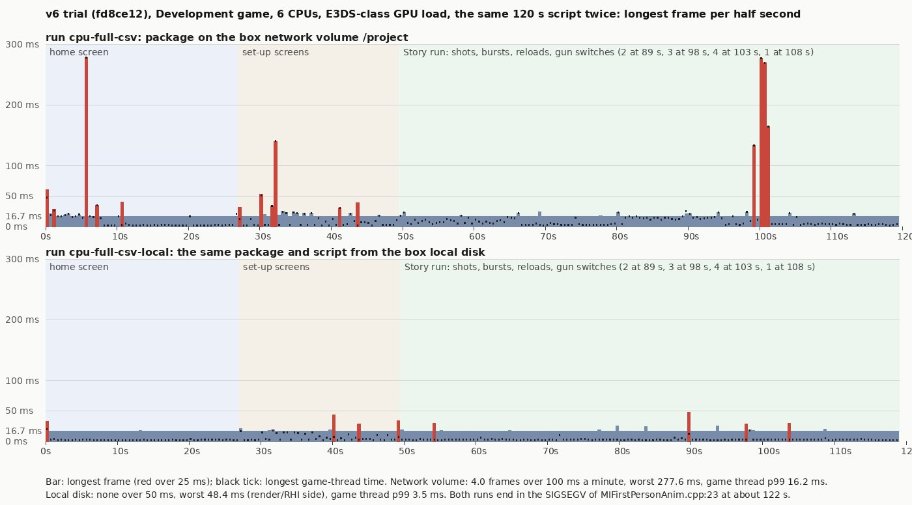

# Smooth play: the lanes' findings

The owner played version 4 on E3DS: "It is very laggy and buggy" (stutter or freezes, a low frame rate; bugs in menus,
weapons and gameplay). DECISIONS.md (2026-11-25, ~21:00) makes this file's verdict a release criterion. One section per
lane; every number names the run it comes from. Severities: blocker (a freeze, a crash, a stuck state, or under 50 fps
sustained on E3DS-class limits), must-fix (a player would feel or see it), should-fix, nit.

## CPU and game-thread cost (lane `cpu`, 2026-11-25, 21:20 to 22:40 UTC)

**Verdict of this lane: not smooth, because of one crash; the game thread itself is not the lag.** Run from a local disk,
the same package and script played the home screen, every set-up screen, a Story run with shots, bursts, reloads and all
four gun switches at **59.8 fps, no frame over 50 ms, the game thread at 2.1 ms a frame on average and 3.5 ms at the
99th percentile** (16.7 ms is the budget). But the game **crashed in all three measured sessions**, each time at the
engine's periodic garbage collection after a gun switch, about two minutes in (C1: blocker). The synchronous asset loads
of the set-up screens, the Briefing and the gun switches cost 7 to 18 ms of game thread each (C2). Casings, decals,
effects, the probe line, the JSON data and garbage collection were measured and are cheap. **The large freezes first
seen on the box (140 to 280 ms, one of almost a second) were the box's, not the game's** (C6): the same run from the
box's network volume had them, from its local disk it had none. That matters for every lane measuring on this box.

### How it was measured

| What | Value |
|---|---|
| Package | `v6trial.zip` (game `fd8ce12`, the guns trial; the newest package on the box), its Development game (`MurderInc`, the same code as the Shipping one, with stats, CSV profiler and trace) |
| Where | Unpacked privately twice: `/project/ue/smooth/cpu/v6t` (the box's network volume, where every lane's packages live) and `/tmp/smooth-cpu/v6t` (the box's local disk). Runs in `/project/ue/smooth/cpu/runs`, Insights exports in `/project/ue/smooth/cpu/ins` |
| E3DS emulation | `lag-test.sh` with `load=1:0.05:0.05:1024` (the gate's `v6-e3ds-l12` load) and `cpus=0-5` (6 CPUs, 5 task workers: Unreal's Vulkan RHI then runs without its interrupt and submission threads, as on E3DS's 8 hyper-threads), `-sm5`, 1920 x 1080, a viewer through Pixel Streaming, `-MICloudProbe=1` as on E3DS |
| How close | The GPU read **7.0 to 10.2 ms a frame at render scale 0.75** (probe `gpuMs`, `dr`); E3DS read 10.6 to 13.2 ms at 0.50 to 0.75 (DECISIONS.md, 13:23). This load is a little lighter than E3DS's card: right for game-thread costs, which do not depend on it; frame rates here are an upper bound for E3DS. The CPU side is harsher on threads (5 workers, not 6) and kinder on clock speed (the box's cores are faster than an A4000 server's) |
| Script | The Development game's demo director playing `tools/box/cloud/sound-demo.txt` (`full-csv.txt` / `full-trace.txt` in the lane folder): 20 s of home screen, the set-up screens (crew, four gun slots, the Workbench with a silencer previewed and fitted, level, mode, difficulty), a Story run: single shots, a burst, reloads, the dry press, switches to guns 2, 3, 4 and back to 1 with shots, melee, walking, sprinting, a jump, then the fight on the avenue (never reached: C1) |
| Runs | `cpu-full-tr` (network volume, Unreal Insights trace with `-trace=default,task -statnamedevents`: for attribution only, tracing slows the game thread), `cpu-full-csv` (network volume, CSV profile, no trace), `cpu-full-csv-local` (local disk, CSV profile, no trace). All CLEAN: no other game on the GPU in any second (`others=0` in every watcher line) |
| Tools | `UnrealInsights -OpenTraceFile=... -NoUI -AutoQuit -ExecOnAnalysisCompleteCmd="@=cmds.txt"` with `TimingInsights.ExportTimingEvents` / `ExportTimerStatistics` (`-threads=GameThread`; a thread id such as `2` selects the GPU queues, not the game thread), `lag_csv.py` and `csvsum.py` (frames over 25, 50, 100 ms a minute, 1 % low) |

**Per-frame numbers** (every frame of the CSV profiles, not one-second averages; network volume `cpu-full-csv` /
local disk `cpu-full-csv-local`):

| Phase | fps | frames over 25 / 50 / 100 ms a minute | worst frame | 1 % low | game thread avg / p99 |
|---|---|---|---|---|---|
| Home screen, 0 to 20 s | 58.4 / **59.8** | 33.0 / 9.0 / 3.0 vs **12.0 / 0 / 0** | 277.6 / **32.8** ms | 17.9 / **45.4** fps | 5.5 / 20.2 vs **1.8 / 3.4** ms |
| Set-up screens and Briefing, 20 to 49.5 s | 59.4 / **59.8** | 12.2 / 4.1 / 2.0 vs **10.2 / 0 / 0** | 140.3 / **42.6** ms | 30.8 / **45.6** fps | 2.4 / 12.4 vs **2.3 / 7.1** ms |
| Story run: shooting, reloads, gun 2, 49.5 to 98 s | 59.9 / **59.9** | 0 / 0 / 0 vs **7.4 / 0 / 0** | 23.7 / **48.4** ms | 54.8 / **48.9** fps | 4.7 / 14.8 vs **2.1 / 3.1** ms |
| Switch to gun 3 and its first shots, 98 to 104 s | 48.7 / **59.7** | 70 / 70 / 60 vs **20 / 0 / 0** | 277.3 / **29.3** ms | 4.1 / **41.8** fps | 7.8 / 178.7 vs **2.4 / 3.3** ms |
| Gun 4, gun 1, melee, walking, 104 to 119 s | 60.0 / **60.0** | 0 / 0 / 0 vs **0 / 0 / 0** | 22.0 / **20.0** ms | 56.5 / **58.2** fps | 2.7 / 4.2 vs **2.1 / 3.0** ms |
| Whole run | 59.0 / **59.8** | 12.1 / 6.0 / 4.0 vs **8.6 / 0 / 0** | 277.6 / **48.4** ms | 22.4 / **47.6** fps | 4.1 / 16.2 vs **2.1 / 3.5** ms |

From the local disk the frames over 25 ms are the render and RHI threads', not the game thread's (the worst, 48.4 ms at
89.75 s, is RHI 52 ms in the frame after gun 2's first draw; the game thread 2.7 ms): the render and stream lanes' ground.
The GPU was never the limit (GPUTime average 7.8 ms, worst 24.6 ms once).

### Findings

| # | Severity | Finding | Measured cost | Evidence |
|---|---|---|---|---|
| C1 | **blocker** | **The game crashes (SIGSEGV) at the first periodic garbage collection after a gun switch.** Stack (symbolised with `/project/ue/cloud/symbols/fd8ce12/MurderInc.debug`): `MIFirstPersonAnimPrivate::Sample` (`MIFirstPersonAnim.cpp:23`, `L.Clip->GetPlayLength()`) from `FMIFPAnimProxy::Evaluate` (`:300`). `UMIFPAnimInstance::SetPose` kept raw `UAnimSequenceBase*` in `FMIFPPose`; the rig lets go of the old gun's clips on `Equip`, the collector frees them, and an anim instance that still holds that pose evaluates freed memory | The process ends: exit code 139 | **3 of 3 sessions.** `cpu-full-tr`: switch back to gun 1 at 108.7 s, `CollectGarbageInternal` at 132.242 s (the periodic one; the one before at 71.13 s), the game thread's last frame starts at 132.262 s, "Signal 11 caught" at 21:53:51.88. `cpu-full-csv` and `cpu-full-csv-local`: the same stack, 13.7 and 13.9 s after the switch to gun 1, at the second periodic collection (the CSV's `GC` event at 60.7 to 60.8 s, the crash at about 122 s). The switch lane found the same crash in version 4 and fixed the source at `2a35906` (`HeldClips`, `MIFirstPersonAnim.h`); no package has that fix yet. To close it: a package of the fix through this same script past two collections (over 125 s, with switches), and a longer session |
| C2 | should-fix | **Synchronous loads on the game thread** in the set-up screens, the Briefing and gun switches: `LoadObject` / `FSoftObjectPath::TryLoad` from ticks and input in `AMIShowroom::Tick` (a gun swap: `UMIGunAssembly::Assemble` loads the gun mesh, every part mesh, top round, magazine and materials), `UMIWeaponComponent::EquipMesh` (gun mesh, idle clip), `UMIFirstPersonRig::Equip` (`LoadAs`: clips, part meshes, optics; it also parses `grips.json`, 62 KB, on every equip), `AMIPlayerCharacter` (arms, materials). Each asset not yet in memory is a `FlushAsyncLoading` that holds the frame | **Local disk: 7 to 18 ms of game thread** in the frame of each load (CSV events with the next frames' game-thread time: gun focus on the slot screen 10.4, 7.3, 9.4 ms; the Briefing 10.4 ms; switch to gun 2 11.7 ms; to gun 3 18.2 ms, its frame 18.6 ms). **Network volume: 202 ms** for the Briefing's load alone (trace 46.81 s: `FTickFunctionTask > MIShowroom > LoadObject > StaticLoadObjectInternal > FlushAsyncLoading`, 183.9 ms of it `MainThreadWaitingOnAsyncLoadingThread`) | Runs `cpu-full-csv-local` (CSV events column), `cpu-full-tr` (`ev_sel.csv`, `w_briefing.csv`). On a disk as fast as the box's local one these are one late frame each; on a slower or cold disk (E3DS's is not known; every E3DS session starts on a fresh copy, PROGRESS.md "What a cold machine adds") they grow towards the network-volume numbers. Fix without touching rules: load every offered gun, part and clip and the crew's arms once, asynchronously, on the home screen (six guns, 22 parts) and keep them referenced (a `UPROPERTY` array on a subsystem), so `TryLoad` finds them in memory; parse `grips.json` once |
| C3 | (withdrawn) | A freeze of almost a second around the switch to gun 3 in `cpu-full-csv` (five frames of 84 to 277 ms, 100.2 to 101.0 s) | none from the local disk: the same moment's worst frame 18.6 ms | It was the box (C6), not the game: `cpu-full-csv-local`, 98 to 104 s, game thread p99 3.3 ms |
| C4 | should-fix | **The HUD draw takes 15 to 22 ms in some traced frames** (`HUD Time`, i.e. `AMIHUD::DrawHUD` and what it calls: crosshair, weapon bar, health, objective, markers, subtitles); median 0.8 ms. No named scope inside, so which part is not known | Traced: 16 frames of 11 to 23 ms in 60 s of play (60.99, 67.83, 68.64, 76.15, 79.17 s ...), each the frame's whole excess (exclusive 15.5 to 22.0 ms, nothing under it but `DbgDraw_Canvas_TextItem_RuntimeCache` x30, 0.08 ms). Untraced from the local disk the whole game thread never passed 11.7 ms in play | Run `cpu-full-tr` (`ev_hud.csv`, `h_*.csv`). Not a hitch today; worth a named event round `DrawPlay`, `DrawFlow`, `DrawMenu`, `DrawWeaponBar`, `DrawWheel` and `UMIAudioSubsystem::DrawSubtitle` (new subtitle text is shaped and rasterised by the font cache the first time) before it becomes one |
| C5 | should-fix | **The set-up screens' Slate widget costs up to 47 ms in a traced frame** (`SMIFrontEnd [MIFrontEnd.cpp(86)]`), 13 frames over 10 ms between 30 and 57 s; 38 ms exclusive at the Workbench (40.36 s) | Traced 19 to 47 ms per event; untraced from the local disk the game thread's p99 on these screens is 7.1 ms, worst 18.3 ms | Run `cpu-full-tr`, `cpu-full-csv-local`. This is READY.md's "rebuild in the paint pass" (menu audit), here with its game-thread cost; nothing to add to its fix |
| C6 | **must-fix for the measurements** (not the game) | **Packages run from the box's network volume `/project` (9p) get freezes that the same package from the local disk does not.** Same package, script, load and CPUs: frames over 100 ms 4.0 a minute against 0, worst 277.6 against 48.4 ms, game thread p99 16.2 against 3.5 ms and even its average 4.1 against 2.1 ms. The traced run shows the form they take: seven frames of 73 to 181 ms inside scopes with no work in them (`Tick_PerformanceMonitoring` 125 to 181 ms at 34.9, 85.9, 88.9, 115.8 s; `Render_BeginFrame` 73 to 181 ms at 19.8, 22.9, 28.9 s): the thread was not running. Plain reads of the volume are not slow (300 random 64 KB reads of the `.ucas`: 0.53 ms median, 1.1 ms worst; the local disk 1.23 and 1.7 ms), so it is more likely page faults on the memory-mapped binary and paks in the box's sandbox than bandwidth. A second suspect is load from other jobs (some early stalls fell in seconds when the box was 92 to 99 % busy with other lanes' compiles), but the 1-second freeze of C3 came when the box was quiet (`cpu=36-52`, no compiler) | All long frames of `cpu-full-csv` and `cpu-full-tr` over 50 ms | Runs `cpu-full-csv` against `cpu-full-csv-local` (picture). **Every lane that measures frame times on this box should run its package from local disk** (`/tmp`, lost when the box stops; `unzip` there takes under a minute), or treat any long frame as the box's until it repeats from local disk. Earlier gates measured from `/project` too: their long frames may include this |
| C7 | nit | **Casings, magazines and debris are spawned physics actors, not pooled** (`UMIEffects::SpawnBody`: an `AStaticMeshActor` with CCD and shadows per casing, two per round; destroyed by life span) | `SpawnActor` 77 calls in the session, **0.086 ms average, 0.26 ms worst**; `RegisterComponent` worst 0.4 ms; `RecreatePhysicsState` / `DestroyPhysicsState` 0.001 to 0.002 ms; `Exclusive/Physics` 0.025 ms a frame | Runs `cpu-full-tr`, `cpu-full-csv`. At the CHOPPER's 720 rounds a minute that is about 2 ms a second spread over 24 frames: no hitch. Pooling them as the puffs are pooled is tidy work, not a lag fix. The 20-Goon fight was not reached (C1), so a full-auto fight with Goon fire is unmeasured |
| C8 | nit | **Garbage collection** (default settings: every 61.1 s, `gc.TimeBetweenPurgingPendingKillObjects`) | 3 collections, **2.4 to 3.2 ms** each (`CollectGarbageInternal`), plus 0.6 to 0.8 ms incremental; from the local disk the GC frame's game thread was 6.2 ms | Runs `cpu-full-tr`, `cpu-full-csv-local`. Not a hitch; only the crash's trigger (C1) |
| C9 | nit | **The probe line (`-MICloudProbe=1`, still set on E3DS)**: one line a second, built with ~40 `Printf` fields, `FPlatformMemory::GetStats` (reads `/proc`), and in the Shipping game `printf` + `fflush` to the launcher's pipe | The core ticker's scope rises from a median 0.004 ms to **0.15 to 0.24 ms once a second** (33 of 10,704 ticks over 0.15 ms in 60 s of play, 1.0 s apart; worst 0.52 ms): about 0.02 % of the frame time | Run `cpu-full-tr` (`STAT_FTicker_Tick` events). Nothing a player feels. The only risk is the pipe: if the reader of the game's stdout (the launcher's `tee`) stopped reading, `fflush` would hold the game thread; not seen |
| C10 | nit | **Per-frame scans and lookups**: `UMIAudioSubsystem::Observe` runs two `TActorIterator`s every frame; `UMIEffects` reads `MIJson::NumberOr(Fx, "a.b.c")` paths on every flash, tracer and casing; `UMIGameSubsystem::StartPitch` parses `presentation.json` (51 KB) on every run start; each `AMIExplosive` and objective actor parses it at boot | `UMIAudioSubsystem` tick 0.046 ms a frame on average (0.23 ms worst); the JSON parses have no named scope and were not timed alone: they run at boot, at a run's start and at a gun equip, inside C2's 7 to 18 ms frames at most | Run `cpu-full-tr`. Cache the JSON roots and the numbers once; no player sees these |
| C11 | nit | **AI, box world, timers, debug drawing.** The enemy logic senses on a randomised interval (`SenseEvery`), its line of sight is a loop over the 757 boxes of `FMIBoxWorld`, the nav grid is rebuilt only when a blocking box is removed (an explosive). No `DrawDebug*` in the game code; the only per-shot timer is the casing's show timer | Not measured in a fight (C1 ended every run first); `Exclusive/TickActors` 0.17 ms and `Ticks/MIGoonMovement` 12 ticks a frame with no Goon awake | Code review; a fight measurement is the next step once C1's fix is packaged |

### What this says about the owner's session

- **Stutter or freezes**: C1 ends a session about two minutes in once a gun has been switched (a frozen picture, then a
  lost stream); this is the one thing in this lane that a player of version 4 certainly met if they switched guns and
  played on (the switch lane found it in version 4). C2's loads are single late frames on a fast disk. The game thread
  does not explain a sustained stutter.
- **Low frame rate**: not the game thread: 2.1 ms of 16.7 on average with 5 task workers. A sustained low rate on E3DS has
  to come from the GPU, the render thread or the stream (the other lanes).
- **Our earlier E3DS measurement** (DECISIONS.md 13:23) was a 24-second holdout with no gun switch reported, so it could not
  meet C1. The probe's `worstMs` is the longest frame of each second, so one-second averages did not hide freezes there.

### Not done, not proven

- The fight (20 Goon slots, explosions, full-auto with casings): every run crashed before it (C1).
- A trace from the local disk (queued, dropped for GPU time): C4's and C5's traced numbers come from the network volume.
- Version 4 itself under this script: its demo director and menus differ; the hitch lane measures version 4.
- E3DS's disk speed and its first-session (cold) load times: C2's size on E3DS depends on them.
- No fix was written (this phase changes no game code).

### Files (on the box, not in the repository)

`/project/ue/smooth/cpu/`: `go.sh` (a queue of `lag-test.sh` runs that holds the GPU claim, a placeholder process named
`MurderInc`, from the moment the GPU is free until its last run ends), `full-csv.txt`, `full-trace.txt`, `csvsum.py`;
`runs/cpu-full-tr`, `runs/cpu-full-csv`, `runs/cpu-full-csv-local` (each CSV run with its `profile.csv`); `ins/` (the trace,
`tree.py`, `flat.py`, `evsum.py` and every export named above).

## Stutter and freeze hunt (lane `hitch`, 2026-11-25, 21:20 to 23:50 UTC)

**Verdict of this lane: not smooth, in either version.** Version 4 (the owner's) crashed in **2 of 2** Hold the Block
sessions (H1). The newest package (`v6trial.zip`, game `fd8ce12`) did not crash in this lane's four sessions, but it
**locks itself at 45 or 30 frames a second for the rest of a run after one heavy second**, because the frame-rate
target only rises on a menu screen (H2): with the GPU load that reproduces E3DS's own GPU readings (l20, below) Hold the
Block fell to 30 at the end of its first fight and stayed there; the Story held 60. On top of that both versions have
cold-start shader (PSO) hitches of 110 to 250 ms on the first screens (H3) and a train of 33 ms frames in the first
fight (H4). Away from those moments the play is clean: 60 frames a second, game thread 2.2 ms, render thread 5 to 6 ms, the GPU 8 to 9 ms at render scale 0.75 under `l12` and 12 to 13 ms at 0.50 under `l20`, and no garbage
collection over 4.4 ms in eleven minutes (H7).

**What the owner most likely met.** Not one-second averages hiding freezes: the probe's `worstMs` is the longest frame
of each second (`MICloud.cpp`, `ProbeWorst = Max(ProbeWorst, DeltaTime)`), so the 21.1 ms worst frame of our own E3DS
sample (DECISIONS.md, 13:23) was real for those 130 seconds. That sample was short, a first room or a 24-second holdout
without a gun switch. A longer session meets three things that sample could not: the crash after a gun switch (H1: a
frozen picture, then a dead stream), the governor's one-way drop (H2: 45 or 30 frames a second until the next menu,
which Hold the Block never shows), and the first-fight stutter (H4). E3DS's own logs show what a shared card does to
this game (H8): 17 to 27 frames a second with frames of 40 to 77 ms every second and single freezes of 0.36 to
1.88 s. That matches both halves of the owner's report, a low frame rate and freezes. The owner's own session log would settle which of these it was: with
"Show the Unreal log in the browser console" on and `-MICloudProbe=1` set, the owner's browser console held the probe
lines of that session.

### How it was measured

| What | Value |
|---|---|
| Packages | **Version 4**: `/project/ue/cloud/v3a-fix/out/MurderInc.zip` (sha256 `5d7f9238...`, the file uploaded at 11:36; game `6c4d810`, launcher `2322f3c`). **Newest**: `/project/ue/cloud/v6trial.zip` (game `fd8ce12`, the guns trial; no newer package exists). Both unzipped as `e3dsfresh`, then copied to the box's local disk (`/tmp/smooth-hitch/v4`, `/tmp/smooth-hitch/v6t`) after the CPU lane's C6 (the 9p volume makes freezes of its own). Debug symbols of both builds copied beside the binaries so a crash prints its stack (`/project/ue/cloud/symbols/<commit>/*.sym`) |
| E3DS-class limits | `lag-test.sh` with `load=1:0.05:0.05:1024` (the gate's `e3ds-l12`), **`cpus=0-7`**, `-sm5`, 1920 x 1080, `runas=fresh clean=1` (a new user with an empty home and a fresh `Saved` every run: no driver shader cache, as on a new E3DS machine), `-MICloudProbe=1`, the Development game of the same package (same code, CSV profiler). The gate's `l20` load (`1:0.05:0:1024`), and one run with no load |
| How close | **CPU: exact in kind.** E3DS's machine logs `CPUs: 8 cores, 8 with hyper-threads, 7 task workers (more than 6: the RHI has its interrupt and submission threads)` (its game log in the box's browser console, `/project/ue/cloud/e3ds-session-1/firefox-console-s5.log`); `cpus=0-7` here gives the same 7 workers and the same RHI threads (the box shows no hyper-threads). The box's cores are faster. **GPU: `l20` reproduces E3DS's card, `l12` is lighter.** In the Story's play `l20` reads 11.6 to 13.0 ms (30-s medians) at render scale 0.50 (`v6-story-l20`, `v4-story-l20`: 11.8 ms, 52 of 56 play seconds at 0.50); E3DS read 10.2 to 13.3 ms at 0.50 to 0.63 in the same Story room and 10.6 to 13.2 at 0.50 to 0.75 in Hold the Block (DECISIONS.md, 11:36 and 13:23). `l12` reads 7.8 to 8.8 ms at 0.75: an upper bound. **Disk: local**, as an E3DS session's unpacked copy is likely to be (not known) |
| Player | The Development game's demo director (it aims, fights, walks routes, switches guns): `sm-story.txt` (Home, Crew, four guns in the Loadout, a sight fitted on the Workbench, Block & Style, Briefing, then the whole Story run of `tools/box/demo/demo.txt` to the truck, with switches to all four guns and reloads), `sm-hold.txt` (Hold the Block, seven fights, switches, reloads, a propane blast, about 4 minutes), `sm-long.txt` (Hold the Block, planned as 15 minutes: 26 fights, 26 switches, 26 reloads, 5 blasts; waves 1 to 5, up to 15 enemies; the director got through it in 11.4 minutes of play). God mode on (the runs must last; no rule changes). Plus the Shipping launcher's path with the Development game and the stream viewer pressing keys and clicking through every set-up screen and all four guns (`guns-keys.txt`, `-csvCaptureFrames=7800`) |
| Per-frame data | CSV profile of every frame from the first second (`csvprofile start` in the script, or `-csvCaptureFrames`): FrameTime, game / render / RHI thread, GPU, the engine's `PSO/GraphicsPSOHitch`, `PSO/ComputePSOHitch`, `PSO/PSOMisses`, `FlushAsyncLoading` and `GC` events, exclusive timers. Read with `smooth_csv.py` (every frame over 25 ms with what the threads did and the events within 0.6 s) and `pso_frames.py` (the frames where a PSO was created at draw time, a GC or a synchronous load ran) |
| Runs | `/project/ue/smooth/hitch/runs/<name>` on the box (each with `game.log`, the CSV, `summary.txt`, `others.log`), scripts in `/project/ue/smooth/hitch/scripts`, the queue runner `gated.sh` (holds the GPU claim, a placeholder named `MurderInc`, between its runs). Two runs were thrown away: the first `v4-story` started while seven `clang++` compiles and an editor had the box's CPUs (game thread 160 to 2,200 ms a frame, 2 to 20 fps: the box, not the game), and in `v4-story-paused` the viewer of version 4's scripted game got one video frame and left, which paused the game at 44 s (version 4's dev game is therefore run without a viewer, `viewer=0`) |

Black: each frame's time; blue: its GPU time; clipped at 120 ms, longer frames named in red. The panel titles' counts are
from times rounded down to 0.1 ms; the tables below use the exact values. In the third and fourth panels the GPU time falls
back (at 480 s and at 158 s) while the frame time stays at 22.2 and 33.3 ms: H2.

### Per-frame numbers

Every frame of the CSV profiles (not one-second averages). "Cold" lines include the game's first second and the first
set-up screen; the Story and Hold lines start with the title screen. E3DS-class load `l12` unless the line says otherwise.

| Run | Version | Session | Frames, length | fps | 1 % low | Worst frame | Frames over 25 / 100 ms a minute |
|---|---|---|---|---|---|---|---|
| `v4-story2` | 4 | front end + whole Story run to the truck, 4 guns | 6,371, 106.8 s | 59.66 | 38.4 | 169.6 ms (title) | 5.6 / 1.1 |
| `v6-story` | v6 trial | the same script | 5,819, 97.4 s | 59.74 | 42.1 | 192.0 ms (title) | 3.7 / 1.2 |
| `v4-hold` | 4 | Hold the Block | **crashed at 70 s** (H1) | 59.8 (probe, play) | | 45 ms (probe) | |
| `v4-long` | 4 | Hold the Block, 15 minutes planned | **crashed at 128 s** (H1) | 59.8 (probe, play) | | 77.5 ms (probe) | |
| `v6-hold` | v6 trial | Hold the Block, 3.6 minutes | 12,697, 214.2 s | 59.27 | **28.2** | 198.0 ms (title) | **31.7** / 0.6 |
| `v6-long` | v6 trial | Hold the Block, 11.4 minutes of play | 36,233, 684.6 s | **52.92** (60 for 6 min, then **45 to the end**) | 35.6 | 211.7 ms (title) | 7.1 / 0.5 |
| `v4-menus` | 4 | the Shipping path through the stream, all set-up screens by keys and mouse, 4 guns drawn, aimed, fired, reloaded | 7,800, 136.8 s (from the process start) | 57.0 | 9.1 | 4,283 ms (engine start, nobody connected) | 24.1 / 3.1 |
| `v6-menus` | v6 trial | the same | 7,800, 137.5 s | 56.7 | 8.3 | 5,194 ms (engine start, nobody connected) | 24.9 / 2.2 |
| `v4-story-l20` | 4 | the Story script, load **l20 (E3DS's GPU time)** | 6,197, 103.8 s | 59.70 (60 in every play second, render scale 0.50) | 40.1 | 194.4 ms (title) | 3.5 / 1.7 |
| `v6-story-l20` | v6 trial | the same, l20 | 6,395, 107.2 s | 59.64 (60 in every play second, render scale 0.50) | 37.5 | 221.1 ms (title) | 5.6 / 1.7 |
| `v6-hold-l20` | v6 trial | Hold the Block, load **l20 (E3DS's GPU time)** | 7,047, 191.0 s | **36.90** (60 for 42 s, then **30 to the end**, H2) | 25.5 | 190.4 ms (title) | 1,367.6 (the 33.3 ms frames of the 30 lock) / 0.6 |
| `v6-hold-l15` | v6 trial | Hold the Block, load `1:0.05:0.02:1024` (GPU 9.1 ms at 0.75: close to l12, not between) | probe lines, 215 s of play | 59.9 (lowest second 52.1), target 60 in all 219 play seconds | | 170 ms (probe) | |
| `v6-hold-free` | v6 trial | Hold the Block, no load | 10,497, 215.1 s | 48.79 (60 for 50 s, then 45 to the end: another lane's game took the card from 23:33:06 to 23:35:11, H2) | 35.6 | 188.2 ms (title) | 3.9 / 0.8 |

The two menu runs shared the box's CPUs with other lanes' compiles in 109 and 130 of their 133 samples (the summary
lines say so); their set-up-screen frames over 25 ms are an upper bound. Every other line ran with no compiler beside
it in most samples and no other game on the GPU, except `v6-long` (H2, H8).

**Every frame over 100 ms, and what it was** (CSV times from the capture's start):

| Run | Time | Frame | What the frame was |
|---|---|---|---|
| `v4-story2` | 0.93 s | 169.6 ms | the title's first drawn frames: 7 graphics and 17 compute PSOs created at draw time in the frame before (H3) |
| | 6.11 s | 160.5 ms | Crew, first draw (`MIMenu fe gearup`): 3 synchronous loads, then 4 graphics + 6 compute PSOs created at draw time, render thread 118.5 ms in the frame before (H3) |
| `v6-story` | 1.02 s | 192.0 ms | the title (7 graphics PSOs, 263 ms of compile; 17 compute, 738 ms; spread over threads) |
| | 6.08 s | 129.4 ms | Crew, first draw (16.1 ms of `FlushAsyncLoading`, 4 graphics + 6 compute PSOs, 212 + 521 ms of compile) |
| `v6-hold` | 0.98 s | 198.0 ms | the title, PSOs as above |
| | 49.73 s | 155.9 ms | wave 2, Goons spawning: every thread idle (game 2.3, render 5.5 ms, GPU 8.7 ms); the pacer waited 153 ms for the GPU (H5) |
| `v6-long` | 1.03 s | 211.7 ms | the title |
| | 136.8, 323.1, 353.0, 506.9, 663.7 s | 151.7, 148.2, 131.3, 145.2, 126.8 ms | all threads idle, GPU 7 to 10 ms, the pacer's wait (H5) |
| `v4-story-l20` | 40.03 s | 116.3 ms | in play, all threads idle, GPU 14.4 ms (H5) |
| `v6-story-l20` | 101.09 s | 137.9 ms | after the run's end, all threads idle (H5) |
| `v6-hold-free` | 1.02, 1.39 s | 188.2, 172.9 ms | the title |
| | 180.92 s | 146.3 ms | all threads idle, GPU 4.2 ms, **no load process and no other game on the card** (H5) |
| `v4-menus` | 0 to 5.8 s | 4,283, 1,381, 124 ms | engine start and the first frames, before any viewer (1,641 ms of graphics and 6,302 ms of compute PSO compiles in the second frame) |
| | 7.27, 9.02 s | 252.4, 204.1 ms | the home screen's first frames (7 graphics + 23 compute PSOs), the viewer joining |
| | 15.61 s | 116.5 ms | Crew (H3), with "WaitForGPU: Timed out waiting for fence" from Pixel Streaming's capture at that moment (`game.log` 22:55:15.296) |
| | 96.16 s | 157.9 ms | the viewer leaving (the game pauses): not play |
| `v6-menus` | 0 to 5.2 s, 7.97 s | 5,194, 1,351, 213 ms | engine start; the home screen |
| | 17.30 s | 152.7 ms | Crew (16 ms of loads, 12 PSO misses) |
| | 119.28 s | 164.9 ms | the viewer leaving |

Frames of 25 to 100 ms besides those: the PSO misses of the first fight (H4), the front end's rebuilds (H6, game
thread `UI` 11 to 16 ms, frames 28 to 34 ms, about one every 2 s on the Loadout and the Workbench), the intro's first frame
(`MIMenu fe hit`: 50 and 60 ms, 6 graphics PSOs), and in the holdout a few render- or RHI-thread frames of 30 to 55 ms
with PSO misses. Gun switches cost 8 to 18 ms of synchronous loading (`FlushAsyncLoading`, up to 35 loads in one
frame) but never made a frame over 25 ms from the local disk (CPU lane C2 has them from the network volume).

### Findings

| # | Severity | Finding | Evidence | Fix (proposed, not made) |
|---|---|---|---|---|
| H1 | **blocker** | **Version 4 crashes in Hold the Block after a gun switch.** SIGSEGV reading address 0 in the first-person pack gun's animation (`AnimationContext: SkeletalMeshComponent='FirstPersonPackGun' SkeletalMesh='SK_TFA_AR_Short_Combined' AnimInstance='MIFPAnimInstance_...'`), symbolised: `FMIFPAnimProxy::Evaluate` at `MIFirstPersonAnim.cpp:23`, from a parallel animation task. It is the CPU lane's C1 and the switch lane's crash (PLAY.md), here on the owner's version under E3DS-class limits: a player who switches guns and plays on for a minute or two loses the session (the picture freezes, then the stream ends) | `v4-hold`: switch to the NINE at 47 s, CSV `GC` event at frame 3,522, crash in the same second (`game.log` 22:49:23.954), 70 s into the process. `v4-long`: switch at 78 s, GC at 121 s, crash at 121.3 s (23:17:47.384), 128 s into the process: 2 of 2. The v6 trial did not crash in this lane's 4 sessions (`v6-story`, `v6-hold`, `v6-menus`, `v6-long`: 11 collections and 26 switches in the last), against 3 of 3 in the CPU lane: the freed clips are read, and whether the memory is still mapped decides | Fixed in the branch (`68ce52c`, `HeldClips`; test `SwitchSurvivesGC`), in no package yet. Prove it on the release package with `sm-long.txt` (11 minutes, 26 switches) and the CPU lane's script, both past several collections |
| H2 | **blocker** | **The frame-rate target only falls during play; it rises only on a card or a set-up screen** (`FMIFrameRateGovernor`, `MIPacing.h`: "Up, only at a safe moment ... not in live play"). One second in which the GPU cannot keep up at the smallest picture drops 60 to 45 (and 45 to 30) for the rest of the run, however fast the GPU is afterwards. Hold the Block never shows a set-up screen, so a run that drops stays down for its whole length; in the Story a player gets it back only by pausing. 45 frames a second on a 60 Hz display is also uneven (every third frame is shown twice): a judder on top of the low rate | `v6-long`: 60 for 6 min 13 s, then `Frame-rate target: 60 -> 45 ... the GPU took 20.6 ms a frame` (23:06:36.477) when another game appeared on the card for two minutes (`others.log` 23:06:23 to 23:08:26, card memory 5.9 to 12.0 GB). From 480 s the GPU was back at 6.9 to 9.4 ms at render scale 0.75 (probe lines), the target stayed 45 for the last 5.2 minutes: 52.9 fps for the session. `v6-hold-l20` (the load that gives E3DS's GPU time): 60 held through the first fight, then 60 -> 45 -> 30 two seconds after it (42 s into the play, 23:20:56 and 23:20:57), then **30 for 146 of 189 play seconds** at a GPU median of 19.1 ms (most seconds would have fitted a 45 target: 22.2 ms); after 150 s the GPU was down to 12.9 to 13.5 ms (30-s medians) and the frames stayed at 33.3 ms (chart, fourth panel). `v6-hold-free` (no load) repeated `v6-long` by accident: another lane's game on the card for two minutes, 60 -> 45 at 23:33:21, and after it left the GPU read 4.6 to 5.6 ms while the target stayed 45 to the end. Under l12 the holdout's own heaviest frame reached 24.4 ms of GPU (`v6-hold` CSV) without a full second over the line; with E3DS's GPU time (l20) the first fight's end is where it drops. **This is the most likely "low frame rate" of the owner's report** | Let the target rise during play with the same rule as on the menus (GPU at the smallest picture under four fifths of the next rate's frame time for `RaiseAfter` seconds, the doubling back-off kept), or at least between holdout waves and on the pause card. It changes pacing only, no gameplay rule. Prove with `v6-long` and `v6-hold-l20` again: the target back at 60 within a minute of the load going |
| H3 | **must-fix** | **Cold-start PSO hitches on the first screens**: the title's first frames 170 to 212 ms, the home screen through the stream 204 to 252 ms, the Crew screen's first draw 108 to 160 ms, the intro's first frame 50 to 60 ms. The engine's own counters show graphics and compute pipeline states created at draw time in exactly those frames (`PSO/GraphicsPSOHitch`, `PSO/ComputePSOHitch`): 4 to 9 graphics and 6 to 23 compute PSOs each, 200 to 1,000 ms of compile work spread over the worker threads. **No pipeline cache is packaged** ("Vulkan PSO Precaching = 1, PipelineFileCache = 0" in the game log; `Config/` has no `r.ShaderPipelineCache` setting), and every E3DS session starts on a machine with no driver cache. The 3a gate measured the same Crew frame at 0.82 to 0.92 s with its packages on the network volume (PROGRESS.md, "What a cold machine adds"); from local disk it is 110 to 160 ms | `pso_frames.py` on every CSV above (for example `v6-story`: frame 60, 7 graphics + 17 compute PSO hitches, then the 192 ms frame; frame 347, 4 + 6, then 129.4 ms). E3DS's own first frames of version 4 (browser console, sessions 3 and 4): 413 and 187 ms in the game's second second | Bundle a recorded pipeline cache (record with `-logPSO` through the front end, the Story and Hold the Block on SM5, cook it in with `r.ShaderPipelineCache.Enabled=1`), and/or precache the global compute shaders (5.9's PSO precaching covers materials, not the global and Lumen compute passes); draw the Crew stage once behind the CLICK TO PLAY card. Prove: `pso_frames.py` lists no PSO hitch after the title, the Crew frame under 50 ms on a cold user |
| H4 | **must-fix** | **The first fight stutters**: in the first 30 s of fighting in Hold the Block, **88 frames over 25 ms**, nearly all 33.3 ms (one display refresh lost each), almost every one with 1 to 8 PSO misses (draws waiting for a pipeline state that the precacher had not built: the Goons, the Buzzards, muzzle flashes, tracers, impacts, the first blast). 1 % low 28 fps for the run. After about 60 s of play it is gone | `v6-hold` per 30 s: 0 to 30 s 56.4 fps and 88 frames over 25 ms, 30 to 60 s 16, then 0 to 7. PSO misses in the runs: 1,687 (`v6-story`), 1,166 (`v4-story-paused`), 4,579 in 2,011 frames (`v6-long`) | The same cache as H3, recorded through fights; or warm the enemy and effect materials before play (spawn one of each, hidden, during the intro), which costs no rule |
| H5 | should-fix (or the box's) | **Single frames of 126 to 156 ms with every thread idle**, about one every two minutes in the holdout: game thread 2 to 3 ms, render 5 to 8 ms, the frame's GPU time 7 to 10 ms, and the pacer's wait 149 to 153 ms (`worst wait` in the summary lines). Something held the GPU for 150 ms that is not the game's own frame | `v6-hold` 49.73 s; `v6-long` 136.8, 323.1, 353.0, 506.9, 663.7 s | Not the outside load process: `v6-hold-free` had one (180.92 s, GPU 4.2 ms) with no load process and no other game on the card for 14 s before it. Could still be the box (a sandboxed kernel). Look at what waits on the GPU in those frames (Pixel Streaming's capture fence, an occlusion read-back) with a trace from local disk |
| H6 | should-fix | **The set-up screens' rebuilds cost a frame each**: game-thread `UI` 11 to 16 ms in frames of 28 to 34 ms, about one every two seconds on the Loadout and the Workbench (v6 trial; 14 frames over 25 ms in 30 s of set-up) | `v6-menus` 20 to 48 s (`GT: UI 16.3, 12.7, 11.6, 12.4, 13.4, 12.5`), `v4-menus` the same pattern at 11 to 12 ms | READY.md M1 and CPU lane C5: the rebuild in the paint pass. Their fix removes this too |
| H7 | nit | **Memory and garbage collection over 15 minutes are not a problem**: 11 collections in `v6-long`, none in a frame over 22.2 ms (the 45-fps frame); resident memory 3,239 MB a minute in, 3,402 to 3,509 MB from minute 8 (+200 to 270 MB, flat after that); texture streaming at 780 to 795 MB all session against its 600 MB pool (READY.md's "over budget": a sharpness question, not a hitch) | `v6-long` probe lines (`rssMB`, `texStreamMB`), `pso_frames.py` (GC frames) | None needed for smoothness |
| H8 | (evidence) | **What a shared card does, on E3DS itself**: the box's browser kept E3DS's game log of five sessions on 2026-11-25 (`/project/ue/cloud/e3ds-session-1/firefox-console-s5.log`). With version 3's game left on the card from an earlier session, the home screen ran at **26 to 27 fps with 40 to 45 ms frames every second** (GPU 33 to 41 ms at render scale 0.50), single frames of **660 ms**, then a session at **17 fps with frames of 55 to 77 ms and freezes of 357 ms and 1,881 ms**. On a clean card version 4 played at **60.0 fps, worst frame 19.3 to 20.3 ms** (199 and 102 play seconds). `v6-long` reproduced the shared card by accident on the box: the other game's two minutes cost 49.8 and 44.9 fps and frames of 55 to 82 ms, and H2 kept the cost after it left | probe lines split by the `[MICloud] Build` start line of each session | Version 4's launcher stops leftover games of the package; nothing stops another process on the card, and H2 makes any such episode last |

**Steady-state frame rate under E3DS-class limits** (the v6 trial). Under `l12`: 60.0 in every second of the Story's play
and in the holdout after the first minute, until H2 drops it; medians a frame: GPU 7.8 to 8.8 ms (render scale 0.75, which
dynamic resolution never had to lower), render thread 5.0 to 6.2 ms, RHI 2.4 to 3.2 ms, game thread 2.1 to 2.4 ms; the
heaviest holdout frame 24.4 ms of GPU. Under `l20` (E3DS's GPU time): the Story held 60 in every play second at render scale
0.50 (GPU 11.6 to 13.0 ms, 4 ms in hand), while Hold the Block's fights needed 19 to 23 ms of GPU at any render scale
(dynamic resolution 0.50 to 0.75 changes little, BOX.md row 43): it falls below 60 in fights, and H2 then keeps it at 30.
With H2 fixed the holdout would drop to 45 or 30 in a fight and come back to 60 between waves; to hold 60 through the fights
on the A4000, the quality ladder (release 3c, off by default) or cheaper fight effects would have to take 3 to 6 ms off the
GPU. A per-pass GPU breakdown was not taken here.

**Version 4 against the v6 trial** (criterion 4 of DECISIONS.md 21:00): same script, same limits. Story: 59.66 against
59.74 fps, 1 % low 38.4 against 42.1, frames over 25 ms 5.6 against 3.7 a minute, over 100 ms 1.1 against 1.2 a minute
(the cold-start frames, H3, in both); with E3DS's GPU time (`l20`) 59.70 against 59.64, both at 60 in every play second.
Hold the Block: version 4 crashed twice before 130 s; the v6 trial ran 3.6 and 11.4
minutes without a crash but with the first-fight stutter (H4) and the 45 lock (H2). So the v6 trial is not yet better
than version 4 on the per-frame numbers that matter, and nothing in it removes H2 to H4.

### Not done, not proven

- The release package (the branch with the crash fix, the hands, the 3c review fixes) was not measured: no package of it
  exists. Every line above should be run again on it (`/project/ue/smooth/hitch/queue*.txt` are the lines).
- No Unreal Insights trace from this lane (the CPU lane has one, from the network volume); "top stacks" here are the CSV's
  exclusive timers and the engine's PSO and loading counters, and the crash's symbolised stack.
- Pixel Streaming's encoder under the long session was not separated from the game (the summary lines carry the sender's
  numbers: `v6-long` encoded 52.3 a second with a lowest second of 0, which is the other game's two minutes).
- The owner's own session log: not available. A copy of that session's browser console (or a new session with the
  console open) would show `gpuMs` with `viewers=0` on the home screen (a shared card reads 30 ms or more) and any
  `Frame-rate target` and `Signal 11` lines.
- No game code was changed (this phase).

### Files (on the box, not in the repository)

`/project/ue/smooth/hitch/`: `scripts/` (`sm-story.txt`, `sm-hold.txt`, `sm-long.txt`, `smooth_csv.py`, `pso_frames.py`,
`dump_ft.py`, `plot_box.py`), `queue*.txt`, `gated.sh` (the queue runner with the GPU claim), `runs/<name>/` for every run
named above, the unzipped packages in `v4/`, `v6t/` and their local copies in `/tmp/smooth-hitch/` (lost when the box stops).
The lane's copy of `lag-test.sh` (`/project/ue/smooth/hitch/repo/tools/box/cloud/`) differs from the branch in two lines:
a run without a viewer keeps its CSV profile, and a `-nullrhi` game or this lane's own claim does not count as a game.

## Gameplay, menu and weapon bug hunt (lane `bugs`, 2026-11-25 22:35 to 2026-11-26 00:40 UTC)

**Verdict of this lane: not smooth yet.** The game's rules hold up. Every mode, death, Run it back, Restart, results card,
debrief, Back to title and new start played in both packages without a stuck state, a refused command or an error line.
On E3DS-faithful limits the newest package also played the same life cycle with no frame over 50 ms: front end, run start,
gun switches, pause, Settings, death, Run it back by a real key, a second run. Three things a player meets in normal play
are wrong:

- **B1, blocker in version 4:** version 4 crashes after a gun switch. This is the switch lane's crash. It reproduces here
  with no GPU at all, so any machine can check a package for it.
- **B2, must-fix:** every Hold the Block wave ends with 50 to 165 s of waiting for the last Buzzards. To a player the wave
  looks stuck.
- **B3, should-fix:** each press on the Graphics quality row freezes the picture for one frame of 62 to 377 ms.

B4 to B8 are smaller. Nothing in this lane explains a sustained low frame rate. Ultra graphics costs no more GPU time than
Auto on E3DS-class limits (B3), and the game thread's 99th percentile is 3.6 ms.

### How it was played

| What | Value |
|---|---|
| Packages | **Version 4**: the zip of `6c4d810` (`/project/ue/cloud/v3a-fix/out/MurderInc.zip`, PLAY.md). **The newest**: `v6trial.zip` (`fd8ce12`). Both were unpacked privately to the box's local disk (`/tmp/smooth-bugs/v4`, `/tmp/smooth-bugs/v6t`), as C6 asks. The Development game of each package was used; its rules and flow code is the Shipping game's |
| Same code at the head? | Between `6c4d810` and `fd8ce12`, `Flow/`, `Player/`, `UI/` and `Weapons/MIWeaponRules.cpp` differ by 47 lines (`git diff --stat`). From `fd8ce12` to the head, `Flow/` and `MIWeaponRules.cpp` are unchanged. `UI/` and `MIPlayerController.cpp` carry the set-up screen fixes of `d072184` (READY.md M1 to M10). So every rules or flow finding below holds for version 4 and for the head; the Head column says so finding by finding |
| Logic runs (no GPU) | The Development game with `-nullrhi`, on CPUs 14 and 15 at `nice 19`, `t.MaxFPS 60` (`/project/ue/smooth/bugs/nr.sh`). The demo director plays a script: **n1** is the life cycle in the next row, **n2** plays Story twice to the debrief, **n3** is 12 minutes of Hold the Block. The probe line comes every 0.5 s (`state`, `fire`, `mag`). The director logs every flow event, reload phase, switch phase and kill. Rules and animation run as with a GPU: version 4's crash reproduced this way (B1). There are no pictures, and these runs need no GPU claim |
| What n1 plays (both packages) | The front end as a first-time player: Home, Gear up, Crew, Loadout, Block & Style (Story, Kingpin), Briefing, Hit the block. A reload while sprinting. A switch in the middle of a reload, and back. Aiming while switching, firing aimed on the new gun, switching back aimed. The pause key with the trigger held at full auto, then resume. Pause, Settings (look speed and field of view changed), back, resume. A walk to the avenue aimed and firing, until death. Run it back, death again, Back to title. Hold the Block from the front end, death, the results card, Run it back, Restart from the pause card, and a quit in the middle of the run |
| GPU runs | `lag-test.sh` (this lane's copy, `/project/ue/smooth/bugs/repo`) with `game=dev`, `load=1:0.05:0:1024`, `cpus=0-5`, `-sm5`, 1920 x 1080, a viewer through Pixel Streaming and a CSV profile. That load is the render lane's E3DS-faithful `l20`. **g1** is n1's script with 19 `MIShot` pictures; the death card is answered with a real `Enter` key event and the pause opened with a real `P`. **g2** steps Graphics quality from Auto through Low, Medium and High to Ultra during a run, fights on Ultra, then steps back to Auto. The runs held the GPU claim (`gq.sh`, queue `q/q1.txt`), one game at a time |
| How close to E3DS | `g1-v6t`, first 84 s: **GPU 11.1 to 13.7 ms at render scale 0.50, 60 frames a second**. Version 4 on E3DS's A4000 read 10.2 to 13.3 ms at 0.50 to 0.63 (DECISIONS.md, 2026-11-25). From t 84 s of `g1-v6t` another job took the card: video memory rose from 7.9 GB to 12 to 13 GB, `others=1` showed in 7 watcher samples, the GPU went to 20 to 27 ms and the target to 30. Only the first 84 s are used. `g1-v4` shared the box throughout: every CPU was 97 to 98 % busy with another lane's build, and the target stayed at 30. Its pictures and logic are used, its frame times are not. `g2-v4` and `g2-v6t` were clean (`others=0` in all 140 and 135 samples) |
| Instrument | An `MIShot` holds its frame for 200 to 340 ms while the viewport is read back (B8). Each such frame and the two after it are left out of the per-frame numbers (57 frames a run); the CSV's `Cmd: MIShot` events mark them |

**Per-frame numbers, the newest package, E3DS-faithful load** (`g1-v6t`, 0 to 84 s, CSV, `MIShot` frames left out): 4,596
frames, **58.3 fps, 7 frames over 25 ms, none over 50 ms, worst 46.3 ms, 1 % low 40.9 fps, game thread p99 3.6 ms.** This window
covers the front end, Hit the block, the reload while sprinting, four gun switches, two pauses, Settings, the walk, the
first death, the death card, Run it back by the `Enter` key and the second run.

### Findings

| # | Severity | Bug | Steps to reproduce | Evidence | Head |
|---|---|---|---|---|---|
| B1 | **blocker** (version 4) | **Version 4 crashes after a gun switch.** The crash is a SIGSEGV, a null read, at the next periodic garbage collection after the CHOPPER (the pack gun) is put away. This is the switch lane's crash (PLAY.md), found here a third way: with no GPU and no stream, so any machine can check a package for it in three minutes | Hold the Block or Story: press 2 (the NINE) and keep the NINE for a minute | `n3-v4`: `switch chopper -> Nine draw` at t 134.2 s, then `Signal 11 caught ... SIGSEGV: invalid attempt to read memory at address 0x0` at 22:57:01 (t about 183 s, the first collection after the switch), exit code 139. `n3-v6t` ran the same script with the trial's hand-IK CHOPPER, played on to t 715 s and exited 0. `n1-v4` did not crash: it switched back to the CHOPPER within 4 s each time | Fixed in the branch (`1f560d7` and the `HeldClips` commit, PLAY.md) and proven by `SwitchSurvivesGC`. Not yet in a package. **Gate for the v6 package:** `nr.sh <package> scripts/n3.txt` (no GPU) must exit 0 after 10 minutes of switches |
| B2 | must-fix (the owner decides: a timing rule) | **Every Hold the Block wave ends with 50 to 165 s of waiting for the last Buzzards.** The Goons are all dead 23 to 43 s into a wave. Then the player stands in an empty street while one to three drones circle out of reach. The wave goes on until they are shot, or until the game's own rule brings them down after 60 s without a hit. Waves 1 to 5 lasted 94, 98, 193, 120 and 151 s; the wait is 54 to 85 % of each. A player reads it as a stuck wave | Hold the Block on any difficulty: kill every Goon, then watch the wave banner and the tally | `n3-v6t`, summed up by `waves.py`: the seconds after the wave's start at which a Goon (g) or Buzzard (b) fell. Wave 1: `15g 16g 19g 23g 34b 53b 94b`. Wave 2: `16b 19g 21g 23g 26g 27g 41b 53b 98b`. Wave 3: `11g 17g 21g 21g 24g 26g 29g 42b 49b 133b AUTO 193b`. Wave 4: last Goon at 43 s, cleared at 120 s. Wave 5: last Goon at 41 s, `AUTO`, cleared at 151 s. `AUTO` is the log line `Hold: 1 Buzzard(s) unhurt for 60 s as the wave's last enemies: brought down, the wave counts as cleared`. `n3-v4`: wave 1's last Goon at 24 s, `AUTO`, cleared at 102 s. The shooter is the demo director (`auto 1 1`): it fires at whatever it can see from the start. A player who walks may find the drones sooner, but cannot make them come down | Same rules at the head: `UMIGameSubsystem::UpdateLastEnemies` (`MIGameSubsystem.cpp`, `const double Limit = 60.0`, waves with only Buzzards left). The 60 s rule exists only in the Unreal game and is off in tests and replays (`Boots.bPersist`). So it can change without touching the golden runs, for example to 15 s counted from the last Goon's death. It is still a timing rule, so it needs the owner's word under the release criteria |
| B3 | should-fix | **Each press on Settings, Graphics quality freezes the picture for one frame of 62 to 377 ms**, in the stream as on the box. **Ultra costs no more than Auto**: on the E3DS-faithful load both draw at render scale 0.50 with 11.9 to 14.7 ms of GPU time (single samples of 16.7 to 20.9 ms in both). So the setting brings a hitch and no visible gain on E3DS | Pause, Settings, Graphics quality, Right four times (Auto to Ultra), back, play; then Left four times | `g2-v4`, the frame after each `Cmd: MIMenu right` (CSV rows 760, 769, 788, 803): **377.3, 214.9, 276.6 and 70.9 ms**, with the render thread at 23 to 42 ms in those frames. `g2-v6t`: 74.7, 72.1, 75.9 and 73.7 ms going up; 71.2, 71.9, 62.3 and **167.8 ms** (render thread 125.5 ms) going back to Auto. The game logs `Graphics quality: 0` through `3 (scalability groups only; ...)`, one line a press. Probe `gpuMs`, `dr=0.50` and `target=60` throughout | Same at the head (`UMICloudSubsystem::ApplyStreamedQuality` on every `UMIGameSubsystem::MenuAdjust`). Fix idea: apply the level once, when Settings closes. Or hide the row in a stream, where the cloud profile and dynamic resolution already decide the picture |
| B4 | should-fix | **A run cannot be left for the menus.** The pause card offers Resume, Restart run, Difficulty and Settings. Only death or the debrief lead to Back to title or Change set-up. A first-time player who wants another gun, mode or crew has to get killed first | Start any run and press P or Esc | Picture (both pause cards). `MIMenus.cpp`, `EMIMenuScreen::Pause`: `resume`, `restart`, `difficulty`, `settings`. That is the web game's card (`src/menus.js`, `paused()`), but the web game has no set-up screens to go back to | Same at the head. Add `changesetup` and `totitle` to the pause card: `UMIGameSubsystem::MenuConfirm` already handles both ids, which the death card uses |
| B5 | must-fix, **not proven in a browser** | **The stream does not pause when the player leaves the page.** The web game pauses on `blur` and `visibilitychange` (`src/game.js` 923-928) and drops held keys when focus or the pointer lock goes (`src/input.js` 1196-1206). The Unreal game pauses only when the viewer's connection ends (`UMICloudSubsystem::ReleaseForLeave`, from `OnAllViewersLeft`). It has no handler for Pixel Streaming's `MouseLeave`. Its own cards tell the player "Esc gives the mouse back to the browser" (the click card, and the pause card's last line in the picture). So a player who presses Esc or switches tabs leaves the run going behind the page and is shot while away. A key held at that moment may stay down if the page sends no key-up | Through E3DS: start a run, press Esc (or Alt+Tab) for 10 s, come back | Code and the cards' text, as cited. The box cannot run a browser viewer (BOX.md row 27), and no E3DS session was spent | Same at the head. To check in one E3DS session from the box's browser (`owner-browser.sh`): press Esc in a run; the pause card must show. Fix idea: pause on `MouseLeave` and on a message the page sends on `blur` |
| B6 | should-fix | **Nothing a player chooses survives an E3DS visit.** Look speed, field of view, volume, quality, the four guns, the Workbench builds and the Hold the Block best all live in the save slot. E3DS starts a fresh machine for every session (PROGRESS.md, "What a cold machine adds"; C2). The box keeps its saves, so READY.md's "the choice survives" holds there and not on E3DS | Set up guns, play, close the page, open the link again | Every run here starts with `Saved/SaveGames` deleted, as on a fresh E3DS machine (`nr.sh`, `lag-test.sh`). Every first screen then shows the defaults (picture: Back to title shows CHOPPER / NINE and Story, the defaults) | Same at the head. The page bridge of `docs/unreal/maps/progression.md` is the place to keep these |
| B7 | nit | The set-up line in the log spells names as Unreal first met them: `"guns":["chopper","Nine"]`, `"level":"bLock"`, `"time":"Day"` | Any run from the front end | `n1-v6t` log: `Set-up: {"crew":"Rule","guns":["chopper","Nine"],...,"level":"bLock",...,"time":"Day"}` | Harmless today: an `FName` compares without case. The progression's page bridge will carry these strings, so write them lower-case |
| B8 | nit (instrument) | `MIShot` holds its frame for 200 to 340 ms, so a CSV or probe line from a run that takes pictures shows those frames as freezes | Any demo script with `MIShot` | All 11 frames over 100 ms in `g1-v6t` are `Cmd: MIShot` frames. In `g1-v4`, 19 of 20 are. The 20th, 112.2 ms (row 3499) in Hold the Block wave 1, came while every CPU of the box was busy | Not the game. Lanes that read frame times from picture runs should leave those frames out, as done above |

### Checked and right (both packages unless named)

- **Weapons in play** (`n1`: probe `mag`, the director's reload and switch lines):
  - A reload while sprinting runs to the end (`start`, `magout`, `magin` 22 to 30, `bolt`, `done` with `sprint 1` held).
  - A switch in the middle of a reload cancels it (`reload chopper cancel`, then `switch chopper -> Nine holster`) and
    keeps the magazine's count: 24 before, 24 after switching back.
  - Aiming survives a switch both ways, and the NINE fires aimed (15 to 14).
  - With the trigger held, the pause fires nothing (`mag` 20 through the pause). Firing goes on after resume, since the
    button is still held (20 to 15).
  - Pictures `05` to `07`: the right gun in the hands after each switch, aimed after an aimed switch.
- **Pause and Settings.** P opens the pause card from a real key event (picture `08` of both packages). Look speed and field
  of view change and apply at once (`09`, `10`: 1.05x and 76 degrees). Back returns to the pause card; Back again resumes.
- **Death and Run it back.** The death card comes 1.5 s after death (`menus:card dead`), with the run's time, reels and
  kills. A real `Enter` key event starts the run again (picture `13`: a full magazine, health 100). Run it back resets the
  reels, the explosives and the enemies (`explosives:reset`, `player:reset`, seven `enemy:spawn`). Aiming does not carry
  into the next run (`14`). Two deaths, then Back to title, give the Home screen with the set-up kept (`16`).
- **Hold the Block.** The results card shows waves cleared, kills, score and best (picture: 1, 8, 1,565, "New best"). Run it
  back and Restart from the pause card both restart wave 1 (`holdout:wave 1 7`).
- **Story to the end, twice** (`n2`). Three reels and the truck reach `game:state complete` and the debrief. Run it again
  resets everything, and the second run reaches the debrief too (t 68 and 133 s in v6t). Then Back to title and a new run.
- **Quit in the middle of a run.** The game exits with code 0 (`n1`, `n2`, `g1`, `g2`: `[MurderInc.sh] the game quit normally`).
- **Transitions on E3DS-faithful limits** (`g1-v6t`, first 84 s, above): no frame over 50 ms at the run's start, a switch,
  a pause, Settings, the death, the death card or Run it back.
- **Logs.** No `Error` or `Ensure` line in any logic run apart from B1's crash. The only warnings come from the box
  (`/proc/meminfo`, netlink), the first start's missing save, and a console-lookup note for `MIMenu`.

### What this lane says about the owner's session

- **Stutter or freezes:** B1 ends a version 4 session about a minute after any switch off the CHOPPER: the picture freezes,
  then the stream is lost. A player who touches Graphics quality gets a third of a second of freeze per press (B3).
- **Bugs in gameplay:** Hold the Block's long empty waits (B2) and a run that cannot be left (B4). If the owner pressed Esc
  or left the tab, the run went on without them (B5, unproven).
- **Low frame rate:** nothing in this lane. With the card to itself, the newest package held 58.3 fps through the whole
  life cycle at E3DS's GPU time. When another job shared the card, the game's target fell to 45 and then 30, as the pacer
  is built to do (`g1-v6t` from t 84 s). A busy E3DS machine would look the same: that is the render and stream lanes'
  ground.

### Not done, not proven

- B5 in a real browser: there is no browser viewer on the box, and no E3DS session was spent.
- The simulated pad on the death, results and pause cards in a stream. The menu lane's pad run covers the set-up screens,
  and `SwitchEveryWay` covers the pad in play. Under `-nullrhi` the game takes no key events (runs `t1` and `t2`: keys were
  "handled" but changed nothing), so the logic runs used the director's commands.
- A long Story session on a clean GPU with frame times: `g1-v4`'s frame times are not usable (above).
- The head itself: no package of it exists yet. The rules and flow findings were read in its code (the Head column).

### Files (on the box, not in the repository)

`/project/ue/smooth/bugs/` holds:

- `nr.sh` (the logic runs) and `scripts/` (`n1`, `n2`, `n3`, `g1`, `g2`).
- `runs/`: the logic runs (`game.log`, `result.txt`).
- `lag/`: the GPU runs (CSV, `game.log`, `others.log`, `seg.txt`).
- `ev.py`, `waves.py`, `seg.py` (per-segment frame numbers from a demo run's CSV) and `sheet.py`.
- `gq.sh`: this lane's GPU queue and claim.

The pictures are in `/tmp/smooth-bugs/shots/` (`g1-v4`, `g1-v6t`, `g2-v4`, `g2-v6t`), on the local disk, so they are lost
when the box stops.

## Bug fixes (lane `bug`, the fixer of the bug findings, 2026-11-26 00:35 to 03:00 UTC)

**Verdict of this lane: the crash is gone from a package of the branch; two of the five other bugs are fixed, one waits
for the owner, two wait for the page.** Every claim below comes from a run on the box named in the tables (per-frame CSV
lines, probe lines every 0.25 to 1 s, the director's event log, the engine's crash handler).

| # | Finding | Status | Commit |
|---|---|---|---|
| H1, C1, B1 | The SIGSEGV at the garbage collection after a gun switch | **fixed** (the branch's `HeldClips`, now in a package and proven past many collections) | in the branch before this lane (`HeldClips`, test `SwitchSurvivesGC`) |
| B5 | The stream does not pause when the player leaves the page | **fixed in the game**; the page's half is for the lead (below) | `63d4862` |
| B4 | A run cannot be left for the menus | **fixed** | `3ac39ee` |
| B2 | Hold the Block waves end with long waits for the last Buzzards | **not fixed**: a timing rule, the owner's word (below) | |
| B6 | Settings, guns, builds and the best score lost on every E3DS session | **not fixed**: needs the page bridge of the next release (below) | |

### The package these proofs ran on

No package of the branch existed (the release engineer packages only at the GO of DECISIONS.md 20:40), so this lane made
its own with the branch's own `package-cloud.sh` steps, in its own folders (`/project/ue/smooth/bug/pkg/pkg.sh`: the
release copy `/project/ue/smooth/bug/rel-smoothbug`, the cloud folder `/project/ue/smooth/bug/cloud`; nothing of the
release engineer's was read or written but the shared art input). Source: the branch at `ab55e0d` plus this lane's two
fixes (the C++ of `63d4862` and `3ac39ee`); the copied `Source/` is identical file for file to that tree
(`diff -r` against a worktree of `ab55e0d` with the patch applied), `Config/` differs only by the section the editor writes
for its Android file server plugin (`bIncludeInShipping=False`). Every step passed: editor build, the round-4 weapons
import (guns, rattler, parts, sockets ok), overlay, usage (20 materials, 6 cube maps), Development and Shipping cooks,
289 of 289 Sound Waves and 35 of 35 weapon assets in both pak lists, zip `MurderInc-bug.zip` (2.3 GB, sha256
`94c8719c...`). It is a proof package, never to be uploaded: it lacks the commits pushed after `ab55e0d` by other lanes.
Unpacked on the box's local disk (`/tmp/smooth-bug/fix`, CPU lane C6). The "before" runs used the v6 trial (`fd8ce12`,
unpacked privately to `/tmp/smooth-bug/v6t`), whose code has the crash; version 4's crash is the earlier lanes' runs.

### H1 / C1 / B1: the crash after a gun switch

**Before and after on the same script, with no GPU** (`nr.sh`: the Development game, `-nullrhi`, two CPUs, the demo
director playing the CPU lane's whole `full-csv.txt`: home, every set-up screen, the Workbench, a Story run with shots,
reloads, switches to guns 2, 3, 4 and back to 1, then the fight):

| Run | Package | Switches (the director's `switch ... draw` events) | End |
|---|---|---|---|
| `cpu-nr-v6t` | v6 trial `fd8ce12` | CHOPPER to NINE 89.7 s, NINE to STICK 98.3 s, STICK to STRETCH 103.4 s, STRETCH to CHOPPER 108.3 s | **`Signal 11 caught ... SIGSEGV: invalid attempt to read memory at address 0x0` at t 120.7 s, exit code 139**; crash context `SkeletalMeshComponent='FirstPersonPackGun' SkeletalMesh='SK_TFA_AR_Default_Combined' AnimInstance='MIFPAnimInstance_...'` (the CPU lane's C1, here without a GPU) |
| `cpu-nr-fix` | this lane's package | the same four at 89.7, 98.3, 103.4 and 108.4 s | no signal; the script played to its end (t 208 s, into the fight on the avenue that C1 never let any earlier run reach), the process was stopped by the run's own time limit |
| `n3-fix` (the bugs lane's 12-minute Hold the Block gate, `scripts/n3.txt`) | this lane's package | CHOPPER to NINE at 134.2 s (version 4 crashed about 49 s after this switch, `n3-v4`), and back and forth every 120 s to 614.4 s | **exit code 0** at t 858 s after seven waves, the director's own `quit`; no `Signal 11` line |

The periodic collection runs every 61.1 s (CPU lane C8), so `n3-fix` passed about 14 collections and `cpu-nr-fix` three
after the first switch.

**With the GPU, under E3DS-class limits** (this lane's copy of `lag-test.sh`, the GPU claim held, local disk): the CPU
lane's line (`sb-cpu-full`) and the hitch lane's 11-minute holdout (`sb-long`) on this lane's package are queued behind
the perf lane's GPU queue; their per-frame numbers follow in this section's next commit.

### B5: a run pauses when the player stops looking

**What E3DS's player does** (its live script `e3dsCore.min_ns_dark.js`, fetched on the box 2026-11-26 00:39 UTC and read,
not kept): its mouse controller listens for `mouseenter` and `mouseleave` on the video's parent in every mouse mode and
sends Pixel Streaming's `MouseEnter` / `MouseLeave` (and releases the mouse buttons); its locked-mouse controller, when the
pointer lock ends (Esc, another window), only stops sending mouse moves and sends a `KeyUp` for every held key; it tells
the page around it `streamFocusLost` / `streamFocusGained` when `document.hasFocus()` changes; and a page command
`{cmd: 'sendToUe4', value: ...}` (also `sendDataToUE`, `sendMessageToStreamingBuild`) reaches the game as
`emitUIInteraction(value)`, Pixel Streaming's `UIInteraction` message. So after Esc nothing reaches the game until the
pointer leaves the picture, and a tab switch reaches it only through the page.

**The fix** (`63d4862`, `Cloud/MICloud.cpp`, `GuardViewerInput`): the plugin's `MouseLeave` and `UIInteraction`
handlers are wrapped (each still runs first, with the message as it came). A `MouseLeave` from the viewer who has the
input, or a `UIInteraction` descriptor `{"murderinc": "away"}`, calls `UMICloudSubsystem::PauseForAway`: a run in play or
in its intro pauses and everything the viewer held is let go (`ReleaseForLeave`, the same as when the connection ends);
on a menu, a card or a run already paused nothing changes. The `MouseLeave` Pixel Streaming sends itself when a
connection closes has no sender and is ignored (the connection's own end pauses already). A probe line now ends
`away=<signals> awayPaused=<runs paused>`, and the log says `Viewer away (<why>): the run is paused ...`. No rule of play
changes: the pause is the pause key's. Tests: `MurderInc.Cloud.ViewerAway` (the pause in the intro and in play, the held
W and mouse button let go and not acting after Resume, nothing on the pause card or the title, and the page's word read
from bytes laid out as Pixel Streaming hands them over: the word, other words, other keys, a plain string, a message cut
short, an empty one). `rtcinput.py` gained the verbs `leave`, `enter` and `ui <text>`.

**Through the stream, before and after** (the Development game's director starts a Story run; the viewer `away-view.txt`
sends a `MouseLeave` in play, presses P, sends the page's word in play, presses P, sends another word, pauses with P and
sends a `MouseLeave` on the pause card, presses P): queued with the GPU runs above (`sb-away-v6t`, `sb-away-fix`).

### B4: the pause card can leave the run

**The fix** (`3ac39ee`, `Flow/MIGameSubsystem.cpp`, `PatchCards`): the pause card gains **Change set-up** and **Back to
title** after its own four rows, with the death card's words (`frontend.cards.changeSetup`, `cards.toTitle`), also when
it is built again after Settings (`MenuBack`). `MenuConfirm` already ended a run for both ids, as the death card's rows
do. `src/menus.js` is untouched: the web game has no set-up screens to go back to. Test `MurderInc.Run.PauseCardLeave`
(the rows' order, the rows after Settings and after a difficulty change, Back to title to Home, a new run, Change set-up
to the Briefing).

**In the packages, before and after** (no GPU, `scripts/b4.txt`: a Story run, the pause key, `MIMenu changesetup`, Hit the
block again, the pause key, `MIMenu totitle`; the console command selects the row and confirms it only if the card has
it):

| Run | Package | `MIMenu changesetup` on the pause card (t 20.4 s) | `MIMenu totitle` on the pause card (t 33.8 s) |
|---|---|---|---|
| `b4-v6t` | v6 trial | nothing: no event, the run stays paused (probe `state=3`) | nothing: no event, still paused |
| `b4-fix` | this lane's package | `game:state title` in the same frame; the front end's next answer is `screen briefing` | `game:state title` in the same frame; the next set-up command answers `screen crew` from Home |

(The director's front-end commands act even behind a paused run, which is how `b4-v6t` went on at all; a player has no
such path.)

### B2: the long waits at the end of Hold the Block waves (not fixed: the owner decides)

Seen again on this lane's package (`n3-fix`): the waves began at 15.0, 101.8, 148.9, 224.4, 358.6, 532.9 and 715.7 s, so
waves 1 to 6 lasted 86.8, 47.1, 75.5, 134.2, 174.3 and 182.8 s, and three of them (4, 5, 6) ended only by the rule
`Hold: N Buzzard(s) unhurt for 60 s as the wave's last enemies: brought down`. It is a timing rule: under the release
criteria it changes only on the owner's word (below).

### B6: choices lost on every E3DS session (not fixed: the page bridge)

Nothing in the game can keep them: every E3DS session is a new machine. The keeper is the page bridge of
`docs/unreal/maps/progression.md` 4.4 (the next release). That plan's open question, "the exact E3DS iframe command that
forwards a page message to the game" (its line 521), is answered by the read above: `sendToUe4` (or `sendDataToUE`,
`sendMessageToStreamingBuild`) arrives in the game as a `UIInteraction` descriptor, the path B5's word uses and tests.
The other direction was seen in the same script only as far as the player (`HandleResponseFromUnreal` and its response
listeners); whether the player passes a game's response up to the page was not read.

### For the lead

1. **B5, the page's half** (PREFLIGHT.md section 3's prompt for the website and `docs/CURSOR_HANDOFF.md`, section 6 "Focus,
   keys, controllers and full screen"): add this item, so that a tab switch or a click on the page pauses the run, as the
   web game does:
   > - While the stream is playing, tell the game when the player looks away: on `streamFocusLost`, and when the tab becomes
   >   hidden (`visibilitychange` with `document.visibilityState === 'hidden'`), send
   >   `frame.contentWindow.postMessage(JSON.stringify({cmd: 'sendToUe4', value: {murderinc: 'away'}}), '*')` before anything
   >   else you do for that moment. The game pauses the run; the player resumes it with P or the pause card. Send nothing when
   >   the player comes back.
2. **B2, the owner's question** (a timing rule; DECISIONS.md 20:40, nothing waived): "In Hold the Block, when only drones
   are left and nobody has hit them, the game brings them down after 60 seconds. Shorten it to 15 seconds?" On a yes, the
   change is one number in `UMIGameSubsystem::UpdateLastEnemies` (`Flow/MIGameSubsystem.cpp`, `const double Limit = 60.0;`
   to `15.0`); the rule is off in tests and replays (`Boots.bPersist`), so the golden runs are untouched; re-run `n3` with
   `nr.sh` and read the wave lengths.
3. **The release package** must be gated on the crash as `cpu-nr-fix` and `n3-fix` were: `nr.sh <unpacked package>
   scripts/full-csv.txt <name> 330` and `nr.sh <unpacked package> scripts/n3.txt <name> 900` (no GPU, about 6 and 15
   minutes, CPUs of their own), each without a `Signal 11` line; the v6 trial fails the first in two minutes.

### Suite

`tools/box/test.sh MurderInc` in this lane's clone (`/project/ue/smooth/bug/repo-smoothbug`, the guns imported with
`import-chars.sh r4 all` from `/project/ue/fp-in-guns` as the guns lane does, the Sound Waves re-imported, built with
`-MaxParallelActions=6`): **218 passed, 0 failed, 0 skipped** at `ab55e0d` plus the two fixes, **219 passed, 0 failed, 0
skipped** at `04c66c8` plus the two fixes (the commits as pushed) and **219 passed, 0 failed, 0 skipped** at the merge
`1119352`, the golden replays included (`Golden.*`, `Loadout.ParityGolden`, all Success). The three warnings are not this
lane's: `Audio.EngineRender` (no audio device under `-NoSound`), `Audio.VoiceData` (placeholder voice takes),
`Frontend.StageFloor` (a pack magazine mesh absent from the clone).

### Files (on the box, not in the repository)

`/project/ue/smooth/bug/`: `repo-smoothbug` (the clone), `pkg/` (`pkg.sh`, the private copy of `package-cloud.sh`),
`cloud/` (the package's build folders, zip, symbols), `nr.sh`, `nr2.sh` (`NR_CPUS=`), `gq.sh` and `q1.txt` (the GPU queue
and its claim), `lagtools/` (a copy of `tools/box` whose `lag-test.sh` does not count a `-nullrhi` game or this lane's
claim as another game, and whose `rtcinput.py` has the new verbs), `scripts/` (`b4.txt`, `away-demo.txt`,
`away-view.txt`, and copies of `full-csv.txt`, `n3.txt`, `sm-long.txt`), `runs/` (the no-GPU runs), `lag/` (the GPU runs),
`logs/`. The unpacked packages are in `/tmp/smooth-bug/` (lost when the box stops).

## Perf fixes (lane `perf`, 2026-11-26, 00:35 to 02:30 UTC)

**Verdict of this lane: the blocker is fixed and proven; two must-fix items are not closed.** The frame-rate target now
comes back in live play (H2): with the hitch lane's own load and script, a minute of a shared card left the old game at
30 frames a second for the rest of the run (60 of 60 play seconds after the load at 30), the fixed game was back at 60
28 s after the load ended (59 of the last 86 play seconds at 60, the rest on the way up). The same change also undoes a
drop this lane had not looked for: in two of this lane's four cold holdout runs the first seconds of play (render thread
25 to 40 ms, GPU 12 ms) held the game back for a second and dropped the target to 45; the old rule keeps such a 45 to
the end of the run, the new one had 60 back 10 s later. Graphics quality presses no longer freeze the picture (B3), the
data's assets are loaded in the background before a set-up screen asks for them (C2), the HUD has named trace scopes
(C4), and `lag-test.sh` says when a run comes from the box's network volume (C6). The cold-start pipeline-state hitches
(H3) and the first fight's stutter (H4) are **not** fixed: they need a recorded pipeline cache in the package, which is
the release engineer's packaging script (For the lead, below); the first-fight train did not come back in this lane's
cold runs, and limiting the precompile pool made things worse. The set-up screens' frame per key press (H6) is **not**
fixed either: READY.md's M1 moved the rebuild from the paint into the tick (measured), it costs the same frame. H5's single 126 to 156 ms frames are Pixel Streaming 2's
capture waiting 100 ms for its fence; one capture setting was measured against it (below). No gameplay rule changed: the
golden replays pass unchanged, and every change is pacing, loading, the moment a setting is written, or a trace name.

### How it was measured

| What | Value |
|---|---|
| Packages | The newest package on the box, `v6trial.zip` (game `fd8ce12`), unpacked to the box's local disk (`/tmp/smooth-perf/v6t-before`, copied from the hitch lane's local copy; C6 says why not from `/project`). **After** copies are the same folder with only the Development game binary replaced: `v6t-after` is `fd8ce12` plus this lane's pacing change (`MIPacing.*`, the cvar line of `MICloud.cpp`) and the Settings change (`MIGameSubsystem.*`), applied with `git apply -3` in a worktree of `fd8ce12` (`/project/ue/smooth/perf/fd8`, patches `p1-game.patch`, `p2-game.patch`) and built as `MurderInc Linux Development`; `v6t-c2` adds the preload (`Core/MIPreload.*`). Same cooked content, same Shipping binary, same launcher in all of them, so a before / after pair differs only in the code named |
| E3DS emulation | The hitch lane's conventions: `lag-test.sh` (this lane's copy, `/project/ue/smooth/perf/tools/box/cloud`), `cpus=0-7` (7 task workers and the RHI's interrupt and submission threads, as E3DS's game log reads), `load=1:0.05:0:1024` (`l20`, the load that reproduces E3DS's own GPU readings: here 12.5 to 13.2 ms at render scale 0.50 in the holdout's calm, E3DS 10.6 to 13.2 ms at 0.50 to 0.75) or `l12` where named, `-sm5`, 1920 x 1080, a viewer through Pixel Streaming, `runas=fresh clean=1` (a new user with no driver shader cache, a fresh `Saved`: E3DS's cold machine), `-MICloudProbe=1`. Every run had the card to itself (`others=0` in every watcher line). **Not** like E3DS: the box's CPUs were shared with other lanes' compiles in most runs (watcher `cpu=` median 51 to 79 %, p90 81 to 96 %; the two runs of a pair within 21 points of each other) |
| A shared card on purpose | `v6-long`'s stuck 45 came from another game on the card for two minutes, by accident. `spike=75:60:0.3:0` (this lane's copy of `lag-test.sh`) starts one more load process (`gpu_hog.py 0.3 0`, the `1:0.3:0` load: 33.8 ms a frame on the earlier box) 75 s after the run's load starts, for 60 s: in both runs 60 to 64 s into the play, while the holdout fights |
| Scripts | The hitch lane's `sm-hold.txt` (Hold the Block from the start, god mode, seven fights, switches, reloads, a blast, about 3.5 minutes), the bugs lane's `g2-v6t.txt` without its `MIShot` lines (`q2.txt`: pause, Settings, Graphics quality Auto to Ultra by four presses, play, Ultra back to Auto by four presses), the CPU lane's `full-csv.txt` (20 s of home screen, every set-up screen, four guns focused and slotted, the Workbench, a Story run with all four guns) |
| Per-frame data | Every frame of the CSV profile (`perf_sum.py`: fps, frames over 25 / 50 / 100 ms a minute, worst frame, 1 % low as `csvsum.py` defines it, per 30 s of play, and the game log's `Frame-rate target` lines; `b3frames.py`: the longest of the four frames after each menu press; `c2frames.py`: every frame with a `FlushAsyncLoading` event), all in `/project/ue/smooth/perf` |

### The findings, one by one

Each finding was checked again before anything changed. "Before" and "after" are the same package, script, load, CPUs and
cold user, run back to back.

| # | Finding | Checked | What was done | Before | After |
|---|---|---|---|---|---|
| H2 | **blocker**: the frame-rate target falls in play and rises only on a card, so Hold the Block keeps 45 or 30 to its end | **Right, reproduced on purpose.** `p-hs-before`: the extra load from 63 s of play drops 60, 45, 30 in two seconds (`at the smallest picture the game fell short ... the GPU took 26.8 ms`); the load ends at 123 s, the GPU is back at 12.9 ms (30-s medians), the target stays 30: **60 of the 60 play seconds after the load at 30, 30.0 fps**. Without the extra load (`p-hold-before`) the target held 60 all run: the drop needs a heavy second, as the hitch lane said | `FMIFrameRateGovernor` rises in live play too, with the rule it used on cards (GPU at the smallest picture under four fifths of the next rate's frame for 10 s, the doubling back-off when a rise does not hold for 30 s kept); a rise that held for 120 s gives the 10 s wait back; `MI.Cloud.FpsRiseInPlay 0` is the old rule. `MIPacing.h/.cpp`, `MICloud.cpp`, `DefaultGame.ini` (commit `de28380`), tests in `MurderInc.Cloud.FrameRate` (the holdout case, the shared-card case, the back-off and earn-back, the old rule) and `MurderInc.Cloud.QualityGuards` | `p-hs-before`: play 40.24 fps, last 60 s at 30.0 fps, 1 % low 18.4 | `p-hs-after`: the extra load from 64 s to 124 s drops 60, 45, 30 the same way; then `30 -> 45 ... for 10 s, in play` 10.8 s after the load ended and `45 -> 60` 28.2 s after it. **Play 47.61 fps, the last 60 s at 58.8 and 59.9 fps** (30-s buckets), 1 % low 24.3. Of the 86 play seconds after the load: 10 at 30, 17 at 45, 59 at 60 (probe lines) |
| H2 (second way in) | A **cold start** can drop the target too: in `p-hold-after` and `p-hs-after` the first seconds of play (render thread 25 to 40 ms a frame while the GPU took 12.4 to 13.7 ms) held the game back for a second and the target fell to 45. The drop rule is unchanged by this lane; the same can happen in the old build (it did not in this lane's two before runs) | Read in the probe lines: `held=33 waitMs=364`, `held=41 waitMs=434` in the two seconds before the drop, `gpuMs` 12.1 and 12.7 | The same change | (old rule: 45 kept to the end of the run, as in the hitch lane's `v6-long`) | `p-hold-after`: `45 -> 60 ... in play` 10.2 s after the drop; the run played **58.87 fps**, 1 % low 34.0, against **59.58 fps** in `p-hold-before` (no drop there); from 30 s of play to the end both runs held 59.4 to 60.0 fps in every 30-s bucket |
| B3 | should-fix: each Graphics quality press freezes the picture for 62 to 377 ms | **Right.** `p-q-before`, the longest of the 4 frames after each press: **359, 305, 339, 77 ms** going up, **88, 87, 51, 103 ms** going back (render thread 19 to 61 ms in them); the log writes `Graphics quality: 0, 1, 2, 3` and back, one line a press | In a stream the level waits while Settings is open and is written once when the card closes (`UMIGameSubsystem::ApplySettings`, `FlowFrame`; commit `4b621b7`). Not a rule: the card still shows the value at once, the picture changes when the card closes | 8 frames over 50 ms in the two Settings visits, worst 359.2 ms; capture 57.37 fps, 6.8 frames over 100 ms a minute | `p-q-after`: **no frame over 16.7 ms after any press or Back**; the log writes `Graphics quality: 3` once and `auto` once. Capture 59.03 fps, over 100 ms 2.2 a minute (the game's first second and one fight frame at 41 s); GPU medians 11.7 to 12.8 ms in each 15-s span (before 11.8 to 12.5) |
| C2 | should-fix: synchronous asset loads on the game thread (set-up screens, Briefing, gun switches) | **Right.** `p-c2-off` (the preload switched off): **53 synchronous loads in 8 frames**, game thread median 11.2 ms, worst 19.6 ms in those frames: Gear up 18.7 ms, gun focus 10.3 / 6.8 / 9.6 ms, the Briefing 11.2 ms, gun 2 11.4 ms, gun 3 (33 loads) 19.6 ms, the same as the CPU lane's run | `UMIPreloadSubsystem` (new, `Core/MIPreload.*`, commits `36da424`, `2fa5273`): once the title screen is up it loads every asset that `presentation.json`, `attachments.json`, `guns.json` and `crew.json` name, in the background, and keeps them; off with `MI.Preload 0` or `-MINoPreload`, and in tests; test `MurderInc.Preload.Paths` | `p-c2-off`: 20 to 118 s 59.6 fps, game thread p99 6.16 ms, 2.5 frames over 50 ms a minute, 1 % low 36.2; gun switches (88 to 104 s) game thread worst 19.6 ms | `p-c2-on`: `Preload: 114 of 114 assets ... in memory, 0.2 s after the title screen came up` (15 more named in the data are not in this package); **0 synchronous loads in 191 s**; 20 to 118 s 59.8 fps, game thread p99 3.80 ms, 0.6 frames over 50 ms a minute, 1 % low 47.5; gun switches game thread worst 7.1 ms. Resident memory at most 3,206 MB against 3,180 MB (+26 MB) |
| H3 | must-fix: cold-start pipeline-state (PSO) hitches of 110 to 250 ms on the title, home and Crew screens, no pipeline cache packaged | **Right.** The game log of every run: `Vulkan PSO Precaching = 1, PipelineFileCache = 0`; `LogPSOHitching: Encountered 150 PSO creation hitches so far (34 graphics, 116 compute). 0 of them were precached` in the first 7 s (`v6-hold`). The engine's precaching covers materials, not the global compute shaders (5.9's `r.ShaderPipelineCache.GlobalShadersOnlyWhenPSOPrecaching`: with precaching on, a bundled cache is what brings the global shaders) | **Not fixed here**: it needs a pipeline cache recorded from a package and cooked into the next one, which is the packaging script (For the lead, 1). The Crew screen's part that was loading (`FlushAsyncLoading` at Gear up, 18.7 ms) is gone with C2 | | |
| H4 | must-fix: the first fight stutters (a train of 33 ms frames, 1 to 8 PSO misses each) | **Right, but the cause is the cold start's background compile, not the misses.** `v6-hold` started the fight 3 s after the process: 21, 24, 42 frames over 25 ms in its first three 10-s spans with about 1,060 PSO misses each, then 14, 3, 0 as the misses ran out; only the first 10 s had blocking hitches (10), the rest had none. `v6-story` went through the front end first and began its run 35.3 s after the process (`game:state playing`): **0 frames over 25 ms from 10 s on**, with 736, 232, 169 and 265 misses in 10-s spans of its play. So the misses themselves do not make the long frames (the engine counts no blocking PSO creation in them: `GraphicsPSOHitch` 0); the 33 ms frames come while the boot's precompile pool (75 % of the CPUs by default, `r.pso.PrecompileThreadPoolPercentOfHardwareThreads`) still competes with the render and RHI threads, the first 30 to 40 s after the process starts (BOX.md row 62 saw the same pool at 70 to 90 % a thread). A player who goes through the front end mostly misses that window; the scripts that start a fight 3 s after the process do not. The Story's fight is lighter than the holdout's, so this is the likelier reading, not a proof | **Not fixed.** One cheap remedy measured and **rejected**: the pool limited to 3 threads (`-dpcvars=r.pso.PrecompileThreadPoolSizeMax=3`, logged as set). The fix is the bundled cache of H3 (For the lead, 1) | **The train did not come back today.** `p-h12-base` (the hitch lane's `v6-hold` line again, `l12`, cold): first 30 s of play 6 frames over 25 ms (the hitch lane's run: 88), 59.7 fps; misses 1,224, 1,168, 1,027 in the first three 10-s spans, then 20, 3, 7. With `l20`, cold, the first 30 s of play had 25, 37, 38 and 91 frames over 25 ms (`p-hold-before`, `p-hs-before`, `p-hold-after`, `p-hs-after`, the last with the cold drop of row 2): it varies run to run with the box's CPU load, not with the misses | `p-h12-pso3`: first 30 s 8 frames over 25 ms (no better); the misses no longer run out: 456 to 759 in every 10-s span to the end of the run (with the engine's default `r.PSOPrecache.ProxyCreationStrategy 1` a component whose PSOs are still compiling is not drawn yet, so a longer compile is a longer window of missing or late meshes). Kept at the default |
| H5 | should-fix: single 126 to 156 ms frames with every thread idle | **Explained.** 5 of the 7 frames over 120 ms in `v6-long`, `v6-hold` and `v6-hold-free` come in the same second as `UPixelCaptureMediaCapture::WaitForGPU: Timed out waiting for fence to be written!` (`v6-long` 23:02:40.8, 23:06:17.0, 23:11:27.7 against the frames logged at 23:02:41.2, 23:06:17.4, 23:11:28.4; `v6-hold` 22:50:26.7 against 155.9 ms at 22:50:26.8; `v6-hold-free` 23:35:24.9 against 146.3 ms). The engine's Pixel Capture polls its fence with `FRHIGPUFence::Poll` for up to 100 ms (`PixelCaptureCapturerMediaCapture.cpp:256-266`), the pattern the engine's own note warns against. The other two (`v6-long` 23:05:47 and 23:08:51) have no capture line: their cause is not known | **Not fixed.** The one switch the game can turn without changing the engine was measured and **rejected**: `-PixelStreamingUseMediaCapture=false` (Pixel Streaming's RHI capturer with its own fence) | `v6-long` (the hitch lane, default capturer, `sm-long.txt`, `l12`): play 681.6 s, **0.4 frames over 100 ms a minute**, 1.8 over 50 ms | `p-long-rhicap` (the same script and load, `v6t-after`, the RHI capturer): play 782.4 s at 59.50 fps (the target never moved), but **1.8 frames over 100 ms a minute** (worst 219.4 ms), 2.8 over 50 ms; the probe lines put them on the render thread (`renderMs=225.8`, `174.6` in seconds with a GPU of 8 ms). Four times as many freezes: the default stays |
| H6 / C5 | should-fix: each front-end rebuild costs a frame of 28 to 34 ms (11 to 16 ms of UI on the game thread) | **Right, and READY.md's M1 fix moved the cost, it did not remove it.** M1 (`7bc34df`) rebuilds the set-up screens on the game thread before Slate's frame instead of inside the paint: that ended the flicker (READY.md), and the menu fixer's binary of it (`fd8ce12` + M1, `/project/ue/ready/menufix/pkg-after4`) was measured here against the trial with the hitch lane's `v6-menus` line (`game=ship -MIDev`, the viewer's `guns-keys.txt`, `l12`), 20 to 48 s (Crew, Loadout, the Workbench). The frames over 25 ms are the ones after the viewer's key presses (one every 1 to 2.5 s in the script) | Nothing in this lane's code (the front end is the menu fixer's: For the lead, 8) | `p-menus-before`: 15 frames over 25 ms (27 to 42 ms, one 69 ms), in them the game thread's exclusive `UI` 8.9 ms on average; game thread p99 9.1 ms | `p-menus-m1`: **14 frames over 25 ms** (27 to 39 ms, one 70 ms), in them `UI` 2.0 ms and **`TickActors` 7.6 ms** on average (game thread 10 to 14 ms in those frames): the same rebuild, now in the tick. `UI` p99 6.9 to 1.5 ms. Not fixed |
| C4 | should-fix: HUD frames of 15 to 22 ms with nothing named inside | Not reproduced untraced (the CPU lane: the game thread never above 11.7 ms in play from local disk) | Named trace scopes in `AMIHUD::DrawHUD`, `DrawPlay`, `DrawHurt`, `DrawStepMarker`, `DrawFlow`, `DrawMenu`, `DrawWeaponBar`, `DrawWheel` and `UMIAudioSubsystem::DrawSubtitle` (commit `e618e90`). **No trace was taken with them** (the GPU time went to the runs above): the next traced run names the part | | |
| C6 | must-fix for the measurements: packages run from `/project` (9p) get 100 to 280 ms freezes | Right (the CPU lane's two runs); every run of this lane ran from `/tmp` | `lag-test.sh local=1` (or `LAG_LOCAL=1`) copies a build that sits on `/project` to `/tmp/lag-local` once and runs it there; a run from `/project` without it writes `volume=warning: ...` into its `info.txt` (commit `541ed6a`). Default behaviour unchanged. **Not exercised in a run here** (all of this lane's builds were on `/tmp` already) | | |

### For the lead

1. **A bundled pipeline cache for H3 and H4** (`tools/box/cloud/package-cloud.sh`, the release engineer's). The steps are
   Epic's recording workflow for bundled pipeline caches; the variables named were checked in 5.9's `ShaderPipelineCache.cpp`;
   **none of it was run in this lane**:
   - in `Config/DefaultGame.ini` `[/Script/UnrealEd.ProjectPackagingSettings]`: `bShareMaterialShaderCode=True` (the cook then
     writes the stable shader keys, `.shk`, under `Saved/Cooked/Linux/MurderInc/Metadata/PipelineCaches`);
   - record: run the packaged Development game with `-logPSO` on SM5 (`-sm5`, the E3DS path) through the front end, every
     set-up screen, a Story run and two Hold the Block waves, under `runas=fresh clean=1`; it writes
     `Saved/CollectedPSOs/*.rec.upipelinecache`;
   - expand: `UnrealEditor-Cmd MurderInc.uproject -run=ShaderPipelineCacheTools expand <recordings> <.shk files>
     MurderInc_SF_VULKAN_SM5.spc`, put the `.spc` in `unreal/MurderInc/Build/Linux/PipelineCaches/` and cook again;
   - in the game: `r.ShaderPipelineCache.Enabled=1` (with PSO precaching on, 5.9 then precompiles the global shaders from
     it, `r.ShaderPipelineCache.GlobalShadersOnlyWhenPSOPrecaching`), at start-up while the title waits for its viewer;
   - prove: `pso_frames.py` (the hitch lane's) on a cold `sm-story.txt` run lists no PSO creation hitch after the title, and a
     cold `sm-hold.txt` run (the fight 3 s after the process) has no train of 33 ms frames in its first 40 s.
2. **Draw the Crew stage once behind the CLICK TO PLAY card** (front end, `UI/MIShowroom.cpp` / `SMIFrontEnd.cpp`, the menu
   readiness fixer's): the Crew screen's first draw is a 108 to 160 ms frame of PSO creation (H3); C2's preload took its
   loads away, not its shaders. Spawning the stage and its arms hidden-but-rendered for one frame while the click card
   covers the picture moves that frame where nothing moves.
3. **`grips.json` is parsed on every equip** (`Weapons/MIFirstPersonRig.cpp`, the hands engineer's; the CPU lane's C2): keep
   the parsed `TSharedPtr<FJsonObject>` in a function-local static, filled on the first `Equip`, so a gun switch stops reading
   and parsing 62 KB. With C2's preload the switch's asset loads are already gone (`p-c2-on`: game thread worst 7.1 ms at
   the switches against 19.6 ms).
4. **Pixel Streaming's capture wait** (H5): keep `PixelStreaming2.UseMediaCapture` at its default (the other capturer had four
   times the frames over 100 ms, `p-long-rhicap`). What is left is in the engine's plugin: `UPixelCaptureMediaCapture::WaitForGPU`
   polls its fence for up to 100 ms (`Engine/Plugins/Media/PixelCapture/.../PixelCaptureCapturerMediaCapture.cpp:256-266`); a
   change there (flush to the RHI thread before polling, or a shorter wait) is an engine change and was not made. About one
   such frame every two to three minutes of play on the box; whether E3DS's machine has them is for its probe lines to say
   (`worstMs` over 100 with `gpuMs` under the frame).
5. **The release package**: run `p-hs-before` / `p-hs-after`'s line (`sm-hold.txt`, `l20`, `spike=75:60:0.3:0`) on it with
   this lane's copy of `lag-test.sh` (or add the `spike=` key to the branch's): the target must be back at 60 within
   30 s of the extra load's end. And `q2.txt` (Graphics quality presses): no frame over 50 ms after a press.
6. **Memory**: the preload keeps every gun, part and clip the data names in memory (at most 3,206 MB resident in `p-c2-on`
   against 3,180 MB in `p-c2-off`: +26 MB for the trial's 114 assets). `MI.Preload 0` in the cloud profile switches it off if E3DS's
   4 to 6 GB budget ever needs it.
7. **A side effect to know about**: in `p-c2-on` the trial's game did **not** crash after its gun switches (exit 0 at 191 s),
   where `p-c2-off`, the same binary with the preload off, crashed at the periodic collection after the switch to gun 1
   (`Signal 11 caught`, exit 139: C1 / H1). The preload keeps the old gun's clips referenced, so the collector cannot free
   what the anim instance still reads. One run each: not a proof, and not the fix (the fix is `HeldClips` in the branch).
8. **The set-up screens' rebuild still costs a frame per key press** (H6, `UI/SMIFrontEnd.cpp` / `MIFrontEnd.cpp`, the menu
   fixer's): after M1 the 8 to 12 ms are in `TickActors` instead of `UI` (`p-menus-m1`). A frame that has to fit a rebuild
   and the game in 16.7 ms misses and shows as 27 to 30 ms. Ways out that change no screen: rebuild only the column that
   changed (the focus moved within one list), or build the next screen's widgets in the frame after the key press and swap
   them in when built.

### The suite

The whole suite (`tools/box/test.sh MurderInc`, golden replays included) in this lane's clone
(`/project/ue/smooth/perf/repo-perf`: the branch, the twelve generated folders copied from `/project/ue/repo-guns` with the
guns imported, `audio-import.sh` run once), built with `-MaxParallelActions=6`:

| Commit | Result |
|---|---|
| `591ab43` (this lane's fixes merged with the branch at `04c66c8`) | `TESTS OK passed=218 failed=0 skipped=0`, 83 s |
| `cdd5be3` (merged with `6192b07`) | `TESTS OK passed=218 failed=0 skipped=0`, 77 s |
| `9032311` (merged with `1119352`: the bugs fixer's pause and focus changes in `MICloud.cpp` and `MIGameSubsystem.cpp`, merged without a conflict) | `TESTS OK passed=220 failed=0 skipped=0`, 78 s, 11 golden replays among them; pushed as `9248390` (the merge of two documentation commits on top) |

No test was skipped, weakened or re-recorded. One test line changed meaning because the rule changed:
`MurderInc.Cloud.FrameRate`'s "10 ms for a minute in live play: it does not rise in a fight" is now "it rises in play
after 10 s", and the old assertion is kept, word for word, under `bRiseInPlay = false`. In `MurderInc.Cloud.QualityGuards`
the case "the governor on its own drops to 45" runs with the old rule (with the new one the ladder's two steps bring 60
back, which a new case asserts).

### Files

`/project/ue/smooth/perf/` on the box: `runs/<name>/` for every run named above (`game.log`, the CSV profile,
`summary.txt`, `others.log`, `spike.log`), `q1.txt` (the queue), `gated.sh` (the queue runner and GPU claim, a copy of the
hitch lane's), `tools/box/cloud/lag-test.sh` (the hitch lane's copy plus `spike=` and this lane's claim name), `hscripts/`
(the scripts), `perf_sum.py`, `b3frames.py`, `c2frames.py`, `buckets.py`, `fd8/` (the worktree of `fd8ce12` with the
patches), `p1-game.patch`, `p2-game.patch`. The packages are in `/tmp/smooth-perf/` (local disk: lost when the box stops).
