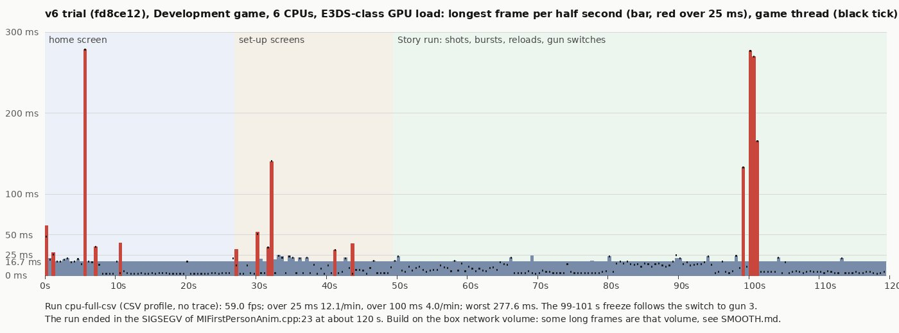

# Smooth play: the lanes' findings

The owner played version 4 on E3DS: "It is very laggy and buggy" (stutter or freezes, a low frame rate; bugs in menus,
weapons and gameplay). DECISIONS.md (2026-11-25, ~21:00) makes this file's verdict a release criterion. One section per
lane; every number names the run it comes from. Severities: blocker (a freeze, a crash, a stuck state, or under 50 fps
sustained on E3DS-class limits), must-fix (a player would feel or see it), should-fix, nit.

## CPU and game-thread cost (lane `cpu`, 2026-11-25, 21:20 to 22:40 UTC)

**Verdict of this lane: not smooth.** The play loop itself is cheap (game thread 4.7 ms a frame on average, no frame over
25 ms in 48 s of shooting, bursts and reloads), but the game **crashed in both measured sessions** about two minutes in,
right after the engine's periodic garbage collection that follows a weapon switch, and it **freezes for up to a second**
around gun switches and **hitches 140 to 280 ms on the set-up screens and the Briefing**, where the code loads assets
synchronously on the game thread. Casings, decals, effects, the probe line, the JSON data and garbage collection were
measured and are not where the lag comes from.

### How it was measured

| What | Value |
|---|---|
| Package | `v6trial.zip` (game `fd8ce12`, the guns trial; the newest package on the box), its Development game (`MurderInc`, the same code as the Shipping one, with stats, CSV profiler and trace) |
| Where | `/project/ue/smooth/cpu/v6t` (the zip unpacked privately), runs in `/project/ue/smooth/cpu/runs`, Insights exports in `/project/ue/smooth/cpu/ins` |
| E3DS emulation | `lag-test.sh` with `load=1:0.05:0.05:1024` (the gate's `v6-e3ds-l12` load) and `cpus=0-5` (6 CPUs, 5 task workers: Unreal's Vulkan RHI then runs without its interrupt and submission threads, as on E3DS's 8 hyper-threads), `-sm5`, 1920 x 1080, a viewer through Pixel Streaming, `-MICloudProbe=1` as on E3DS |
| How close | The GPU read **7.0 to 10.2 ms a frame at render scale 0.75** (probe `gpuMs`, `dr`); E3DS read 10.6 to 13.2 ms at 0.50 to 0.75 (DECISIONS.md, 13:23). So this load is a little lighter than E3DS's card: fine for game-thread costs, which do not depend on it; frame rates here are an upper bound for E3DS. The CPU side is harsher on threads (5 workers, not 6) and kinder on clock speed (the box's cores are faster than an A4000 server's) |
| Script | The Development game's demo director playing `tools/box/cloud/sound-demo.txt` (as `full-csv.txt` / `full-trace.txt` in the lane folder): 20 s of home screen, the set-up screens (crew, four gun slots, the Workbench with a silencer previewed and fitted, level, mode, difficulty), a Story run: single shots, a burst, reloads, the dry press, gun switches 2, 3, 4 and back to 1 with shots, melee, walking, sprinting, a jump, then the fight on the avenue (never reached, below) |
| Runs | `cpu-full-tr` (Unreal Insights trace, `-trace=default,task -statnamedevents`; for attribution only, tracing slows the game thread) and `cpu-full-csv` (CSV profile, no trace: the per-frame numbers below). Both CLEAN: no other game on the GPU in any second (`others=0` in all 309 and 308 watcher lines) |
| Tools | `UnrealInsights -OpenTraceFile=... -NoUI -AutoQuit -ExecOnAnalysisCompleteCmd="@=cmds.txt"` with `TimingInsights.ExportTimingEvents` / `ExportTimerStatistics` (`-threads=GameThread`; a thread id such as `2` selects the GPU queues, not the game thread), `lag_csv.py` and `csvsum.py` (frames over 25, 50, 100 ms a minute, 1 % low) |

**Per-frame numbers of `cpu-full-csv`** (7,041 frames, 119 s, every frame, not one-second averages):

| Phase | fps | frames over 25 / 50 / 100 ms a minute | worst frame | 99th percentile frame | 1 % low | game thread avg / p99 |
|---|---|---|---|---|---|---|
| Home screen, 0 to 20 s | 58.4 | 33.0 / 9.0 / 3.0 | 277.6 ms | 23.7 ms | 17.9 fps | 5.5 / 20.2 ms |
| Set-up screens and Briefing, 20 to 49.5 s | 59.4 | 12.2 / 4.1 / 2.0 | 140.3 ms | 17.4 ms | 30.8 fps | 2.4 / 12.4 ms |
| Story run, shooting and reloads, 49.5 to 98 s | 59.9 | **0 / 0 / 0** | 23.7 ms | 16.7 ms | 54.8 fps | 4.7 / 14.8 ms |
| The switch to gun 3 and its first shots, 98 to 104 s | 48.7 | 70 / 70 / 60 | 277.3 ms | 178.8 ms | 4.1 fps | 7.8 / 178.7 ms |
| Gun 4, back to gun 1, melee, walking, 104 to 119 s | 60.0 | 0 / 0 / 0 | 22.0 ms | 16.7 ms | 56.5 fps | 2.7 / 4.2 ms |
| Whole run | 59.0 | 12.1 / 6.0 / 4.0 | 277.6 ms | 17.2 ms | 22.4 fps | 4.1 / 16.2 ms |

The GPU was never the limit (GPUTime avg 7.9, worst 14.0 ms); every long frame above is the game thread's (the render
thread waited on it: `RenderThreadIdle/CriticalPath` up to 280 ms in the same frames).

### Findings

| # | Severity | Finding | Measured cost | Evidence |
|---|---|---|---|---|
| C1 | **blocker** | **The game crashes (SIGSEGV) at the first periodic garbage collection after a weapon switch.** Stack (symbolised with `/project/ue/cloud/symbols/fd8ce12/MurderInc.debug`): `MIFirstPersonAnimPrivate::Sample` (`MIFirstPersonAnim.cpp:23`, `L.Clip->GetPlayLength()`) from `FMIFPAnimProxy::Evaluate` (`:300`). `UMIFPAnimInstance::SetPose` kept raw `UAnimSequenceBase*` in `FMIFPPose`; the rig lets go of the old gun's clips on `Equip`, the collector frees them, and an anim instance that still holds that pose evaluates freed memory. | The process ends: exit code 139 | Run `cpu-full-tr`: switch back to gun 1 at 108.7 s, `CollectGarbageInternal` at 132.242 s (the periodic one; the one before was at 71.13 s), the game thread's last frame starts at 132.262 s, "Signal 11 caught" at 21:53:51.88. Run `cpu-full-csv`: the same stack, 13.7 s after the switch to gun 1, at the second periodic collection (the CSV's `GC` event at 60.8 s, the crash at about 122 s). **2 of 2 sessions.** The switch lane found the same crash in version 4 and fixed the source at `2a35906` (`HeldClips`, `MIFirstPersonAnim.h`); no package has that fix yet: a package of it must be run through this same script past two collections (over 125 s with switches) before this is closed |
| C2 | **must-fix** | **Synchronous loads on the game thread in the menus and at the Briefing.** `LoadObject` / `FSoftObjectPath::TryLoad` from ticks and input: `AMIShowroom::Tick` (gun swap: `UMIGunAssembly::Assemble` loads the gun mesh, every part mesh, top round, magazine and materials), `UMIWeaponComponent::EquipMesh` (gun mesh, idle clip), `UMIFirstPersonRig::Equip` (`LoadAs`: clips, part meshes, optics; it also parses `grips.json`, 62 KB, on every equip), `AMIPlayerCharacter` (arms, materials). Each unloaded asset is a `FlushAsyncLoading` that stops the frame | **202.4 ms** in one frame at the Briefing (trace 46.81 s: `FTickFunctionTask > MIShowroom > LoadObject > StaticLoadObjectInternal > FlushAsyncLoading`, 183.9 ms of it `MainThreadWaitingOnAsyncLoadingThread`); 12 ms at 37.3 s; the CSV run logs a `FlushAsyncLoading` event at the focus of the NINE (33.2 s), STICK (34.8 s) and STRETCH (36.4 s), the silencer preview (40.2 s), the Briefing (46.5 s) and the switch to gun 3 (98.4 s); its 140 ms frame at 32.2 s is on the gun-slot screen | Runs `cpu-full-tr` (`ev_sel.csv`, `w_briefing.csv`), `cpu-full-csv` (CSV events column). Fix without touching rules: load every offered gun, part, clip and the crew's arms once, asynchronously, on the home screen (they are few: six guns, 22 parts) and keep them referenced (a `UPROPERTY` array on a subsystem), so `TryLoad` finds them in memory; parse `grips.json` once |
| C3 | **must-fix** | **A freeze of almost a second around the switch to gun 3 (the STICK with the silencer fitted) and its first shot.** Five frames in a row of 84, 179, 277, 270 and 165 ms (CSV frames 5947 to 5951, 100.2 to 101.0 s; the switch at 98.07, its `FlushAsyncLoading` at 98.35, the first shot at 100.07); 133 and 128 ms frames at 99.2 to 99.4 s before them. The CSV puts the time in the game thread's `Exclusive/UI` (162 to 274 ms), the render thread waiting for it | ~1.0 s of 975 ms frames; 6 s window at 48.7 fps, 1 % low 4.1 fps | Run `cpu-full-csv`; `lag_csv.py` output in the run's folder. The traced run did **not** show it at the same moment (its long frames were elsewhere, see C6), so it is not every switch. The box was quiet then (`cpu=36-52`, no compiler running: `others.log` 21:59:15 to 21:59:17). Not yet proven to be the game's rather than the box's disk (C6); C2's preloading removes the loads that start it either way |
| C4 | should-fix | **The HUD draw takes 15 to 22 ms in some frames** (`HUD Time`, i.e. `AMIHUD::DrawHUD` and what it calls: crosshair, weapon bar, health, objective, markers, subtitles); median 0.8 ms. No named scope inside, so which part is not known | 16 frames of 11 to 23 ms in 60 s of play in the traced run (60.99, 67.83, 68.64, 76.15, 79.17 s ...), each the frame's whole excess (exclusive 15.5 to 22.0 ms, nothing under it but `DbgDraw_Canvas_TextItem_RuntimeCache` x30, 0.08 ms) | Run `cpu-full-tr` (`ev_hud.csv`, `h_*.csv`). Traced, so inflated: the untraced run has no frame over 25 ms in the same phase, its game-thread p99 is 14.8 ms. Next: `SCOPED_NAMED_EVENT` round `DrawPlay`, `DrawFlow`, `DrawMenu`, `DrawWeaponBar`, `DrawWheel` and `UMIAudioSubsystem::DrawSubtitle` (new subtitle text is shaped and rasterised by the font cache the first time) |
| C5 | should-fix | **The set-up screens' Slate widget costs up to 47 ms in a frame** (`SMIFrontEnd [MIFrontEnd.cpp(86)]`), 13 frames over 10 ms between 30 and 57 s; 38 ms exclusive at the Workbench (40.36 s) | 19 to 47 ms per event on the Workbench and slot screens | Run `cpu-full-tr`. This is READY.md's "rebuild in the paint pass" finding (menu audit), here with its game-thread cost; nothing to add to its fix |
| C6 | must-fix (for our measurements, not the game) | **Stalls in code that does nothing.** In the traced run seven frames of 73 to 181 ms are spent inside scopes that contain no work: `Tick_PerformanceMonitoring` 163, 181, 153, 125 ms (34.9, 85.9, 88.9, 115.8 s), `Render_BeginFrame` 181, 73, 155 ms (19.8, 22.9, 28.9 s). The thread was not running. The packages on the box run from `/project`, a 9p network volume (`cache=remote_revalidating`); the game's binary and paks are memory-mapped from it, and a page fault there waits on the network. E3DS runs from its own disk | Up to 181 ms a stall, about one a minute in play | Run `cpu-full-tr` (`ev_sel.csv`). Not proven yet: the same script from the box's local disk (`/tmp/smooth-cpu/v6t`) is queued as `cpu-full-csv-local` and `cpu-full-tr-local` (below). Until then **every lane's frame times on the box may contain hitches E3DS does not have**, and some of C3 may be one |
| C7 | nit | **Casings, magazines and debris are spawned physics actors, not pooled** (`UMIEffects::SpawnBody`: an `AStaticMeshActor` with CCD and shadows per casing, two per round; destroyed by life span) | `SpawnActor` 77 calls in the session, **0.086 ms average, 0.26 ms worst**; `RegisterComponent` worst 0.4 ms; `RecreatePhysicsState` / `DestroyPhysicsState` 0.001 to 0.002 ms; `Exclusive/Physics` 0.025 ms a frame | Run `cpu-full-tr` / `cpu-full-csv`. At the CHOPPER's 720 rounds a minute that is about 2 ms a second spread over 24 frames: no hitch. Pooling them as the puffs are pooled is tidy work, not a lag fix. The 20-Goon fight was not reached (C1), so a full-auto fight with Goon fire is unmeasured |
| C8 | nit | **Garbage collection** (default settings: every 61.1 s, `gc.TimeBetweenPurgingPendingKillObjects`) | 3 collections, **2.4 to 3.2 ms** each (`CollectGarbageInternal`), plus 0.6 to 0.8 ms incremental | Run `cpu-full-tr`. Not a hitch; only the crash's trigger (C1) |
| C9 | nit | **The probe line (`-MICloudProbe=1`, still set on E3DS)**: one line a second, built with ~40 `Printf` fields, `FPlatformMemory::GetStats` (reads `/proc`), and in the Shipping game `printf` + `fflush` to the launcher's pipe | The core ticker's scope rises from a median 0.004 ms to **0.15 to 0.24 ms once a second** (33 of 10,704 ticks over 0.15 ms in 60 s of play, 1.0 s apart; worst 0.52 ms): about 0.02 % of the frame time | Run `cpu-full-tr` (`STAT_FTicker_Tick` events). It costs nothing a player feels. The only risk is the pipe: a reader that stops reading stops the game at `fflush`; the launcher's `tee` to a local file does not stop |
| C10 | nit | **Per-frame scans and lookups**: `UMIAudioSubsystem::Observe` runs two `TActorIterator`s every frame; `UMIEffects` reads `MIJson::NumberOr(Fx, "a.b.c")` paths on every flash, tracer and casing; `UMIGameSubsystem::StartPitch` parses `presentation.json` (51 KB) on every run start; each `AMIExplosive` and objective actor parses it at boot | `UMIAudioSubsystem` tick 0.046 ms a frame on average (0.23 ms worst); `UE::Json::ParseInPlace`-class costs well under a millisecond per file | Run `cpu-full-tr`. Cache the JSON roots and the numbers once; no player sees these |
| C11 | nit | **AI, box world, timers, debug drawing.** The enemy logic senses on a randomised interval (`SenseEvery`), its line of sight is a loop over the 757 boxes of `FMIBoxWorld`, the nav grid is rebuilt only when a blocking box is removed (an explosive). No `DrawDebug*` in the game code; the only per-shot timer is the casing's show timer | Not measured in a fight (C1 ended both runs first); `Exclusive/TickActors` 0.17 ms and `Ticks/MIGoonMovement` 12 ticks a frame with no Goon awake | Code review; a fight measurement is the next step once C1's fix is packaged |

### What this says about the owner's session

- **Stutter or freezes**: C1 ends the session (a crash is a freeze followed by a lost stream), C3 is a one-second freeze on
  a gun switch, C2 is a 0.14 to 0.28 s freeze on the set-up screens and the Briefing. All three are on the paths a first
  session takes (set-up screens, a run, switching guns) and none was on the path our earlier E3DS measurement took (keyboard
  through the screens, a 24-second holdout with no gun switch reported: DECISIONS.md 13:23), which explains why that measurement read
  60 fps and a 21 ms worst frame.
- **Low frame rate**: not the game thread. In play it uses 4.7 ms of 16.7 on average with 5 task workers; the frame rate
  of the play phase was 59.9 with no frame over 25 ms. A sustained low rate on E3DS has to come from the GPU or the stream
  (the other lanes).
- **Our probe**: `worstMs` is the longest frame of each second, so one-second averages did not hide these freezes; the
  E3DS session simply did not do what triggers them.

### Not done, not proven

- The local-disk runs (C6): queued behind other lanes' GPU claims when this section was written; if they finished, the
  addendum below has them.
- The fight (20 Goon slots, explosions, full-auto with casings): both runs crashed before it (C1).
- Version 4 itself under this script: its demo director and menus differ; the hitch lane measures version 4.
- No fix was written (this phase changes no game code).

### Files (on the box, not in the repository)

`/project/ue/smooth/cpu/`: `go.sh` (a queue of `lag-test.sh` runs that holds the GPU claim, a placeholder process named
`MurderInc`, from the moment the GPU is free until its last run ends), `full-csv.txt`, `full-trace.txt`, `csvsum.py`;
`runs/cpu-full-tr`, `runs/cpu-full-csv` (with `profile.csv`); `ins/` (the trace, `tree.py`, `flat.py`, `evsum.py` and every
export named above).
