# The Vultures on Levels 2 and 3: crews, looks and the generated-character pipeline

Status (2026-11-26): roster written, concept turnarounds made for all six, the pipeline proven end to end on the first
character (`SK_Vulture_CanalShell`); the other five are not yet built. Owner's instruction (via the lead): "you can also
use trippo in higsfield to generate realistic charachters". This page is the character lead's plan for the next
release's three-level story (docs/unreal/MAPS.md, [chinatown.md](chinatown.md), [midtown.md](midtown.md),
[progression.md](progression.md)): the enemies on Level 2 (Canal Street, night, wet) and Level 3 (Midtown rooftops,
night) are distinct crews of the same gang, the Vultures, so each level reads differently.

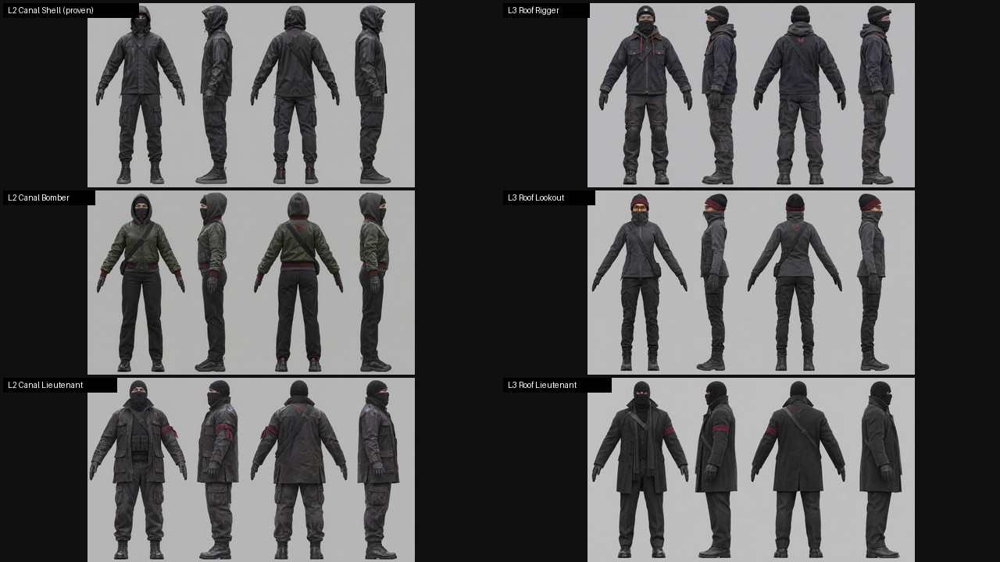

`art/previews/characters/maps/vultures_roster_concepts.jpg`: the six concept turnarounds (front, left, back, right),
Level 2 on the left, Level 3 on the right, rank and file above, lieutenants at the bottom.

---

## 1. Rules for every character

- **Invented people only.** No real person's likeness, no named or famous reference in any prompt. Faces are covered
  (balaclava, gaiter, bandana, collar), so no face is a likeness of anyone.
- **No logos, brands or lettering** on clothes, shoes or gear (prompts say so; every sheet is checked by eye).
- **No ethnic caricature.** The crews are defined by clothes, gear and attitude, never by ethnicity. The Canal Street
  crew is a mixed New York crew in believable wet-night streetwear: nothing in its look refers to Chinese people or
  Chinatown (no conical hats, mandarin collars, silk, dragons, characters or "oriental" motifs). Masks and bandanas like
  the Goons' are fine.
- **Adult men and women.** Two of the six are women.
- **Same game piece as a Goon.** Every Vulture is an AMIGoon with the same rules (90 / 110 / 130 hit points, head sphere
  0.155 m x 2.2, body capsule 0.27 m, movement capsule 0.3 x 1.8 m, from config.json, never from the mesh), the same
  SMG (`SM_Weapon_GoonSMG` in both hands, warning lamp), the same pipe rush (`SM_Weapon_GoonPipe`, so every look has a
  black webbing sling diagonally across the chest and back), the same skeleton (SK_Mannequin, all 89 joints), the same
  clips and the same in-game scale (**0.98** on the mesh component, presentation.json `enemies.goon.meshScale`). A
  lieutenant is heavier in look only (build, coat, vest); if the game later gives lieutenants more hit points that is a
  rules change for the design lane, not this page.
- **Same silhouette size as the Goons.** Built on the mannequin to the Goon's height (hood top 1.818 m before the 0.98
  scale), 0.50 to 0.58 m across the shoulders and sleeves, no coat below mid-thigh (runs and the pipe rush), nothing
  wider than the body capsule's reach (no backpacks, rifles slung wide, capes).
- **Readability.** The Goons wear oxblood on black and the levels are lit around that (chinatown.md 11.3: no red in the
  fight backgrounds; midtown.md: cool level, no red field behind a fight). Every Vulture stays a dark figure (body
  albedo under about 0.08 linear) with oxblood accents and the gang mark: **the crew V** (two oxblood bars 0.20 x 0.03 m
  leaning 24 degrees outward, centred 1.29 m up on the back, as on the Goons). Rank mark: **lieutenants wear an oxblood
  cloth band on the left upper arm**, visible from the front, side and back. The readability check (chinatown.md 17
  check 11) runs with these meshes in place of the Goons.

## 2. The roster

Three looks per level: two rank and file, one lieutenant. The crew is picked per spawn as the Goon outfits are now
(random), with the lieutenant at a lower share (proposal: 1 in 5 spawns, at most 2 alive): the enemy lane decides.
Wiring proposal (not done here, `src/` and the game code are not touched): a per-level `enemyLook.variants` in the
level's `tuning` that replaces presentation.json `enemies.goon.variants` (`/Game/Characters/Vultures/SK_Vulture_*`);
Level 1 keeps the three Goons.

| Id | Asset | Level | Role | Who | Build, height (before 0.98) | Silhouette key |
|---|---|---|---|---|---|---|
| canal_shell | `SK_Vulture_CanalShell` | 2 | rank and file | man | lean; 1.822 m over the hood (built) | black rain shell, hood up |
| canal_bomber | `SK_Vulture_CanalBomber` | 2 | rank and file | woman | athletic; 1.818 m over the hood | olive bomber, hood up, bandana |
| canal_lieutenant | `SK_Vulture_CanalLieutenant` | 2 | lieutenant | man | broad, heavy; 1.815 m over the cap | open waxed parka over a vest, arm band |
| roof_rigger | `SK_Vulture_RoofRigger` | 3 | rank and file | man | wiry; 1.815 m over the cap | navy duck work jacket, headlamp, knee pads |
| roof_lookout | `SK_Vulture_RoofLookout` | 3 | rank and file | woman | lean; 1.815 m over the beanie | slate softshell, collar to the nose, amber glasses |
| roof_lieutenant | `SK_Vulture_RoofLieutenant` | 3 | lieutenant | man | broad, heavy; 1.805 m | charcoal wool car coat, balaclava, arm band |

All built on the one mannequin skeleton (a woman's mesh keeps her own narrower shoulders and hips in the mesh; the
joints are the mannequin's, which the clips need). Heights are set by the top of the head gear over the mannequin's
head (`vultures.ROSTER`): hood 1.818 m, cap or beanie 1.815 m, bare balaclava 1.805 m.

### 2.1 Level 2, Canal Street: the Canal crew (night, wet)

The crew that runs the bootleg tables and the dub room. Rainwear: matte and waxed shells with a wet sheen on the
shoulders, hoods up, dark trousers, rubber-soled shoes. Mixed crew.

**canal_shell, `SK_Vulture_CanalShell` (proven below).** Lean man. Matte black hooded waterproof rain shell, hip
length, slightly loose, taped seams, hood up and cinched round the face, storm flap over the zip, two zipped chest
pockets, small dark oxblood cord toggles at the hood and hem; dark charcoal knitted two-hole balaclava under the hood
(face, mouth and neck covered, eyes only); black webbing sling across the chest; dark charcoal tapered cargo joggers
with side cargo pockets and rib ankle cuffs; black leather gloves; black waterproof high-top sneakers with dark grey
soles and an oxblood heel tab; rain sheen on hood and shoulders; crew V on the upper back. Colours: shell #111214,
balaclava #26272a, joggers #2a2b2e, toggles / V / heel tab #7c151d, soles #4a4b4e. Materials: nylon shell (roughness
0.35-0.5 where wet, 0.6 dry), rib knit, cotton twill, glove leather, rubber.

**canal_bomber, `SK_Vulture_CanalBomber`.** Athletic woman. Dark olive-green padded nylon bomber jacket, waist length,
no patches, with dark oxblood rib-knit collar, cuffs and waistband; charcoal hooded sweatshirt under it with the hood
UP over a black knit beanie; plain black cotton bandana over nose and mouth (eyes and brows show); black straight-leg
jeans; black leather gloves; black chunky trainers with dark soles and an oxblood heel tab; sling; crew V; rain sheen
on the shoulders. Colours: bomber #2f3424, hoodie #34353a, bandana and jeans #141416, rib trims #5a1419.
Materials: satin nylon (roughness 0.45), rib knit, fleece, denim, leather.

**canal_lieutenant, `SK_Vulture_CanalLieutenant`.** Broad, heavy man. Dark charcoal waxed-cotton field parka to
mid-thigh, worn open, four flap pockets, dark corduroy collar up, side vents; plain black low-profile vest with two flat
pouches under it (no patches); black knit watch cap; black fleece neck gaiter over nose and mouth (eyes only); oxblood
cloth arm band on the left upper arm; dark grey cargo trousers darkened by rain; black leather lace-up boots; black
leather gloves; sling; crew V; waxed sheen. Colours: parka #2b2a28, vest #0f1011, gaiter and cap #121214, trousers
#3a3a3c, band #7c151d. Materials: waxed cotton (roughness 0.4-0.55, darker creases), nylon, fleece, twill, leather.

### 2.2 Level 3, Midtown rooftops: the Roof crew (night, cold, wind)

The crew dressed as the sign-rigging and building crews on the roofs above the square: winter workwear, watch caps,
gaiters, safety glasses, and a sharper-dressed lieutenant for the buyer's side.

**roof_rigger, `SK_Vulture_RoofRigger`.** Wiry man. Dark navy heavy cotton duck work jacket, hip length, quilted
lining at the cuffs, dark brown corduroy collar, two chest flap pockets; charcoal hooded sweatshirt underneath with
the hood down and dark oxblood drawcords; black knit watch cap with a small black headlamp on an elastic strap (lamp
off); black fleece neck gaiter over nose and mouth; clear safety glasses; dark charcoal double-knee work trousers with
black knee pads; black leather work boots; black work gloves; sling; crew V. Colours: jacket #232838, collar #3a2a20,
trousers #2c2c2e, cords and V #7c151d. Materials: duck canvas (roughness 0.75), corduroy, fleece, polycarbonate,
leather, rubber.

**roof_lookout, `SK_Vulture_RoofLookout`.** Lean woman. Dark slate-grey fleece-lined softshell jacket, hip length,
zipped with a tall collar over nose and mouth; black knit beanie with a dark oxblood turned-up cuff; amber-tinted
wraparound shooting glasses; small black crossbody pouch at the left hip; black slim cargo trousers tucked into black
lace-up hiking boots; black softshell gloves; sling; crew V. Colours: softshell #3b3e42 (the lightest Vulture: still
under 0.08 linear), beanie #111113 with cuff #5a1419, lens amber #b0701a at 40 % opacity. Materials: softshell (0.6),
rib knit, polycarbonate, ripstop, leather.

**roof_lieutenant, `SK_Vulture_RoofLieutenant`.** Broad, heavy man. Charcoal wool car coat to mid-thigh,
single-breasted, open, collar up, dark buttons; plain black low-profile vest over a black roll-neck; dark charcoal wool
scarf; black knit two-hole balaclava (eyes only); oxblood arm band on the left upper arm; black leather sling (the
lieutenant's one dressier piece); charcoal wool trousers; black leather boots and gloves; crew V on the coat's back.
Colours: coat #2e2e31, trousers #2a2a2d, balaclava and vest #0e0e10, band #7c151d. Materials: wool melton (0.8,
fuzz), knit, nylon, leather.

### 2.3 Budgets (the Goons' numbers)

| Item | Goon (r3) | Vulture |
|---|---|---|
| Triangles | 115-117.5k, cap 120k | cap **120k**; Tripo `face_limit` 110000 (canal_shell: 105,477) |
| Skeleton | SK_Mannequin, 89 joints, up to 6 influences | the same, **4** influences (goon_generated's proven setting) |
| Texture sets | `Goon<Outfit>_Cloth` 4096 + `_Head` 2048, BC / N (OpenGL) / ORM | one unique set `Vulture<Name>` **4096**, BC / N (OpenGL) / ORM (R the generated occlusion, G roughness, B metallic): about the memory of the Goon's two sets |
| Slots | `M_Goon<Outfit>_Cloth`, `_Head` | one: `M_Vulture_<Name>` |
| LODs | none | none in the GLB; set Unreal's auto LODs (LOD1 50 %, LOD2 25 %) at import, as for the Goons when that lands |
| In play | pool 12 alive at most | the same pool: a level shows its own three looks |

## 3. The pipeline (as proven; fixes from the proof are in it)

### 3.1 Turnaround sheet (Higgsfield `generate_image`)

Model `gpt_image_2_6`, aspect 16:9, quality high, resolution 4k (3840 x 2160): **3.25 credits** a sheet. One sheet with
all four views keeps the person, clothes and colours consistent across the views (four separate images drift). The
shared frame, then the character block from section 2 written as a description:

```text
Photorealistic character turnaround reference sheet for a 3D game model. The SAME <man|woman> shown four times side
by side in one row, left to right: 1) front view, 2) left side profile with the body facing the left edge of the image,
3) back view, 4) right side profile with the body facing the right edge of the image. Full body from the top of the
head to the soles in every view, identical scale, every figure standing on the same baseline, long-lens orthographic
look with no perspective distortion. Neutral A-pose in every view: arms straight and angled about 40 degrees down and
away from the body, hands open and relaxed with the fingers together, a clear gap between the arms and the torso, feet
about shoulder width apart, standing straight. Plain flat light grey seamless background, soft even shadowless studio
light, no floor shadow, no text, no labels, no frames.

The character: an invented adult <man|woman>, <build>, about <height> tall, <who, where, weather>. <Clothes, gear,
mask, colours, from section 2>. On the upper back a small oxblood-red V mark made of two short bars. A black nylon
webbing sling strap runs diagonally across the chest from the right shoulder to the left hip and across the back.
<Trousers, gloves, shoes>. Realistic fabric detail, real New York <streetwear|workwear|winter clothes>. No weapon in
the hands. No logos, no brand marks, no lettering anywhere on the clothes.
```

Check every sheet before spending on 3D: four figures; view 2 faces the image's left and view 4 its right (all six
sheets came out right first time); the arm band (lieutenants) shows in the front, the back and the LEFT profile only;
nothing that reads as a brand; no skin but the eye area. From the proof: add "the eyes in deep shadow inside small
openings, no skin showing round them" to masked characters (canal_shell's balaclava shows lids and lashes). The sheets are in `art/out/characters/maps/<id>/src/sheet_v1.png`.

### 3.2 Split and upload

`art/blender/assets/_vultures_views.py <sheet.png> <out prefix>` (PIL and numpy): find the four figures as runs of non-background columns (the background
is the median of the top and bottom rows; a figure column has more than 3 pixels 18 levels off it), crop each with
10 px margin at the common height, paste it centred on a square canvas of 1.12 x the figure height in the background
grey, resize to 2048 x 2048, save `view_front|left|back|right.png`. The A-pose front figure is wider than a quarter of
the sheet (1,045 px of 960): never cut the sheet in equal quarters. Upload with `media_upload` (four files), `curl -X PUT
-H "Content-Type: image/png" -H "If-None-Match: *" --data-binary @view_x.png '<upload_url>'` (the signed URL includes
the If-None-Match header), then `media_confirm` type image.

### 3.3 Tripo (Higgsfield `generate_3d`)

`tripo_h3_1_multiview_to_3d`, medias in the order **front, left, back, right** (role `image_references`), `texture`
true, `pbr` true, `texture_quality` detailed, `geometry_quality` detailed, `face_limit` 110000, other settings default.
**18 credits** (`get_cost` true first). About 3 minutes; `jobs_wait` with 15 s timeouts. Download with curl to
`art/out/characters/maps/<id>/<id>_tripo.glb` (git-ignored).

What comes back (canal_shell): one mesh, one connected piece, 105,477 triangles, 52,697 vertices after the weld; one
material with three 4096 maps: `Color_*` (JPEG), `ORM_*` (JPEG: R occlusion, G roughness, B metallic) and
`NormalGL_*` (PNG, OpenGL); one UV atlas inside 0..1 (about 32 % of a 512 grid's cells hit, near the Goons' 33-45 %).
The figure stands on Z but **faces along X** (the arm span lies on Blender Y): the build turns it.

### 3.4 Blender (`art/blender/assets/vultures.py`)

    venv/bin/python art/blender/build.py build vultures --only canal_shell --export --preview --samples 32
    MI_PREVIEWS=hero,detail,poses,wire     pick the pictures

(venv as art/blender/README.md: `python3 -m venv venv && venv/bin/pip install bpy==5.3.0 numpy pillow`.) 40 s to the
export, about 6 minutes for the previews on 3 threads. Steps:

1. **Import and clean** (`gen3d.load`, weld): floating pieces under 0.4 % of the faces and over 3 cm from the body are
   deleted, smooth shading. Tripo's winding is kept: it is consistent but for 11 edges at the soles, and a
   `recalc_face_normals` (tried first) is confused by the 15 non-manifold edges there and flipped whole patches (339
   edges of opposite winding after it, a validation error). `gen3d.load` now reads Tripo's packed `ORM_*` image as
   occlusion / roughness / metallic (it used to take it for the base colour because the name has no "rough" or
   "metal" in it).
2. **Orient**: ground at z 0, centred between the feet; if the slice between 50 and 65 % of the height (the A-pose
   forearms and hands) is wider on Y than on X the mesh is turned 90 degrees about Z; then `goon_generated.facing_check`
   (toes in front of the shins) turns it 180 degrees if it faces +Y. canal_shell needed both.
3. **Scale to the Goon**: top of the mesh = the mannequin's top x the roster factor (hood 1.818 / 1.805). Decimate
   (collapse) only when over the 120k cap.
4. **Bind** (goon_generated's proven method): the mannequin's upper arms, forearms, thighs and calves posed onto the
   mesh's own limbs (canal_shell: arms 20.8 and 21.5 degrees lower than the mannequin's A-pose, legs 3 degrees),
   weights copied from the posed mannequin surface (median 3.3 cm away), finger weights folded into the hand (the
   generated gloves are one piece), smoothed, at most 4 influences, then inverse skinning back to the mannequin's
   reference pose; round trip exact (max 0.0000 m).
   Added with roof_lieutenant (section 10): when the wrist search finds no cross-section near the skeleton's arm
   line (fewer than 20 points: the arm is then left unfitted, exactly 0 degrees and length x 1.000), it is
   restarted on the line from the shoulder to the mesh's fingertip (`vultures.arm_guess`); arms the default search
   fits are unchanged.
5. **Weights by body segment** (the lesson of SK_RuleArms round 3, extended to a whole body): each vertex is labelled
   torso / left arm / right arm / left leg / right leg by the nearest bone chain of the fitted skeleton (torso distances
   x 0.55: it is wide); a segment keeps only its own bones (an arm never takes a thigh, the pelvis or the other arm; a
   leg never takes an arm or the other leg; the torso never takes a forearm, hand, calf or foot); the torso may follow
   an upper arm only within 13 cm of that shoulder joint and a thigh only below the hip joint + 5 cm (a loose jacket's
   side panel must not swing with the arm). Masked before and after smoothing and after the 4-influence limit.
   Added with canal_bomber (section 7; characters built before it keep their results): a limb label must connect to
   its hand or foot over mesh edges between vertices of the same label, and islands that do not (a hip pouch beside
   the hanging forearm) go to the torso; an arm vertex keeps upper-spine weight only within 18 cm of its shoulder
   joint. The build also logs how far the reference pose stretches the generated surface (`rest_stretch` in the
   check file): the posed check measures against that reference pose, so it cannot see it.
6. **Pose check** (`vultures.pose_check`, written into the check file): the clips rifle_jog_fwd, rifle_idle_ads,
   rifle_reload, pistol_idle_ads, unarmed_attack and death_front every 6 frames, plus three held poses (`held_pose`):
   kneel on the right knee, crouch (thighs 70 degrees forward, knees 110, trunk 20), overhead swing. Per pose: the
   `_rule_gate.Gate` capsule test (no vertex more than 6 cm outside the capsule of the bones that weight it) and the
   edge stretch (posed over rest edge length: 99.9th percentile, edges over 2 x). goon_generated's kneel
   (`hand_pose(arm, 1)`) bends the right knee backward through the joint (thigh 80 degrees back, shin rotated a
   further 95 the wrong way): it failed 491 vertices by 26 cm and is not a pose a body makes, so it is replaced.
7. **Texture set** `Vulture<Name>` (written in the build, the previews read it as Unreal will): BC sRGB and N
   (OpenGL) unchanged; ORM = the generated occlusion, roughness remapped to **0.45 + 0.5 x the generated value**
   (0.45-0.95) and metallic kept only where over 0.5 (zips, buckles). The raw generated roughness (canal_shell mean
   0.56, many texels at 0.2-0.4) made the joggers, hood and gloves read as glossy vinyl in the first previews: the
   generated Goon's main fault in 2026. The preview material is the Goons' `textured_material` graph (BC x AO, sheen =
   the Cloth model's fuzz from roughness, specular 0.35).
8. **Export** (`char.export_character`, influences 4: every SK_Mannequin joint, slot stub material), then
   `rule.export_checks` (validation, the skeleton round trip against SKM_Manny_Simple, a re-import) and a manifest
   record (`art/out/manifest.json`, family `vultures`). Everything is in `art/out/glb/SK_Vulture_<Name>.glb.check.json`.
9. **Previews** (`art/previews/characters/maps/vulture_<id>_*.jpg`, at most 300 kB): hero (studio and street night),
   detail (head at 1 m, legs), poses (jog, aim, crouch, death), wire (clay beside SK_Goon_Hoodie for the size, and the
   wireframe at 1.2 m); plus the turnaround sheet.

### 3.5 Unreal (for the enemy lane; nothing imported in this pass)

The import is the Goons' (`tools/box/chars/mi_chars.py`): Interchange on the existing `SK_Mannequin`, no new skeleton,
`keep_exported_normals` (Recompute Normals off), the set's textures with the normal green channel flipped, `TC_MASKS`
for ORM. Material: the Goons' `goon_material` graph works as is (Cloth shading model, cloth amount from roughness, fuzz
= BC x 0.9 + 0.01, specular 0.30, two-sided off: the generated shell is closed); the wet sheen of the Canal crew is in
the generated roughness and can be lifted by the level's `MPC_Weather` wetness like the street. In-game scale 0.98;
the SMG on `hand_r` at the Goons' offset (presentation.json `weaponOffset`).

### 3.6 Cost per character

3.25 (sheet) + 18 (Tripo) = **21.25 credits**, plus 3.25 per sheet redone. The five remaining characters: about 90
credits for one Tripo take each (their sheets are made).

## 4. The proof: `SK_Vulture_CanalShell`

Built 2026-11-26 with `build.py build vultures --only canal_shell --export --preview --samples 32` (export at 38 s,
previews 2 min more). Outputs (git-ignored): `art/out/glb/SK_Vulture_CanalShell.glb` (3.7 MB) with
`.check.json`, the set `art/out/textures/VultureCanalShell/`, the manifest record; sources in
`art/out/characters/maps/canal_shell/`.


| Measure | Result |
|---|---|
| Turnaround | one sheet, four consistent views, profiles facing the right way, no brand, eyes only through the balaclava |
| Tripo take | first take kept: 105,477 triangles (budget 120k), one piece, 4096 maps (BC, ORM, normal GL), UVs inside 0..1 |
| Clean-up | 0 floaters; turned 90 degrees (arm span on Y) and 180 (facing +Y); 11 edges of opposite winding at the soles left as Tripo made them (the export validation reports them, non-fatal) |
| Size | hood top 1.822 m in the reference pose (SK_Goon_Hoodie 1.818), 0.98 in the game; beside the Goon in clay the two match in height, shoulders and stance (`vulture_canal_shell_wire.jpg`) |
| Fit to the skeleton | arms 21.4 / 21.9 degrees below the mannequin's A-pose, lengths x 0.99; legs 3 degrees, x 1.00; weights from the mannequin surface median 3.2 cm away (99th percentile 13 cm: the loose shell and hood) |
| Weights by segment | torso 18,636 vertices, arms 5,694 / 6,031, legs 11,029 / 11,307; 2,616 cross-segment weights removed before smoothing, 3,850 after; max 4 influences; 0 unweighted |
| Skeleton | 89 joints, the round trip against SKM_Manny_Simple: largest change 0.0000005 m, 0.00013 degrees (`rule.export_checks`, re-import 105,477 of 105,477 triangles) |
| Pose check | 99 poses, 97 pass the capsule test; the two that fail are 1 vertex in a rifle reload frame (6.6 cm) and 16 vertices in the death fall's 12th frame (10 cm), both under the arms where the shell is loosest |
| Edge stretch (edges over 2 x their rest length, share of about 158k; 99.9th percentile stretch) | jog 1.1 %, x 4.7; aim 0.7 %, x 3.1; reloads 1.1 %, x 5.0; melee 1.8 %, x 5.9; death fall 2.8 %, x 7.5; kneel 0.8 %, x 6.5; crouch 1.1 %, x 6.8; overhead swing 0.9 %, x 5.4 |
| The same measure on the hand-built Goons (baseline) | SK_Goon_Hoodie: jog 1.05 %, x 9.6; aim 1.3 %, x 8.6; death 2.4 %, x 11.9. SK_Goon_Puffer: jog 1.9 %, x 6.2; death 3.2 %, x 11.1. The generated mesh deforms as well as the Goons or better (fewer layers to stretch against each other) |
| Texture set | 4096, albedo mean linear 0.036 / 0.035 / 0.037 (a black figure, as the readability rule wants), roughness mean 0.73 after the remap (0.56 raw), metallic 0 (no texel over 0.5), occlusion mean 0.998 (Tripo's occlusion is nearly empty) |


`vulture_canal_shell_hero.jpg`: front and back three-quarter in the studio light and in a night street rig (one
sodium lamp, a green sign): the matte black shell with the wet sheen on hood and shoulders, the oxblood toggles, the
crew V on the back, the sling with its buckle; at night a dark figure with the oxblood accents, as the Goons.

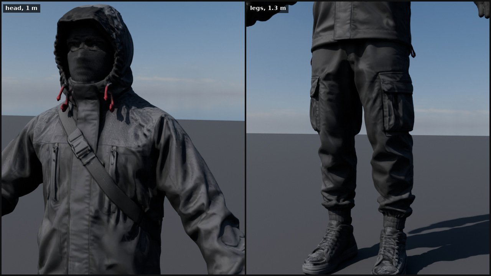

`vulture_canal_shell_detail.jpg`: head at 1 m (the balaclava, the hood's drawcord channel and toggles, taped zips,
rain beads in the texture) and the joggers and high-tops at 1.3 m (cargo pockets, rib cuffs, laced uppers).


`vulture_canal_shell_poses.jpg`: the jog, the aimed idle, the crouch and the forward death fall on the bound mesh, no
tearing at shoulders, elbows, hips or knees.


`vulture_canal_shell_wire.jpg`: in clay beside SK_Goon_Hoodie (same height and stance), and the wireframe at 1.2 m:
Tripo's even triangulation (median edge 8.7 mm), no edge loops.

**What the proof found and fixed in the pipeline**

1. Tripo faces the figure along X: the first bind matched the arms to nothing (152 degrees, length x 0.33) and 97 of
   98 poses failed. Fixed by the orientation step (3.4 step 2).
2. `gen3d.load` took Tripo's `ORM_*` image for the base colour (no "rough" or "metal" in its name). Fixed in
   `mi/gen3d.py` (it now reads it as occlusion / roughness / metallic), so the base colour is the real `Color_*` map.
3. A `recalc_face_normals` in the clean-up flipped patches (11 inconsistent edges became 339). Removed.
4. The raw roughness made the cloth read as vinyl. Remapped (3.4 step 7).
5. The torso followed the upper arms everywhere the posed mannequin's arm was nearest (a loose shell's side panels
   swung with the arm): the torso's upper-arm and thigh weights are now limited to the joints' neighbourhood. Edges over
   2 x in the jog went from 1,923 to 1,682.
6. goon_generated's kneel bends the right knee backward (491 vertices 26 cm outside their capsules): replaced by a real
   kneel, a crouch and the overhead swing (`held_pose`).
7. Height: goon_generated's 1.78 / 1.75 over the mannequin gave a hood 1.8 cm taller than the Goon's; now set from the
   Goon's measured hood top.

**Known weaknesses (for the art review)**

- One fused shell: jacket, sling, hood, balaclava and trousers are one surface (no layers, no inner hood, nothing to
  simulate); the sling and buckle are relief on the jacket.
- The gloves are rigid on the hands (finger weights folded into `hand_l` / `hand_r`): no finger curl round the SMG's
  grip. The Goons' gloves are per finger. The fingers stay as generated (straight, together): fine at 3 m and beyond, visible at 1 m on the SMG's grip.
- Skin shows round the eyes through the balaclava's opening (lids, lashes): the Goons' r3 rule was the eyeball filling
  a small recessed opening with no skin ring. Not a caricature problem (dark knit, no mouth hole), but the next sheets
  can ask for "eyes in deep shadow inside small openings".
- No edge loops at the joints (deformation is skinning only), no LODs, no corrective shapes; the death fall puts 16
  vertices under the arms 10 cm outside their capsules for a few frames.
- Tripo's occlusion map is nearly empty (mean 0.998); any shading the base colour carries in the folds stays in it
  (not measured; less visible than on the earlier generated Goon in the previews).
- Not imported in Unreal in this pass (no box): the in-engine check (scale 0.98, materials, the SMG on `hand_r`, a
  readability frame in a Canal Street view) is the enemy lane's next step.

**Verdict.** Usable as a game enemy: realistic at 3 to 40 m, at the Goons' size, on the same skeleton and clips, deforms
as well as the Goons by the same measure, at 21.25 credits per character and one build command. Below the
hand-built Goons at 1 m (fused layers, rigid gloves). Proceed with the five remaining characters on this pipeline.

## 5. Credits

| What | Credits |
|---|---|
| canal_shell turnaround sheet (gpt_image_2_6, 4k high) | 3.25 |
| canal_shell Tripo multiview (`tripo_h3_1_multiview_to_3d`, detailed, 110k) | 18 |
| five more turnaround sheets (canal_bomber, canal_lieutenant, roof_rigger, roof_lookout, roof_lieutenant) | 16.25 |
| **Total this pass** | **37.5** (cap 600) |

No GPU box was rented or used.

## 6. `SK_Vulture_CanalLieutenant` (Level 2 lieutenant, built)

Built 2026-11-26 on the pipeline of section 3 as committed in 3119628, with no change to it, from the first Tripo
take: `build.py build vultures --only canal_lieutenant --export` (42 s) then `--preview --samples 32` (2.7 min on 3
threads). Outputs (git-ignored): `art/out/glb/SK_Vulture_CanalLieutenant.glb` (3.8 MB) with `.check.json`, the set
`art/out/textures/VultureCanalLieutenant/`, the manifest record; sources in `art/out/characters/maps/canal_lieutenant/`
(the sheet, the four views, `canal_lieutenant_tripo.glb`).

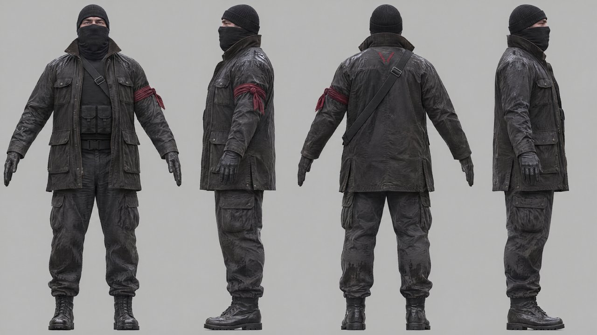

`vulture_canal_lieutenant_turnaround.jpg`: the sheet made in the first pass (`sheet_v1.png`), used as it was. Checked
before spending: four figures, view 2 faces the image's left and view 4 its right, the oxblood band on the LEFT upper
arm (seen in the front, the left profile and the back, hidden in the right profile), the crew V on the upper back, the
sling from the right shoulder to the left hip, no brand or lettering, the face covered by the watch cap and the gaiter.

| Measure | Result |
|---|---|
| Tripo take | first take kept (1 of at most 3): 108,150 triangles (budget 120k), one connected piece, 0 floaters, 0 edges of opposite winding (canal_shell had 11), 4096 maps (Color, ORM, NormalGL), UVs inside 0..1, 32 % of a 512 grid's cells hit |
| Clean-up | turned 90 degrees (arm span 0.54 m on Y against 0.23 on X) and 180 (facing +Y), as canal_shell; no decimation |
| Size | cap top 1.815 m in the reference pose (mannequin 1.805 x 1.006), 0.98 in the game; 1.13 m across the A-pose hands, 0.54 m deep (the open parka). Beside SK_Goon_Hoodie in clay: same height and stance, visibly broader in the shoulders and coat, as a lieutenant should read (`vulture_canal_lieutenant_wire.jpg`) |
| Fit to the skeleton | arms 20.7 / 21.9 degrees below the mannequin's A-pose, lengths x 0.98 / 0.99; legs 2.5 / 2.9 degrees, x 1.00; weights from the mannequin surface median 4.1 cm away (99th percentile 16 cm: the parka stands off the body more than the shell) |
| Weights by segment | torso 24,460 vertices (the parka skirt), arms 5,746 / 5,339, legs 9,245 / 9,283; 4,769 cross-segment weights removed before smoothing, 7,100 after, 0 after the 4-influence limit; 0 unweighted |
| Skeleton | 89 joints; round trip against SKM_Manny_Simple: largest change 0.0000005 m, 0.00013 degrees; re-import 108,150 of 108,150 triangles; **0 validation errors** |
| Pose check | 99 poses, **98 pass** the capsule test (canal_shell 97). The one failure: 9 vertices up to 7.8 cm out in the 12th frame of the death fall (under the arms, as on canal_shell, where it was 16 vertices and 10 cm) |
| Edge stretch (edges over 2 x their rest length, share of 162,225; 99.9th percentile; the worst frame of each clip) | jog 1.7 %, x 5.4; aim 1.4 %, x 4.0; reloads 1.8 %, x 5.8; melee 3.0 %, x 8.7; death fall 4.0 %, x 9.8; kneel 1.4 %, x 9.3; crouch 2.0 %, x 8.9; overhead swing 1.4 %, x 6.1 |
| Against the Goons (same measure) | SK_Goon_Hoodie jog 1.05 %, x 9.6, death 2.4 %, x 11.9; SK_Goon_Puffer jog 1.9 %, x 6.2, death 3.2 %, x 11.1. The worst stretch (99.9th percentile) is below both Goons in every compared pose; the share of stretched edges sits between the two Goons in the jog and above both in the death fall. Against canal_shell it is about 1.5 x the stretched edges: the long open parka is the hardest garment for skinning alone |
| Where it stretches | by the dominant bone of each stretched edge: the pelvis-weighted parka skirt (z 0.6 to 0.95 m, about 1,300 of the 3,350 crouch edges, 1,900 of the 6,000 in the death fall), then the thigh-twist zones and the spine under the vest. In the previews the skirt follows the thighs in the crouch (it shortens rather than tears) and no tearing shows at shoulders, elbows, hips or knees |
| Texture set | 4096, albedo mean linear 0.037 / 0.035 / 0.037 (a dark figure, under the 0.08 rule), roughness mean 0.75 after the remap, metallic 0 (no texel over 0.5), occlusion mean 0.998 (empty, as on canal_shell) |

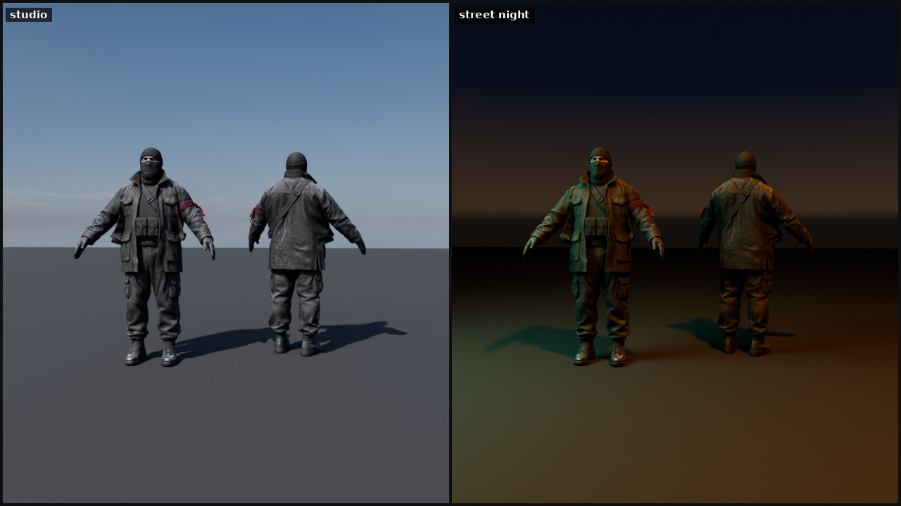

`vulture_canal_lieutenant_hero.jpg`: front and back three-quarter, studio and street night. The open charcoal parka
with its four flap pockets and corduroy collar up, the black vest with the two-pouch placard and belt, the knotted
oxblood band on the left arm, the crew V high on the back with the sling across it; at night a broad dark figure with
the oxblood band as the one accent, the Goons' reading.

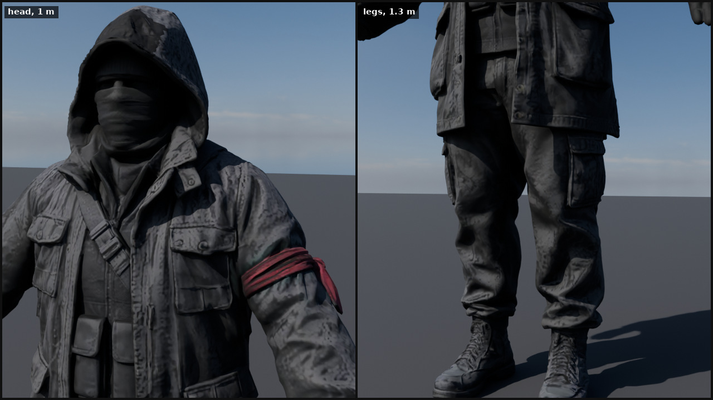

`vulture_canal_lieutenant_detail.jpg`: head at 1 m (knit watch cap, fleece gaiter over nose and mouth, the corduroy
collar, the sling buckle, snaps and pocket flaps, rain on the waxed shoulders) and the legs at 1.3 m (cargo pockets,
cuffs gathered over laced leather boots).

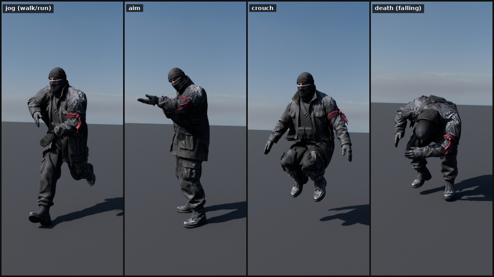

`vulture_canal_lieutenant_poses.jpg`: jog, aim, crouch and the forward death fall on the bound mesh.

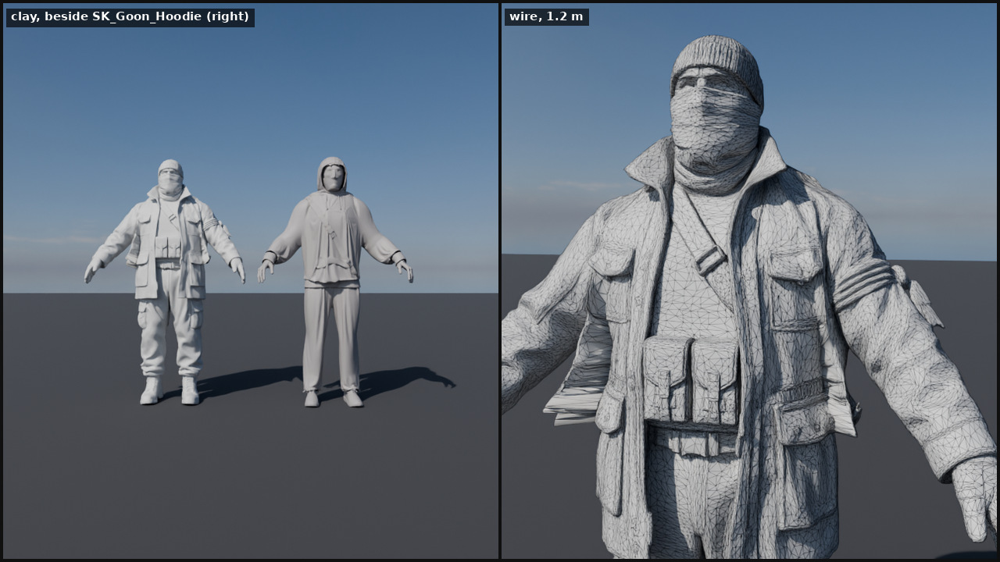

`vulture_canal_lieutenant_wire.jpg`: clay beside SK_Goon_Hoodie, and the wireframe at 1.2 m (Tripo's even
triangulation, no edge loops).

**Known weaknesses (for the art review)**

- **Skin round the eyes.** Between the cap and the gaiter a band of skin shows: brows, eyes, the bridge of the nose
  (the sheet was made before the "eyes in deep shadow" advice of 3.1). It is an invented face and mostly covered, so
  the rules hold, but at 1 m it shows more face than the Goons' r3 masks. Fix if the review asks: a sheet with the
  gaiter pulled to just under the eyes and the eyes in deep shadow, then one more Tripo take (21.25 credits).
- The waxed parka reads closer to worn leather than to waxed cotton at 1 m (the generated base colour carries
  light rain streaks on the shoulders and sleeves); right for a wet night, a step from the brief's cotton.
- The parka skirt is skinning only: it shortens with the thighs in the crouch and stretches more than the shell's
  hem in the death fall (above). A per-character skirt weight blend (pelvis and both thighs by position) would
  lower it; not done here, to keep the shared pipeline unchanged while the other lanes build on it.
- As canal_shell: one fused surface (coat, vest, sling, gaiter, trousers), rigid one-piece gloves (no finger curl
  round the SMG's grip), no edge loops, LODs or corrective shapes, occlusion map empty, not imported in Unreal yet
  (the enemy lane's check: scale 0.98, materials, the SMG on `hand_r`, a readability frame on Canal Street).

**Verdict.** Usable as the Level 2 lieutenant at 3 to 40 m: realistic, the Goons' height, a clearly heavier and
better-dressed silhouette than the rank and file with the rank band readable from the front, side and back, on the
same skeleton and clips, 98 of 99 poses inside the capsules and a cleaner mesh than the proof (0 validation errors).
Below the hand-built Goons at 1 m (fused layers, rigid gloves, the eye band).

**Credits (this character):** 18 (one Tripo take, `tripo_h3_1_multiview_to_3d`, detailed, 110k); the sheet's 3.25
is in section 5. No GPU box was rented or used.

## 7. `SK_Vulture_CanalBomber` (Level 2 rank and file, built)

Built 2026-11-26 from the first Tripo take, with two changes to the bind (3.4 step 5) that this character needed:
`build.py build vultures --only canal_bomber --export --preview --samples 32` (36 s to the export, 2.3 min of previews
on 3 threads). Outputs (git-ignored): `art/out/glb/SK_Vulture_CanalBomber.glb` (3.6 MB) with `.check.json`, the set
`art/out/textures/VultureCanalBomber/`, the manifest record; sources in `art/out/characters/maps/canal_bomber/` (the
sheet, the four views, `canal_bomber_tripo.glb`).

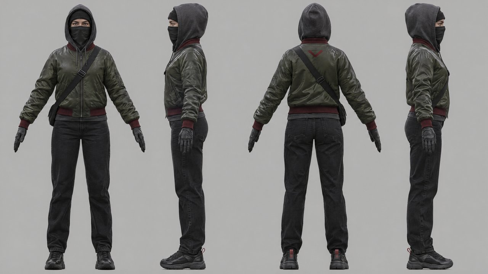

`vulture_canal_bomber_turnaround.jpg`: the sheet made in the first pass (`sheet_v1.png`), used as it was. Checked
before spending: four figures, view 2 faces the image's left and view 4 its right, the olive bomber with oxblood rib
collar, cuffs and waistband, the charcoal hood up over a black beanie, a plain black bandana over nose and mouth
(eyes and brows show, as the brief says), the crew V on the upper back, the sling from the right shoulder to the left
hip, black jeans and chunky trainers with the oxblood heel tab; no brand or lettering. The sheet added a small black
pouch on the sling at the right hip (not in the brief; kept, it is plain gear).

| Measure | Result |
|---|---|
| Tripo take | first take kept (1 of at most 3): 104,450 triangles (budget 120k), one connected piece, 0 floaters, 0 edges of opposite winding, 4096 maps (Color, ORM, NormalGL), UVs inside 0..1, 31 % of a 512 grid's cells hit |
| Clean-up | turned 90 degrees (arm span 0.49 m on Y against 0.17 on X) and 180 (facing +Y), as the others; no decimation |
| Size | hood top 1.818 m over the floor in the reference pose (mannequin 1.805 x 1.007), the Goon's hood height; 0.98 in the game; 1.16 m across the A-pose hands, 0.46 m deep. Beside SK_Goon_Hoodie in clay: same height, a narrower woman's build in the shoulders and hips (`vulture_canal_bomber_wire.jpg`) |
| Fit to the skeleton | arms 23.6 / 23.6 degrees below the mannequin's A-pose, lengths x 0.97 / 0.975 (her arms are a little shorter than the mannequin's bones); legs 3.2 / 3.1 degrees, x 1.00; weights from the mannequin surface median 3.0 cm away (99th percentile 12 cm) |
| Weights by segment | torso 21,704 vertices, arms 4,978 / 5,064, legs 10,421 / 10,046; 62 right-arm vertices not connected to the hand (the hip pouch) moved to the torso; 3,345 cross-segment weights removed before smoothing, 3,966 after, 0 after the 4-influence limit; 0 unweighted |
| Skeleton | 89 joints; round trip against SKM_Manny_Simple: largest change 0.0000005 m, 0.00013 degrees; re-import 104,450 of 104,450 triangles; **0 validation errors** |
| Pose check | 99 poses, **99 pass** the capsule test; the worst vertex is 2.1 cm outside its capsules (the limit is 6) |
| Edge stretch (edges over 2 x their rest length, share of about 156,700; 99.9th percentile; the worst frame of each clip) | jog 1.3 %, x 5.7; aim 0.9 %, x 3.9; reloads 1.0 %, x 4.6; melee 1.7 %, x 6.1; death fall 2.5 %, x 6.9; kneel 1.0 %, x 6.1; crouch 1.4 %, x 7.0; overhead swing 1.0 %, x 6.0 |
| Against the Goons (same measure) | SK_Goon_Hoodie jog 1.05 %, x 9.6, aim 1.3 %, x 8.6, death 2.4 %, x 11.9; SK_Goon_Puffer jog 1.9 %, x 6.2, death 3.2 %, x 11.1. The worst stretch is below both Goons in every compared pose; the share of stretched edges is between the two Goons in the jog and the death fall and below the Hoodie in the aim. About canal_shell's figures (jog 1.1 %, death 2.8 %) |
| Reference pose against the generated surface (new in the check file, `build.bind.rest_stretch`) | 99.9th percentile x 5.7, worst edge x 27, 496 edges over 2 x, 222 over 4 x, all under the arms (the mannequin's A-pose holds the arms 23.6 degrees higher than the generated figure). canal_shell as built: x 5.1, worst x 28, 554 and 239 |
| Texture set | 4096, albedo mean linear 0.031 / 0.031 / 0.029 (a dark figure, under the 0.08 rule), roughness mean 0.71 after the remap, metallic 0 (no texel over 0.5), occlusion mean 0.998 (empty, as on the others) |

**What this character found in the pipeline (fixed in `vultures.py`, commits 8d5fde1 and 34379e2)**

1. The first bind failed 5 of 99 poses (a rifle reload frame, the melee, two death-fall frames and the overhead
   swing; 5 to 8 vertices each, up to 12.5 cm out). All were on the inside of a forearm where it hangs beside the
   jacket hem and the hip pouch: arm-labelled vertices that kept 0.3 to 0.45 of `spine_03` (the arm segment may take
   the upper spine for the shoulder), so the forearm left them behind. Now an arm vertex keeps upper-spine weight
   only within 18 cm of its shoulder joint: 0 of 99 fail, worst 2.1 cm, and the stretch went down too (death fall
   p99.9 x 7.3 to x 6.9).
2. The hero and clay previews then showed flat dark sheets sticking out beside the right hip. The raw Tripo mesh is
   clean there (checked in clay from five sides): the pouch lies against the hanging forearm and 62 of its vertices
   were labelled right arm, so the inverse skinning to the mannequin's higher A-pose tore it apart. Limb labels must
   now connect to their hand or foot over the mesh; islands go to the torso. The sheets are gone, and the reference
   pose's worst stretch fell from x 69 to x 27 (edges over 4 x from 306 to 222).
3. The posed check measures stretch against the bound reference pose, so it cannot see damage done by the inverse
   skinning itself (point 2 passed it). The build now logs and stores that stretch (`rest_stretch`).

canal_shell (8 leg vertices would move under the island rule) and canal_lieutenant were built before these changes
and were not rebuilt here; a rebuild of either picks them up.


`vulture_canal_bomber_hero.jpg`: front and back three-quarter, studio and street night. The padded olive bomber with
its sleeve pocket and the oxblood rib collar, cuffs and waistband, the charcoal hood up over the beanie, the bandana,
the sling and buckle, the crew V on the back; at night a dark figure whose olive and oxblood separate her from the
black canal_shell at the same distance.

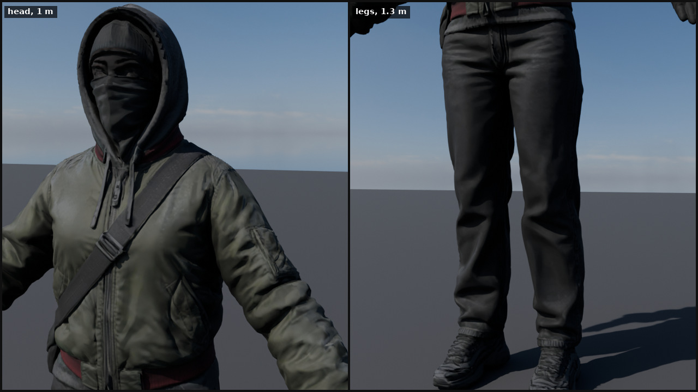

`vulture_canal_bomber_detail.jpg`: head at 1 m (the knit beanie, hood with drawcords, the bandana, rain beads on the
nylon, quilting and the sleeve pocket's zip) and the legs at 1.3 m (straight black jeans, stacked hems over chunky
trainers).

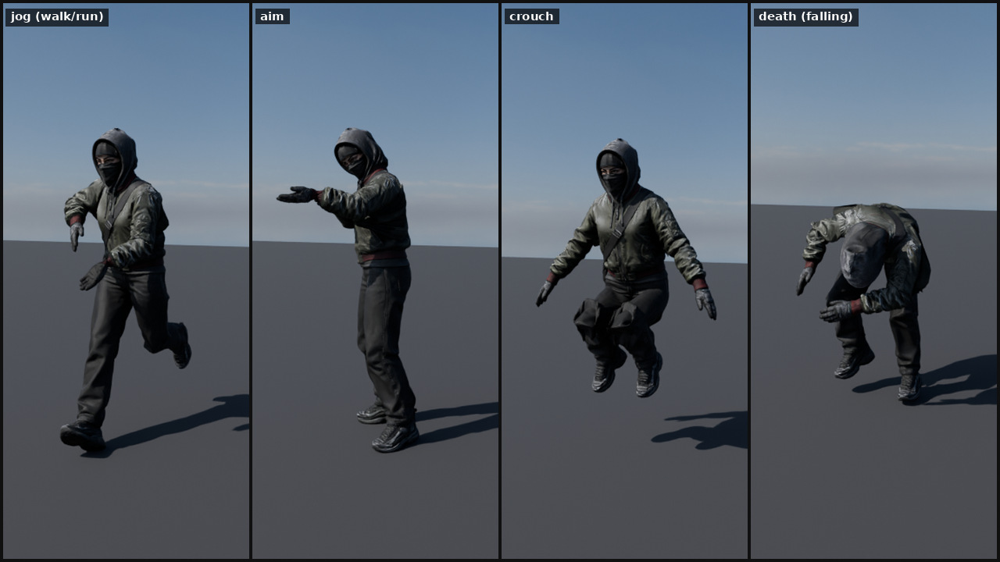

`vulture_canal_bomber_poses.jpg`: jog, aim, crouch and the forward death fall on the bound mesh; no tearing at
shoulders, elbows, hips or knees.

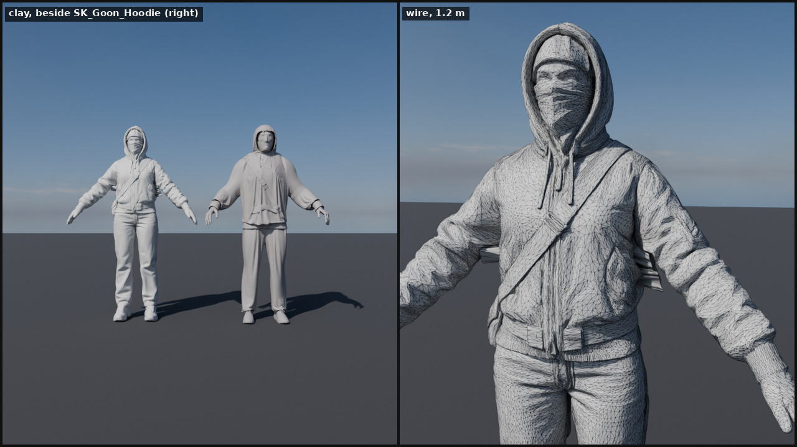

`vulture_canal_bomber_wire.jpg`: clay beside SK_Goon_Hoodie, and the wireframe at 1.2 m (Tripo's even
triangulation, no edge loops).

**Known weaknesses (for the art review)**

- **Fins under the arms in the reference pose.** Behind the upper arms the reference pose stretches the armpit into
  thin fins (visible behind the arms in the hero and wire pictures; 222 edges over 4 x). canal_shell has the same in
  about the same amount. The game never shows the reference pose and the clips hold the arms forward or down, where
  the armpit closes again (none show in the jog, aim, crouch or death pictures), but a T-pose or arms-out frame would.
  The fix belongs to the pipeline: bind with the mannequin's arms lowered to the generated figure's angle.
- **The jeans read glossy at 1.3 m**, closer to coated denim or leather than to washed black denim: the roughness
  remap (0.45 + 0.5 x) is shared by all Vultures and Tripo painted the jeans darker and smoother than the jacket. A
  per-character roughness floor for denim would fix it.
- **More face than the Goons.** The bandana leaves the eyes, brows and the bridge of the nose bare, as the brief
  asks: an invented woman's face, mostly covered, but at 1 m it shows more skin than the Goons' r3 masks.
- As the others: one fused surface (bomber, hoodie, sling, bandana, jeans), rigid one-piece gloves (no finger curl
  round the SMG's grip), no edge loops, LODs or corrective shapes, occlusion map empty, not imported in Unreal yet (the
  enemy lane's check: scale 0.98, materials, the SMG on `hand_r`, a readability frame on Canal Street).

**Verdict.** Usable as Level 2 rank and file at 3 to 40 m: a realistic woman in believable wet-night New York
streetwear, the Goons' height, on the same skeleton and clips, all 99 poses inside the capsules and less worst stretch
than both Goons; she reads differently from canal_shell (olive and oxblood against black, bomber against rain shell).
Below the hand-built Goons at 1 m (fused layers, rigid gloves, glossy jeans).

**Credits (this character):** 18 (one Tripo take, `tripo_h3_1_multiview_to_3d`, detailed, 110k); the sheet's 3.25
is in section 5. Diagnostic clay renders ran in Blender only. No GPU box was rented or used.

## 8. `SK_Vulture_RoofRigger` (Level 3 rank and file, built)

Built 2026-11-26 from the first Tripo take, on the pipeline as committed after section 7 (with the bind fixes of
8d5fde1 and 34379e2), with no change to it: `build.py build vultures --only roof_rigger --export` (40 s) then
`--preview --samples 32` (2.5 min on 3 threads). Outputs (git-ignored): `art/out/glb/SK_Vulture_RoofRigger.glb`
(3.7 MB) with `.check.json`, the set `art/out/textures/VultureRoofRigger/`, the manifest record; sources in
`art/out/characters/maps/roof_rigger/` (the sheet, the four views, `roof_rigger_tripo.glb`).

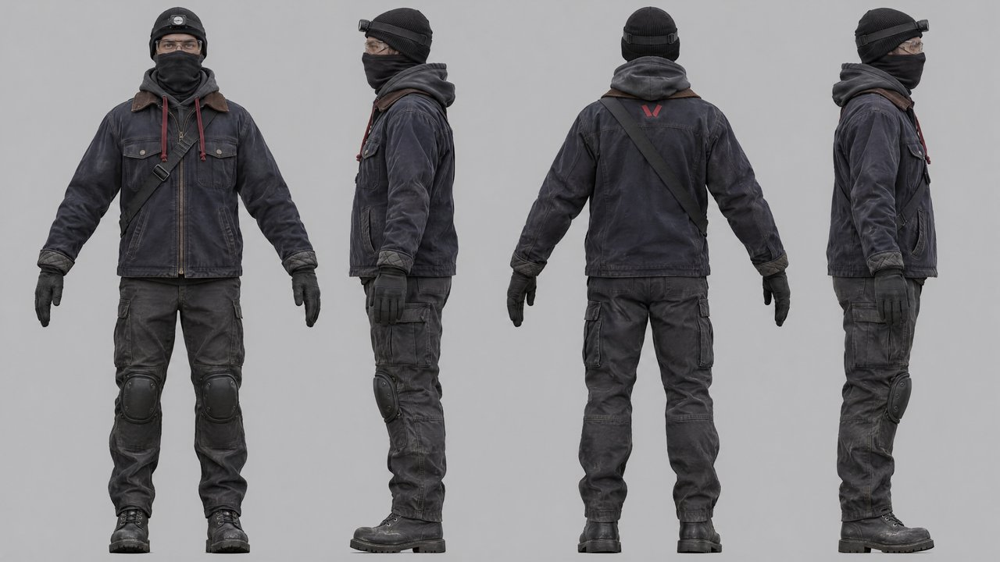

`vulture_roof_rigger_turnaround.jpg`: the sheet made in the first pass (`sheet_v1.png`), used as it was. Checked
before spending: four figures, view 2 faces the image's left and view 4 its right; the dark navy duck jacket with the
brown corduroy collar, two snapped chest flap pockets and quilted cuffs; the charcoal hoodie under it, hood down, with
oxblood drawcords; the black watch cap with a small headlamp on a strap; the black fleece gaiter over nose and mouth;
clear safety glasses; charcoal double-knee cargo work trousers with black knee pads; black lace-up work boots and
gloves; the crew V on the upper back. One correction before upload: the headlamp's housing carried a tiny
illegible light mark under the lens (about 15 x 5 pixels in the 2048 front view); it was painted out of
`view_front.png` (the untouched view is kept as `view_front_orig.png`) so nothing that could read as a maker's mark
went to Tripo. Deviation from the brief, kept: the sling runs from the LEFT shoulder to the right hip (the brief says
right shoulder to left hip). It is relief on the jacket and the pipe is a separate mesh, so the
game is unaffected.

| Measure | Result |
|---|---|
| Tripo take | first take kept (1 of at most 3): 106,791 triangles (budget 120k), one connected piece, 0 floaters, 0 edges of opposite winding, 4096 maps (Color, ORM, NormalGL), UVs inside 0..1, 32 % of a 512 grid's cells hit |
| Clean-up | turned 90 degrees (arm span 0.52 m on Y against 0.20 on X) and 180 (facing +Y), as the others; no decimation |
| Size | cap top set to 1.815 m in the fitted pose (mannequin 1.805 x 1.006); 1.818 m over the floor in the reference pose (the headlamp sits on the cap's front); 0.98 in the game; 1.10 m across the A-pose hands, 0.47 m deep. Beside SK_Goon_Hoodie in clay: the same height and stance, a little bulkier in the jacket's shoulders (`vulture_roof_rigger_wire.jpg`) |
| Fit to the skeleton | arms 19.6 / 19.8 degrees below the mannequin's A-pose, lengths x 1.05 (the long sleeves and gloves run past the mannequin's wrists; the others were x 0.97 to 0.99); legs 1.9 / 2.6 degrees, x 1.00; weights from the mannequin surface median 3.0 cm away (99th percentile 12 cm) |
| Weights by segment | torso 23,885 vertices, arms 5,346 / 4,966, legs 9,935 / 9,244; 1 right-arm vertex not connected to the hand moved to the torso; 3,149 cross-segment weights removed before smoothing, 5,385 after, 0 after the 4-influence limit; 0 unweighted |
| Skeleton | 89 joints; round trip against SKM_Manny_Simple exact (`rule.export_checks` True); re-import 106,791 of 106,791 triangles; **0 validation errors** |
| Pose check | 99 poses, **99 pass** the capsule test; no vertex outside its capsules at all (the worst is 0.4 cm inside; the limit is 6 cm outside) |
| Edge stretch (edges over 2 x their rest length, share of about 160,200; 99.9th percentile; the worst frame of each clip) | jog 1.1 %, x 4.9; aim 1.1 %, x 4.6; reloads 1.2 %, x 5.4; melee 2.0 %, x 7.2; death fall 2.7 %, x 7.2; kneel 0.8 %, x 6.8; crouch 1.0 %, x 6.0; overhead swing 0.9 %, x 6.0 |
| Against the Goons (same measure) | SK_Goon_Hoodie jog 1.05 %, x 9.6, aim 1.3 %, x 8.6, death 2.4 %, x 11.9; SK_Goon_Puffer jog 1.9 %, x 6.2, death 3.2 %, x 11.1. The worst stretch is below both Goons in every compared pose; the share of stretched edges is the Hoodie's in the jog, below it in the aim and between the two Goons in the death fall. About canal_shell's figures (jog 1.1 %, death 2.8 %) |
| Reference pose against the generated surface (`build.bind.rest_stretch`) | 99.9th percentile x 6.7, worst edge x 29, 424 edges over 2 x, 262 over 4 x: the under-arm fins of section 7 in about the same amount (the arms are held 19.7 degrees higher by the mannequin's A-pose) |
| Texture set | 4096, albedo mean linear 0.035 / 0.033 / 0.037 (a dark figure, under the 0.08 rule), roughness mean 0.77 after the remap, metallic 0 (no texel over 0.5), occlusion mean 0.998 (empty, as on the others) |

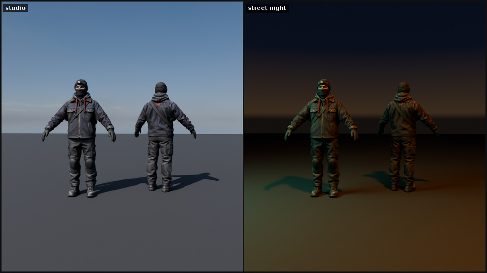

`vulture_roof_rigger_hero.jpg`: front and back three-quarter, studio and street night. The worn navy duck jacket
with the brown corduroy collar, brass-tone zip and snaps, the oxblood hoodie drawcords, black knee pads on the
charcoal work trousers, the sling and buckle, the crew V high on the back; at night a dark figure whose knee pads,
cap and headlamp give it a workwear silhouette unlike the Canal crew's rainwear.

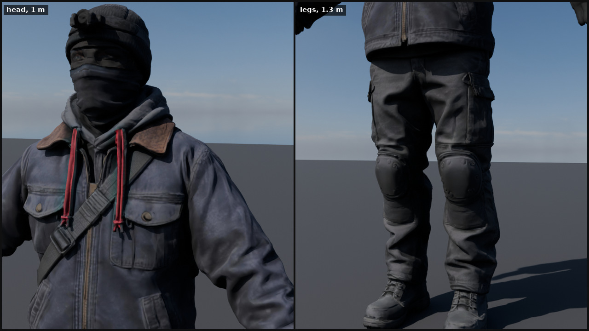

`vulture_roof_rigger_detail.jpg`: head at 1 m (knit watch cap, the headlamp on its strap, safety glasses, the fleece
gaiter, the hood and drawcords, the corduroy collar, pocket flaps with snaps, the sling buckle) and the legs at 1.3 m
(cargo pockets, the double knees under hard knee pads, laced leather boots).

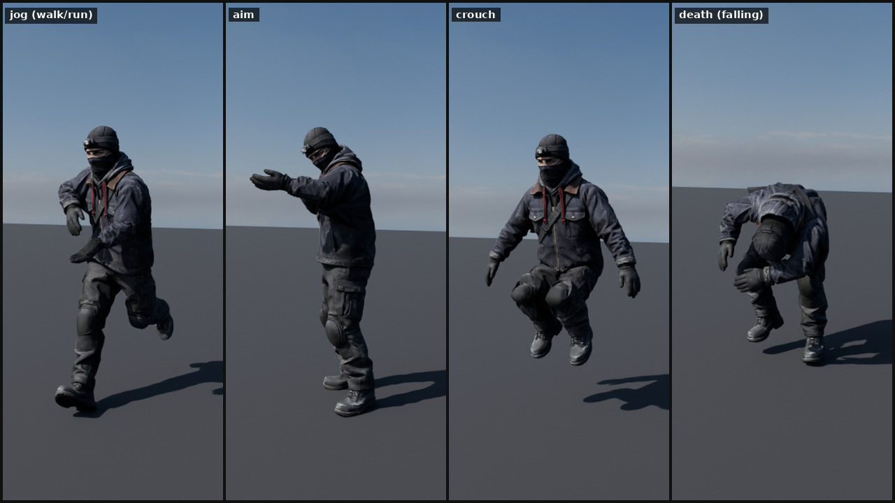

`vulture_roof_rigger_poses.jpg`: jog, aim, crouch and the forward death fall on the bound mesh; no tearing at
shoulders, elbows, hips or knees, and the knee pads stay on the knees. (The held crouch bends the legs without moving
the root, so the feet leave the ground in the picture, as for the others; the game's crouch clips move the root.)

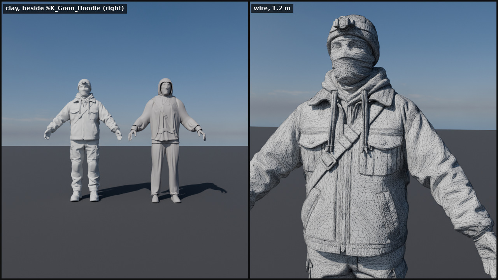

`vulture_roof_rigger_wire.jpg`: clay beside SK_Goon_Hoodie, and the wireframe at 1.2 m (Tripo's even
triangulation, no edge loops; the headlamp, drawcords, pocket flaps and sling are relief on the one surface).

**Known weaknesses (for the art review)**

- **More face than the Goons.** Clear safety glasses over bare eyes, as the brief asks: between the cap and the
  gaiter the eyes, brows and the bridge of the nose show. An invented man's face, mostly covered, so the rules hold;
  at 1 m it shows more skin than the Goons' r3 masks. The glasses are painted relief on the face, not a separate
  clear lens.
- **The headlamp lens is a light grey patch in the base colour**, not emissive: at night it catches the street light
  as a small bright dot on the forehead (the hero's night half). Right for a lamp that is off; if it reads as lit in
  the Midtown readability frame, darken that patch in `T_VultureRoofRigger_BC`.
- **The duck canvas reads a little like worn leather at 1 m** (soft sheen on the sleeves and shoulders), the shared
  roughness remap again (section 7, the jeans); and a faint teal tint at the edge of the left chest pocket from the
  generated colour. Neither shows at play distance.
- The sling runs from the left shoulder to the right hip, mirrored from the brief (above); cosmetic only.
- As the others: one fused surface (jacket, hoodie, sling, gaiter, trousers, knee pads), rigid one-piece gloves (no
  finger curl round the SMG's grip), the under-arm fins in the reference pose, no edge loops, LODs or corrective
  shapes, occlusion map empty, not imported in Unreal yet (the enemy lane's check: scale 0.98, materials, the SMG on
  `hand_r`, a readability frame on the Midtown roofs).

**Verdict.** Usable as Level 3 rank and file at 3 to 40 m: a realistic, invented roof worker in believable winter
New York workwear, the Goons' height, on the same skeleton and clips, all 99 poses inside the capsules with no vertex
outside them, less worst stretch than both Goons, and the cleanest mesh of the four built so far (0 validation errors,
0 opposite-winding edges). It reads apart from the Canal crew (navy canvas, knee pads, headlamp against black and olive
rainwear). Below the hand-built Goons at 1 m (fused layers, rigid gloves, the eye band).

**Credits (this character):** 18 (one Tripo take, `tripo_h3_1_multiview_to_3d`, detailed, 110k); the sheet's 3.25
is in section 5. No GPU box was rented or used.

## 9. `SK_Vulture_RoofLookout` (Level 3 rank and file, built)

Built 2026-11-26 from the first Tripo take, on the pipeline as committed after section 7 (with the bind fixes of
8d5fde1 and 34379e2), with no change to it: `build.py build vultures --only roof_lookout --export` (39 s) then
`--preview --samples 32` (2.3 min on 3 threads). Outputs (git-ignored): `art/out/glb/SK_Vulture_RoofLookout.glb`
(3.6 MB) with `.check.json`, the set `art/out/textures/VultureRoofLookout/`, the manifest record; sources in
`art/out/characters/maps/roof_lookout/` (the sheet, the four views, `roof_lookout_tripo.glb`).

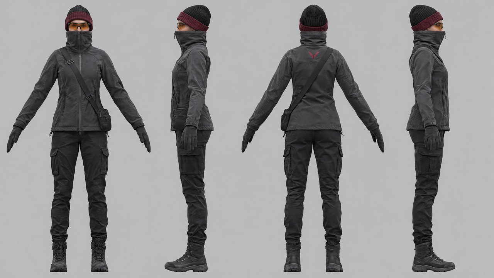

`vulture_roof_lookout_turnaround.jpg`: the sheet made in the first pass (`sheet_v1.png`), used as it was, and the
four views split from it in that pass, uploaded unchanged. Checked before spending: four figures, view 2 faces the
image's left and view 4 its right; the slate-grey fleece-lined softshell zipped to the top, its tall collar over nose
and mouth with the fleece lining showing at the rim; the black knit beanie with the oxblood turned-up cuff; amber
wraparound shooting glasses; the small black crossbody pouch at the left hip on the sling, which runs from the right
shoulder to the left hip as the brief says; black slim cargo trousers tucked into black lace-up hiking boots; black
softshell gloves; the oxblood crew V high on the back; no brand, lettering or maker's mark anywhere.

| Measure | Result |
|---|---|
| Tripo take | first take kept (1 of at most 3): 104,306 triangles (budget 120k), one connected piece, 0 floaters, 0 edges of opposite winding, 4096 maps (Color, ORM, NormalGL), UVs inside 0..1, 32 % of a 512 grid's cells hit |
| Clean-up | turned 90 degrees (arm span 0.52 m on Y against 0.17 on X) and 180 (facing +Y), as the others; no decimation |
| Size | beanie top 1.815 m in the fitted pose and 1.815 m over the floor in the reference pose (mannequin 1.805 x 1.006); 0.98 in the game; 1.15 m across the A-pose hands, 0.46 m deep. Beside SK_Goon_Hoodie in clay: the same height, a slim woman's build, narrower in the shoulders and hips than the Goon and than canal_bomber (`vulture_roof_lookout_wire.jpg`) |
| Fit to the skeleton | arms 23.2 / 22.4 degrees below the mannequin's A-pose, lengths x 0.99; legs 0.2 / 0.2 degrees, x 1.00 (her stance matches the mannequin's almost exactly; the others were 2 to 3 degrees off); weights from the mannequin surface median 2.8 cm away (99th percentile 8.7 cm, the closest fit so far: the softshell is fitted) |
| Weights by segment | torso 22,819 vertices, arms 5,887 / 5,400, legs 9,091 / 8,926; 0 limb vertices disconnected from their hand or foot (the pouch hangs on the sling at the hip, clear of the forearm); 2,492 cross-segment weights removed before smoothing, 2,522 after, 0 after the 4-influence limit; 0 unweighted |
| Skeleton | 89 joints; round trip against SKM_Manny_Simple: largest change 0.0000005 m, 0.00013 degrees; re-import 104,306 of 104,306 triangles; **0 validation errors** |
| Pose check | 99 poses, **99 pass** the capsule test; the worst vertex is 0.1 cm outside its capsules (the overhead swing; the limit is 6 cm) |
| Edge stretch (edges over 2 x their rest length, share of about 156,500; 99.9th percentile; the worst frame of each clip) | jog 0.7 %, x 3.9; aim 0.5 %, x 2.9; reloads 0.8 %, x 4.1; melee 1.1 %, x 4.2; death fall 2.0 %, x 5.3; kneel 0.5 %, x 4.2; crouch 0.8 %, x 4.6; overhead swing 0.8 %, x 5.2 |
| Against the Goons (same measure) | SK_Goon_Hoodie jog 1.05 %, x 9.6, aim 1.3 %, x 8.6, death 2.4 %, x 11.9; SK_Goon_Puffer jog 1.9 %, x 6.2, death 3.2 %, x 11.1. **Below both Goons in every compared pose, on both measures**, and the lowest of the five Vultures built (canal_shell jog 1.1 %, death 2.8 %; roof_rigger 1.1 %, 2.7 %) |
| Reference pose against the generated surface (`build.bind.rest_stretch`) | 99.9th percentile x 2.7, worst edge x 10.5, 305 edges over 2 x, **37 over 4 x** (canal_bomber 222, roof_rigger 262): the under-arm fins of section 7 are nearly absent. The fitted softshell sleeve leaves little loose cloth under the arm for the mannequin's higher A-pose to pull out |
| Texture set | 4096, albedo mean linear 0.044 / 0.039 / 0.039 (the lightest Vulture, as the brief says, and still under the 0.08 rule), roughness mean 0.80 after the remap, metallic 0 (no texel over 0.5), occlusion mean 0.998 (empty, as on the others) |

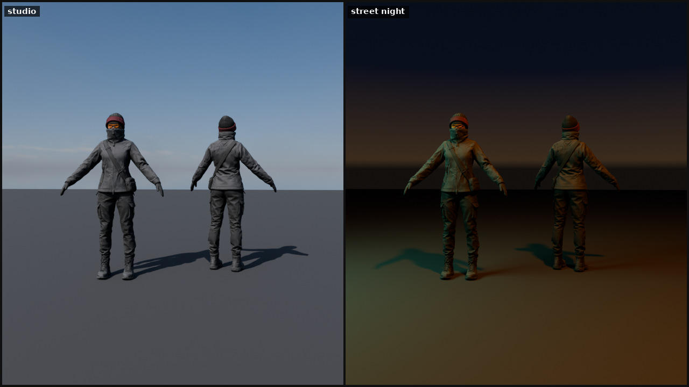

`vulture_roof_lookout_hero.jpg`: front and back three-quarter, studio and street night. The slate softshell with its
seamed panels, zipped hand pockets and the tall collar zipped over the face, the oxblood beanie cuff and the amber
glasses, the sling and the pouch at the left hip, slim cargos into hiking boots; at night a slim grey figure whose
beanie cuff and amber lenses are the two accents, lighter and narrower than the Rigger beside her on the roofs.

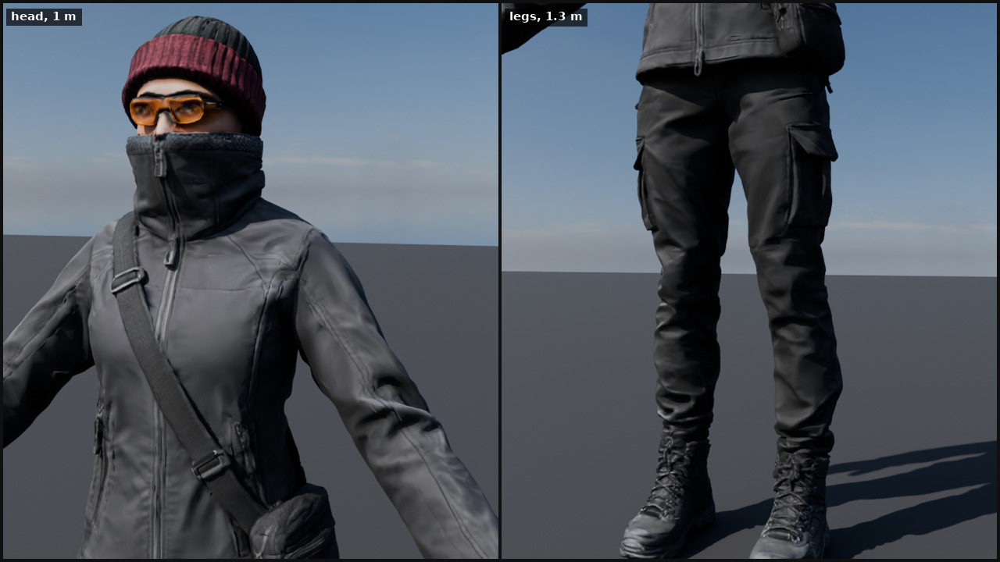

`vulture_roof_lookout_detail.jpg`: head at 1 m (rib-knit beanie with the oxblood cuff, the amber wraparound glasses,
the collar's fleece rim and zip pull, the sling's slider, the softshell's seams and zips) and the legs at 1.3 m (cargo
pockets with flaps, slim legs gathered into laced hiking boots with lugged soles).

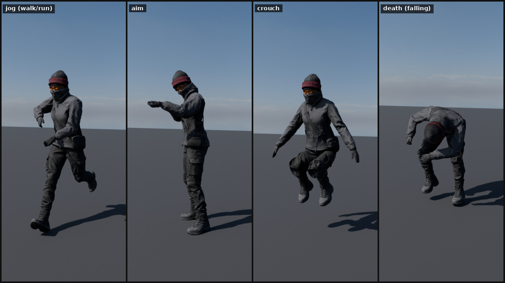

`vulture_roof_lookout_poses.jpg`: jog, aim, crouch and the forward death fall on the bound mesh; no tearing at
shoulders, elbows, hips or knees, and the pouch stays at the hip. (The held crouch bends the legs without moving the
root, so the feet leave the ground in the picture, as for the others.)

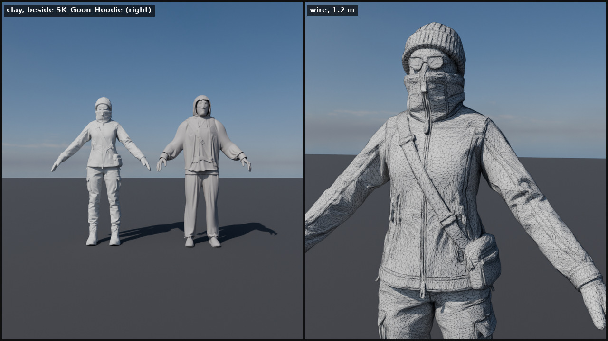

`vulture_roof_lookout_wire.jpg`: clay beside SK_Goon_Hoodie, and the wireframe at 1.2 m (Tripo's even
triangulation, no edge loops; the zips, collar, sling, pouch and glasses are relief on the one surface).

**Known weaknesses (for the art review)**

- **The crew V is faint.** On the sheet it is a clear oxblood V; on the model it reads as a pale grey V with a dull
  red edge just under the collar (the hero's back figure, studio half). Tripo lightened it when it baked the back
  view. It is still there and placed right, but it does not carry the crew colour at play distance. Fix if the review
  asks: paint the V's texels in `T_VultureRoofLookout_BC` to #5a1419 (a texture edit, no credits).
- **More face than the Goons.** The collar stops at the bridge of the nose and the glasses are amber, so the eyes,
  brows and a band of skin show through and round them; an invented woman's face, mostly covered, so the rules hold,
  but at 1 m it shows more skin than the Goons' r3 masks. The glasses are relief on the face, not a separate lens.
- **The softshell reads a little like brushed leather in the studio light at 1 m** (soft highlights on the sleeves),
  the shared roughness remap again (sections 7 and 8); it reads as matte fabric in the night half and at play
  distance.
- As the others: one fused surface (softshell, collar, sling, pouch, trousers), rigid one-piece gloves (no finger
  curl round the SMG's grip), no edge loops, LODs or corrective shapes, occlusion map empty, not imported in Unreal
  yet (the enemy lane's check: scale 0.98, materials, the SMG on `hand_r`, a readability frame on the Midtown roofs).

**Verdict.** Usable as Level 3 rank and file at 3 to 40 m: a realistic, invented woman in believable winter New York
outdoor wear, the Goons' height, on the same skeleton and clips, all 99 poses inside the capsules, the least stretch
of any Vulture and well under both Goons, the closest fit to the mannequin and almost none of the under-arm fins. She
reads apart from the Rigger on the same roofs (slim slate softshell, oxblood beanie cuff and amber lenses against navy
canvas and knee pads) and from the Canal crew. Below the hand-built Goons at 1 m (fused layers, rigid gloves, the
eye band, the faint crew V).

**Credits (this character):** 18 (one Tripo take, `tripo_h3_1_multiview_to_3d`, detailed, 110k); the sheet's 3.25
is in section 5. No GPU box was rented or used.

## 10. `SK_Vulture_RoofLieutenant` (Level 3 lieutenant, built)

Built 2026-11-26 from the first Tripo take, with one change to the bind that this character needed (the arm fit's
fallback, below and in 3.4 step 4, commit c604614): `build.py build vultures --only roof_lieutenant --export` (36 s)
then `--preview --samples 32` (2.4 min on 3 threads). Outputs (git-ignored):
`art/out/glb/SK_Vulture_RoofLieutenant.glb` (3.8 MB) with `.check.json`, the set
`art/out/textures/VultureRoofLieutenant/`, the manifest record; sources in `art/out/characters/maps/roof_lieutenant/`
(the sheet, the four views, `roof_lieutenant_tripo.glb`).

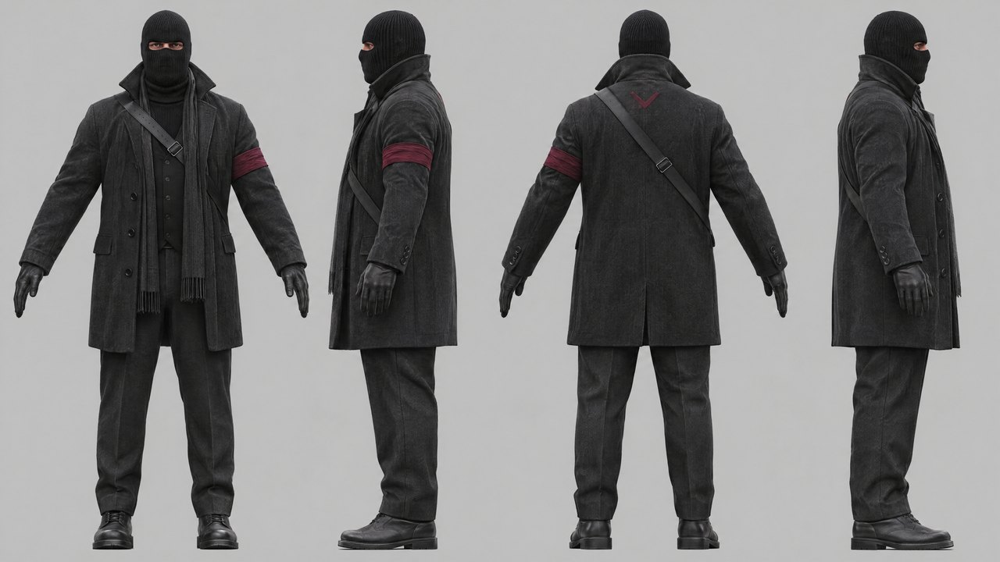

`vulture_roof_lieutenant_turnaround.jpg`: the sheet made in the first pass (`sheet_v1.png`), used as it was, and the
four views split from it in that pass, uploaded unchanged. Checked before spending: four figures, view 2 faces the
image's left and view 4 its right; a broad, heavy man in a charcoal wool car coat to mid-thigh, single-breasted and
open, collar up, dark buttons, flap pockets, a centre back vent; a black buttoned vest over a black roll-neck; a dark
charcoal wool scarf with fringed ends hanging open; a black knit two-hole balaclava; the oxblood band on the LEFT upper
arm (seen in the front, the left profile and the back, hidden in the right profile); a black leather sling with a
metal buckle from the right shoulder to the left hip; the crew V high on the coat's back; charcoal wool trousers with
a crease, black leather lace-up boots and gloves; no brand or lettering anywhere. The eyes and the skin round them
show in the balaclava's openings (the sheet did not ask for "eyes in deep shadow").

| Measure | Result |
|---|---|
| Tripo take | first take kept (1 of at most 3): 105,078 triangles (budget 120k), one connected piece, 0 floaters, 3 edges of opposite winding (canal_shell had 11), 4096 maps (Color, ORM, NormalGL), UVs inside 0..1, 31 % of a 512 grid's cells hit |
| Clean-up | turned 90 degrees (arm span 0.54 m on Y against 0.23 on X) and 180 (facing +Y), as the others; no decimation |
| Size | balaclava top 1.805 m over the floor (the roster's factor 1.0: a bare balaclava over the mannequin's head), 1.3 cm under SK_Goon_Hoodie's hood; 0.98 in the game; 1.12 m across the A-pose hands, 0.56 m deep (the open coat and the scarf). Beside SK_Goon_Hoodie in clay: the same stance, about the same height, broader and heavier in the shoulders and the coat (`vulture_roof_lieutenant_wire.jpg`) |
| Fit to the skeleton | arms 21.6 / 20.2 degrees below the mannequin's A-pose, lengths x 1.020 / 1.028; legs 2.5 / 2.2 degrees, x 1.00; weights from the mannequin surface median 3.3 cm away (99th percentile 16 cm, the coat skirt) |
| Weights by segment | torso 23,859 vertices, arms 5,772 / 5,506, legs 8,953 / 8,437; 17 left-arm and 7 right-arm vertices not connected to the hand moved to the torso; 4,781 cross-segment weights removed before smoothing, 6,503 after, 0 after the 4-influence limit; 0 unweighted |
| Skeleton | 89 joints; round trip against SKM_Manny_Simple: largest change 0.0000005 m, 0.00013 degrees; re-import 105,078 of 105,078 triangles; one validation error, the 3 edges of opposite winding Tripo made (left as they are, as on canal_shell) |
| Pose check | 99 poses, **99 pass** the capsule test; the worst vertex is 0.3 cm outside its capsules (the limit is 6) |
| Edge stretch (edges over 2 x their rest length, share of about 157,600; 99.9th percentile; the worst frame of each clip) | jog 1.5 %, x 5.4; aim (rifle and pistol) 0.9 %, x 4.6; reloads 1.2 %, x 5.1; melee 2.6 %, x 9.2; death fall 3.4 %, x 8.9; kneel 1.4 %, x 9.8; crouch 1.9 %, x 7.5; overhead swing 1.0 %, x 5.7 |
| Against the Goons (same measure) | SK_Goon_Hoodie jog 1.05 %, x 9.6, aim 1.3 %, x 8.6, death 2.4 %, x 11.9; SK_Goon_Puffer jog 1.9 %, x 6.2, death 3.2 %, x 11.1. The worst stretch is below both Goons in every compared pose; the share of stretched edges is between the two Goons in the jog, below the Hoodie in the aim, and **above both in the death fall** (3.4 %). It is the most stretched Vulture in the melee, death, kneel and crouch: the coat skirt to mid-thigh rides on the thighs and folds where they bend (seen in clay from front and back in the kneel, the melee, the death fall and the crouch: the skirt drapes and bunches, no tearing) |
| Reference pose against the generated surface (`build.bind.rest_stretch`) | 99.9th percentile x 8.9, worst edge x 79, 406 edges over 2 x, 292 over 4 x: the under-arm fins of section 7 on both sides, at the coat's side panels (0.19 to 0.26 m out, 1.05 to 1.29 m up), more than on the others (roof_rigger x 6.7, 262 over 4 x) |
| Texture set | 4096, albedo mean linear 0.027 / 0.026 / 0.026 (the darkest Vulture, under the 0.08 rule), roughness mean 0.80 after the remap, metallic 0 (no texel over 0.5), occlusion mean 0.998 (empty, as on the others) |

**What this character found in the pipeline (fixed in `vultures.py` and `goon_generated.fit_pose`, commit c604614)**

The first bind left the right arm unfitted: `fit upperarm_r 0.0 deg, length x1.000`. The wrist search
(`goon_generated.mesh_joint`) slices the mesh near the skeleton's own arm line; this man's arms hang 20 degrees below
the mannequin's A-pose and the coat sleeve is thick, so on the right the slice held 3 points (under the 20 it needs)
and the search stopped at its start (the left arm, at 24 points, only just passed). With the arm bound at the wrong
angle every pose still passed the capsule test, but the stretch did not: p99.9 x 27.8 in the kneel and 6,044 edges
over 2 x in the worst frame. Now, only when the default search returns an unfitted arm, it is restarted on the line
from the shoulder to the mesh's fingertip (the point of that side farthest from the shoulder among those 15 cm
outside it and below it). The right arm then fits at 20.2 degrees, x 1.028; the left arm, refitted the same way in a
test, gave 21.5 degrees, x 1.022 against the default's 21.6, x 1.020, so the two searches agree. Worst p99.9 stretch
x 27.8 to x 9.8, worst edges over 2 x 6,044 to 5,383. Arms the default search fits keep their results, so the other
five Vultures are unaffected by a rebuild.


`vulture_roof_lieutenant_hero.jpg`: front and back three-quarter, studio and street night. The charcoal wool coat
with its collar up, the open front over the buttoned vest and roll-neck, the fringed scarf, the black leather sling
and buckle, the oxblood band on the left arm and the crew V under the collar; at night the darkest figure of the Roof
crew, whose long coat gives it a silhouette apart from the rigger's work jacket and knee pads and the lookout's
softshell.

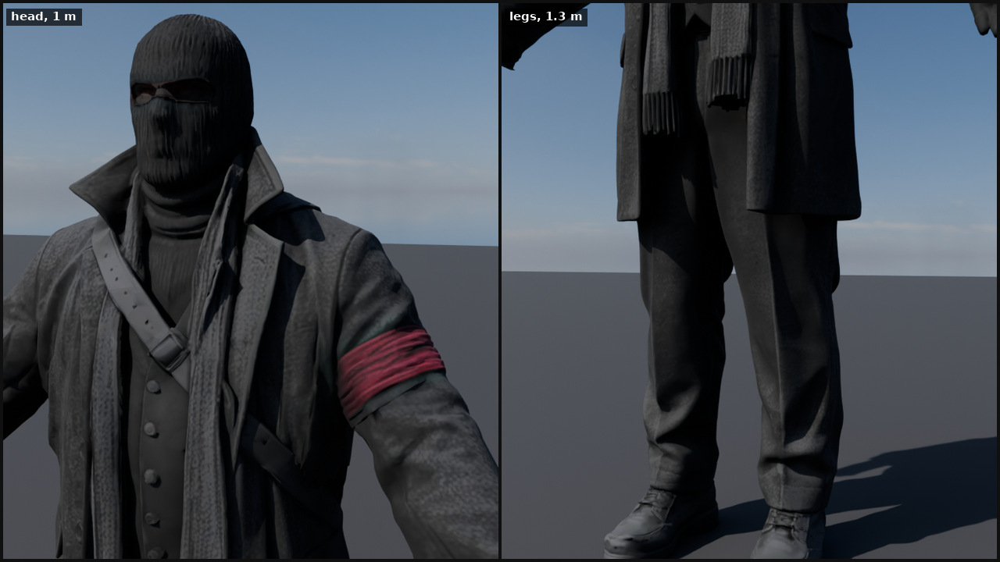

`vulture_roof_lieutenant_detail.jpg`: head at 1 m (the ribbed knit balaclava, the eyes and lids in its openings, the
roll-neck, the wool texture of the coat and the scarf, the stitched leather sling and its buckle, the vest's buttons,
the band's folds) and the legs at 1.3 m (the coat hem and scarf fringes, creased wool trousers, polished lace-up
boots).

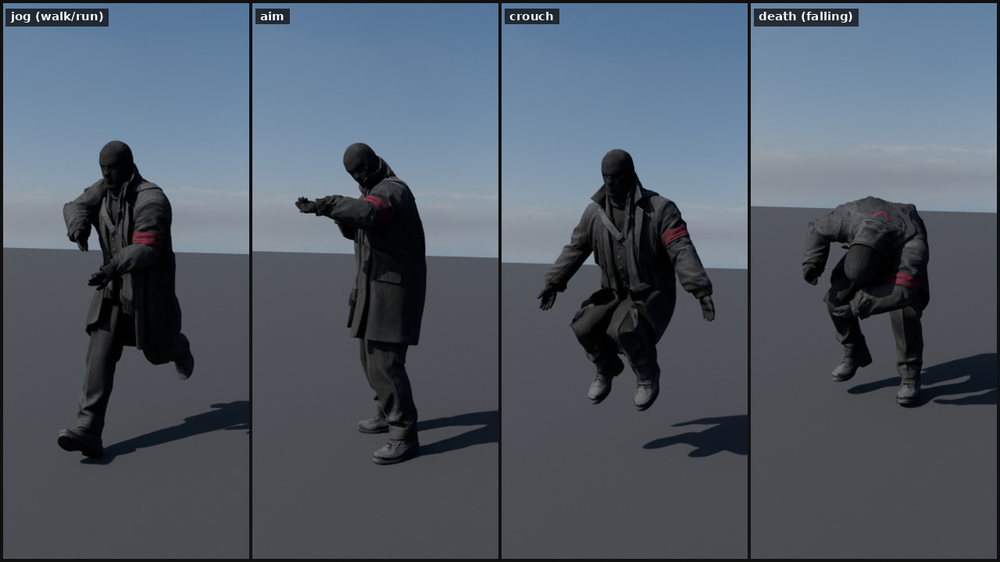

`vulture_roof_lieutenant_poses.jpg`: jog, aim, crouch and the forward death fall on the bound mesh; no tearing at
shoulders, elbows, hips or knees; in the crouch the coat skirt folds between the knees. (The held crouch bends the
legs without moving the root, so the feet leave the ground in the picture, as for the others.)

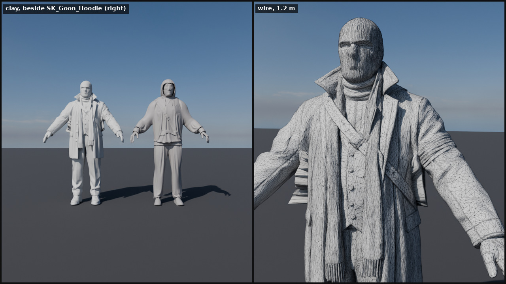

`vulture_roof_lieutenant_wire.jpg`: clay beside SK_Goon_Hoodie, and the wireframe at 1.2 m (Tripo's even
triangulation, no edge loops; the scarf, vest buttons, sling and lapels are relief on the one surface). The under-arm
fin shows as flat sheets behind the right arm.

**Known weaknesses (for the art review)**

- **The under-arm fins are the largest of the Vultures** (292 edges over 4 x, worst x 79): flat sheets behind the
  arms in the reference pose, visible in the hero and wire pictures. As on the others, the clips hold the arms down
  or forward and the fins close (none show in the jog, aim, crouch or death pictures), but a T-pose or arms-out frame
  would show them. The fix is the pipeline's (section 7): bind with the mannequin's arms lowered to the generated
  figure's angle.
- **The eyes show warm at night.** The balaclava's openings show the eyes, lids and a band of skin, as for
  canal_shell; under the street-night lights the lids catch the warm light and read at 5 m as two small warm points
  (`vulture_roof_lieutenant_hero.jpg`, night half). If that reads as glowing eyes in the Midtown readability frame,
  darken the eye-hole skin in `T_VultureRoofLieutenant_BC`, or redo the sheet with "eyes in deep shadow" (3.25 + 18
  credits).
- **The coat skirt is skinned to the thighs**, so it rides with each leg and folds between them instead of hanging:
  believable in the clips at play distance (the clay checks above), but the death-fall stretch share is above both
  Goons. A cloth simulation or skirt bones would be the next step; neither is in the pipeline.
- Height 1.805 m, 1.3 cm under the Goons' hood (the roster's factor for a bare balaclava); the coat sleeves and the
  sling have a soft sheen at 1 m (the shared roughness remap).
- As the others: one fused surface (coat, scarf, vest, sling, balaclava, trousers), rigid one-piece gloves (no finger
  curl round the SMG's grip), no edge loops, LODs or corrective shapes, occlusion map empty, not imported in Unreal yet
  (the enemy lane's check: scale 0.98, materials, the SMG on `hand_r`, a readability frame on the Midtown roofs).

**Verdict.** Usable as the Level 3 lieutenant at 3 to 40 m: a realistic, invented heavy man in a believable New York
winter coat, scarf and balaclava, on the same skeleton and clips, all 99 poses inside the capsules with less worst
stretch than both Goons, and the lieutenant's marks (the oxblood band, the leather sling, the long coat) readable
against the rigger and the lookout. Below the hand-built Goons at 1 m (fused layers, rigid gloves, the eye openings)
and the most stretched Vulture in the bending poses, because of the coat skirt.

**Credits (this character):** 18 (one Tripo take, `tripo_h3_1_multiview_to_3d`, detailed, 110k; `get_cost` checked
first); the sheet's 3.25 is in section 5. The diagnostic fit tests and clay pose renders ran in Blender only. No GPU
box was rented or used.
