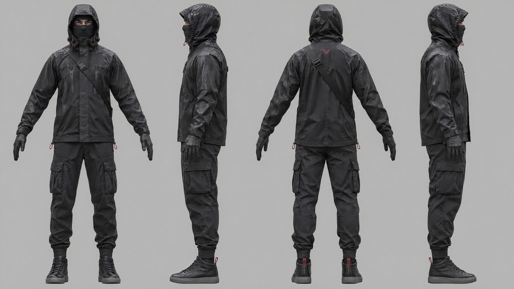
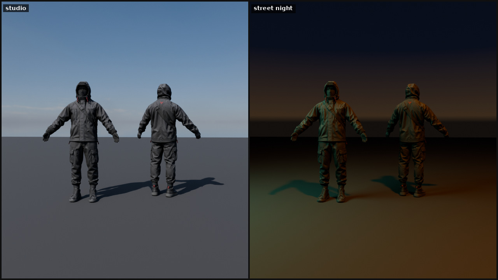
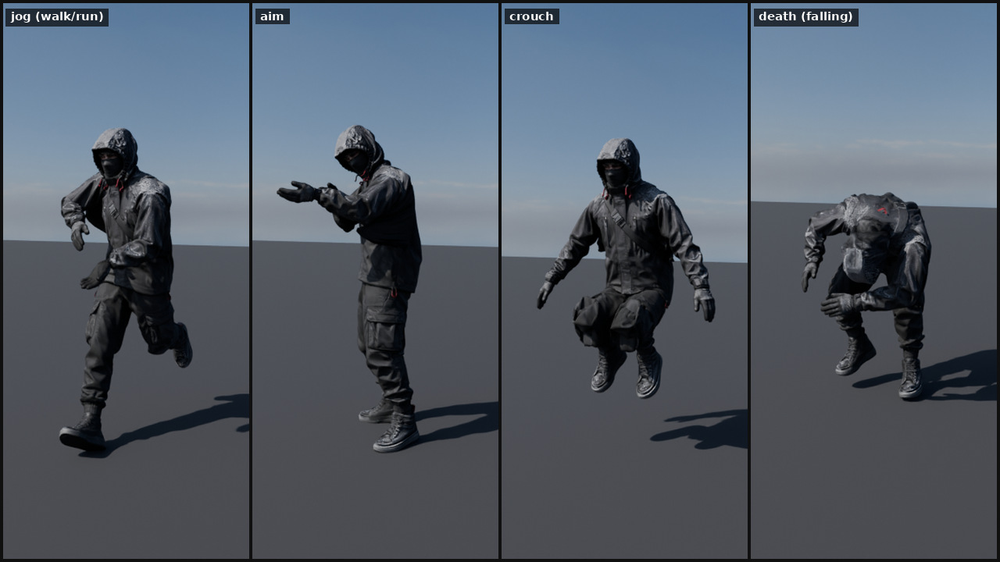
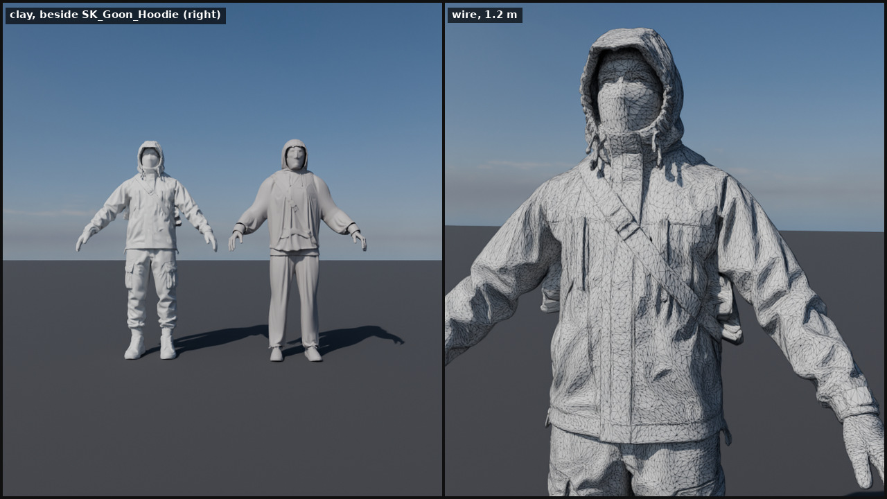

# The Vultures on Levels 2 and 3: crews, looks and the generated-character pipeline

Status (2026-11-26): roster written, concept turnarounds made for all six, the pipeline proven end to end on the first
character (`SK_Vulture_CanalShell`); the other five are not yet built. Owner's instruction (via the lead): "you can also
use trippo in higsfield to generate realistic charachters". This page is the character lead's plan for the next
release's three-level story (docs/unreal/MAPS.md, [chinatown.md](chinatown.md), [midtown.md](midtown.md),
[progression.md](progression.md)): the enemies on Level 2 (Canal Street, night, wet) and Level 3 (Midtown rooftops,
night) are distinct crews of the same gang, the Vultures, so each level reads differently.


`art/previews/characters/maps/vultures_roster_concepts.jpg`: the six concept turnarounds (front, left, back, right),
Level 2 on the left, Level 3 on the right, rank and file above, lieutenants at the bottom.

---

## 1. Rules for every character

- **Invented people only.** No real person's likeness, no named or famous reference in any prompt. Faces are covered
  (balaclava, gaiter, bandana, collar), so no face is a likeness of anyone.
- **No logos, brands or lettering** on clothes, shoes or gear (prompts say so; every sheet is checked by eye).
- **No ethnic caricature.** The crews are defined by clothes, gear and attitude, never by ethnicity. The Canal Street
  crew is a mixed New York crew in believable wet-night streetwear: nothing in its look refers to Chinese people or
  Chinatown (no conical hats, mandarin collars, silk, dragons, characters or "oriental" motifs). Masks and bandanas like
  the Goons' are fine.
- **Adult men and women.** Two of the six are women.
- **Same game piece as a Goon.** Every Vulture is an AMIGoon with the same rules (90 / 110 / 130 hit points, head sphere
  0.155 m x 2.2, body capsule 0.27 m, movement capsule 0.3 x 1.8 m, from config.json, never from the mesh), the same
  SMG (`SM_Weapon_GoonSMG` in both hands, warning lamp), the same pipe rush (`SM_Weapon_GoonPipe`, so every look has a
  black webbing sling diagonally across the chest and back), the same skeleton (SK_Mannequin, all 89 joints), the same
  clips and the same in-game scale (**0.98** on the mesh component, presentation.json `enemies.goon.meshScale`). A
  lieutenant is heavier in look only (build, coat, vest); if the game later gives lieutenants more hit points that is a
  rules change for the design lane, not this page.
- **Same silhouette size as the Goons.** Built on the mannequin to the Goon's height (hood top 1.818 m before the 0.98
  scale), 0.50 to 0.58 m across the shoulders and sleeves, no coat below mid-thigh (runs and the pipe rush), nothing
  wider than the body capsule's reach (no backpacks, rifles slung wide, capes).
- **Readability.** The Goons wear oxblood on black and the levels are lit around that (chinatown.md 11.3: no red in the
  fight backgrounds; midtown.md: cool level, no red field behind a fight). Every Vulture stays a dark figure (body
  albedo under about 0.08 linear) with oxblood accents and the gang mark: **the crew V** (two oxblood bars 0.20 x 0.03 m
  leaning 24 degrees outward, centred 1.29 m up on the back, as on the Goons). Rank mark: **lieutenants wear an oxblood
  cloth band on the left upper arm**, visible from the front, side and back. The readability check (chinatown.md 17
  check 11) runs with these meshes in place of the Goons.

## 2. The roster

Three looks per level: two rank and file, one lieutenant. The crew is picked per spawn as the Goon outfits are now
(random), with the lieutenant at a lower share (proposal: 1 in 5 spawns, at most 2 alive): the enemy lane decides.
Wiring proposal (not done here, `src/` and the game code are not touched): a per-level `enemyLook.variants` in the
level's `tuning` that replaces presentation.json `enemies.goon.variants` (`/Game/Characters/Vultures/SK_Vulture_*`);
Level 1 keeps the three Goons.

| Id | Asset | Level | Role | Who | Build, height (before 0.98) | Silhouette key |
|---|---|---|---|---|---|---|
| canal_shell | `SK_Vulture_CanalShell` | 2 | rank and file | man | lean; 1.822 m over the hood (built) | black rain shell, hood up |
| canal_bomber | `SK_Vulture_CanalBomber` | 2 | rank and file | woman | athletic; 1.818 m over the hood | olive bomber, hood up, bandana |
| canal_lieutenant | `SK_Vulture_CanalLieutenant` | 2 | lieutenant | man | broad, heavy; 1.815 m over the cap | open waxed parka over a vest, arm band |
| roof_rigger | `SK_Vulture_RoofRigger` | 3 | rank and file | man | wiry; 1.815 m over the cap | navy duck work jacket, headlamp, knee pads |
| roof_lookout | `SK_Vulture_RoofLookout` | 3 | rank and file | woman | lean; 1.815 m over the beanie | slate softshell, collar to the nose, amber glasses |
| roof_lieutenant | `SK_Vulture_RoofLieutenant` | 3 | lieutenant | man | broad, heavy; 1.805 m | charcoal wool car coat, balaclava, arm band |

All built on the one mannequin skeleton (a woman's mesh keeps her own narrower shoulders and hips in the mesh; the
joints are the mannequin's, which the clips need). Heights are set by the top of the head gear over the mannequin's
head (`vultures.ROSTER`): hood 1.818 m, cap or beanie 1.815 m, bare balaclava 1.805 m.

### 2.1 Level 2, Canal Street: the Canal crew (night, wet)

The crew that runs the bootleg tables and the dub room. Rainwear: matte and waxed shells with a wet sheen on the
shoulders, hoods up, dark trousers, rubber-soled shoes. Mixed crew.

**canal_shell, `SK_Vulture_CanalShell` (proven below).** Lean man. Matte black hooded waterproof rain shell, hip
length, slightly loose, taped seams, hood up and cinched round the face, storm flap over the zip, two zipped chest
pockets, small dark oxblood cord toggles at the hood and hem; dark charcoal knitted two-hole balaclava under the hood
(face, mouth and neck covered, eyes only); black webbing sling across the chest; dark charcoal tapered cargo joggers
with side cargo pockets and rib ankle cuffs; black leather gloves; black waterproof high-top sneakers with dark grey
soles and an oxblood heel tab; rain sheen on hood and shoulders; crew V on the upper back. Colours: shell #111214,
balaclava #26272a, joggers #2a2b2e, toggles / V / heel tab #7c151d, soles #4a4b4e. Materials: nylon shell (roughness
0.35-0.5 where wet, 0.6 dry), rib knit, cotton twill, glove leather, rubber.

**canal_bomber, `SK_Vulture_CanalBomber`.** Athletic woman. Dark olive-green padded nylon bomber jacket, waist length,
no patches, with dark oxblood rib-knit collar, cuffs and waistband; charcoal hooded sweatshirt under it with the hood
UP over a black knit beanie; plain black cotton bandana over nose and mouth (eyes and brows show); black straight-leg
jeans; black leather gloves; black chunky trainers with dark soles and an oxblood heel tab; sling; crew V; rain sheen
on the shoulders. Colours: bomber #2f3424, hoodie #34353a, bandana and jeans #141416, rib trims #5a1419.
Materials: satin nylon (roughness 0.45), rib knit, fleece, denim, leather.

**canal_lieutenant, `SK_Vulture_CanalLieutenant`.** Broad, heavy man. Dark charcoal waxed-cotton field parka to
mid-thigh, worn open, four flap pockets, dark corduroy collar up, side vents; plain black low-profile vest with two flat
pouches under it (no patches); black knit watch cap; black fleece neck gaiter over nose and mouth (eyes only); oxblood
cloth arm band on the left upper arm; dark grey cargo trousers darkened by rain; black leather lace-up boots; black
leather gloves; sling; crew V; waxed sheen. Colours: parka #2b2a28, vest #0f1011, gaiter and cap #121214, trousers
#3a3a3c, band #7c151d. Materials: waxed cotton (roughness 0.4-0.55, darker creases), nylon, fleece, twill, leather.

### 2.2 Level 3, Midtown rooftops: the Roof crew (night, cold, wind)

The crew dressed as the sign-rigging and building crews on the roofs above the square: winter workwear, watch caps,
gaiters, safety glasses, and a sharper-dressed lieutenant for the buyer's side.

**roof_rigger, `SK_Vulture_RoofRigger`.** Wiry man. Dark navy heavy cotton duck work jacket, hip length, quilted
lining at the cuffs, dark brown corduroy collar, two chest flap pockets; charcoal hooded sweatshirt underneath with
the hood down and dark oxblood drawcords; black knit watch cap with a small black headlamp on an elastic strap (lamp
off); black fleece neck gaiter over nose and mouth; clear safety glasses; dark charcoal double-knee work trousers with
black knee pads; black leather work boots; black work gloves; sling; crew V. Colours: jacket #232838, collar #3a2a20,
trousers #2c2c2e, cords and V #7c151d. Materials: duck canvas (roughness 0.75), corduroy, fleece, polycarbonate,
leather, rubber.

**roof_lookout, `SK_Vulture_RoofLookout`.** Lean woman. Dark slate-grey fleece-lined softshell jacket, hip length,
zipped with a tall collar over nose and mouth; black knit beanie with a dark oxblood turned-up cuff; amber-tinted
wraparound shooting glasses; small black crossbody pouch at the left hip; black slim cargo trousers tucked into black
lace-up hiking boots; black softshell gloves; sling; crew V. Colours: softshell #3b3e42 (the lightest Vulture: still
under 0.08 linear), beanie #111113 with cuff #5a1419, lens amber #b0701a at 40 % opacity. Materials: softshell (0.6),
rib knit, polycarbonate, ripstop, leather.

**roof_lieutenant, `SK_Vulture_RoofLieutenant`.** Broad, heavy man. Charcoal wool car coat to mid-thigh,
single-breasted, open, collar up, dark buttons; plain black low-profile vest over a black roll-neck; dark charcoal wool
scarf; black knit two-hole balaclava (eyes only); oxblood arm band on the left upper arm; black leather sling (the
lieutenant's one dressier piece); charcoal wool trousers; black leather boots and gloves; crew V on the coat's back.
Colours: coat #2e2e31, trousers #2a2a2d, balaclava and vest #0e0e10, band #7c151d. Materials: wool melton (0.8,
fuzz), knit, nylon, leather.

### 2.3 Budgets (the Goons' numbers)

| Item | Goon (r3) | Vulture |
|---|---|---|
| Triangles | 115-117.5k, cap 120k | cap **120k**; Tripo `face_limit` 110000 (canal_shell: 105,477) |
| Skeleton | SK_Mannequin, 89 joints, up to 6 influences | the same, **4** influences (goon_generated's proven setting) |
| Texture sets | `Goon<Outfit>_Cloth` 4096 + `_Head` 2048, BC / N (OpenGL) / ORM | one unique set `Vulture<Name>` **4096**, BC / N (OpenGL) / ORM (R the generated occlusion, G roughness, B metallic): about the memory of the Goon's two sets |
| Slots | `M_Goon<Outfit>_Cloth`, `_Head` | one: `M_Vulture_<Name>` |
| LODs | none | none in the GLB; set Unreal's auto LODs (LOD1 50 %, LOD2 25 %) at import, as for the Goons when that lands |
| In play | pool 12 alive at most | the same pool: a level shows its own three looks |

## 3. The pipeline (as proven; fixes from the proof are in it)

### 3.1 Turnaround sheet (Higgsfield `generate_image`)

Model `gpt_image_2_6`, aspect 16:9, quality high, resolution 4k (3840 x 2160): **3.25 credits** a sheet. One sheet with
all four views keeps the person, clothes and colours consistent across the views (four separate images drift). The
shared frame, then the character block from section 2 written as a description:

```text
Photorealistic character turnaround reference sheet for a 3D game model. The SAME <man|woman> shown four times side
by side in one row, left to right: 1) front view, 2) left side profile with the body facing the left edge of the image,
3) back view, 4) right side profile with the body facing the right edge of the image. Full body from the top of the
head to the soles in every view, identical scale, every figure standing on the same baseline, long-lens orthographic
look with no perspective distortion. Neutral A-pose in every view: arms straight and angled about 40 degrees down and
away from the body, hands open and relaxed with the fingers together, a clear gap between the arms and the torso, feet
about shoulder width apart, standing straight. Plain flat light grey seamless background, soft even shadowless studio
light, no floor shadow, no text, no labels, no frames.

The character: an invented adult <man|woman>, <build>, about <height> tall, <who, where, weather>. <Clothes, gear,
mask, colours, from section 2>. On the upper back a small oxblood-red V mark made of two short bars. A black nylon
webbing sling strap runs diagonally across the chest from the right shoulder to the left hip and across the back.
<Trousers, gloves, shoes>. Realistic fabric detail, real New York <streetwear|workwear|winter clothes>. No weapon in
the hands. No logos, no brand marks, no lettering anywhere on the clothes.
```

Check every sheet before spending on 3D: four figures; view 2 faces the image's left and view 4 its right (all six
sheets came out right first time); the arm band (lieutenants) shows in the front, the back and the LEFT profile only;
nothing that reads as a brand; no skin but the eye area. From the proof: add "the eyes in deep shadow inside small
openings, no skin showing round them" to masked characters (canal_shell's balaclava shows lids and lashes). The sheets are in `art/out/characters/maps/<id>/src/sheet_v1.png`.

### 3.2 Split and upload

`art/blender/assets/_vultures_views.py <sheet.png> <out prefix>` (PIL and numpy): find the four figures as runs of non-background columns (the background
is the median of the top and bottom rows; a figure column has more than 3 pixels 18 levels off it), crop each with
10 px margin at the common height, paste it centred on a square canvas of 1.12 x the figure height in the background
grey, resize to 2048 x 2048, save `view_front|left|back|right.png`. The A-pose front figure is wider than a quarter of
the sheet (1,045 px of 960): never cut the sheet in equal quarters. Upload with `media_upload` (four files), `curl -X PUT
-H "Content-Type: image/png" -H "If-None-Match: *" --data-binary @view_x.png '<upload_url>'` (the signed URL includes
the If-None-Match header), then `media_confirm` type image.

### 3.3 Tripo (Higgsfield `generate_3d`)

`tripo_h3_1_multiview_to_3d`, medias in the order **front, left, back, right** (role `image_references`), `texture`
true, `pbr` true, `texture_quality` detailed, `geometry_quality` detailed, `face_limit` 110000, other settings default.
**18 credits** (`get_cost` true first). About 3 minutes; `jobs_wait` with 15 s timeouts. Download with curl to
`art/out/characters/maps/<id>/<id>_tripo.glb` (git-ignored).

What comes back (canal_shell): one mesh, one connected piece, 105,477 triangles, 52,697 vertices after the weld; one
material with three 4096 maps: `Color_*` (JPEG), `ORM_*` (JPEG: R occlusion, G roughness, B metallic) and
`NormalGL_*` (PNG, OpenGL); one UV atlas inside 0..1 (about 32 % of a 512 grid's cells hit, near the Goons' 33-45 %).
The figure stands on Z but **faces along X** (the arm span lies on Blender Y): the build turns it.

### 3.4 Blender (`art/blender/assets/vultures.py`)

    venv/bin/python art/blender/build.py build vultures --only canal_shell --export --preview --samples 32
    MI_PREVIEWS=hero,detail,poses,wire     pick the pictures

(venv as art/blender/README.md: `python3 -m venv venv && venv/bin/pip install bpy==5.3.0 numpy pillow`.) 40 s to the
export, about 6 minutes for the previews on 3 threads. Steps:

1. **Import and clean** (`gen3d.load`, weld): floating pieces under 0.4 % of the faces and over 3 cm from the body are
   deleted, smooth shading. Tripo's winding is kept: it is consistent but for 11 edges at the soles, and a
   `recalc_face_normals` (tried first) is confused by the 15 non-manifold edges there and flipped whole patches (339
   edges of opposite winding after it, a validation error). `gen3d.load` now reads Tripo's packed `ORM_*` image as
   occlusion / roughness / metallic (it used to take it for the base colour because the name has no "rough" or
   "metal" in it).
2. **Orient**: ground at z 0, centred between the feet; if the slice between 50 and 65 % of the height (the A-pose
   forearms and hands) is wider on Y than on X the mesh is turned 90 degrees about Z; then `goon_generated.facing_check`
   (toes in front of the shins) turns it 180 degrees if it faces +Y. canal_shell needed both.
3. **Scale to the Goon**: top of the mesh = the mannequin's top x the roster factor (hood 1.818 / 1.805). Decimate
   (collapse) only when over the 120k cap.
4. **Bind** (goon_generated's proven method): the mannequin's upper arms, forearms, thighs and calves posed onto the
   mesh's own limbs (canal_shell: arms 20.8 and 21.5 degrees lower than the mannequin's A-pose, legs 3 degrees),
   weights copied from the posed mannequin surface (median 3.3 cm away), finger weights folded into the hand (the
   generated gloves are one piece), smoothed, at most 4 influences, then inverse skinning back to the mannequin's
   reference pose; round trip exact (max 0.0000 m).
5. **Weights by body segment** (the lesson of SK_RuleArms round 3, extended to a whole body): each vertex is labelled
   torso / left arm / right arm / left leg / right leg by the nearest bone chain of the fitted skeleton (torso distances
   x 0.55: it is wide); a segment keeps only its own bones (an arm never takes a thigh, the pelvis or the other arm; a
   leg never takes an arm or the other leg; the torso never takes a forearm, hand, calf or foot); the torso may follow
   an upper arm only within 13 cm of that shoulder joint and a thigh only below the hip joint + 5 cm (a loose jacket's
   side panel must not swing with the arm). Masked before and after smoothing and after the 4-influence limit.
6. **Pose check** (`vultures.pose_check`, written into the check file): the clips rifle_jog_fwd, rifle_idle_ads,
   rifle_reload, pistol_idle_ads, unarmed_attack and death_front every 6 frames, plus three held poses (`held_pose`):
   kneel on the right knee, crouch (thighs 70 degrees forward, knees 110, trunk 20), overhead swing. Per pose: the
   `_rule_gate.Gate` capsule test (no vertex more than 6 cm outside the capsule of the bones that weight it) and the
   edge stretch (posed over rest edge length: 99.9th percentile, edges over 2 x). goon_generated's kneel
   (`hand_pose(arm, 1)`) bends the right knee backward through the joint (thigh 80 degrees back, shin rotated a
   further 95 the wrong way): it failed 491 vertices by 26 cm and is not a pose a body makes, so it is replaced.
7. **Texture set** `Vulture<Name>` (written in the build, the previews read it as Unreal will): BC sRGB and N
   (OpenGL) unchanged; ORM = the generated occlusion, roughness remapped to **0.45 + 0.5 x the generated value**
   (0.45-0.95) and metallic kept only where over 0.5 (zips, buckles). The raw generated roughness (canal_shell mean
   0.56, many texels at 0.2-0.4) made the joggers, hood and gloves read as glossy vinyl in the first previews: the
   generated Goon's main fault in 2026. The preview material is the Goons' `textured_material` graph (BC x AO, sheen =
   the Cloth model's fuzz from roughness, specular 0.35).
8. **Export** (`char.export_character`, influences 4: every SK_Mannequin joint, slot stub material), then
   `rule.export_checks` (validation, the skeleton round trip against SKM_Manny_Simple, a re-import) and a manifest
   record (`art/out/manifest.json`, family `vultures`). Everything is in `art/out/glb/SK_Vulture_<Name>.glb.check.json`.
9. **Previews** (`art/previews/characters/maps/vulture_<id>_*.jpg`, at most 300 kB): hero (studio and street night),
   detail (head at 1 m, legs), poses (jog, aim, crouch, death), wire (clay beside SK_Goon_Hoodie for the size, and the
   wireframe at 1.2 m); plus the turnaround sheet.

### 3.5 Unreal (for the enemy lane; nothing imported in this pass)

The import is the Goons' (`tools/box/chars/mi_chars.py`): Interchange on the existing `SK_Mannequin`, no new skeleton,
`keep_exported_normals` (Recompute Normals off), the set's textures with the normal green channel flipped, `TC_MASKS`
for ORM. Material: the Goons' `goon_material` graph works as is (Cloth shading model, cloth amount from roughness, fuzz
= BC x 0.9 + 0.01, specular 0.30, two-sided off: the generated shell is closed); the wet sheen of the Canal crew is in
the generated roughness and can be lifted by the level's `MPC_Weather` wetness like the street. In-game scale 0.98;
the SMG on `hand_r` at the Goons' offset (presentation.json `weaponOffset`).

### 3.6 Cost per character

3.25 (sheet) + 18 (Tripo) = **21.25 credits**, plus 3.25 per sheet redone. The five remaining characters: about 90
credits for one Tripo take each (their sheets are made).

## 4. The proof: `SK_Vulture_CanalShell`

Built 2026-11-26 with `build.py build vultures --only canal_shell --export --preview --samples 32` (export at 38 s,
previews 2 min more). Outputs (git-ignored): `art/out/glb/SK_Vulture_CanalShell.glb` (3.7 MB) with
`.check.json`, the set `art/out/textures/VultureCanalShell/`, the manifest record; sources in
`art/out/characters/maps/canal_shell/`.



| Measure | Result |
|---|---|
| Turnaround | one sheet, four consistent views, profiles facing the right way, no brand, eyes only through the balaclava |
| Tripo take | first take kept: 105,477 triangles (budget 120k), one piece, 4096 maps (BC, ORM, normal GL), UVs inside 0..1 |
| Clean-up | 0 floaters; turned 90 degrees (arm span on Y) and 180 (facing +Y); 11 edges of opposite winding at the soles left as Tripo made them (the export validation reports them, non-fatal) |
| Size | hood top 1.822 m in the reference pose (SK_Goon_Hoodie 1.818), 0.98 in the game; beside the Goon in clay the two match in height, shoulders and stance (`vulture_canal_shell_wire.jpg`) |
| Fit to the skeleton | arms 21.4 / 21.9 degrees below the mannequin's A-pose, lengths x 0.99; legs 3 degrees, x 1.00; weights from the mannequin surface median 3.2 cm away (99th percentile 13 cm: the loose shell and hood) |
| Weights by segment | torso 18,636 vertices, arms 5,694 / 6,031, legs 11,029 / 11,307; 2,616 cross-segment weights removed before smoothing, 3,850 after; max 4 influences; 0 unweighted |
| Skeleton | 89 joints, the round trip against SKM_Manny_Simple: largest change 0.0000005 m, 0.00013 degrees (`rule.export_checks`, re-import 105,477 of 105,477 triangles) |
| Pose check | 99 poses, 97 pass the capsule test; the two that fail are 1 vertex in a rifle reload frame (6.6 cm) and 16 vertices in the death fall's 12th frame (10 cm), both under the arms where the shell is loosest |
| Edge stretch (edges over 2 x their rest length, share of about 158k; 99.9th percentile stretch) | jog 1.1 %, x 4.7; aim 0.7 %, x 3.1; reloads 1.1 %, x 5.0; melee 1.8 %, x 5.9; death fall 2.8 %, x 7.5; kneel 0.8 %, x 6.5; crouch 1.1 %, x 6.8; overhead swing 0.9 %, x 5.4 |
| The same measure on the hand-built Goons (baseline) | SK_Goon_Hoodie: jog 1.05 %, x 9.6; aim 1.3 %, x 8.6; death 2.4 %, x 11.9. SK_Goon_Puffer: jog 1.9 %, x 6.2; death 3.2 %, x 11.1. The generated mesh deforms as well as the Goons or better (fewer layers to stretch against each other) |
| Texture set | 4096, albedo mean linear 0.036 / 0.035 / 0.037 (a black figure, as the readability rule wants), roughness mean 0.73 after the remap (0.56 raw), metallic 0 (no texel over 0.5), occlusion mean 0.998 (Tripo's occlusion is nearly empty) |



`vulture_canal_shell_hero.jpg`: front and back three-quarter in the studio light and in a night street rig (one
sodium lamp, a green sign): the matte black shell with the wet sheen on hood and shoulders, the oxblood toggles, the
crew V on the back, the sling with its buckle; at night a dark figure with the oxblood accents, as the Goons.


`vulture_canal_shell_detail.jpg`: head at 1 m (the balaclava, the hood's drawcord channel and toggles, taped zips,
rain beads in the texture) and the joggers and high-tops at 1.3 m (cargo pockets, rib cuffs, laced uppers).



`vulture_canal_shell_poses.jpg`: the jog, the aimed idle, the crouch and the forward death fall on the bound mesh, no
tearing at shoulders, elbows, hips or knees.



`vulture_canal_shell_wire.jpg`: in clay beside SK_Goon_Hoodie (same height and stance), and the wireframe at 1.2 m:
Tripo's even triangulation (median edge 8.7 mm), no edge loops.

**What the proof found and fixed in the pipeline**

1. Tripo faces the figure along X: the first bind matched the arms to nothing (152 degrees, length x 0.33) and 97 of
   98 poses failed. Fixed by the orientation step (3.4 step 2).
2. `gen3d.load` took Tripo's `ORM_*` image for the base colour (no "rough" or "metal" in its name). Fixed in
   `mi/gen3d.py` (it now reads it as occlusion / roughness / metallic), so the base colour is the real `Color_*` map.
3. A `recalc_face_normals` in the clean-up flipped patches (11 inconsistent edges became 339). Removed.
4. The raw roughness made the cloth read as vinyl. Remapped (3.4 step 7).
5. The torso followed the upper arms everywhere the posed mannequin's arm was nearest (a loose shell's side panels
   swung with the arm): the torso's upper-arm and thigh weights are now limited to the joints' neighbourhood. Edges over
   2 x in the jog went from 1,923 to 1,682.
6. goon_generated's kneel bends the right knee backward (491 vertices 26 cm outside their capsules): replaced by a real
   kneel, a crouch and the overhead swing (`held_pose`).
7. Height: goon_generated's 1.78 / 1.75 over the mannequin gave a hood 1.8 cm taller than the Goon's; now set from the
   Goon's measured hood top.

**Known weaknesses (for the art review)**

- One fused shell: jacket, sling, hood, balaclava and trousers are one surface (no layers, no inner hood, nothing to
  simulate); the sling and buckle are relief on the jacket.
- The gloves are rigid on the hands (finger weights folded into `hand_l` / `hand_r`): no finger curl round the SMG's
  grip. The Goons' gloves are per finger. The fingers stay as generated (straight, together): fine at 3 m and beyond, visible at 1 m on the SMG's grip.
- Skin shows round the eyes through the balaclava's opening (lids, lashes): the Goons' r3 rule was the eyeball filling
  a small recessed opening with no skin ring. Not a caricature problem (dark knit, no mouth hole), but the next sheets
  can ask for "eyes in deep shadow inside small openings".
- No edge loops at the joints (deformation is skinning only), no LODs, no corrective shapes; the death fall puts 16
  vertices under the arms 10 cm outside their capsules for a few frames.
- Tripo's occlusion map is nearly empty (mean 0.998); any shading the base colour carries in the folds stays in it
  (not measured; less visible than on the earlier generated Goon in the previews).
- Not imported in Unreal in this pass (no box): the in-engine check (scale 0.98, materials, the SMG on `hand_r`, a
  readability frame in a Canal Street view) is the enemy lane's next step.

**Verdict.** Usable as a game enemy: realistic at 3 to 40 m, at the Goons' size, on the same skeleton and clips, deforms
as well as the Goons by the same measure, at 21.25 credits per character and one build command. Below the
hand-built Goons at 1 m (fused layers, rigid gloves). Proceed with the five remaining characters on this pipeline.

## 5. Credits

| What | Credits |
|---|---|
| canal_shell turnaround sheet (gpt_image_2_6, 4k high) | 3.25 |
| canal_shell Tripo multiview (`tripo_h3_1_multiview_to_3d`, detailed, 110k) | 18 |
| five more turnaround sheets (canal_bomber, canal_lieutenant, roof_rigger, roof_lookout, roof_lieutenant) | 16.25 |
| **Total this pass** | **37.5** (cap 600) |

No GPU box was rented or used.
