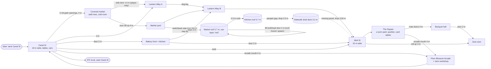

# Level 2: Chinatown / Canal Street (design)

Status: design for the three-map release (DECISIONS.md 2026-11-25 ~21:40). Nothing here is built. This file is the
level designer's brief. It is meant for whoever writes the level data and its generator, the art lane (Blender and
the box), the gameplay/C++ lane and the lead. The staged build plan and the lanes are in [../MAPS.md](../MAPS.md).

**Revision 2 (lead review, 2026-11-25).** Two design reviews found four must-fix problems across the three designs, two
of them in this level, and several should-fix ones. This revision resolves them:

- **Falls hurt.** config.json `player.fall` deals damage above a 13 m/s landing (gravity 21), so any drop over 4.02 m
  costs health. Every drop this level invites is now 4.0 m or less: the gap in the kitchen roof's Mott parapet drops
  2.5 m onto a sidewalk shed on the bakery's Mott face, and the shed drops 3.05 m to the sidewalk. The drop to Canal is
  gone, and every other roof edge has a playerOnly edge guard (4.4, 4.6, check 4 in section 17).
- **The roof is not a safe camp.** The market roof, B0 and the kitchen roof form a nav layer of their own (`roof`,
  y 5.7). Three Goon spawns sit at a roof bulkhead on B0. A Goon whose target is on another layer moves to a cell of its
  own layer that can see him, instead of walking under the slab toward his (x, z). This works without stair links (nav
  step A, MAPS.md lane N). The yard stair becomes a nav link when step B lands (4.4, 8.2, 8.6).
- **No spawn in the player's room.** A spawn inside the interior box the player is in is skipped, so wave 2 comes
  through the gates and the yard door, not from behind the next counter (8.4).
- **Goons must read.** The Goons wear oxblood on black, so red is kept out of the backgrounds of the main fight spaces
  and the palette is amber, pink, green and cool white. A readability check at 15 and 25 m runs in the five worst views
  (1, 11.3, check 11).
- **Less postcard, more Canal Street.** The Square is a worn neighbourhood park with card tables and a basketball
  hoop. There is one lantern string, the lions stand only at the banquet doors, and the art budget goes to everyday
  clutter (4.8, 13).
- **One schema for all three levels.** Text uses progression.md 7.2's keys (`frontend.story.chinatown.*`), and the HUD
  says "reels" while the radio says "masters" (15.3). `el` is optional, so there is no degenerate deck. Audio sits in
  `audio_chinatown.json` through levels.json `data.audio`. The nav and the cover filter are written by the engine's
  bake step, not re-implemented in Python (15, 16, 17).
- **One notch harder than the Block:** maxAlive +1 on every difficulty through the level's `tuning` (8.1).

Conventions are the ones `level.json` uses. Units are web units: metres, +Y up, x east, z south, so north is -Z.
Unreal (X, Y, Z) cm = web (x, z, y) x 100. A web yaw of 0 looks north (-Z), and a positive yaw turns left, so
facing east is yaw -1.5708. A prop's `rotationY` r gives forward (cos r, 0, -sin r), and its Unreal yaw is -r in
degrees. Heights are measured from the road at y = 0, and sidewalks are at 0.15.

The route lengths, nav counts and spawn checks below come from a throwaway rasteriser of this plan. It used the
game's own nav rule (0.5 m cells, 0.5 m inflate, blocked band 0.47 to 1.5 m, outer ring blocked, 8-neighbour A*).
They are design numbers. The real generator must recompute them from the final collider list (section 17).

---------------------------------------------------------------------------------------------------

## 0. The level in one page

| | Level 1, the Block (built) | Level 2, Canal Street (this design) |
|---|---|---|
| Setting | Jamaica Ave under the El, Hollis, Queens, 4:15 PM, day | Canal St and Mott St, Chinatown, Manhattan, 7:40 PM, night, the street still wet after rain |
| Bounds (web) | x -46..46, z -34..34 (92 x 68 m, 6,256 m²) | **x -44..44, z -34..32 (88 x 66 m, 5,808 m²)** |
| Nav grid | 184 x 136 cells, 9,052 free | 176 x 132 cells, about 11,170 free (prototype) |
| Feel | Open avenue, one big shop, an open lot | Packed and close-quarters: one wide street, a narrow street, two alleys, four walk-in interiors (the market, the bakery, the arcade, the banquet hall with the dub room), one low roof |
| Objectives | Reel 1 The Avenue, Reel 2 Chop Shop, Reel 3 The Cage | **Reel 4 The Tables, Reel 5 The Market, Reel 6 The Dub Room** |
| Extraction | IPX truck at the south end of the lot | IPX truck idling at the east end of Canal St |
| Critical path (A* on nav) | 39.0 + 25.0 + 65.8 + 63.9 = **193.7 m** | 34.5 + 27.4 + 59.6 + 60.2 = **181.7 m** |
| Spawns | 29 ground, 17 air | 38 ground (3 of them on the roof layer), 18 air |
| Explosives | 21 (14 propane, 7 rack) | 18 (15 propane, 3 rack) |
| Colliders | 777 | budget at most 800 (planned about 780) |
| Lighting | Day rig (sun, clouds, sky) | Night rig: no sun shadow and no volumetric clouds. About 48 placed local lights, at most 10 of them shadowed. Emissive neon. Wet ground |

**The story beat.** After the Block, the Vultures run three more masters down to Canal Street. One is at a
bootleg table out front. One is in the cold room at the back of a covered market. One sits in the back-room
"dub room" off Mott St where the crew copies the masters. Rule takes all three, and the IPX truck waits at the
east end of Canal. The mission rules do not change: three objectives, three waves, a pursuit, an extraction.

**Why it plays differently.** The Block is mostly open ground. Canal Street is 19 m from facade to facade, with
parked cars, trucks and a row of vendor tables. Off it run narrow alleys (4 m), a narrow street (Mott, 10 m), a
26 x 20 m market hall packed with stall counters, a shop you can walk through (the bakery), a covered arcade, and a
banquet hall that opens into the dub room. Most fights happen at 5 to 15 m, and every wave comes out of doorways
as well as from the street ends. Buzzards have three open air spaces: Canal St, the market roof and yard, and the
Square. Below 15 m they cannot fly over the five- to seven-storey buildings, so drones come down the streets.

---------------------------------------------------------------------------------------------------

## 1. Setting, time and mood

- **Place line:** `Chinatown, Manhattan · Canal St · 7:40 PM`. It is late November and fully dark. Shops are
  still open and the vendors are packing up.
- **Weather:** the rain has stopped and no rain falls. Falling rain is translucent overdraw, and it is the worst
  case for the stream encoder at QP 34. The ground is wet: dark asphalt, puddles in the gutters, drips from awnings
  and fire escapes near the player, and steam from manholes and kitchen vents.
- **Light:** neon, lightboxes and shop interiors carry the street. Cool LED street lamps match the art bible's
  2010s to 2020s street kit. The market hall has hard white light from bare bulbs and fluorescents. The bakery is
  warm pink-white. One string of red paper lanterns hangs over the banquet hall's doors, and nowhere else. The sky
  is a low overcast lit orange-brown from below by the city.
- **Palette (readability).** The Goons wear oxblood red on black (DESIGN.md), so red must not be the background they
  fight in. The street reads amber and sodium, pink, jade green and cool white. Red emissive is allowed only on signs
  that are never behind a fight from the critical path: in the market aisles, alley B, the arcade and the Square, the
  light behind an enemy is never red. Section 11.3 gives the per-sign colours, and check 11 in section 17 measures it.
- **Sound:** wet tyres from beyond the street ends, the buzz of a transformer, Cantonese talk radio from a shop
  (invented content), mahjong tiles from a second-floor window, kitchen fans in the alleys, fish-tank pumps in the
  market, and a distant train rumble across the bridge to the east every 90 to 150 s. That rumble replaces the
  El's train pass.
- **Why night.** The owner asked for "lots of neon", which only reads at night. Day was considered: neon at 550
  nits and signs at 900 would read as signboards, not neon. Night is new work (section 11), but it is also cheap
  on the GPU. There is no sun cascade and no cloud shadow or reconstruction, and that GPU time pays for the local
  lights.

---------------------------------------------------------------------------------------------------

## 2. Footprint

- **Bounds:** x -44..44, z -34..32. The player is clamped to them. Every building collider that lies outside
  them only blocks shots and sight.
- **Nav grid:** origin (-44, -34), cell 0.5, 176 columns x 132 rows. In Unreal the origin is (-4400, -3400) and
  the cell is 50 cm.
- **The front-end stage** stays at (0, 0, 100000) cm. The tallest geometry here is the backdrop towers (at most
  about 120 m) and the bridge silhouette far to the east (about 600 to 900 m away). Both stay well under 1 km and
  outside the stage room's view. The unlit sky dome (11.1) has a radius of 2 km, so it would enclose the stage room
  1 km up: it is a sky-only mesh, hidden while the front-end stage is shown, and the stage room keeps its own
  lighting. The fog's opacity and the bloom are checked at the stage camera before the first art build.
- **Edges.**
  - **West:** a street dig with steel plates, jersey barriers across the roadway at x -43.6..-42.8 and a parked
    box truck. The player arrives here.
  - **East:** barriers at x 42.6..43.4, a stalled delivery truck and traffic barrels, just past the IPX truck.
  - **Mott St south:** a box truck parked across the street (x 9.6..17.6, z 27.2..29.8) under a sidewalk shed.
  - **North:** a continuous row of buildings.
  - **South-west:** the backs of tall tenements.
  - Canal St and Mott St continue beyond the bounds as art and backdrop only.

---------------------------------------------------------------------------------------------------

## 3. Plan

### 3.1 Top-down plan

The plan is 1 character = 1 m east-west and 1 row = 2 m north-south (z labels on the left). North is up.

```
         -40       -30       -20       -10       0         10        20        30        40
         |         |         |         |         |         |         |         |         |
 -34 ########  ###########  ############  ###########  #############  #########  ############
 -32                                                                                         
 -30 ##      ccccc           ccccc           ccccc                                 ccccc   ##
 -28 ##      ccccc           ccccc           ccccc                   bbbbbbbb      ccccc   ##
 -26 ##  S                                                           bbbbbbbb     TTTTTTTTT##
 -24 ##                                                                          XTTTTTTTTT##
 -22 ##    ccccc                   bbbbbbbb                          cccccc       TTTTTTTTT##
 -20 ##    ttcctt  tt  tt  tt  tt  ttbbttbbtt      tt  tt            cccccc                ##
 -18       tt  tt  tt  tt  tt  tt  tt  4t  tt      tt  tt                                    
 -16                                                                                         
 -14 ##############    ####    ###    ###    ######  ####          ############   ###########
 -12 ##############    #   nnn  nnn  nnn   nn   ##      #          ############   ###########
 -10 ##############dd  #   nnn  nnn  nnn   nn  nn#      #          ############ n #  **######
  -8 ##############dd  #   nnn  nnn  nnn   nn  nnnnnnn  #  ccc     ############      **######
  -6 ##############    #   nnn  nnn  nnn   nn  nn#      #  ccc     ############   #   #######
  -4 ##############    #   nnn  nnn  nnn   nn  nn###  ###  ccc     ############   ###########
  -2 ##############    #   nnn  nnn  nnn   nn  nn#      #          ############   ###########
   0 ##############    wwwww  w                 ##      #          ############   ###########
   2 ##############    #      w   pppppp        ##         ccc                               
   4 ##############  nn###5###w###pppppp##    ####  nn  #  ccc       nnn                nnn  
   6 ##############    ##########ZZZZZZZ       dd#  nn  #  ccc               o    o          
   8 ##############    ##########ZZZZZZZ**     dd###nn ##  ccc          n              n     
  10 ##############                  nn                                 n              n     
  12 ##############      dd                        dd                        o    o          
  14 ####################################################            nnn                nnn  
  16 ####################################################                                    
  18 ####################################################  ccc     #############    #####ssss
  20 ####################################################  ccc     #   nn  # nnn nnn nnn ssss
  22 ####################################################  ccc     #   nn  # nnn nnn nnn ssss
  24 ####################################################                  # nnn nnn     ssss
  26 #################################################### bbbbbbbbb#         nnn nnn ##  ssss
  28 #################################################### bbbbbbbbbnn 6    # nnn nnn #      #
  30 ####################################################          nn########################
```

Legend:

- `#`: walls and buildings.
- `n`: counters, tables and other low solids.
- `c`: cars.
- `b`: box trucks.
- `T`: the IPX truck.
- `t`: vendor tables.
- `d`: dumpsters.
- `w`: cold-room walls.
- `p`: pallet stacks.
- `Z`: the climbable stair to the market roof.
- `o`: pavilion columns.
- `s`: the stage.
- `*`: explosives.
- `S`: the player start.
- `4`, `5`, `6`: the reels.
- `X`: the extraction zone.

Blank cells are walkable ground.

Reading the plan:

- **Canal St** fills the top band, z -34..-14.
- **Lantern Alley A** is the 4 m slot at x -30..-26, from Canal down to z 14. **Alley B** runs east along
  z 10..14 to Mott.
- **The market** is the stall grid at x -26..0, z -14..6. Its **yard** (with the stair `Z`) is at x -16..0,
  z 6..10.
- **The bakery** is at x 0..8.
- **Mott St** is at x 8..18.
- **The arcade** is the 4 m slot at x 29.4..33.6, from Canal to **the Square** (x 18..44, z 2..18).
- **The banquet hall** (x 26.3..44) and **the dub room** (x 18..26) take up z 18..32.

### 3.2 How the spaces connect



---------------------------------------------------------------------------------------------------

## 4. The spaces

Every opening that Goons must use is at least **2.0 m** wide. With the 0.5 m inflate, that leaves at least one
free column of nav cells. Player-only gaps are 1.4 m. Every step the player climbs is at most 0.42 m: risers are
0.219, the stage is 0.40, the plinth 0.30, kerbs 0.15 and the roof curb 0.30.

Every drop the level invites is at most **4.0 m**. Falls hurt: config.json `player.fall` deals (landing speed − 13)
× 7 damage, and with gravity 21 a 4.02 m drop lands at 13 m/s, the limit. A drop of 5.7 m from the roof would land at
15.5 m/s and cost about 17 of 100 health, and that can kill a player on low health in wave 2. Every edge that is not
an authored drop therefore has an **edge guard**: a playerOnly box on the parapet's outer face, from the walking surface
to 3.0 m above it. A 1.0 m parapet alone is not enough, because a 0.42 m box next to it plus the 1.0 m jump clears it.
The guard blocks movement only, so shots and sight pass. The authored drops are listed in 4.4.

### 4.1 Canal Street (zone `canal`, x -44..44, z -34..-14)

**Cross-section, north to south:**

- North facade plane at z -33.0, with six shop alcoves 2.4 m wide and 1.0 m deep (to z -34) centred at
  x -35, -22, -8, 5, 20, 31.
- North sidewalk z -33.0..-29.8 (3.2 m) at y 0.15.
- Roadway z -29.8..-19.0 (10.8 m): north parking lane z -29.8..-27.6, two travel lanes, south parking lane
  z -21.2..-19.0.
- South sidewalk z -19.0..-14.0 (5.0 m) at y 0.15.
- Vendor table strip along the south kerb at z -18.8..-17.8: tables 1.8 m long at a 4 m pitch, so the gaps are
  2.2 m and Goons can pass. Tables start at x -38, -34, ..., -6, then x 2 and 6.
- The south facade at z -14.0. The Mott crossing breaks it at x 8..18.

**What is parked there (axis-aligned, so no oriented boxes):**

- North lane: a sedan (x -36..-31.5), a taxi (x -20..-15.5), a sedan (x -4..0.5) and an SUV (x 34..38.5).
- South lane: the livery sedan that dropped Rule off (x -38..-33.5), a box truck (x -14..-6, z -21.4..-18.9;
  cover in front of Reel 4) and a van (x 20..25.5).
- A box truck double-parked in the north travel lane at x 20..28, z -27.6..-25.0. It breaks up the 88 m view
  along the street.
- The IPX truck in the south travel lane at x 33.5..41.5, z -24.3..-21.7.

**Sight lines and cover:**

- The longest sight line in the level is the roadway from the start to the truck, 77 m. Cars, the two box trucks
  and the table row break it up.
- Cover is the cars (1.4 to 1.6 m tall), the box trucks, the tables (0.75 m, with goods racks to 1.3 m), the
  newspaper boxes, the alcoves, the dumpling and chestnut carts, and the hydrants.
- The south sidewalk is the protected lane, with the tables between it and the road. The north sidewalk is the
  exposed flank where enemies come out of the alcoves.

**Above:** projecting blade signs 4 to 12 m up, lightbox bands at 3.2 to 4.2 m, a sidewalk shed in front of N4
(x 0..12; posts block, the deck is art only), fire escapes on N1 and N3 only, and air conditioners.

### 4.2 Lantern Alley (zone `alley`; A: x -30..-26, z -14..14; B: x -30..8, z 10..14)

- **A** is a 4 m slot off Canal between W1 (a six-storey tenement) and the market's west wall. A painted wooden
  board over the mouth reads LANTERN ALLEY. This is an in-world nickname, not a city street sign: the alley is
  named after the party-goods wholesaler whose back door opens on it.
- No lanterns hang over the alley. It is a working back alley: the wholesaler's cartons stacked on a hand truck, fish
  boxes and styrofoam from the market, cardboard bales, trash bags, kitchen exhaust fans, bare bulkhead lamps, wet
  concrete.
- Alley A has a dumpster at x -29.9..-28.3, z -9..-7.2 and a stack of crates at x -27.6..-26, z 4..5.4. The market
  side door (1.4 m, player only) is at z -2.9..-1.5 in the market's west wall. Restaurant back doors and three fire
  escapes are on W1's east face, as dressing.
- **The dog-leg** is at x -30..-26, z 10..14. Alley A ends visually in the S1 wall, so alley B opens only when
  you reach the corner. A stencilled arrow "MOTT ST →" and a lit kitchen door mark the turn (section 7.3).
- **B** runs east for 38 m behind the market yard to Mott St. It is a narrow shooting lane with staggered cover:
  dumpsters at x -24..-22.2 (S1 side) and x 2..3.8 (S3 side), and a pallet pile at x -12..-10.2 (yard side).
  There is a fire escape on S1 and one on S2 (dressing), and the bakery's alley door is at x 4..6.

### 4.3 The covered market (zone `market`; shell x -26..0, z -14..6; interior x -25.6..-0.4, z -13.6..5.6)

The market is a former garage turned into a market hall: one tall storey with a clear height of 5.4 m and a roof
slab whose top is the walkable roof at **5.7 m**. The floor is concrete at y 0. GOLDEN TIDE MARKET.

**Openings:**

- Three Canal entrances with roll gates up, each 4 m wide and 3.4 m tall: x -22..-18, -15..-11 and -8..-4.
- A side door to alley A, 1.4 m (player only).
- A rear roll-up to the yard at x -7..-3 (4 m).
- The east wall (x -0.4..0, a party wall with the bakery) has no door. A door there would give a second route of
  almost equal length to Mott and make the drawn path flip.

**Inside:**

- **Stall rows** are double counters 1.8 m wide and 0.95 m tall: R1 x -21.6..-19.8, R2 x -16.4..-14.6,
  R3 x -11.2..-9.4, R4 x -6.0..-4.2. Each row has a front run (z -11..-5) and a back run (z -3..-0.5). Aisles
  between rows are 3.4 m. The west aisle is 4 m. The front aisle (behind the gates) runs z -13.6..-11, the cross
  aisle z -5..-3 and the back aisle z -0.5..1.5.
- **The fish counters** run along the east wall (x -1.4..-0.4, z -10..-1), with ice trays, styrofoam boxes and
  live tanks (opaque glass, the bubbles in the material).
- **The cold room** is at x -25.6..-18.4, z 1.5..5.6, with walls 0.25 m thick. Its door (2.0 m, a PVC strip
  curtain, art only) is in the north wall at x -21..-19, under a lit sign COLD ROOM. **Reel 5 is here.**
- **The stockroom** is three pallet stacks at x -15..-13.4, -12.6..-11 and -10.2..-9.4, z 2.4..5.2.
- **Overhead:** bare-bulb pendants, hanging stall boards (FRESH FISH, FRUIT, VEGETABLES, DRY
  GOODS, TOFU, ROAST MEAT), tarps, and skylights in the roof. All of it sits above 2.4 m and is art only,
  so it never blocks sight.
- **Sight lines:** 25 m along each aisle, 25 m across the cross aisle. The counters are chest-high cover. This is
  the close-quarters room of the level.

### 4.4 The yard, the stair and the roofs (rooftop play: the `roof` nav layer)

- **The yard** is x -16..0, z 6..10, concrete at y 0, open to alley B along z 10. It holds a dumpster
  (x -1.9..-0.4, z 6.3..8.1) and a cage of gas cylinders (two propane, x -9..-7.2, z 8.8..9.8, next to the rear
  door).
- **The stair** is a steel switchback fixed to the market's south wall. It is the one climbable fire escape in
  the level.
  - Flight 1 runs west in the south lane (z 7.2..8.2), from its foot at x -9.8 (y 0) up to x -13.2 (y 2.85):
    13 risers of 0.219 m on treads of 0.26 m.
  - The mid landing is x -14.6..-13.2, z 6.0..8.2, at y 2.85.
  - Flight 2 runs east in the north lane (z 6.0..7.2), from x -13.2 to x -9.8 (y 5.7).
  - The top landing is x -9.8..-8.6, z 6.0..7.2, at y 5.7, through a gap in the roof parapet.
  - That is 26 step boxes plus 2 landings plus 2 side plates, about 30 colliders. Its boxes block the street
    layer's nav, as the Block's shed stair does. With nav step B (MAPS.md lane N) it is a **nav link** `yardStair`
    from the street layer at (-9.4, 0, 7.7) to the roof layer at (-9.2, 5.7, 6.6), so Goons then follow the player
    up and down it. Its outer side is guarded (playerOnly to 3.0 m over each tread), so nobody falls off a flight.
- **The market roof** is x -26..0, z -14..6, plus the back building B0 (x -26..-16, z 6..10), all at y 5.7, as
  tar and gravel. It has:
  - parapets 1.1 m on Canal (north), 1.0 m on alley A (west) and 1.0 m on the yard and alley B (south), except at
    the stair head, each with an edge guard (section 4);
  - four skylight boxes 2 x 3 x 0.8 m and three condensers 1.2 m tall, as cover from Buzzards and from roof Goons;
  - rooftop letters GOLDEN TIDE MARKET on a steel frame standing on the north parapet. They are the landmark you see from
    Canal St, and the frame legs give cover;
  - **the B0 bulkhead**, the storeroom's roof-access stair house (x -25.4..-22.4, z 6.6..9.4, 2.6 m tall), with
    its 2.0 m door on the east face at z 7.0..9.0. It is the roof Goons' door: three ground spawns of the `roof`
    layer sit here and on the roof (8.2). The stair inside it is art only, like the Block's shop interiors.
- **The kitchen roof** is the bakery's one-storey rear extension (x 0..8, z -3..10) at y 5.7. It joins the market
  roof over a 0.30 m curb at x 0. Its east parapet on Mott (1.0 m, guarded) has a broken 3 m section at z 2..5, lit
  by the glow of the LITTLE KITE CAFE sign opposite. That gap is the roof's one way down besides the stair.

**The authored drops (every one 4.0 m or less, checked by check 4 in section 17):**

| Drop | From | To | Height | Landing speed | Damage |
|---|---|---|---|---|---|
| R1 | the kitchen roof's parapet gap (x 8, z 2..5, y 5.7) | the sidewalk shed deck on the bakery's Mott face (4.6, top 3.2) | 2.5 m | 10.2 m/s | 0 |
| R2 | the shed deck's missing plywood panel (x 10, z 2..5, y 3.2) | the Mott west sidewalk (0.15) or the roadway (0) | 3.05 to 3.2 m | 11.3 to 11.6 m/s | 0 |
| | the mid landing of the stair (2.85), over its rail | the yard (0) | 2.85 m | 10.9 m/s | 0 (the rail is guarded anyway) |

A sprint off the shed lands on the parked van (roof 2.0 m) or on the roadway; both are free.

**What the roof is for:** it is optional in Story, and it is contested ground, never a safe camp.

- From the roof you look over Canal (Reel 4 and the street) and down Mott toward the Square.
- It is a short cut from Reel 5 to Mott St: up the stair, across the roofs, down onto the shed and to the street,
  with no damage taken.
- **Enemies up here.** The roof is the nav layer `roof` (y 5.7, rect x -26..8, z -14..10). With nav step A
  (layers, no links, MAPS.md lane N):
  - Three roof Goon spawns (rf1 to rf3, 8.2) put Goons on the roof whenever the player is on it, or is in Canal,
    alley A or the market below it (each point's `overlooks` zones). Roof Goons fire down over the parapets.
  - A Goon whose target is on another layer does not path toward the target's (x, z). It moves to the nearest cell
    of its own layer within 30 m that has a line of sight to him (a **firing cell**) and fights from there. So street
    Goons take the yard, alley B, the Canal sidewalk and Mott, looking up, instead of bunching in the market under the
    slab.
  - A Goon with no firing cell, out of the player's view and not having seen him for 10 s, goes back to the pool
    and its wave slot back to the queue (the stranded rule of midtown.md 7.2).
  - With nav step B, the yard stair is a link and Goons follow the player up and down.
- Buzzards attack freely up here, as on the Block's scaffold deck. Three air spawns sit over the roof and yard and one
  over the kitchen roof.
- Until step A exists (the early grey box), the roof spawns are switched off in the data and the roof is the
  Block-like player-and-Buzzards-only space. The release does not ship like that: Hold Canal Street on a Goon-free
  roof is the camping exploit the reviews found (8.6), and in Story the roof would be a safe gallery over wave 2. If
  step A slips, the lead chooses between a slip and leaving Hold Canal Street out (MAPS.md section 6).

### 4.5 The bakery (W3: shell x 0..8, z -14..10; walk-through shop)

- MOON GATE BAKERY, in pink exposed neon.
- **The front shop** is x 0.4..7.6, z -13.6..-3.2. Its floor is at 0.15 and its ceiling at 3.8. It has a display
  counter at x 0.4..5 (the aisle is 2.6 m) and a Canal door at x 2..4.
- **The kitchen** is x 0.4..7.6, z -3..9.6, with a clear height of 5.4. A partition with a 2 m door at x 3..5
  separates it from the front shop. It has a steel table at x 3.6..5, z 4.6..8.4, plus ovens and racks of trays.
  Its doors are the Mott door (x 8, z 2..4) and the alley B door (x 4..6, z 10).
- The bakery links Canal, Mott and alley B for Goons and the player. Buzzards do not enter: the doors are 2.6 m
  tall, too low for minHeight 2.2 plus the 0.5 m body.

### 4.6 Mott Street (zone `mott`, x 8..18, z -14..32)

- West sidewalk x 8..10, one-way roadway x 10..16, east sidewalk x 16..18, kerbs 0.15.
- West-lane parking: a sedan (z -8..-3.5), a van (z 3..8.5) and a taxi (z 18..22.5).
- **A sidewalk shed** along the bakery's Mott face (x 8..10, z -3..10): a plywood-and-pipe deck with its top at
  3.2 m, its posts on the kerb line (x 9.7..9.9, every 3 m, clear of the bakery's Mott door at z 2..4) and a 1.0 m
  plywood parapet on its outer edge, guarded, with one missing panel at z 2..5. It is the landing of drop R1 and the
  start of drop R2 (4.4). The deck is above the nav band, so only its posts block the street layer. About 10
  colliders.
- **The everyday street:** a fruit stand under the shed's south end with crates on the sidewalk, two delivery e-bikes
  chained to the shed posts, cardboard bales and trash bags on the kerb, a SEVEN STARS COACH storefront (an
  intercity bus ticket office, with its waiting-line stanchions) on S3, and a QUICK WIRE money transfer and phone
  shop next to the grocery. These are the details that make it Canal and Mott rather than a set.
- A box truck across the south end (x 9.6..17.6, z 27.2..29.8).
- 46 m long and narrow, so Goons push up and down it.
- The fronts on Mott: the bakery's kitchen door; S3 GOOD WISHES GROCERY, with fruit boxes on the
  sidewalk; E1a's LITTLE KITE CAFE; and the dub room's roll-up (x 18, z 24..27, 3 m, open) under the dead neon
  of SILVER WAVE VIDEO.
- The fire escape on S3's Mott face is dressing.

### 4.7 The arcade and the neon workshop (x 29.4..33.6, z -14..2; workshop x 34..37.6, z -10..-4)

- PLUM BLOSSOM ARCADE. It is a covered passage 4.2 m wide and 4.2 m tall under E1, with lit arch signs
  at both mouths.
- On either side are kiosks behind glass that you cannot enter: WATCH REPAIR, KEYS CUT, PHONES.
- One kiosk pillar stands at x 31..31.6, z -9.5..-8.9.
- **The neon workshop** is BIG LIGHT SIGNS. It opens off the arcade through a 2 m door at x 33.6,
  z -8..-6. Inside are bundles of glass tube, a bending bench, a half-finished sign glowing on the wall, and the
  torch rack (an explosive of type `rack`, which is the Block's welding rack). It is a dead-end pocket with good
  cover.
- **Role:** the arcade is the short way from the Square to the truck, used on the final run (section 7). It is
  16 m of choke, and Goons spawn in it during the pursuit.

### 4.8 The Square (x 18..44, z 2..18, paved, y 0.15)

- A worn neighbourhood park, not a festival set: cracked asphalt and old hexagonal pavers, a low chain-link fence
  around two dirt beds, folding card tables where old men play cards and xiangqi in the evening, a basketball hoop on
  a pole in the south-east corner (x 40.6..40.9, z 16.0..16.3), park benches with armrests, a city trash can at every
  exit, pigeons. At its centre stands an old **pavilion**, its paint peeling, lit from below by one work lamp:
  - a plinth at x 27.5..34.5, z 6.5..13.5, y 0.15..0.45. Its top is under 0.47, so it does not block nav;
  - four columns 0.4 m square at (28.2, 7.2), (33.8, 7.2), (28.2, 12.8) and (33.8, 12.8);
  - a pagoda roof slab at 3.6..4.4. It blocks shots and Buzzards, and it is above the nav band.
- Four raised concrete beds 3 x 1 x 0.9 m at the corners, edged with chain-link: (20..23, 4..5), (39..42, 4..5),
  (20..23, 15..16) and (39..42, 15..16).
- Benches and folding card tables at x 23..23.8 and 38..38.8, z 9..11.
- A pair of small stone lions at the banquet hall's doors, at (29.5, 16.8) and (36.5, 16.8): the hall's own, as
  restaurants have them. They are the only lions in the level.
- No lantern strings over the Square. The level's one lantern string hangs over the banquet doors (4.9).
- This is the Buzzards' arena: 26 x 16 m of open air over three-storey E2, at most 15 m of flight ceiling.
- Exits: the Mott edge (x 18), the arcade mouth (x 29.4..33.6 at z 2) and the banquet hall doors (x 31..35 at
  z 18).

### 4.9 The banquet hall and the dub room (E2, x 18..44, z 18..32)

- **The banquet hall** is CRANE PAVILION BANQUET HALL, interior x 26.3..43.6, z 18.4..31.6.
  - Floor 0.15, clear height 5.0. The main doors (4 m, red lacquer with gold lattice panels, no characters) are at x 31..35 on the Square,
    under the level's one string of red lanterns (16 lanterns, art only).
  - Seven round tables with cloths and chairs (1.7 m collider boxes) at (29.5, 21.5), (33.5, 21.5), (29.5, 25),
    (33.5, 25), (37.5, 21.5), (29.5, 28.8) and (33.5, 28.8).
  - A stage at x 40.8..43.6, z 18.8..26.6, 0.40 high, with a backdrop panel.
  - A kitchen at x 36.4..43.6, z 27.2..31.6, with a 2 m door at x 38..40.
- **The dub room** is the Vultures' copying room, interior x 18.4..26.0, z 18.4..31.6.
  - Floor 0.15, clear height 4.2. It is reached through the Mott roll-up (3 m) or through a 2 m door in the
    partition at x 26, z 26..28 from the banquet hall.
  - Racks of reel-to-reel and tape decks against the west wall (x 18.4..19.4, z 28..31.4), a cutting table at
    x 22.2..23.8, z 20.4..22.4, towers of disc burners, boxes of blank discs, a monitor with no brand, and
    cables. **Reel 6 is here.**
- Both rooms are Buzzard-enterable interiors with doorways in the data. The doorways are the Mott roll-up and the
  hall's main doors.

### 4.10 Buildings

`ground` is 3.8 m and `upper` 3.1 m, as on the Block. A roof height is 3.8 + 3.1 x (storeys - 1), and the parapet
adds 0.9.

| Id | Footprint (x, z) | Storeys | Roof / parapet top | Front | Facade | Shops (ground; upper) | Fire escapes |
|---|---|---|---|---|---|---|---|
| N1 | -44..-29, -36..-33 | 6 | 19.3 / 20.2 | Canal | painted brick, cream | GOLD HITS RECORDS; 2F JADE TEAPOT DIM SUM (blade) | 1 (Canal) |
| N2 | -29..-15, -36..-33 | 5 | 16.2 / 17.1 | Canal | red brick | TWIN CARP JEWELRY; 3F FAR SHORE TRAVEL (window letters) | 0 |
| N3 | -15..-1, -36..-33 | 5 | 16.2 / 17.1 | Canal | buff brick | EIGHT TREASURE BBQ (roast-duck window) | 1 (Canal) |
| N4 | -1..13, -36..-33 | 6 | 19.3 / 20.2 | Canal | brown brick, sidewalk shed in front | SPRING PINE HERBS & GINSENG | 0 |
| N5 | 13..26, -36..-33 | 5 | 16.2 / 17.1 | Canal | painted green | LONG LIFE NOODLE HOUSE; 2F MAHJONG (window neon) | 0 |
| N6 | 26..44, -36..-33 | 7 | 22.4 / 23.3 | Canal | red brick | SUNNY DAY LAUNDROMAT; HARBOR STAR HOTEL (4-storey blade, the east landmark) | 0 |
| W1 | -44..-30, -14..32 | 6 | 19.3 / 20.2 | Canal, alley A | red brick | WEST CITY HARDWARE (gate down) | 3 (alley A) |
| M | -26..0, -14..6 | 1 (hall) | 5.7 / 6.8 (Canal side) | Canal | painted block and corrugated fascia | GOLDEN TIDE MARKET (walk in) | 0 (the climbable stair is separate) |
| B0 | -26..-16, 6..10 | 1 | 5.7 | alley A | common brick | market storeroom (shut); its roof bulkhead is the roof Goons' door (4.4) | 0 |
| W3 | 0..8, -14..-3 (front), -3..10 (one-storey rear) | 5 / 1 | 16.2 / 17.1; rear 5.7 | Canal, Mott | buff brick, sidewalk shed on Mott | MOON GATE BAKERY (walk through) | 0 |
| S1 | -30..-14, 14..32 | 5 | 16.2 / 17.1 | alley B (backs) | common brick | backs | 2 (alley B) |
| S2 | -14..0, 14..32 | 5 | 16.2 / 17.1 | alley B (backs) | painted brick | backs | 1 (alley B) |
| S3 | 0..8, 14..32 | 6 | 19.3 / 20.2 | Mott | brown brick | GOOD WISHES GROCERY; SEVEN STARS COACH; QUICK WIRE | 1 (Mott) |
| E1a | 18..29.4, -14..2 | 5 | 16.2 / 17.1 | Canal, Mott, Square | red brick | GOLDEN LUCK ELECTRONICS (Canal); LITTLE KITE CAFE (Mott); CLEVER HANDS TAILOR (Square) | 1 (Mott) |
| Arcade | 29.4..33.6, -14..2 | under E1 | 4.2 (ceiling) | Canal, Square | terrazzo, glass kiosks | PLUM BLOSSOM ARCADE | 0 |
| E1b | 33.6..44, -14..2 | 6 | 19.3 / 20.2 | Canal | buff brick | WILLOW BRIDGE OPTICAL (Canal); BIG LIGHT SIGNS (inside, off the arcade) | 0 |
| E2 | 18..44, 18..32 | 3 | 10.0 / 10.9 | Square, Mott | painted stucco, cream with gold trim | CRANE PAVILION BANQUET HALL; SILVER WAVE VIDEO (the dub room) | 0 |

In total there are **10 fire-escape stacks** and one climbable stair. Only N1's and N3's escapes are in the
start view (section 13.4, flicker).

---------------------------------------------------------------------------------------------------

## 5. Player start

- **Position:** (-40.0, 0, -24.5), in the Canal roadway beside the livery sedan that dropped Rule off, just inside
  the west dig.
- **Yaw:** -1.5708 (facing east). The Unreal pose is (-4000, -2450, 0) cm, yaw 0.
- **Start pitch:** +4°. The Block uses 7° (presentation.json block.startPitch), so this needs a per-level value.
- **First view:** east down Canal. The table row and the glowing market entrances are on the right, the TWIN
  CARP and JADE TEAPOT signs on the left, and the HARBOR STAR HOTEL blade 77 m away above the IPX truck, so the end of the
  level is in sight from the first second. The Reel 4 marker is 30 m ahead and slightly right.
- **Patrol check:** the starting patrol must spawn at least 32 m away. 27 of the 35 street ground points qualify, plus the 3 roof points (the
  market, Mott, the Square, east Canal).

---------------------------------------------------------------------------------------------------

## 6. Objectives and extraction

The reels are numbered 4 to 6 so the story reads as one album across the campaign, while the HUD tally counts
this level (0/3 to 3/3). Nothing in the rules reads the code as a number: the case looks up reels[i] by index.
Whether to keep 1 to 3 per level instead is open question 2.

| # | id | code | label | place | zone | interior | web pos | rotationY | Unreal pos (cm) / yaw | What it is |
|---|---|---|---|---|---|---|---|---|---|---|
| 0 | `reel4` | `4` | Reel 4 — The Tables | THE TABLES | canal | false | (-10.0, 0.15, -16.2) | 1.5708 (faces north, to the road) | (-1000, -1620, 15) / -90 | On the sidewalk between the bootleg disc table and the market front, behind the south-lane box truck. A boombox on the table plays a muffled loop. |
| 1 | `reel5` | `5` | Reel 5 — The Market | THE MARKET | market | true | (-22.5, 0, 4.4) | 1.5708 (faces its door) | (-2250, 440, 0) / -90 | In the cold room at the back of the market, on a pallet among the fish boxes. |
| 2 | `reel6` | `6` | Reel 6 — The Dub Room | THE DUB ROOM | mott | true | (21.2, 0.15, 28.4) | 1.5708 (faces north) | (2120, 2840, 15) / -90 | In the copying room, by the racks, cabled to a deck that is mid-transfer. |

**Extraction:**

- Code `IPX`, label `IPX truck`, zone `canal`, place `CANAL ST`.
- Zone pos (32.1, 0, -23.0), radius **2.5**, the same as the Block. In Unreal it is (3210, -2300, 0) cm,
  radius 250.
- Truck pos (37.5, 0, -23.0), rotationY 0 (forward east, rear doors west, toward the zone). In Unreal it is
  (3750, -2300, 0), yaw 0.
- The truck and zone are placed exactly as the Block's: zone = truck - 5.4 m x forward.
- The truck and the reel case are reused as they are (AMITruck, AMIReelCase; presentation.json objectives). The
  case's 75 cm lift suits a reel on a table or pallet.
- Before all three reels are in, the refusal prompt plays every 8 s, as on the Block. The Block's line ("Reels
  still out there — the truck won't roll without all three") is not tied to the Block's place, so Canal reuses it.
- **Staging.** The truck idles from the start, as on the Block, but boxed in: the stalled delivery truck at the east
  barriers sits across its nose. Its hazard lights blink until all three reels are in; then its rear doors open
  (AMITruck Open, the existing state) and its beacon turns on, which is what draws the eye down the arcade. Midtown
  stages its truck differently (it rolls in at the end, midtown.md 6.3), so the three extractions do not feel the
  same.

---------------------------------------------------------------------------------------------------

## 7. Critical path and guidance

### 7.1 The four legs (A* on the prototype nav; the ground path draws these)

| Leg | From → to | Length | Route the path draws | Fight |
|---|---|---|---|---|
| 1 | Start → Reel 4 | 34.5 m | East along the Canal roadway, onto the south sidewalk through a gap in the table row at x -11, then to the reel. | The patrol, from the north alcoves and the market front. |
| 2 | Reel 4 → Reel 5 | 27.4 m | Through the middle market entrance (x -15..-11), down the aisle between R2 and R3, west along the back aisle to the cold-room door. | Wave 1 arrives from both ends of Canal and the north alcoves, which pushes you into the market. |
| 3 | Reel 5 → Reel 6 | 59.6 m | Out of the cold room, east along the back aisle, through the rear roll-up, across the yard into alley B, east to Mott St, south down Mott to the dub room roll-up. | Wave 2 floods the market from the Canal gates and the yard. Alley B is the shooting lane. |
| 4 | Reel 6 → truck | 60.2 m | Through the partition door into the banquet hall, between the tables, out the main doors, across the Square, north through the arcade, across the Canal sidewalk to the truck. | Wave 3, then the pursuit, in the Square and the arcade. |
| | **Total** | **181.7 m** | | The Block's path measured the same way is 193.7 m. |

The rating's time thresholds (270 s and 400 s, flow.rating) can stay as they are at first: the route is 6 %
shorter but the fights are denser. Re-tune after playtests, as a per-level override.

### 7.2 Route ties (path flip)

Legs 3 and 4 each have a second route of similar length:

- Leg 3 via the Square and the banquet hall.
- Leg 4 via the dub room's Mott roll-up and up Mott St.

The layout makes the intended route clearly shorter:

- The market has no east door.
- The roll-up sits at z 24..27, south of the reel's partition door.

The generator must check that each intended leg is **at least 10 % shorter** than the best route that avoids it
(section 17). If the guidance lane adds hysteresis to the path, the margin can be smaller.

### 7.3 Where players get lost, and the fix

| Spot | Why | Fix (data and art, no map-specific code) |
|---|---|---|
| The market grid | Four identical rows; hanging goods cut the long view | Ground path. The cold-room sign COLD ROOM is lit cold white and visible down the west aisle. The boombox loop at the case. The objective marker. |
| Three ways out of the market (gates, side door, rear roll-up) | The side door into alley A is the nearest exit from the cold room in a straight line | The path takes the rear roll-up, which is lit by a work lamp and a green exit box. The side door is a narrow dark door for the player only. Alley A loops to alley B anyway, so it is never a dead end. |
| Alley A's dog-leg | The alley seems to end in a wall | Stencilled "MOTT ST →" and a lit kitchen door at the bend (x -28, z 12), and the wholesaler's lit back door with its cartons at the corner. |
| The roof | After climbing the stair, the way down may not be obvious | The one gap in the kitchen roof's Mott parapet is lit by the LITTLE KITE CAFE sign; it drops 2.5 m onto the sidewalk shed, whose missing panel drops 3.05 m to Mott, both free of damage. The stair head has a hazard-yellow handrail. Every other edge is guarded, so nobody falls by accident and nobody is tempted into a drop that hurts. |
| Mott St south | The dub room roll-up is on the left among other shopfronts | The only raised shutter on Mott, with a flickering dead neon over it, and light spilling onto wet asphalt. The marker. |
| After Reel 6 | Two exits (the Mott roll-up or the banquet hall) | The path goes through the hall. The radio line names the arcade. The arcade's arch sign is the brightest object on the Square. |
| The arcade | A tunnel; the truck is not visible from the Square | The truck's beacon and the HARBOR STAR HOTEL blade show through the arcade's north mouth. |
| Closed shopfronts | Players try doors that are art only | Rule: open = gate up, interior lit, door gap at least 2 m. Closed = gate down and tagged, or dark glass. Never a lit, open-looking door that is solid. |

### 7.4 Hint lines (shown after no progress; the guidance lane's timing)

The hints are keyed by objective id (`guide.hints` {reel4, reel5, reel6, extraction}) and say where the target is from
anywhere, because the player may take the reels in any order. The guidance targets the nearest unsecured reel.

- Reel 4: "Reel 4's on a table outside the market. South side of Canal."
- Reel 5: "Back of the market. The cold room, by the west wall."
- Reel 6: "The dub room's at the south end of Mott St. Its shutter's the only one up."
- Extraction: "The truck's at the east end of Canal. Cut through the arcade off the square."

---------------------------------------------------------------------------------------------------

## 8. Enemies

### 8.1 Rules that apply unchanged

The rules come from MIGameRules and config.json:

- Pools of 12 Goons and 8 Buzzards.
- Difficulty waves: one wave per reel, three in all.
- maxAlive 9, 11 or 13 by difficulty. The pursuit budget after the last reel is 5, 8 or 12.
- ChoosePosition scores points by distance, hidden from the player's eye, last use and a random term.
- tooClose 9 m (re-pick), waves from at least 18 m, the patrol from at least 32 m, and the 26 m ring as a
  fallback.

Chinatown changes no rule. It reads two things from its level file (`tuning`, section 15), both of them absent for
the Block:

- `tuning.difficulty.maxAliveAdd` **1**: maxAlive 10, 12 and 14 on hustler, boss and kingpin. The close quarters
  make every extra Goon count, and the pools (12 Goons, 8 Buzzards) still cover it.
- `tuning.spawn.excludePlayerRoom` **true** (8.4).

The Buzzard share is not raised here: Buzzards are at their weakest in 4 to 10 m streets (8.5).

### 8.2 Ground spawns (38)

- y is 0 on asphalt and 0.15 on sidewalks and interior floors.
- Facing is toward the nearest opening or the play space, as the exporter's `facingSource` does.
- In the prototype, every point sits on a free nav cell in the one connected component.

| Area | Points (x, z) | Notes |
|---|---|---|
| Canal (12) | c1 (-41.5, -27.0) behind the west dig. c2 (-35, -33.3), c3 (-22, -33.3), c4 (-8, -33.3), c5 (5, -33.3), c6 (20, -33.3), c7 (31, -33.3): the north alcoves, enemies out of the shops. c8 (42.0, -31.5) east end of the north sidewalk. c9 (42.0, -16.0) east end of the south sidewalk. c10 (24, -15.0) E1a door. c11 (-36, -15.0) W1 door. c12 (24.0, -28.6) behind the double-parked box truck. | The alcoves are hidden from most of the street. |
| Alley (5) | a1 (-28, -12), a2 (-28, -4), a3 (-28, 7), a4 (-28, 12.5), a5 (-19, 12) | a3, a5 and m3 are within 9 m of Reel 5, so the 9 m re-pick drops them for that wave. |
| Market (9) | m1 (-24.2, -12.4) NW inside, m2 (-2.6, -12.4) NE inside, m3 (-23.6, 0.4) back aisle west, m4 (-6.5, 4.2) by the rear door, m5 (-13, 9.2) yard, m6 (-4.5, 8.6) yard, m7 (2.0, 7.0) bakery kitchen, m8 (-6, 12) alley B, m9 (5.5, 12.4) alley B east | `interior` is true for m1 to m4 and m7. |
| Mott and east (9) | t1 (9.0, -6) W3 side, t2 (17.0, -4) E1a door on Mott, t3 (13, 30.8) behind the south box truck, t4 (9.0, 22) S3 door, t5 (31.5, -1.0) arcade (interior), t6 (21.5, 16.6) Square SW behind a planter, t7 (42.6, 4.0) Square NE service gate, t8 (40.0, 29.5) banquet kitchen (interior), t9 (24.8, 30.4) dub room (interior) | |
| Roof (3), layer `roof`, y 5.7 | rf1 (-21.4, 5.7, 8.0) at the B0 bulkhead door, rf2 (-4.0, 5.7, -12.4) behind the rooftop letters' legs, rf3 (-24.0, 5.7, -5.0) behind the west condenser | `layer` roof, `overlooks` [canal, alley, market]: a candidate only when the player is on the roof or in those zones. Needs nav step A; switched off in the data until then (4.4). |

Every other point carries `layer` street. The spawn reach of this level is street → [street, roof] and roof →
[roof, street], filtered by each roof point's `overlooks`.

### 8.3 Air spawns (18)

The Buzzard starts at the point's y. Every point is at least 2.2 m over the ground below, at most 12 m (the
ceiling is 15 m absolute), and at least 1.5 m from any collider.

| Area | Points (x, y, z) |
|---|---|
| Canal (7) | (-36, 9.5, -24.5), (-20, 10, -25), (-4, 10.5, -24.5), (12, 10, -25), (28, 10, -24.5), (40, 9.5, -25.5), (20, 11, -21.5) |
| Market roof and yard (3) | (-20, 9, -4), (-8, 9.5, 0), (-13, 8.5, 8) |
| Kitchen roof (1) | (4, 9, 3) |
| Mott (3) | (13, 10, -6), (13, 10, 8), (13, 9.5, 22) |
| Square (4) | (24, 9, 6), (36, 9.5, 6), (28, 10.5, 13), (40, 9, 13) |

### 8.4 How each wave arrives (from the prototype distances; hiding decided at run time)

- **Patrol** (unaware, at least 32 m from the start). It spreads over the market, the yard, Mott and east Canal.
  The first contact is usually a Goon stepping out of the market's east gate, or a Buzzard over east Canal.
- **Wave 1** (Reel 4 at (-10, -16.2)). The candidates at 18 m or more are the north alcoves c2 to c7, both street
  ends, the market NE corner m2 (which drops out at 6 m), alley A and the yard. The wave comes along Canal from
  east and west and out of the north shops, with Buzzards over the roadway. The market entrances behind you are
  the cover. That is the intended push.
- **Wave 2** (Reel 5, in the cold room). The candidates are the Canal doors, the bakery kitchen, alley B
  (m8, m9), Mott and the roof (rf1 to rf3, firing down into the yard). m1 to m4 are inside the market's interior
  box, which the player is in, so `excludePlayerRoom` drops them: no Goon appears behind the next counter. The fight comes into the market from the front gates and
  the yard at once. The player fights out through the rear roll-up into alley B, or climbs to the roof.
- **Wave 3** (Reel 6, in the dub room). The candidates are the arcade (t5), the Square (t6, t7), the banquet
  kitchen (t8), Mott north (t1, t2) and the Canal east end. The pursuit then refills from the same pool while you
  cross the Square and the arcade. Expect contact in the arcade's 16 m tube, so the neon workshop door is the
  side pocket to fall back into.
- **The 26 m fallback ring** can land inside a building in a dense map. With 35 points spread through every
  space, ChoosePosition should never need it. The generator checks this anyway (section 17, check 6).

### 8.5 Buzzards here

- **No El.** The loader requires `el.deck` today, and the Buzzards plan around it. Revision 2 makes `el` optional
  once, for both new levels (`bHasDeck`, MAPS.md lane E, item E2): the level file has no `el` section and the deck
  logic is skipped. The Block's file has its deck, so its code path is unchanged. The degenerate-deck trick of the
  first draft (a deck parked 250 m outside the bounds) is the fallback only if E2 slips: every deck test in
  MIEnemies.cpp is a point-in-rectangle check, so it would never apply.
- **Ceiling.** maxAltitude 15 m absolute. Only E2 (10.9 m) and the one-storey roofs can be flown over. Everything
  else is a wall, so Buzzards travel along Canal, Mott, the Square and the market airspace.
- **Orbit in narrow streets.** Orbit radius 14 to 22 m (clamp 13 to 23) is wider than Mott (10 m) and alley B
  (4 m). In those places Buzzards will press against the walls and use their detour logic. On Canal (19 m), the
  Square (26 x 16 m) and above the market roof (26 x 24 m incl. B0 and the yard) they orbit normally.
  - Play the grey box with the Block's tuning first, and count detours and stuck frames.
  - Only if they misbehave, add a per-level override applied when the loaded level is not the Block:
    orbit.radius [10, 16], radiusClamp [9, 17].
  - No air spawn is placed in alley A or B.
- **Interiors.** The market (5.4 m), the arcade (4.2 m), the banquet hall (5.0 m) and the dub room (4.2 m) all
  clear minHeight 2.2 + ceilingClearance 1.3 = 3.5 m. The bakery (3.8 m front, 2.6 m doors) is left out of the
  doorway list on purpose.

### 8.6 Hold mode (holdout) on Canal Street

Holdout is offered on Canal St: it has 38 ground and 18 air spawns, and its explosives come back every second
wave. **It ships only with nav step A**, because without roof Goons the roof is a camp: a player at the stair head,
behind a 1.1 m parapet, shooting Goons who cannot reach him, scores without limit. With step A the roof spawns
(rf1 to rf3) come out of the B0 bulkhead while he is up there and street Goons take firing cells that see him, so the
roof is a place to pass through, not to hold. A Holdout bot test proves it (check 12 in section 17). It needs:

- a per-level mode name, "Hold Canal Street", because "Hold the Block" reads wrong here;
- a tagline, "One street. Endless Vultures.";
- a best score per level, which needs the save to change: today there is one `Best` int.

---------------------------------------------------------------------------------------------------

## 9. Explosives (18)

The hp values are as on the Block: propane 50, rack 70. The `rack` type keeps the Block's welding-rack look,
re-dressed in the fiction as a neon-bender's torch rack. Indices follow the level order, so combat item i is
level explosive i. Each item owns one collider.

| i | type | web pos (x, y, z) | zone | interior | Where and why |
|---|---|---|---|---|---|
| 0 | propane | (-32.6, 0.15, -14.6) | canal | false | dumpling cart outside W1 |
| 1 | propane | (-16.6, 0.15, -14.6) | canal | false | fried-snack stall at the market pier, a pair with 2 |
| 2 | propane | (-16.6, 0.15, -15.45) | canal | false | as 1. It is about 7 m from Reel 4 (the Block's first pair is 9 m from Reel 1). |
| 3 | propane | (-3.0, 0.15, -32.6) | canal | false | EIGHT TREASURE BBQ kitchen tanks, a pair with 4, next to alcove c4 |
| 4 | propane | (-2.15, 0.15, -32.6) | canal | false | as 3 |
| 5 | propane | (24.0, 0.15, -32.6) | canal | false | LONG LIFE NOODLE HOUSE, next to alcove c6 |
| 6 | propane | (6.6, 0.15, -14.6) | canal | false | bakery front, roasted-nut cart |
| 7 | propane | (-13.0, 0, 4.9) | market | true | stockroom, between pallets |
| 8 | propane | (-0.9, 0, -11.2) | market | true | fish-counter boiler, NE corner |
| 9 | propane | (-8.6, 0, 9.3) | market | false | yard gas cage, a pair with 10, next to the rear roll-up |
| 10 | propane | (-7.75, 0, 9.3) | market | false | as 9 |
| 11 | propane | (-26.5, 0, 8.0) | alley | false | alley A, a restaurant's back door at B0 |
| 12 | rack | (-17.0, 0, 13.4) | market | false | alley B, a sign hanger's torch rack against S1 |
| 13 | propane | (9.0, 0.15, -1.0) | mott | false | bakery kitchen's Mott door |
| 14 | rack | (37.0, 0.15, -8.4) | mott | true | the neon workshop |
| 15 | rack | (33.0, 0.15, -12.0) | mott | true | arcade, the sign-repair kiosk (the arcade narrows to 3.2 m here) |
| 16 | propane | (21.8, 0.15, 10.0) | mott | false | Square, hot-pot cart by the card tables |
| 17 | propane | (41.8, 0.15, 30.8) | mott | true | banquet kitchen |

Rule of thumb: every fight space has one pair that can be shot. Nothing explosive sits within 4 m of a reel
case, a doorway centre or the extraction zone.

---------------------------------------------------------------------------------------------------

## 10. Cover points (about 112)

The rule is the exporter's:

- a point 0.6 m out from the side of a solid at least 1.0 m tall that blocks shots;
- on a free nav cell;
- facing away from the solid;
- at least 1.2 m from the next point;
- `onDeck` false everywhere.

| Area | Count | Sources |
|---|---|---|
| Canal | 34 | 9 parked vehicles (2 sides each, 18), the 2 box trucks (6), the table row's goods racks (6), the alcove jambs (4) |
| Market | 22 | the stall row ends and sides (16), fish counters (2), cold-room corners (2), pallets (2) |
| Alleys and yard | 16 | dumpsters (6), crates and pallets (4), the yard cage and stair foot (2), the bakery's alley door (2), the dog-leg corners (2) |
| Bakery | 4 | counter (2), kitchen table (2) |
| Mott | 10 | 3 parked cars (6), the south box truck (2), S3 fruit boxes (2) |
| Arcade and workshop | 4 | kiosk pillar (2), workshop door jambs (2) |
| Square | 8 | planters (4), pavilion columns, too thin to qualify, so none; benches and tables (2); lions (2) |
| Banquet and dub room | 6 | tables (4), cutting table (2) |
| Roof (layer `roof`) | 8 | skylights (3), condensers (2), the letters' legs (2), the B0 bulkhead (1) |

---------------------------------------------------------------------------------------------------

## 11. Lighting and atmosphere (night rig, new)

The rig lives in the level's own `atmos_chinatown.json`, `rigs.night`, using the Block's schema. The values below
are the starting point. They are tuned on the box against the l20 load.

### 11.1 The rig

- **Key:** one movable directional light as cool city glow. Colour #8EA6D6, about 0.3 lux, **no shadows**. There
  is no cascade atlas. Direction is high from the south-east, so silhouettes read on the north facades.
- **Sky:**
  - **No VolumetricCloud and no SkyAtmosphere.** Instead an unlit sky dome: a low overcast gradient from #3A2A24
    at the horizon (the city glow under the cloud) to #0B0D14 at the zenith, with a slow-moving cloud texture.
  - The SkyLight captures once, at load. Real-time capture is off.
  - This saves the 0.55 ms cloud shadow plus the 0.40 ms cloud reconstruction and sky capture measured on the
    box. That is about 2.4 ms on the A4000.
- **Fog:** ExponentialHeightFog sized from a `night` opacity table (the web night rig's FogExp2: colour #303035,
  0.26 opacity at 92 m). The inscattering colour is warmed toward #3A2A24. **Volumetric fog is off.** Bloom gives
  the neon halos. Volumetric fog is a quality-ladder step from render scale 0.63 up, with a 16 px grid and 64
  slices, only if the box measures it as affordable.
- **Post:**
  - Histogram auto exposure, EV100 2.0 to 4.5.
  - Local exposure: highlight contrast 0.6, shadow contrast 0.5.
  - Bloom 0.35.
  - Vignette 0.15. White balance 5600 K, so neon stays saturated and the LED lamps read cool.
  - Film grain 0 and chromatic aberration 0, for the encoder.
- **Lumen:** software, global distance field only (r.Lumen.TraceMeshSDFs=0, as the Block). Emissive sign faces and
  shop interiors feed GI through the surface cache. Every sign face of 1 m² or more must be large enough to
  survive surface-cache culling: check this in the Lumen scene view. Reflections use screen traces on, max
  roughness 0.4.

### 11.2 Real lights (at most 48 placed; at most 20 in view; at most 10 shadowed placed, at most 4 in view)

Lights are culled by their own MaxDrawDistance with fade (unshadowed 35 m with an 8 m fade; shadowed 25 m with a
6 m fade). That keeps the count in view down without a light-pool manager. The web game's rig (atmos.json
lamps.rig: the nearest lamps get real lights) is the fallback if the count in view is still too high.

| Kind | Placed | Shadowed | Type and settings |
|---|---|---|---|
| LED street lamps (cobra heads) | 6 Canal + 3 Mott | 4 Canal (x -30, -6, 18, 38) + 2 Mott (z -4, 20) | spot, 4000 K, 60° outer cone, attenuation 14 m, shadow map 512 |
| Sign wash (neon and lightbox spill on the wall and sidewalk) | 16 | 0 | rect or point at the sign colour, attenuation 5 to 7 m, no specular on the small ones |
| Market | 4 rect + 2 spot | 2 (cross aisle, cold-room door) | fluorescent 5000 K rects and bulb spots, attenuation 12 m |
| Bakery | 2 | 0 | warm 3200 K rect, pink sign wash |
| Arcade and workshop | 4 + 1 | 0 | rects along the ceiling, 4500 K; the workshop's half-lit sign |
| Alleys and yard | 3 + 1 | 0 | bulkhead lamps over back doors, 3000 K |
| Kitchen roof | 1 | 0 | the LITTLE KITE CAFE spill at the broken parapet |
| Square | 1 | 1 (pavilion work-lamp spot) | warm spot down through the pavilion; the one lantern string over the banquet doors is emissive only |
| Banquet hall and dub room | 3 + 2 | 1 (stage) | chandelier points (unshadowed), stage spot (shadowed), dub room work lamp and screen glow |
| Banquet kitchen | 1 | 0 | fluorescent |
| **Total** | **48** | **10** | |

Small clutter does not cast shadows: props under 0.5 m, lanterns, sign tubes, cables and hanging goods.

Rules for the shadowed ten, because SM5 has no virtual shadow maps:

- **Spots only.** A shadowed point light renders six cube faces; a spot renders one. The market's two shadowed
  lights are its bulb spots, not the fluorescent rects. No point light casts a shadow.
- The lights are movable but never move, so whole-scene shadow caching (`r.Shadow.CacheWholeSceneShadows` 1, the
  engine default) keeps their static-geometry depths cached and redraws only what moves (Goons, Buzzards, the player).
  The box checks the cached path is active with `stat shadowrendering`.
- Shadow maps at 512 px (street lamps) and 1024 px (the stage spot) at most.

**Measure before art.** This rig is shared with Midtown (one piece of work, MAPS.md lane L). It is built first in the
grey box with placeholder sign quads, and its five worst views are measured under the l20 load (MAPS.md stage 2)
before any sign is drawn. Wetness is the first quality-ladder step to drop if the numbers miss (11.4).

### 11.3 Emissive

The values follow ART_BIBLE 5.2:

- Exposed neon 400 to 2,000 nits by colour: red about 450, white about 1,200.
- Lightbox faces 100 to 300.
- LED flex 600.
- Window grid (lit flats) 8 to 15, with about 35 % of upper windows lit.
- Shop interiors through glass: the interior cube maps.

At most **3 signs flicker**, all slow dropouts and never a strobe: SILVER WAVE VIDEO (dying), the MAHJONG window
neon, and one stroke of the rooftop GOLDEN TIDE MARKET letters. The one lantern string glows red at 40 to 80 nits.

**Colour plan (readability, section 1).** The Goons are oxblood on black, so:

- Market aisles: hard white bulbs and fluorescents (5000 K), the cold room cold white, the stall boards painted, not
  lit. No red emissive inside the hall.
- Alley B and the yard: bulkhead lamps at 3000 K, the lit kitchen door, the bakery's alley door pink-white. No red.
- The arcade: 4500 K rects, the arch signs in jade green and white, the workshop's half-finished sign in blue.
- The Square: the pavilion work lamp (warm white), the CRANE PAVILION band in gold and cream; red only on the
  lacquered doors and the one lantern string over them, which a player looks at only when walking into the hall.
- Canal: the mix of the sign table in 13.3, with red limited to signs on the north row above 4 m (JADE TEAPOT's
  blade keeps a red outline; TWIN CARP's gold-on-red band is the one red-ground lightbox, at 3.2 to 4.2 m).
- The Goons' look is not changed for this level unless check 11 (section 17) fails. If it fails, the fix is a
  per-level `tuning.enemyLook` rim boost (MAPS.md lane E, item E9), then sign colours, never a brighter street.

### 11.4 Wet ground

- A material parameter collection `MPC_Weather` with Wetness 0.65 drives M_MI_Surface.
  - Base colour darkens by 25 % on porous sets.
  - Roughness is clamped down to 0.22 to 0.35 on asphalt and concrete.
  - Normals flatten by 30 %.
- Puddles come from `puddles.pools` as decals (a new M_MI_Decal kind `puddle`) at roughness 0.04 with a
  rain-ripple normal off. The Block keeps Wetness 0, so its look is unchanged.
- Vertex-colour Wear A (splash/wetness) adds wet streaks at the kerbs and wall bases.
- **Damp fallback.** Wet ground puts most street pixels into Lumen's reflection pass, and on SM5 Lumen traces only
  the global distance field (r.Lumen.TraceMeshSDFs=0), so off-screen neon reflects as soft blobs at a cost. If the
  grey-box measurement (MAPS.md stage 2) misses budget, the level switches to `damp`: Wetness 0.3, roughness at least
  0.45, puddle decals kept. `damp` is also the first step of the quality ladder for this level.

### 11.5 Steam and drips

- `steam.vents`: 7 vents, at the manholes (-24, 0.05, -24.5), (6, 0.05, -25) and (13, 0.05, 0); alley A grate
  (-28, 0.05, 2); yard kitchen vent (-10, 0.05, 9); alley B exhaust (-6, 3.0, 13.8); banquet kitchen wall vent
  (42, 3.2, 17.9).
- They use the Block's steam effect, at most 2 overlapping layers near the camera, fading out within 1.5 m of it.
- Drips are 6 small GPU-sprite emitters under awnings and fire escapes along the path. They run only within 15 m
  of the player.
- **No falling rain.**

---------------------------------------------------------------------------------------------------

## 12. Audio (per-level data, new)

audio.json `zones` and `ambience.train` are global today. Unless they move per level, the Block's reverb boxes
(underEl over the avenue, the chop shop box at x -24..6, z -31..-11) would apply in the middle of Canal St. The
level therefore needs `audio_chinatown.json` (or a `zones` block in the level file). Contents:

- **Zones:**

  | Zone | Preset | Box (web) | Fade |
  |---|---|---|---|
  | street | default | | |
  | market | `shop` | (-25.6, 0, -13.6)..(-0.4, 5.4, 5.6) | 1.5, interior |
  | bakery | `shop` | (0.4, 0, -13.6)..(7.6, 5.4, 9.6) | 1.0, interior |
  | arcade | `underEl` (a hard, low tube) | (29.4, 0, -14)..(33.6, 4.2, 2) | 1.5 |
  | banquet | `shop` | (26.3, 0, 18.4)..(43.6, 5.0, 31.6) | 1.5, interior |
  | dub room | `shop` | (18.4, 0, 18.4)..(26, 4.2, 31.6) | 1.0, interior |
  | alley | `underEl` | x -30..-26, z -14..14 and x -30..8, z 10..14, y 0..18 | 2.0 |

  A dedicated `alley` preset (a narrow, tall slot) is optional later.
- **Ambience:** wet traffic beyond the street ends; the train rumble on the bridge to the east every 90 to 150 s,
  as a distant one-shot with no visual train; mahjong tiles from N5's second floor; talk radio from the grocery;
  transformer hum at the signs (3D, 4 m range); kitchen fans (alleys); fish-tank pumps (market).
- **Surfaces:** asphalt (roads, alleys, roofs), concrete (sidewalks, Square, market, bakery, arcade, dub room),
  metal (stair, workshop), wood (stage), cloth (banquet carpet). These are the existing surface keys only.

---------------------------------------------------------------------------------------------------

## 13. Art

### 13.1 Reused from the Block (unchanged meshes and materials)

- **Facade kit:**
  - SM_Facade_BayWindow and BayBlank in Red, Brown, Buff and Painted; Pier, Fill, CornerReturn, Cornice and
    CorniceEnd, Parapet, ParapetFill and PartyWallCap;
  - ResEntry and Vestibule;
  - FireEscape_Balcony, Bracket, Ladder and Stair;
  - AirConditioner, WindowBlind, Awning_750/1026 (re-tinted fabric), StairBulkhead, RoofPanel_4m, WaterTank
    (on the S1 and E1b roofs, unreachable).
- **Furniture:** Dumpster and Dumpster_Shut, TrashBags A and B, MilkCrate(s), Pallet and PalletStack, cardboard
  boxes, ShoppingCart, NewspaperBox, Mailbox, SignPost, Bollard, JerseyBarrier, TrafficBarrel, TrafficCone,
  Barricade, OilDrum, StreetLamp, RollUpDoor_* (all gates), SteelDoor_190x242, SidewalkShed (N4 and Mott south),
  ChainLink (yard edge), BlockWall.
- **Gaps:** traffic light (Canal/Mott corners, 2), food cart (re-dressed as the dumpling and nut carts), vending
  machine, trash can, planter (Square, re-tinted stone).
- **Street kit:** road, kerb, sidewalk, manhole, drain, hydrant.
- **Vehicles:** Taxi, Van, BoxTruck, Sedan, SUV, Motorbike (delivery mopeds, 2), IPXTruck.
- **Gameplay:** master case and reels, boombox, propane_tank, welding_rack (the torch rack); Goons; the Buzzard.
- **Signs:** the signs.py builders (lightbox, exposed neon on a pan, LED flex, open-face pan letters) and the
  MI_Neon_<Colour> materials.
- **Other:** the six interior cube maps (TC_*) for window parallax; the backdrop generator and window-grid
  material (tenements and a few 20- to 30-storey towers; a simplified suspension-bridge silhouette far to the
  east); the 7 decal kinds; the steam effect.

### 13.2 New

The new art is in a family `art/blender/assets/chinatown.py`, plus extensions to signs.py and facade.py that
leave the Block's output byte-identical. Triangle counts are what the SM5 game draws, so they are LOD0 / Nanite
fallback triangles.

| Asset | Count | Tris each (budget) | Notes |
|---|---|---|---|
| SM_Facade_Shopfront_CT_{Wide, Narrow, Restaurant, Jewelry, Grocery} | 5 generic modules | 6-15k | Not one module per shop: the sign is a separate actor from the sign atlas, so 14 shops need 5 meshes. Roll gates are reused. |
| SM_Facade_CT_WindowGrille, CT_StackedSignRail | 2 | 1-3k | Security grilles on low windows; the steel rail that carries the stacked signs |
| Sign carriers: SM_Sign_CT_Blade_4m / 6m / 12m, SM_Sign_CT_Band_{6,8,10}m, SM_Sign_CT_Arch (arcade), SM_Sign_CT_RooftopFrame (market letters) | 9 | 2-12k | Faces in the atlases (13.5). Exposed-neon English letters are tubes generated from font outlines, 6-sided tube profile, at most 12k per sign. |
| Market hall shell: walls, roof slab, parapets, skylights, rooftop gravel | 1 set | 40k total | Fitted to the colliders (structures.py's measuring step) |
| Market stall counter (2 m), fish counter with ice tray, produce crate stack, dry-goods sacks and bins, styrofoam boxes, hanging stall board, tarp, pendant bulb cage, fish tank, hanging scale, hand truck | 11 | 1-6k | Instanced (ISM) |
| Vendor folding table with cloth; goods clusters: unbranded bags, generic watches in a case, sunglasses rack, "NEW YORK" T-shirts, "CANAL ST" caps, phone cases and chargers, the disc and USB-stick table; market umbrella; clothing rail | 9 | 2-6k | No logo, monogram or pattern that resembles any brand |
| Red paper lantern, lantern string | 2 | 0.6k | ISM, one string of 16 over the banquet doors |
| Pavilion (plinth, 4 columns, pagoda roof), weathered | 1 | 40k | Roof tiles as a tiling set, not modelled one by one; peeling paint in the material |
| Small stone lion (banquet doors) | 1 (mirrored) | 12k | Generic restaurant-door form, no copy of a real statue |
| Folding card table and stools, park bench with armrests, basketball hoop and pole, chain-link bed edging | 4 | 1-4k | The Square as a worn park |
| Everyday street: delivery e-bike (no brand), cardboard bale, fruit-stand crates and scale, waiting-line stanchions, coach-office counter | 5 | 2-6k | The everyday clutter the reviews asked for; trash bags, crates and shopping carts are reused |
| SM_Struct_CT_SidewalkShed_Mott (deck, posts, plywood parapet with the missing panel) | 1 | 10k | Fitted to its colliders (4.6); the Block's SidewalkShed modules where they fit |
| SM_Struct_CT_RoofBulkhead_B0 | 1 | 4k | The roof Goons' door (4.4) |
| Banquet round table with cloth and 8 chairs, stage and backdrop panel (a gold lattice, no characters), red lacquer double door, chandelier, kitchen range and woks | 5 | 3-10k | Tables and chairs as ISM |
| Dub room: reel-to-reel deck, tape deck rack, disc-burner tower, blank-disc boxes, cutting table, monitor without a brand, cable bundles | 7 | 2-8k | |
| Neon workshop: tube bundles, bending bench, transformer boxes, half-finished sign | 4 | 2-6k | |
| Bakery: display case (opaque glass), trays of buns, counter, ovens, rack trolleys | 5 | 2-6k | |
| Roast-duck window display (N3) | 1 | 6k | |
| SM_Struct_CT_YardStair (the climbable switchback) | 1 | 12k | Fitted to its 30 colliders; chunky 48 mm pipe rails (flicker, 13.4) |
| Rooftop: condenser, skylight, roof hatch | 3 | 2-5k | |
| Decals: `puddle` (new kind), red firecracker paper, gum, painted kerb, stencil "MOTT ST →" | 5 kinds | | M_MI_Decal |

### 13.3 Signs and names (invented; ENGLISH ONLY)

**Revision 3 (2026-11-26), the owner's answer (DECISIONS.md 2026-11-26 ~02:00): Canal Street signs are in English only.
No Chinese characters anywhere: on signs, boards, posters, lanterns, doors or screens.** Chinatown reads through the
architecture (packed walk-ups, fire escapes, grilles, stacked blades), the lanterns, the market and its produce, the
awnings, the sign style (lightbox bands with keylines and coin ornaments, blades with stacked letters, exposed neon,
painted boards) and the English shop names. The earlier Chinese strings and the reader sign-off are gone with it.

Every name below is made up for the game. The table was generated from the art's own list
(`art/blender/assets/_chinatown_names.py`, which also fails the build on any non-English character) and the faces are
drawn from it into the sign atlas (`Sign_CT_Atlas1`, cells in `art/out/chinatown/signs_chinatown.json`). Before the art
is final:

1. **Search each name** as written against New York, and change any that turns out to be a real business, brand or
   trade dress (MAPS.md C1). Pearl River, Kowloon and Golden Phoenix were already avoided for that reason. **Searched
   2026-11-26 (revision 4, lane C): the approved list, each query and what it found are in [names.md](names.md).**
   Four names collided with real businesses (a travel agency, a hotel a few blocks away, a Brooklyn cafe, a Bronx
   optometrist) and are replaced in this table by FAR SHORE TRAVEL, HARBOR STAR HOTEL, LITTLE KITE CAFE and WILLOW
   BRIDGE OPTICAL; names.md 4 gives the old names and the evidence. The art's list and the level layout still carry
   the old four until their lanes change them and re-run the atlas: `python3 tools/names/check_names.py` lists every
   line that must change and passes when none is left.
2. **No phone numbers.** Manhattan would be (212), which ART_BIBLE 5.7 does not allow without the owner's approval.
   **No web addresses, no prices of real routes.**
3. **The new real place names** need the lead to add them to ART_BIBLE 5.7's list of allowed real places:
   CHINATOWN, MANHATTAN, CANAL ST, MOTT ST, and the bridge as an unnamed silhouette.
4. IPX is the only real mark in the game and is on no Canal sign.

| Sign (every word on it) | Where | Built as (carrier) | Night |
|---|---|---|---|
| GOLD HITS RECORDS / CDs  ·  VINYL  ·  KARAOKE | N1 ground, Canal | lightbox band (SM_Sign_CT_Band_8m) | on |
| JADE TEAPOT / DIM SUM | N1 2F blade over Canal (red outline above 4 m) | double-sided lightbox blade, letters stacked (SM_Sign_CT_Blade_6m) | on |
| TWIN CARP JEWELRY / GOLD  ·  JADE  ·  WATCHES | N2 ground, Canal: the one red-ground lightbox, 3.2 to 4.2 m | lightbox band (SM_Sign_CT_Band_8m) | on |
| FAR SHORE TRAVEL / TICKETS  ·  TOURS | N2 3F window (window vinyl, lit by the room) | small lightbox (SM_Sign_CT_Kiosk_3m) | off |
| EIGHT TREASURE BBQ / ROAST DUCK  ·  ROAST PORK  ·  SOY CHICKEN | N3 ground, Canal, over the roast-duck window | lightbox band (SM_Sign_CT_Band_8m) | on |
| SPRING PINE HERBS & GINSENG / DRIED GOODS  ·  TEAS  ·  REMEDIES | N4 ground, Canal, behind the sidewalk shed | lightbox band (SM_Sign_CT_Band_10m) | on |
| LONG LIFE NOODLE HOUSE / HAND-PULLED NOODLES  ·  WONTON SOUP | N5 ground, Canal | lightbox band (SM_Sign_CT_Band_8m) | on |
| SUNNY DAY LAUNDROMAT / WASH  ·  DRY  ·  FOLD | N6 ground, Canal | lightbox band (SM_Sign_CT_Band_8m) | on |
| HARBOR STAR / HOTEL | N6, four-storey blade: the east landmark over the IPX truck | double-sided lightbox blade, letters stacked (SM_Sign_CT_Blade_12m) | on |
| GOLDEN TIDE MARKET / FISH  ·  PRODUCE  ·  DRY GOODS  ·  OPEN 7 DAYS | the market's Canal band | lightbox band (SM_Sign_CT_Band_10m) | on |
| MARKET | the market's two blades | double-sided lightbox blade, letters stacked (SM_Sign_CT_Blade_4m) | on |
| FRESH FISH | market stall board | painted board (SM_Sign_CT_StallBoard) |  |
| FRUIT | market stall board | painted board (SM_Sign_CT_StallBoard) |  |
| VEGETABLES | market stall board | painted board (SM_Sign_CT_StallBoard) |  |
| DRY GOODS | market stall board | painted board (SM_Sign_CT_StallBoard) |  |
| TOFU | market stall board | painted board (SM_Sign_CT_StallBoard) |  |
| ROAST MEAT | market stall board (inside the hall: painted, never lit) | painted board (SM_Sign_CT_StallBoard) |  |
| COLD ROOM | over the cold-room door | small lightbox (SM_Sign_CT_Kiosk_1m) | on |
| LANTERN ALLEY | alley A mouth: the party-goods wholesaler's painted board | painted board (SM_Sign_CT_Board) |  |
| MOON GATE BAKERY / BUNS  ·  CAKES  ·  EGG TARTS | W3 Canal band under the pink neon | lightbox band (SM_Sign_CT_Band_6m) | on |
| WEST CITY HARDWARE / TOOLS  ·  PAINT  ·  KEYS | W1 Canal (shut, gate down, sign off) | lightbox band (SM_Sign_CT_Band_8m) | off |
| GOLDEN LUCK ELECTRONICS / PHONES  ·  CAMERAS  ·  REPAIRS | E1a Canal | lightbox band (SM_Sign_CT_Band_10m) | on |
| LITTLE KITE CAFE / MILK TEA  ·  BUNS  ·  NOODLES | E1a Mott (lights the kitchen-roof gap) | lightbox band (SM_Sign_CT_Band_6m) | on |
| CLEVER HANDS TAILOR / ALTERATIONS  ·  HEMS | E1a, Square side | small lightbox (SM_Sign_CT_Kiosk_3m) | on |
| PLUM BLOSSOM ARCADE | both arcade mouths | lit arch (SM_Sign_CT_Arch) | on |
| WATCH REPAIR | arcade kiosk | small lightbox (SM_Sign_CT_Kiosk_1m) | on |
| KEYS CUT | arcade kiosk | small lightbox (SM_Sign_CT_Kiosk_1m) | on |
| PHONES | arcade kiosk | small lightbox (SM_Sign_CT_Kiosk_1m) | on |
| NEON SIGNS | arcade kiosk | small lightbox (SM_Sign_CT_Kiosk_1m) | on |
| WILLOW BRIDGE OPTICAL / EYE EXAMS  ·  FRAMES  ·  CONTACTS | E1b Canal | lightbox band (SM_Sign_CT_Band_8m) | on |
| CRANE PAVILION BANQUET HALL / WEDDINGS  ·  BANQUETS  ·  DIM SUM | E2 Square, over the red doors (gold and cream) | lightbox band (SM_Sign_CT_Band_10m) | on |
| GOOD WISHES GROCERY / PRODUCE  ·  RICE  ·  SAUCES  ·  SNACKS | S3 Mott, over the fruit boxes | lightbox band (SM_Sign_CT_Band_8m) | on |
| SEVEN STARS COACH / DAILY COACH  ·  TICKETS INSIDE | S3 Mott: an intercity bus ticket office (no towns, no prices) | lightbox band (SM_Sign_CT_Band_8m) | on |
| QUICK WIRE  ·  PHONES / MONEY TRANSFER  ·  PREPAID  ·  CASES | S3 Mott, next to the grocery | lightbox band (SM_Sign_CT_Band_6m) | on |
| BIG LIGHT SIGNS | the neon workshop's door board (the half-finished sign is neon geometry) | painted board (SM_Sign_CT_Board) |  |
| FOR RENT / SHOP  ·  INQUIRE INSIDE | upper windows (paper, no numbers) | paper poster (SM_Sign_CT_Poster_A) |  |
| FOR LEASE / RETAIL SPACE | vacant shop window (paper, no numbers) | paper poster (SM_Sign_CT_Poster_A) |  |
| OPERA GALA / SPRING SUNSHINE / TROUPE / ONE NIGHT ONLY | wheat-paste on walls (no faces; an invented troupe) | paper poster (SM_Sign_CT_Poster_B) |  |
| CDs $5 | vendor tables | card and marker (SM_Sign_CT_Placard) |  |
| USB $10 | vendor tables | card and marker (SM_Sign_CT_Placard) |  |
| BAGS $20 | vendor tables | card and marker (SM_Sign_CT_Placard) |  |
| SUNGLASSES $5 | vendor tables | card and marker (SM_Sign_CT_Placard) |  |
| 3 FOR $10 | vendor tables | card and marker (SM_Sign_CT_Placard) |  |
| CANAL ST | corners (plain green blade, no agency mark) | street blade, retroreflective (SM_Sign_CT_StreetBlade) |  |
| MOTT ST | corners (plain green blade, no agency mark) | street blade, retroreflective (SM_Sign_CT_StreetBlade) |  |
| MOON GATE / BAKERY | W3 Canal, over the band: pink exposed neon on a pan | exposed neon (SM_Sign_CT_Neon_MoonGate) | on |
| MAHJONG | N5 2F window neon (flickers) | exposed neon (SM_Sign_CT_Neon_Mahjong) | flickers |
| SILVER WAVE / VIDEO | E2 Mott, over the dub room's roll-up: half dead (flickers) | exposed neon (SM_Sign_CT_Neon_SilverWave) | flickers |
| BIG LIGHT | the neon workshop's half-finished sign on the wall | exposed neon (SM_Sign_CT_Neon_BigLight) | on |
| GOLDEN TIDE MARKET (rooftop) | the market's north parapet | open-face pan letters with gold neon on a steel frame (SM_Sign_CT_RooftopFrame) | on; one stroke flickers |
| Graffiti VULTURES, VLTR (oxblood), RULE, INC (gold); stencil MOTT ST → | alleys, gates, the alley A corner | decals (not built yet) | |

### 13.4 Rules for this level's art

- **Fonts.** The art bible allows OFL or Apache type only (ART_BIBLE 5.6). English only, so no CJK font is needed:
  Inter Display Black and Inter Bold / SemiBold (OFL) for the signs, Old Standard Bold (OFL, in art/blender/fonts) for the
  painted and banquet serif, Carlito Bold (OFL) for the marker placards with a hand-drawn wobble pass in PIL.
- **Fire escapes and flicker.** Thin steel flickers at render scale 0.50 (READY.md R3). The rules:
  - 10 stacks in all, 2 in the start view;
  - railings at least 40 mm thick;
  - no thin steel on the critical-path sight lines in the market, alley B and the arcade;
  - each new stack is checked with flicker.py rev8 at 0.50 against the Block's avenue in the same run.
- **No real marks.** No Chinatown organisation, association, tong, temple or school is named. No political
  posters. No real songs or artists on discs or posters.
- **Collision.** The art carries no collision (as the Block). Every structure that the player stands on or fights
  around (market hall, stair, pavilion, stage) is fitted to its colliders with structures.py's measure-every-vertex
  step.

### 13.5 Textures (share, atlas, avoid 8K)

- **Tiling sets reused:** bricks (Red, RedDark, Brown, Buff, Painted), stucco, concrete, asphalt, pavers,
  corrugated, steel plates, tiles; TS_Roof_ScanBitumen and TS_Roof_ScanGravel **at 2K, not the 8K versions**.
- **New tiling sets (at most 12, 2K):**
  - TS_Tile_Quarry (market floor), TS_Terrazzo (arcade), TS_Paint_RedLacquer, TS_Wood_Lacquer;
  - TS_Fabric_Awning (tinted in the material), TS_Tarp_Blue, TS_Carpet_Banquet;
  - TS_Metal_DiamondPlate (yard), TS_Styrofoam, TS_Stone_Granite (lions, plinth);
  - TS_Paper_Lantern, TS_Tile_RoofGlazed (pavilion).
- **Unique sets (at most 30, 2K):** the market stall dressing, vendor goods (one atlas), dub room kit, bakery kit,
  roast-duck window, pavilion, lion, banquet set, workshop kit.
- **Sign faces: atlases of 4096 x 4096** instead of one 4096 x 512 set per shop. Made (lane A-CT): one page,
  `Sign_CT_Atlas1`, holds all 45 English faces at 71 % fill (lit faces 256 px/m, paper and boards 512 px/m), so the
  budget of three is two pages under:
  - BC: BC7.
  - Emissive: a BC4 mask times a per-sign colour parameter.
  - ORM: shared.
  - About 32 MB per atlas with mips, 96 MB in all.
  - Neon tubes need no texture (MI_Neon_<Colour>).

---------------------------------------------------------------------------------------------------

## 14. Budgets on E3DS (RTX A4000, 8 threads, SM5, no Nanite, 1920 x 1080 stream)

The bar is the Block's measured envelope. Every number is checked on the box with the E3DS-faithful load
(`lag-test.sh ... load=1:0.05:0:1024`, l20) at 1080p, with the Block in the same run, and then on E3DS.

| Item | Block (known) | Canal Street budget |
|---|---|---|
| GPU frame, A4000, render scale 0.50 to 0.63 | 10.2 to 13.3 ms (E3DS, Story, no fight); 13.2 ms box l20 at 0.50 | **at most 13.0 ms in the worst view with a 9-enemy fight**; aim for 11.5. At most the Block + 0.5 ms in the same run. |
| Game thread | not profiled on E3DS | at most 6 ms (colliders at most 800 keep ray casts at the Block's cost) |
| Render thread / RHI | 7.7 / 3.3 ms (16-core box) | at most 7.5 / 3.5 ms on E3DS's 8 threads: measure there, not only on the box |
| Colliders (axis-aligned boxes, brute-force rays) | 777 | **at most 800** (planned about 780, 14.1) |
| Oriented boxes sliced into colliders | 322 | at most 40 (everything parked square to the street) |
| Actors | 1,083 | at most 1,100 (facades as one holder per building with ISMs; signs merged per building) |
| ISM instances | 1,350 | at most 2,200 (stalls, chairs, goods, street clutter) |
| Triangles drawn (SM5 fallback), worst view | unmeasured | **at most 1.5 M** (aim 1.1 M); shadow-depth passes at most 0.8 M |
| Draw calls (mesh draw commands), worst view | unmeasured | **at most 1,500** base pass; at most 600 across shadow passes |
| Local lights | none (day) | 48 placed / at most 20 in view / 10 shadowed placed / at most 4 shadowed in view |
| Translucency | steam | at most 2 layers (steam) near the camera; no rain; glass is opaque (M_MI_Glass) |
| Texture streaming want at 1080p, worst view | 717 to 865 MB against a 600 MB pool | **at most 800 MB**, which assumes the 1000 MB pool of READY.md R4. If the pool stays at 600: LOD bias +1 on the sign atlases and dressing sets, and at most 600 MB. |
| New texture sets | 225 in the Block | at most 12 tiling + 30 unique + 3 sign atlases (about 600 MB on disk) |
| Cooked size added by the map | one version is 2.1 to 2.2 GB | at most **+0.6 GB** (both new maps together at most +1.0 GB: every E3DS session copies the whole zip to a cold machine, 1 to 3 minutes today, and storage is 10 GB) |
| Card memory through a run | 6.1 to 6.8 GB | at most 7.0 GB |

**Shared risk with the Block: vehicles and the road.** Vehicles are 150k to 179k triangles each, and
SM_Street_Road_20m is 234k. Canal St's worst view holds about 10 vehicles and 5 road pieces. At default Nanite
fallback settings that view alone could pass 1.5 M. Before Canal St art goes in:

- set the Nanite fallback explicitly (fallback_percent_triangles, or a hand LOD) to at most 25k per vehicle and
  at most 20k per road piece;
- measure the Block's SM5 baseline (`stat rhi`, `stat scenerendering`, `stat initviews`), which nobody has done
  yet;
- set the per-asset budgets in 13.2 from that baseline.

**Worst views to measure:**

1. Canal St from the start, looking east.
2. The market cross aisle with wave 2 in it.
3. The Square from Mott with 4 Buzzards.
4. Inside the arcade, looking at the Canal mouth.
5. The market roof, looking north over Canal.

### 14.1 Planned collider breakdown (about 780)

| Group | Boxes |
|---|---|
| Ground: sidewalks, kerbs, raised floors (bakery, arcade, banquet, dub room, Square), stage, plinth | 34 |
| Building shells and the facade alcoves (N row 13, W1, B0, S row, E1a/b, E2 outer) | 70 |
| Market: walls with openings 12, stall rows 8, fish counters 3, cold room 5, pallets 3, skylights and condensers on the roof 7, roof slab and parapets 8 | 46 |
| Bakery: walls 10, counter, table, ovens 5 | 15 |
| Arcade and workshop: walls and kiosks 16, pillar 1 | 17 |
| Banquet and dub room: walls 12, tables 7, stage 1, kitchen 4, racks and cutting table 4 | 28 |
| Climbable stair and landings, with their outer guards | 30 |
| Sidewalk shed on Mott (deck, posts, parapet, guards) | 10 |
| Roof edge guards (playerOnly) and the B0 bulkhead | 16 |
| Kitchen roof slab and parapets | 6 |
| Vendor tables, goods racks, carts | 34 |
| Vehicles: 12 parked + IPX truck, sliced as the exporter does (about 5 per car, 8 per truck) | 76 |
| Street furniture: hydrants, mailboxes, newspaper boxes, trash cans and bags, crates, cardboard, barrels, cones, bollards, lamp and light posts, shed posts | 230 |
| Alleys and yard: dumpsters, crates, pallets, AC units at ground level, gates | 60 |
| The Square: columns 4, roof 1, planters 4, benches and tables 4, lions 2 | 15 |
| Explosives | 18 |
| Map edges: barriers, dig plates, end trucks | 30 |
| Spare | 45 |
| **Total** | **about 780** |

---------------------------------------------------------------------------------------------------

## 15. Level data (`level_chinatown.json`, the Block's schema)

The C++ reads these sections today (MILevelData.cpp:86-198). Every one marked "loader" is required with no
fallback. The others feed the art builder, the tests or the guidance lane.

| Key | Read by | Chinatown content |
|---|---|---|
| `meta` | reference | file, game, schema 1, generator (the new layout tool, not the web exporter), units, conversion (the Block's strings), counts {colliders, orientedBoxes, enemySpawns {35, 18}, coverPoints, explosives 18, objectives 3, …} |
| `bounds` | loader (play bounds) | web {minX -44, maxX 44, minZ -34, maxZ 32}; ue {-4400, 4400, -3400, 3200} |
| `zones[]` | loader (spawn zones), text | `canal` x -44..44, z -34..-14 "CANAL ST"; `alley` x -44..-26, z -14..32 "LANTERN ALLEY"; `market` x -26..8, z -14..32 "THE MARKET"; `mott` x 8..44, z -14..32 "MOTT ST". Together they tile the bounds. |
| `places.regions` | zone names on the HUD | CANAL ST (canal); LANTERN ALLEY (x -44..-26, z -14..32 and x -26..8, z 10..14); THE MARKET (x -26..0, z -14..10); THE BAKERY (x 0..8, z -14..10); THE BACKS (x -26..8, z 14..32, roofs and backs); MOTT ST (x 8..18, z -14..32); THE ARCADE (x 18..44, z -14..2); THE SQUARE (x 18..44, z 2..18); THE BANQUET HALL (x 18..44, z 18..32) |
| `ground.surfaces` | art, audio | asphalt: Canal roadway, Mott roadway, alleys A and B, roofs; concrete: sidewalks, Square, yard, market, bakery, arcade, dub room; metal: stair, workshop; wood: stage; cloth: banquet floor |
| `ground.floors` | art, tests | 0: roads, alleys, yard, market; 0.15: sidewalks, Square, bakery, arcade, banquet, dub room; 0.45: pavilion plinth; 0.55: stage; 2.85: stair landing; 5.7: market roof, B0, kitchen roof |
| `playerStart` | loader | zone canal, web pos (-40.0, 0, -24.5), yaw -1.5708, facing (1, 0, 0); ue (-4000, -2450, 0), yaw 0 |
| `objectives[]` | loader, rules, HUD | the three rows of section 6 (index, id, code, label, zone, place, interior, prop, web pos/rotationY/forward, ue) |
| `extraction` | loader, rules | section 6; truck.pos and rotationY are required (loader line 128) |
| `enemySpawns.points` | loader, spawning | 38 ground + 18 air (section 8), each with type, zone, place, interior, facing, facingSource and the new optional `layer` (street or roof) and `overlooks` (zones) |
| `coverPoints.points` | loader, AI | about 112 (section 10), onDeck false, each with `layer` |
| `explosives.items` | loader, combat | 18 (section 9), each with its collider index (owner kind explosive) |
| `interior` | loader, AI, audio | fade 1.5. boxes: market (-25.6, 0, -13.6)..(-0.4, 5.4, 5.6); bakery front (0.4, 0, -13.6)..(7.6, 3.8, -3.2); bakery kitchen (0.4, 0, -3.0)..(7.6, 5.4, 9.6); arcade (29.4, 0, -14)..(33.6, 4.2, 2); workshop (34.0, 0, -10)..(37.6, 3.8, -4); banquet (26.3, 0, 18.4)..(43.6, 5.0, 31.6); dub room (18.4, 0, 18.4)..(26.0, 4.2, 31.6). doorways (outside → inside, y): market gates (-20, 2.6, -16.5)→(-20, 2.6, -11.8), (-13, …), (-6, …); market rear (-5, 2.6, 8.6)→(-5, 2.6, 3.6); arcade north (31.5, 2.6, -16.5)→(31.5, 2.6, -11); arcade south (31.5, 2.6, 4.5)→(31.5, 2.6, -1); banquet doors (33, 2.5, 15.5)→(33, 2.5, 20.0); dub room roll-up (15.5, 2.4, 25.5)→(21.0, 2.4, 25.5). That is 8 doorways. |
| `vantage` | reference, tests | stairsFoot (-9.4, 0, 7.7); deck (-12, 5.7, -4) (the market roof) |
| `cinematicPath.points` | loader (title camera) | 14 keys, section 15.1 |
| `steam.vents` | art, FX | 7 (11.5) |
| `puddles.pools` | art (wet decals) | about 18: along both Canal gutters (z -29.6 and -19.2) every 8 to 12 m, radius 0.8 to 2.4; Mott gutters; alley low points (-28, 6) and (-10, 12); the yard drain (-6, 9); the Square's SW corner |
| `buildings` | art, tests | storeys {ground 3.8, upper 3.1}; list = the 4.10 table (id, name, wall, floors, colliders, web rect, roof, parapetTop); backs [] |
| `el` | loader (deck only) | **absent** (8.5). The loader treats a missing `el` as no deck (MAPS.md item E2), and the art builder skips the El. |
| `train` | not read by C++ | omitted; the train pass is per-level audio (12) |
| `nav` | Golden-style test, AI | `layers`: street (y 0, the plane rule of today, cols 176, rows 132, origin (-44, -34)) and roof (y 5.7, "boxes", rect x -26..8, z -14..10); `links`: yardStair (written, used from nav step B); `spawnReach` street [street, roof], roof [roof, street]. The grids are **written by the engine's bake step** (MAPS.md lane D, `-run=MILevelBake`), from the colliders, with FMIBoxWorld's own code, never by the Python tool |
| `tuning` | rules, AI (new, optional) | `difficulty.maxAliveAdd` 1; `spawn.excludePlayerRoom` true; `startPitch` 4; `rating` absent (the config table) |
| `drops` | tests | R1, R2 of 4.4 (from, to, height) |
| `physics` | reference | the Block's constants, unchanged: STEP_HEIGHT 0.42, NAV_CELL 0.5, NAV_INFLATE 0.5, band 0.47..1.5, … |
| `colliders.boxes` | loader (collision, sight, nav) | about 780 AABBs with tag, surface, owner, blocks and flags (14.1); byTag, byOwner and bySurface summaries |
| `orientedBoxes` | art, reference | few or none |
| `signage` | art | placements for the about 40 sign faces + about 120 posters, decals, stencils and graffiti; paintings = atlas regions |
| `glazing` | art | shop windows, the bakery case, arcade kiosks, upper windows |
| `facades` | art (window lights) | grids and faces per building face; at night about 35 % of the upper windows lit |
| `layout` | art, reference | CANAL {northFacade -33, northKerb -29.8, southKerb -19, southFacade -14, alcoves [-35, -22, -8, 5, 20, 31]}, MOTT {westFacade 8, westKerb 10, eastKerb 16, eastFacade 18}, ALLEY_A, ALLEY_B, MARKET, YARD, STAIR, ROOF_Y 5.7, BAKERY, ARCADE, WORKSHOP, SQUARE, PAVILION, E2, DUB |

### 15.1 Title camera (cinematicPath, 14 keys; pos → look)

| Key | pos (x, y, z) | look (x, y, z) | Shot |
|---|---|---|---|
| 0 | (-41.5, 4.6, -24.5) | (-12, 2.2, -19) | Canal from the dig |
| 1 | (-30, 4.0, -23.5) | (-10, 1.4, -16.5) | the tables |
| 2 | (-18, 3.4, -21.0) | (-10, 1.2, -16) | Reel 4's table |
| 3 | (-13, 2.8, -17.0) | (-13, 1.6, -8) | into the middle market gate |
| 4 | (-13, 3.0, -9) | (-20, 1.2, -2) | the stall rows |
| 5 | (-17.5, 3.2, -1.5) | (-22.5, 0.8, 4.4) | the cold-room door |
| 6 | (-8, 3.2, 1.0) | (-5, 2.4, 9) | toward the rear roll-up |
| 7 | (-5, 3.0, 8.5) | (8, 2.0, 12) | the yard and alley B |
| 8 | (4, 3.4, 12) | (16, 2.0, 20) | out onto Mott |
| 9 | (13, 4.0, 14) | (18, 1.6, 25.5) | the dub room shutter |
| 10 | (16, 5.0, 8) | (31, 2.2, 10) | the Square and the pavilion |
| 11 | (26, 4.2, 6) | (33, 2.0, 18) | the banquet doors and lions |
| 12 | (31.5, 2.8, 4.0) | (31.5, 2.0, -14) | into the arcade |
| 13 | (31.5, 3.0, -16.5) | (37.5, 1.6, -23.0) | the IPX truck on Canal |

The front-end thumbnail `T_UI_Level_Chinatown` is a 16:9 frame from key 1.

### 15.2 `levels.json` entry

```json
"chinatown": {
  "id": "chinatown",
  "text": "frontend.levels.chinatown",
  "map": "/Game/Maps/L_Chinatown",
  "data": {"level": "level_chinatown.json", "props": "props_chinatown.json", "atmos": "atmos_chinatown.json", "audio": "audio_chinatown.json"},
  "place": {"night": "frontend.story.chinatown.location.byTime.night"},
  "number": 2, "par": 5.0, "story": "frontend.story.chinatown", "greyMap": "/Game/Maps/L_GreyChinatown",
  "times": ["night"],
  "provides": {
    "playerStart": true, "objectives": 3, "extraction": true,
    "enemySpawns": {"ground": 38, "air": 18},
    "nav": true, "coverPoints": true, "explosives": true, "titlePath": true, "showroom": null
  },
  "preview": {"camera": "titlePath", "thumbnail": {"asset": "T_UI_Level_Chinatown", "status": "missing", "notes": "16:9 frame from title key 1 (the tables)"}},
  "notes": "Level 2. provides is checked against level_chinatown.json by a per-level DataLoads test; 18 explosives, 14 title keys, 3 reels."
}
```

`order` becomes ["block", "chinatown", "midtown"] only in the change that ships the split Level and Style screens and
map travel (progression.md 7.1). Until then the entry exists, its data loads in tests by id, and the front end is
unchanged. `default` stays "block".

### 15.3 Per-level text (frontend_text.json `frontend.story.chinatown`; never shadows text.json)

Revision 2 moves this level's text to the shared overlay schema of progression.md 7.2, which holds the full JSON.
The overlay's key paths are text.json's own (`radio.intro`, `cards.debrief.kicker`, `objectives.mission`, ...), radio
entries are `{text, secs}`, and any key it lacks falls back to text.json. What changed from the first draft:

- The keys moved from `frontend.levels.chinatown.story.*` to `frontend.story.chinatown.*`, and the flat names took
  text.json's paths: `debriefKicker` → `cards.debrief.kicker`, `debriefTitle` → `cards.debrief.title`, `deadTime` →
  `cards.dead.stats.time`, `holdoutName` → `modes.holdout.name`, `tagline` / `taglineHoldout` →
  `location.tagline` / `location.taglineHoldout`, `hints` → `guide.hints`, `place.night` → `location.byTime.night`.
- `introRule` is gone: `{name}` resolves to "Rule" for Rule, so one line serves every crew member.
- **One word on the HUD.** The HUD says "reels" on every map, the radio says "masters" (the Vault's word). The
  objective lines read "Take back three more master reels", "Two reels left", "Last reel", "Get to the IPX truck".
  The reel labels stay "Reel 4 — The Tables" and so on, and the loading card and debrief show the album count
  ("Album · 6 of 9 home", progression.md 1.2).
- The radio reel lines name no reel by place, so they hold in any order: "That's one. Canal heard it — more coming.",
  "Two. They're pouring out of the back rooms.", then the all-in line, which may name the truck because it plays only
  when every reel is in.
- The level card keeps `frontend.levels.chinatown.name` ("Canal Street"), `blurb` and `placeShort` (progression.md
  3.8).

The radio lines stay within the Block's lengths: the intro runs about 121 characters (4.3 s at the Block's typing
pace). `prompts.refuse` and `radio.contact` are reused from text.json.

---------------------------------------------------------------------------------------------------

## 16. What this level needs from the code and pipeline lanes (none of it changes the Block)

These are shared with Level 3. MAPS.md section 3 gives each item its lane, its stage and its tests; the item codes
(E1, N1, ...) are MAPS.md's.

1. **Level-aware data (E1).** `FMILevelData::ForLevel(Id)` loads levels.json `data.level`. `Get()` stays the
   Block, so every golden and run test is unchanged. Text, audio, atmos and tuning are chosen the same way.
2. **`el` optional (E2)** instead of a degenerate deck (8.5).
3. **Map travel (T1 to T4)** on "Hit the block" and on the debrief's "Next: Canal Street", with the set-up handed
   over and the intro on arrival, from game code (the cloud console refuses `open`). The boot gate reads levels.json
   `map` and `greyMap` (E3).
4. **Times per chosen level and the night rig (E4, L1).** Boot reads the loaded level's `times` and builds
   `rigs.night` from the level's atmos file (11.1).
5. **Per-level audio zones and ambience (E6)** from `audio_chinatown.json` (12). Without this the Block's chop-shop
   reverb box lands on Canal St.
6. **Per-level strings (E5)**, the overlay of 15.3, falling back to text.json for the Block.
7. **Per-level `tuning` (E7):** startPitch 4°, `difficulty.maxAliveAdd`, `spawn.excludePlayerRoom` (E8), and the
   rating table if playtests ask for one.
8. **Nav step A (N1 to N4):** per-layer grids, `layer` on spawns and covers, spawn reach with `overlooks`, firing
   cells, the stranded rule. **This level needs it to ship** (4.4, 8.6). Nav step B (N5, links) makes the yard stair a
   link; the level is complete without it.
9. **Save (P2):** cleared levels, a best rating per level and a Hold best per map.
10. **Generator and bake (D1 to D4):** the shared layout tool (`tools/levels/build_level.py`, one schema for both
    levels; Appendix A is the seed of this level's table) writes colliders, points, layers and links; the engine's
    bake step writes `nav`, filters cover and writes the reach report with FMIBoxWorld's own code. mi_greyblock_map.py
    takes a level id and makes L_GreyChinatown.
11. **Tests (Q1 to Q6):** Levels.Chinatown.Loads, .Nav, .Reach, .Drops and .RoofHold; Run.Chinatown.StoryComplete,
    StoryDeath and Holdout; a recorded golden once the data is final.
12. **Art builder (A0, B1):** build_block.py becomes `build_level.py --level <id>`; `--level block` reproduces
    L_Block exactly, proved by a dump-and-diff of manifest, placements and actor list taken before the refactor.
    send-art.sh learns the `SM_*_CT_*` patterns; package-cloud.sh cooks /Game/Maps/L_Chinatown, and the start map
    stays L_Block.

---------------------------------------------------------------------------------------------------

## 17. Checks the level data must pass (generator gates, before any art)

1. **Nav equality.** The `nav` in the file is the engine bake's output, so this check guards against hand edits and
   stale files: FMIBoxWorld's rebuild from `colliders` equals `nav` cell for cell, per layer.
2. **Connectivity.** One component of the street layer holds:
   - the start;
   - a cell within 2.2 m of each reel (and 2.5 m vertically);
   - the extraction disc;
   - every street ground spawn, or a cell within 4 m of it.
   The roof layer's spawns are on one roof component, and (with step B) the yard stair joins the two.
3. **Legs.** Each leg is within ±10 % of section 7.1. The intended routes for legs 3 and 4 are at least 10 %
   shorter than the best alternative.
4. **Gaps, steps, edges and drops.**
   - Every Goon doorway is at least 2.0 m wide.
   - Every walkable step is at most 0.42 m.
   - The stair is walked bottom to top and back by a PlayerSim test.
   - **Edges (Levels.Chinatown.Drops):** a sprinting PlayerSim capsule pushed outward, with jumps, every 1 m along
     every edge of the roof, the stair, the shed and the stage never leaves its surface, except through the authored
     drops R1 and R2; every authored drop is at most 4.0 m, and the landing takes no damage under config.json
     `player.fall`.
5. **Spawns.**
   - Ground points are on free cells of their layer.
   - Air points are 2.2 to 12 m over the ground below, at least 1.5 m from any box, and inside the bounds minus
     the Buzzards' margin of 1.2 m.
6. **Fallback ring.** Sample player positions every 2 m on the nav. At each one, count the ground points at least
   9 m away, hidden from the eye (1.6 m) by the box ray cast, not in the player's interior box, and on an allowed
   layer. If any sample has fewer than 3, add a point near it.
7. **Colliders.** At most 800, all axis-aligned. Explosive collider indices match `explosives.items`. Every
   interior doorway's inside point lies in exactly one interior box.
8. **Run smoke.**
   - Story completes on the scripted route, and again in the order 6, 4, 5 (the radio and hints read right in any
     order).
   - Holdout spawns both kinds.
   - The Block's goldens still pass unchanged.
9. **Performance gates** (14): the five worst views on the box with l20 at 1080p, then on E3DS. Flicker
   (rev8 at 0.50) on the alley A and Mott fire escapes. Texture streaming want and cooked size recorded.
10. **Content.** Every name in 13.3 searched, English only (the art's own check fails on any other character), no
    brand look-alikes (ART_BIBLE 5.7). Searched 2026-11-26 ([names.md](names.md)); `tools/names/check_names.py`
    passes (no retired name, no unlisted name, no CJK character in the level's files) before the atlas is final.
11. **Readability.** In each of the five worst views (14), with the final lighting, a Goon placed at 15 m and at
    25 m on the critical path: its silhouette's mean luminance differs from the background behind it by at least
    a factor of 1.6 at render scale 0.50, and a reviewer who did not build the level finds it in the stream frame
    within 2 s. A failure is fixed by sign colours, then by the `tuning.enemyLook` rim boost (11.3).
12. **The roof is no camp (Levels.Chinatown.RoofHold).** A Holdout bot holds the stair head and then the roof's
    centre, invulnerable, for 120 s each on boss: Goons engage him on the roof (from the bulkhead or from firing
    cells) within 20 s of each wave start, at least 60 % of the wave's Goons fire at him at least once, and no Goon
    stands for more than 10 s inside the market under him.
13. **Reel rooms are reachable.** Every interior box that holds a reel (the cold room, the dub room) has a Goon path
    from at least two ground spawns, and at least one spawn reaches it within 30 s of walking.

---------------------------------------------------------------------------------------------------

## 18. Build order

MAPS.md section 3 schedules this level's work in stages and lanes. In short:

1. **Data first.** Write the rectangle table (Appendix A, finished), run the layout tool and the engine bake to
   produce `level_chinatown.json`, pass checks 1 to 7, and build L_GreyChinatown. Play the grey box on the box:
   spawns, Buzzards in the narrow streets, the roof (once nav step A is in), the guidance path. Tune the points and
   cover. No art yet.
2. **Light prototype in the grey box.** The shared night rig, the 48 lights on their posts, wet M_MI_Surface on grey
   boxes, emissive placeholder sign quads. Measure the five worst views with l20, wet and damp. This decides the light
   count and the wetness before any sign is drawn. Check 11 runs here with grey Goons first.
3. **Blender:**
   - the Chinatown family;
   - the sign atlas and the neon tube lettering, English only (made: assets/chinatown.py), final after the names are
     searched;
   - facade tables for N1 to N6, W1, W3, S1 to S3, E1a/b and E2 (as data, beside the Block's SHOPS and
     BUILDINGS, not in them);
   - placements;
   - fitting to the colliders.
4. **The box:** import (Interchange, explicit Nanite fallback settings), build L_Chinatown with the parameterised
   builder, then picture rounds (shot.sh / play-shots.sh), the flicker check and the five performance views.
5. **E3DS:** package with the three maps, measure the cooked size and the worst views in the stream, play end to
   end from the front end through the Block into Canal Street.

---------------------------------------------------------------------------------------------------

## 19. Open questions (owner or lead)

Decided in revision 2: the reel codes stay 4 to 6 (one album, progression.md); the roof is a nav layer with roof
Goons (4.4); each level starts fresh with the set-up handed over (progression.md 2.2). Still open:

1. **Time of day.** This design picks night (7:40 PM, wet). The other option is dusk, about 4:45 PM, sun at 2 to
   4°. Dusk keeps the sun cascade and needs the clouds, losing their quality step. It also reads as "lots of
   neon" only in the shade.
2. ~~Who checks the Chinese text~~ **Answered 2026-11-26: English only**, no Chinese characters, no reader needed
   (13.3).
3. **Hold mode name** "Hold Canal Street" and a best score per map. Accepted?
4. **The bridge silhouette** to the east is a real structure shown far away and unnamed. Is it allowed under
   ART_BIBLE 5.7, or should it be generic towers only?

---------------------------------------------------------------------------------------------------

## Appendix A. Seed rectangle table (footprints, web metres)

The prototype rasterised these footprints to get the numbers in this file. Heights are in the text above.
`x0..x1, z0..z1`.

```
north row          -44..44, -36..-33.0, with alcoves 2.4 x 1.0 at x -35, -22, -8, 5, 20, 31 (back at z -34)
W1                 -44..-30, -14..32
market walls       north z -14..-13.6 with openings x -22..-18, -15..-11, -8..-4
                   west x -26..-25.6 with a 1.4 m side door at z -2.9..-1.5
                   south z 5.6..6 with the rear roll-up x -7..-3; east party wall x -0.4..0.4 (no door)
B0                 -26..-16, 6..10
cold room          walls x -25.6..-18.4, z 1.5..5.6 (0.25 m), door x -21..-19 in the north wall
stall rows         R1 -21.6..-19.8, R2 -16.4..-14.6, R3 -11.2..-9.4, R4 -6.0..-4.2; z -11..-5 and -3..-0.5
fish counters      -1.4..-0.4, -10..-1
pallets            -15..-13.4, -12.6..-11, -10.2..-9.4; z 2.4..5.2
yard stair         -14.6..-8.6, 6.0..8.2 (flights and landings: 4.4; the prototype blocked -16..-9.8)
B0 bulkhead        -25.4..-22.4, 6.6..9.4 on the B0 roof (5.7 to 8.3), door on the east face z 7.0..9.0
roof guards        playerOnly on every outer roof edge, 5.7..8.7, except the stair head and the Mott gap z 2..5
Mott shed          deck 8..10, -3..10 (top 3.2); posts at x 9.7..9.9; parapet 1.0 with the missing panel z 2..5
yard dumpster      -1.9..-0.4, 6.3..8.1;   gas cage -9.0..-7.2, 8.8..9.8
bakery shell       0..8, -14..10; Canal door x 2..4; partition z -3.2..-3 with a door x 3..5
                   Mott door z 2..4; alley door x 4..6; counter 0.4..5, -8..-7; table 3.6..5, 4.6..8.4
alley A props      dumpster -29.9..-28.3, -9..-7.2; crates -27.6..-26, 4..5.4
alley B props      dumpster -24..-22.2, 12.2..14; pallets -12..-10.2, 10..11.4; dumpster 2..3.8, 12.2..14
south row          -30..8, 14..32 (S1 -30..-14, S2 -14..0, S3 0..8)
Mott parked        sedan 10.1..12.1, -8..-3.5; van 10.1..12.2, 3..8.5; taxi 10.1..12.1, 18..22.5
Mott box truck     9.6..17.6, 27.2..29.8
E1a                18..29.4, -14..2
E1b                33.6..44, -14..2 minus the workshop 34.0..37.6, -10..-4 (door z -8..-6 off the arcade)
arcade pillar      31.0..31.6, -9.5..-8.9;  torch racks at (37.0, -8.4) and (33.0, -12.0)
pavilion columns   0.4 m square at (28.2, 7.2), (33.8, 7.2), (28.2, 12.8), (33.8, 12.8)
planters           20..23 and 39..42 at z 4..5 and 15..16;  benches 23..23.8 and 38..38.8, z 9..11
E2 front wall      z 18..18.4, door x 31..35;  west wall x 18..18.4 with the roll-up at z 24..27
E2 partition       x 26..26.3 with a door at z 26..28
banquet kitchen    walls z 27..27.2 (door x 38..40) and x 36.2..36.4, z 27..31.6
banquet tables     1.7 m at (29.5, 21.5) (33.5, 21.5) (29.5, 25) (33.5, 25) (37.5, 21.5) (29.5, 28.8) (33.5, 28.8)
stage              40.8..43.6, 18.8..26.6
dub room           racks 18.4..19.4, 28..31.4; cutting table 22.2..23.8, 20.4..22.4
Canal tables       1.8 m at x -38, -34, ..., -6 and 2, 6; z -18.8..-17.8
Canal cars         north lane: -36..-31.5, -20..-15.5, -4..0.5, 34..38.5 (z -29.8..-27.9)
                   south lane: -38..-33.5, 20..25.5 (z -21.2..-19.1)
Canal trucks       box -14..-6, -21.4..-18.9; box 20..28, -27.6..-25.0; IPX 33.5..41.5, -24.3..-21.7
edges              barriers -43.6..-42.8 and 42.6..43.4, z -30..-19
```
